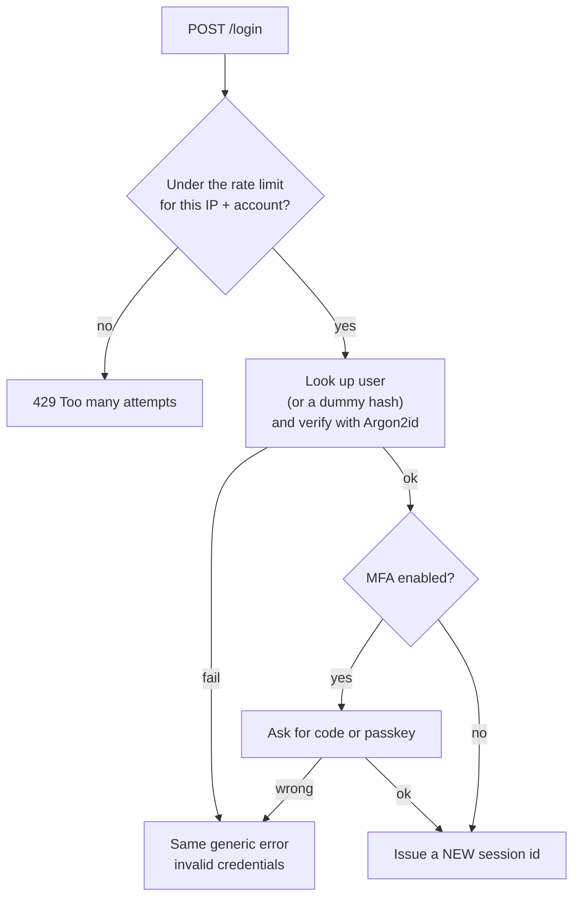

# Secure authentication

After this you can store passwords safely, design a login that resists guessing and enumeration, and review a reset flow for common holes.

Before this: [Sessions, cookies and JWT](../../09-back-end/02-auth/02-sessions-cookies-and-jwt.md) and [XSS, CSRF and browser security](04-xss-csrf-and-browser-security.md).

## The idea

Databases leak. Assume yours will, once, and ask what the attacker holds afterwards. If passwords are stored in plain text, they hold every user's password, and since people reuse passwords, they hold accounts on other sites too. If each password is stored as a slow, salted hash, they hold a long list of puzzles that each cost real computing time to solve.

Authentication has two jobs: making stored credentials worthless when stolen, and making live guessing expensive. The diagram shows a login that does both.



## Key terms

A **password hash** is the output of a one-way function applied to a password. A **salt** is a random value stored with the hash and mixed into it, so equal passwords give different hashes. Hashing is covered in [hashing and salts](../02-cryptography/01-hashing-and-salts.md).

**Argon2id** is a password-hashing function built to be slow and memory-hungry, so guessing at scale is costly. **bcrypt** is an older function with the same goal. Both have a tunable cost.

**Multi-factor authentication (MFA)** needs two different kinds of proof: something you know (password), have (phone, key) or are (fingerprint). A **passkey** (WebAuthn, [MDN](https://developer.mozilla.org/en-US/docs/Web/API/Web_Authentication_API)) replaces the password with a key pair held by the device. The site stores only a public key, and the private key never leaves the device and works only on the real site, so there is no password to phish or leak.

**Credential stuffing** tries username and password pairs leaked from other sites. **Account enumeration** is finding which accounts exist from differences in responses. **Session fixation** is an attacker setting a victim's session id before login, then using it after.

## How it works

Storing passwords ([OWASP Password Storage Cheat Sheet](https://cheatsheetseries.owasp.org/cheatsheets/Password_Storage_Cheat_Sheet.html)):

1. Use Argon2id. As of 2026 OWASP's minimum is 19 MiB of memory, 2 iterations and 1 degree of parallelism. Use bcrypt only if Argon2 is unavailable, with a work factor of at least 10 and a password limit of 72 bytes.
2. Let the library generate the salt and store it inside the hash string.
3. Rehash on login when parameters are out of date.
4. Check new passwords against a breached-password list (for example the Pwned Passwords API) and require length (at least 8, allow 64 or more) over odd complexity rules.

Defending the login ([Authentication Cheat Sheet](https://cheatsheetseries.owasp.org/cheatsheets/Authentication_Cheat_Sheet.html)):

1. Rate limit per account and per IP. Lockout has a cost: a hard lock after 5 failures lets an attacker lock out any user (a denial of service). Prefer rising delays, or a limit that slows without blocking, and CAPTCHA after repeated failures.
2. Return the same message and take similar time for "no such user" and "wrong password". Do the same on signup and reset ("if that email exists, we sent a link").
3. After login, create a new session id, and destroy the old one, so a fixed id is useless. Do it again on privilege changes.
4. Offer MFA, and passkeys where you can. Prefer an authenticator app or key to SMS codes, which can be intercepted by SIM swapping.

Password reset: send a long random single-use token with a short expiry (around 15 to 60 minutes), store only its hash, and invalidate it on use. Never email the password itself, and never use security questions.

## Worked examples

<div class="example" markdown>

### Example 1: hashing and a leaky login

We use `argon2-cffi` 25.1.0 in a throwaway virtual environment (installed with `pip install argon2-cffi`).

```python
from argon2 import PasswordHasher
from argon2.exceptions import VerifyMismatchError

ph = PasswordHasher()
h = ph.hash("correct horse battery staple")
print(h)
print(ph.hash("correct horse battery staple") == h)
try:
    ph.verify(h, "wrong")
except VerifyMismatchError:
    print("mismatch")
print(ph.verify(h, "correct horse battery staple"))
```

```text
$argon2id$v=19$m=65536,t=3,p=4$wNTIjHBYeyMgyea3xXiitA$TW6SOHFEWFTpx38IGKiY5pmFK/4Mj9lDPr582Rwm6Qs
False
mismatch
True
```

1. The string holds the algorithm, the parameters (`m=65536` is 64 MiB), the salt and the hash.
2. Hashing the same password twice gives different strings, because the salts differ.
3. `verify` raises on a mismatch and returns `True` on success.

Now the login. `login_bad` tells the caller which half was wrong. `login_good` verifies against a dummy hash when the user does not exist, so both paths cost the same and return one message:

```python
DUMMY = ph.hash("dummy")

def login_good(name, pw):
    try:
        ph.verify(users.get(name, DUMMY), pw)
        return "ok" if name in users else "invalid credentials"
    except VerifyMismatchError:
        return "invalid credentials"
```

```text
login_bad ['wrong password', 'no such user']
login_good ['invalid credentials', 'invalid credentials']
```

Check: the second line shows the same text for a real user (`alice`) and an unknown one (`mallory`). A single verify took about 40 ms here, which is the point: ten million guesses cost days, not seconds.

</div>

<div class="example" markdown>

### Example 2: a sliding-window rate limit

This keeps up to 5 attempts per 60 seconds per key, with `now` passed in so we can test it:

```python
from collections import defaultdict, deque

WINDOW, LIMIT = 60, 5
attempts = defaultdict(deque)

def allowed(key, now):
    q = attempts[key]
    while q and now - q[0] > WINDOW:
        q.popleft()
    if len(q) >= LIMIT:
        return False
    q.append(now)
    return True

print([allowed("1.2.3.4|alice", t) for t in range(7)])
print(allowed("1.2.3.4|alice", 100))
```

```text
[True, True, True, True, True, False, False]
True
```

Attempts 6 and 7 are blocked, and at time 100 the old attempts have aged out. In production this state lives in Redis, not in process memory, so every server instance shares it.

</div>

## Common mistakes

<div class="warning" markdown>

Watch out: a fast hash such as SHA-256 or MD5 for passwords. They are built to be fast, so a GPU tests billions per second. Use Argon2id or bcrypt.

Watch out: leaking existence through timing or wording. "Email not found" on the reset page enumerates accounts as surely as the login page does.

Watch out: rolling your own session ids or tokens with `Math.random()` or `random`. Use a cryptographic source (`crypto.randomBytes`, Python's `secrets`).

</div>

## Working with AI

<div class="ai" markdown>

Words to use: Argon2id, salt, credential stuffing, account enumeration, session fixation, passkey, rate limiting.

Prompts to try:

- "Write signup and login for Express 5 using Argon2id with OWASP's minimum parameters, a generic error message and a new session id after login. Do not log passwords."
- "Review this password reset flow for enumeration, token reuse, long expiry and missing rate limits."

What to check:

- `md5`, `sha1`, `sha256` or `crypto.createHash` used on passwords.
- Different error text or response codes for unknown users. Test both with curl.
- Reset tokens made from the user id, timestamp or `Math.random()`, or tokens that stay valid after use.
- Parameters copied from an old tutorial, such as bcrypt cost 4. Compare with the OWASP page.

</div>

## Quiz

1\. Why is a salt stored next to the hash safe to expose?

<details class="solution" markdown>
<summary>Answer</summary>

It is not a secret. It forces the attacker to attack each hash separately and defeats precomputed tables, and equal passwords no longer produce equal hashes.

</details>

2\. A site locks an account for an hour after 5 failed logins. Name the attack this enables.

<details class="solution" markdown>
<summary>Answer</summary>

An attacker can lock out any known user on purpose (denial of service). Use per-IP limits, rising delays and alerts instead of a long hard lock.

</details>

3\. The reset page says "No account with that email." What is wrong and how do you fix it?

<details class="solution" markdown>
<summary>Answer</summary>

It enumerates accounts. Always answer "If an account exists, we sent an email", and send the mail only when it does.

</details>

4\. Why issue a new session id after login?

<details class="solution" markdown>
<summary>Answer</summary>

To defeat session fixation: an id the attacker planted before login becomes useless once the server replaces it.

</details>

## Lab

<div class="lab" markdown>

### Lab: harden a login function

Goal: build a login that hashes, rate limits and does not enumerate. Time: about 20 minutes. Runs in: any terminal with Python 3.

1. Create a virtual environment and install `argon2-cffi`.
2. Write `register(name, pw)` that stores `ph.hash(pw)` in a dict.
3. Write `login(name, pw, now)` that calls `allowed` from Example 2, then verifies against a dummy hash for unknown users, and returns one message for both failures.
4. Call it 7 times with a wrong password for `alice` and observe the sixth call.
5. Cleanup: delete the virtual environment.

Expected result: `invalid credentials` for five calls, then `too many attempts`, with the same text for an unknown user.

<details class="solution" markdown>
<summary>Solution</summary>

```python
def login(name, pw, now):
    if not allowed(f"ip|{name}", now):
        return "too many attempts"
    try:
        ph.verify(users.get(name, DUMMY), pw)
    except VerifyMismatchError:
        return "invalid credentials"
    return "ok" if name in users else "invalid credentials"
```

</details>

</div>

## Where this shows up

- [OAuth and SSO](../../09-back-end/02-auth/03-oauth-and-sso.md) moves login to a provider that already does most of this.
- [Secrets and dependency security](06-secrets-and-dependency-security.md) covers the keys that sign your sessions.
