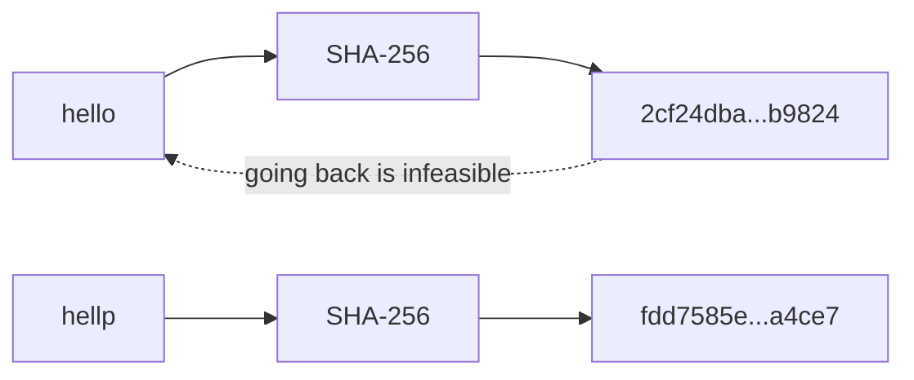
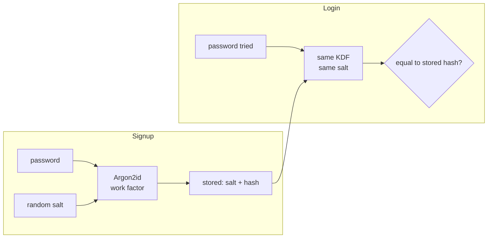

# Hashing and salts

After this you can say what a cryptographic hash guarantees, store passwords safely with a salted slow hash, and tell a checksum from a hash and from a MAC.

Before this: [Modular arithmetic](../../04-discrete-math-for-cs/07-modular-arithmetic.md) and [Security mindset and threat modelling](../01-web-security/01-security-mindset-and-threat-modelling.md).

## The idea

Your database leaks. If it holds passwords, every user is now at risk, on your site and on every other site where they reused the password. If it holds only a fingerprint of each password, the attacker still has work to do. That fingerprint is a hash.

A **hash function** turns any input into a fixed-size output that looks random. The same input always gives the same output, but you cannot work backwards from the output to the input. Change one character of the input and the output changes completely.



In the diagram, two inputs that differ by one letter produce unrelated 256-bit outputs, and the dotted arrow back is the part nobody can do.

## Key terms

A **cryptographic hash function** maps input of any length to a fixed-length **digest**, and is built so that three attacks are infeasible: finding an input for a given digest (**preimage resistance**), finding a second input with the same digest as a given input (**second-preimage resistance**), and finding any two inputs with the same digest (**collision resistance**).

The **avalanche effect** is the property that flipping one input bit changes about half the output bits.

A **salt** is a random value, unique per user and stored beside the hash, that is mixed into the input before hashing.

A **key derivation function** (KDF) is a deliberately slow, tunable hash used to turn a password into a key or a stored verifier. Its **work factor** is the setting (iterations, memory) that controls how slow it is.

An **HMAC** is a hash combined with a secret key, so only someone holding the key can produce or check the tag. It proves a message was not changed and came from a key holder.

## How it works

SHA-256 is the hash you will meet most. Python has it in the standard library:

```python
import hashlib
for s in [b"hello", b"hellp", b"hello"]:
    print(hashlib.sha256(s).hexdigest())
a = int(hashlib.sha256(b"hello").hexdigest(), 16)
b = int(hashlib.sha256(b"hellp").hexdigest(), 16)
print(bin(a ^ b).count("1"), "of 256 bits differ")
print(len(hashlib.sha256(b"x" * 1_000_000).digest()), "bytes for a 1 MB input")
```

```text
2cf24dba5fb0a30e26e83b2ac5b9e29e1b161e5c1fa7425e73043362938b9824
fdd7585e08c4e2afd71dcabdb4636c89d557a3f42db9e2040c8bbd1708aa4ce7
2cf24dba5fb0a30e26e83b2ac5b9e29e1b161e5c1fa7425e73043362938b9824
131 of 256 bits differ
32 bytes for a 1 MB input
```

The first and third lines match (deterministic), the second is unrelated (avalanche: 131 of 256 bits, close to half), and the size is 32 bytes whatever the input.

MD5 and SHA-1 are broken: researchers can build collisions, so never use them for signatures, certificates or integrity against an attacker. Use SHA-256 or SHA-3. A **checksum** such as CRC32 catches accidental corruption only; an attacker can craft a file with any CRC they like. A plain hash of a download proves integrity only if you got the hash over a trusted channel. If both sides share a secret key, use HMAC, and compare tags with `hmac.compare_digest`, which takes the same time whether or not they match.

### Passwords need a slow, salted hash

SHA-256 is designed to be fast, which is the wrong property for passwords. A GPU computes billions of SHA-256 digests per second, so an attacker with a stolen table just tries every common password. A **rainbow table** is a precomputed list of digests for common passwords; a **salt** defeats it, because the attacker would need a separate table per salt. A salt also hides that two users share a password.



The slow KDFs are Argon2id (the first choice), scrypt, bcrypt and PBKDF2. They let you raise the cost as hardware improves. The [OWASP password storage cheat sheet](https://cheatsheetseries.owasp.org/cheatsheets/Password_Storage_Cheat_Sheet.html) gives these minimums as of 2026: Argon2id with 19 MiB of memory, 2 iterations and 1 lane; bcrypt with work factor 10 or more (and a 72-byte password limit); PBKDF2-HMAC-SHA256 with 600,000 iterations. Libraries store the salt and settings inside one string, so you rarely handle the salt yourself.

## Worked examples

<div class="example" markdown>

### Example 1: fast hash against slow hash

We time one SHA-256 digest and one scrypt digest of the same salted password.

1. Make a 16-byte random salt with `os.urandom`.
2. Time `hashlib.sha256(salt + pw)`.
3. Time `hashlib.scrypt` with $N = 2^{15}$, which uses 32 MiB of memory.
4. Compare the two.

```python
import hashlib, os, time

pw = b"correct horse"
salt = os.urandom(16)

def timed(f):
    start = time.perf_counter()
    f()
    return time.perf_counter() - start

fast = timed(lambda: hashlib.sha256(salt + pw).digest())
slow = timed(lambda: hashlib.scrypt(pw, salt=salt, n=2**15, r=8, p=1,
                                    maxmem=64 * 1024 * 1024, dklen=32))
print(f"sha256: {fast * 1e6:9.1f} microseconds")
print(f"scrypt: {slow * 1e6:9.0f} microseconds")
```

```text
sha256:      12.2 microseconds
scrypt:    121471 microseconds
```

Check: scrypt is about four orders of magnitude slower. A user waits 0.1 s once at login, but an attacker trying a billion guesses pays that on every guess. Your times will differ.

</div>

<div class="example" markdown>

### Example 2: Argon2id and HMAC in a library

With the `argon2-cffi` package (`pip install argon2-cffi`), the salt and settings live inside the stored string. Never write your own comparison.

```python
from argon2 import PasswordHasher
ph = PasswordHasher()
h = ph.hash("correct horse")
print(h)
print(ph.verify(h, "correct horse"))
try:
    ph.verify(h, "wrong")
except Exception as e:
    print(type(e).__name__)
```

```text
$argon2id$v=19$m=65536,t=3,p=4$p90/h71prZo8eSz15X6eLg$zUY0g2awXaPqTgO/f48t/9fTnxuX4HMvvlsyB1LpEEA
True
VerifyMismatchError
```

The string reads: algorithm, version, memory in KiB (64 MiB), iterations, lanes, salt, hash. For an HMAC, `hmac.new(key, msg, "sha256").hexdigest()` gives the tag and `hmac.compare_digest` checks it.

</div>

## Common mistakes

<div class="warning" markdown>

Watch out: storing `sha256(password)`, even with a salt. It is fast to brute-force. Use Argon2id, scrypt, bcrypt or PBKDF2.

Watch out: one fixed salt for all users, hard-coded in the source, in place of a random salt per user. The point of a salt is that every row differs.

Watch out: comparing tags or hashes with `==`. It can leak how many leading characters matched through timing. Use `hmac.compare_digest`.

</div>

## Working with AI

<div class="ai" markdown>

Words to use: preimage resistance, collision resistance, salt, work factor, Argon2id, HMAC, constant-time comparison.

Prompts to try:

- "Write Python password registration and login with argon2-cffi for a Flask app. Show where the salt is stored and how to rehash when the parameters change."
- "Our users table stores `md5(password)` with no salt. Give a migration plan that upgrades hashes at the next login without forcing a reset."

What to check:

- Fast hashes (MD5, SHA-1, plain SHA-256) used for passwords. Search the code for `hashlib.` near the word password.
- Parameters copied from old tutorials, such as 1,000 PBKDF2 iterations. Compare them to the OWASP numbers above.
- `==` on secrets or tags, and a home-made salt scheme instead of the library's own.

</div>

## Quiz

1\. Why is SHA-256 a poor choice for password storage even though it is a strong hash?

<details class="solution" markdown>
<summary>Answer</summary>

It is fast, so an attacker with the stolen hashes can test billions of guesses per second. A slow KDF with a work factor makes each guess expensive.

</details>

2\. Predict: what does `hashlib.sha256(b"abc").digest()` return in length, and does it change between runs?

<details class="solution" markdown>
<summary>Answer</summary>

32 bytes (256 bits), and it never changes, because a hash is deterministic. That is why a password hash needs a random salt.

</details>

3\. Two users in the leaked table have the same stored hash. What does that tell the attacker, and what was missing?

<details class="solution" markdown>
<summary>Answer</summary>

They have the same password, so cracking one cracks both. A unique random salt per user would give them different hashes.

</details>

4\. A teammate checks that a webhook is genuine by comparing `sha256(body)` with a header. Why can an attacker forge it, and what fixes it?

<details class="solution" markdown>
<summary>Answer</summary>

Anyone can compute `sha256(body)` for a body they made up. Use an HMAC with a secret shared with the sender, and compare with `hmac.compare_digest`.

</details>

## Lab

<div class="lab" markdown>

### Lab: crack an unsalted hash, then a salted one

Goal: see why salts and slow hashes matter. Time: about 15 minutes. Runs in: any terminal with Python 3.

1. Compute `hashlib.sha256(b"sunshine").hexdigest()` and keep it as the "stolen" hash.
2. Write a loop over the list `["password", "123456", "sunshine", "letmein"]` that hashes each word and prints the match.
3. Now compute `hashlib.sha256(salt + b"sunshine")` with a random 16-byte salt and run the same loop without the salt. Does it match?
4. Time 1,000 SHA-256 hashes, then 5 scrypt hashes (as in Example 1), and compute guesses per second for each.

Expected result: step 2 finds `sunshine`, step 3 finds nothing, and step 4 shows SHA-256 around a thousand times or more faster per guess.

<details class="solution" markdown>
<summary>Solution</summary>

```python
import hashlib, os, time
words = ["password", "123456", "sunshine", "letmein"]
stolen = hashlib.sha256(b"sunshine").hexdigest()
print([w for w in words if hashlib.sha256(w.encode()).hexdigest() == stolen])

salt = os.urandom(16)
salted = hashlib.sha256(salt + b"sunshine").hexdigest()
print([w for w in words if hashlib.sha256(w.encode()).hexdigest() == salted])

t = time.perf_counter()
for i in range(1000):
    hashlib.sha256(str(i).encode()).digest()
fast = 1000 / (time.perf_counter() - t)
t = time.perf_counter()
for i in range(5):
    hashlib.scrypt(str(i).encode(), salt=salt, n=2**15, r=8, p=1, maxmem=64 * 1024 * 1024)
slow = 5 / (time.perf_counter() - t)
print(f"{fast:,.0f} vs {slow:,.1f} guesses per second")
```

</details>

</div>

## Where this shows up

- [Symmetric encryption](02-symmetric-encryption.md) uses a key; hashes have none.
- Signatures hash the message first: [Public-key encryption and signatures](03-public-key-encryption-and-signatures.md).
- Login flows: [Secure authentication](../01-web-security/05-secure-authentication.md) and [Sessions, cookies and JWT](../../09-back-end/02-auth/02-sessions-cookies-and-jwt.md).
