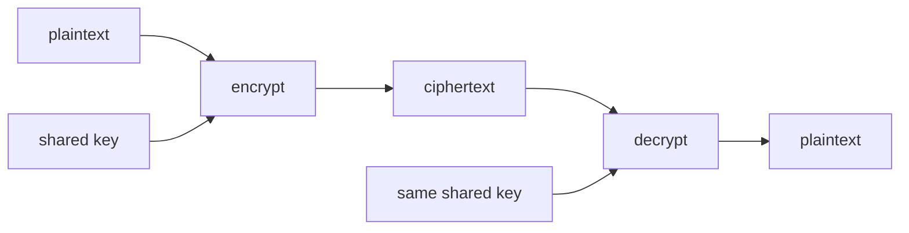
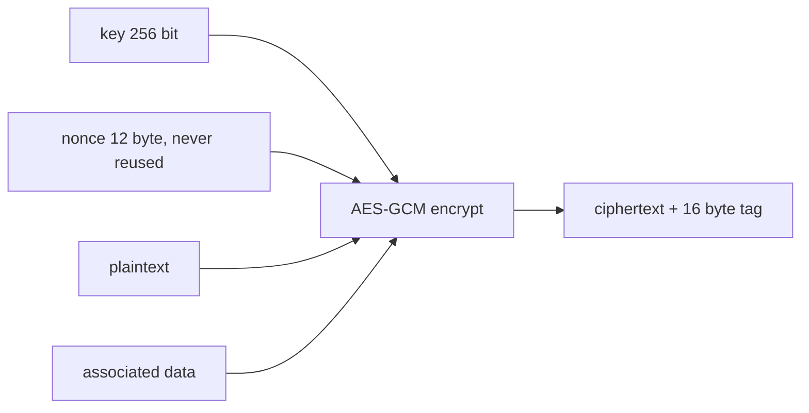

# Symmetric encryption

After this you can encrypt and decrypt data with AES-GCM, explain why modes and nonces matter, and name why key management is the hard part.

Before this: [Hashing and salts](01-hashing-and-salts.md).

## The idea

You store a customer's address in a database column and want a stolen backup to be useless. You encrypt the value with a key before saving it, and decrypt it with the same key when you read it. Whoever has the key reads the data; whoever lacks it sees noise.

**Symmetric encryption** uses one shared secret key for both directions. It is fast, which is why it carries almost all real traffic, including every HTTPS connection once the handshake is done.



In the diagram, the same key sits on both sides. The hard question is how both sides come to hold it without an attacker also holding it. The next lesson, [Public-key encryption and signatures](03-public-key-encryption-and-signatures.md), answers that.

## Key terms

A **cipher** is a pair of algorithms, encrypt and decrypt. **AES** (Advanced Encryption Standard) is the standard block cipher. It works on 16-byte blocks, with a key of 128, 192 or 256 bits. A **stream cipher** such as ChaCha20 produces a stream of key-dependent bytes and combines it with the data, so there is no block size to manage.

A **mode of operation** says how a block cipher handles data longer than one block.

A **nonce** ("number used once") is a value that must never repeat for the same key. A **tag** is a short check value that proves the ciphertext was not changed.

**Authenticated encryption** (AEAD, "authenticated encryption with associated data") gives both secrecy and tamper detection. The **associated data** is extra data, such as a record ID, that is authenticated but sent in the clear.

## How it works

Encrypting alone hides the data but does not stop someone changing the ciphertext. Modes decide how much more you get.

ECB (electronic codebook) encrypts each 16-byte block independently, so equal plaintext blocks give equal ciphertext blocks. Patterns in the data survive. Here is a message with three identical blocks and one different one:

```python
import os
from cryptography.hazmat.primitives.ciphers import Cipher, algorithms, modes
key = os.urandom(16)
block = b"ATTACK AT DAWN!!"            # exactly 16 bytes
data = block * 3 + b"RETREAT NOW!!!!!"
enc = Cipher(algorithms.AES(key), modes.ECB()).encryptor()
ct = enc.update(data) + enc.finalize()
for i in range(0, len(ct), 16):
    print(ct[i:i+16].hex())
```

```text
fd8cfa5bbeaea9c240abdcdee8fe6ce5
fd8cfa5bbeaea9c240abdcdee8fe6ce5
fd8cfa5bbeaea9c240abdcdee8fe6ce5
be1268cf82bf5a13672af9de7335e2de
```

Three equal lines leak that the first three blocks are the same, which is how an encrypted bitmap still shows its outline. Never use ECB.

The default today is an AEAD mode: **AES-GCM**, or **ChaCha20-Poly1305**, which is the usual choice where there is no AES hardware support. Both take a key, a nonce, the data and optional associated data, and return ciphertext with a 16-byte tag appended. Decryption checks the tag first and raises an error if anything changed.



Two rules follow. Generate a fresh random 12-byte nonce for every message and store it next to the ciphertext (it is not secret). And never encrypt two messages with the same key and nonce, because for GCM that leaks the XOR of the plaintexts and breaks the authentication.

## Worked examples

<div class="example" markdown>

### Example 1: encrypt, decrypt, tamper

We use the `cryptography` package (`pip install cryptography`).

1. Generate a 256-bit key and make an `AESGCM` object.
2. Make a random nonce and encrypt, binding the text `invoice-7` as associated data.
3. Decrypt with the same nonce and associated data.
4. Flip one bit of the ciphertext and decrypt again.

```python
import os
from cryptography.hazmat.primitives.ciphers.aead import AESGCM
from cryptography.exceptions import InvalidTag

key = AESGCM.generate_key(bit_length=256)
aes = AESGCM(key)
nonce = os.urandom(12)
ct = aes.encrypt(nonce, b"pay Alice $10", b"invoice-7")
print(len(ct), ct.hex())
print(aes.decrypt(nonce, ct, b"invoice-7"))
tampered = bytes([ct[0] ^ 1]) + ct[1:]
try:
    aes.decrypt(nonce, tampered, b"invoice-7")
except InvalidTag:
    print("InvalidTag: ciphertext was changed")
```

```text
29 82a18445c2df451531b787b88b39033af03c70430dc1bfc72c0f79617a
b'pay Alice $10'
InvalidTag: ciphertext was changed
```

Check: 13 bytes of text plus the 16-byte tag is 29 bytes, the plaintext comes back, and the changed copy is rejected instead of decrypting to garbage. The ciphertext differs on every run.

</div>

<div class="example" markdown>

### Example 2: what a repeated nonce leaks

Two messages under the same key and nonce:

```python
import os
from cryptography.hazmat.primitives.ciphers.aead import AESGCM
aes = AESGCM(AESGCM.generate_key(256))
nonce = os.urandom(12)
c1 = aes.encrypt(nonce, b"attack at dawn", None)
c2 = aes.encrypt(nonce, b"retreat at six", None)   # same key, same nonce: a bug
x = bytes(a ^ b for a, b in zip(c1[:14], c2[:14]))
print(x == bytes(a ^ b for a, b in zip(b"attack at dawn", b"retreat at six")))
```

```text
True
```

XOR of the two ciphertexts equals XOR of the two plaintexts, with no key needed. If one plaintext is guessable, the other falls out.

</div>

## Common mistakes

<div class="warning" markdown>

Watch out: a hard-coded nonce, or a nonce from a counter that resets after a restart. Use a random 12-byte value per message (or a counter that survives restarts).

Watch out: encrypting with the key stored next to the data, such as in the same repository or database. The encryption then protects nothing. Keep keys in a secrets manager or key management service, and rotate them.

Watch out: using a password directly as a key. Derive the key from the password with a KDF (see [Hashing and salts](01-hashing-and-salts.md)).

</div>

## Working with AI

<div class="ai" markdown>

Words to use: AES-256-GCM, AEAD, nonce, associated data, authentication tag, key rotation, KMS.

Prompts to try:

- "Using Python's `cryptography` package, write encrypt and decrypt helpers that use AES-256-GCM, generate a fresh 12-byte nonce per message and store it with the ciphertext. Where should the key come from in production?"
- "Review this function that encrypts user emails. Name every cryptographic mistake (mode, nonce, key storage) and rank them."

What to check:

- `AES.MODE_ECB`, `MODE_CBC` with no authentication, or a fixed IV or nonce. Search the code for `ECB`, `iv =` and `nonce =`.
- An invented library API or a deprecated package (`pycrypto`). Run the code and check the package is maintained.
- A key generated in the code and lost on restart, or logged. Ask where the key lives.

</div>

## Quiz

1\. Why does ECB mode leak information while GCM does not?

<details class="solution" markdown>
<summary>Answer</summary>

ECB encrypts equal plaintext blocks to equal ciphertext blocks, so patterns show. GCM mixes the nonce and a counter into every block, so equal blocks give different ciphertext.

</details>

2\. Predict: you call `aes.decrypt(nonce, tampered, b"invoice-8")` on the untouched ciphertext from Example 1. What happens?

<details class="solution" markdown>
<summary>Answer</summary>

`InvalidTag`. The associated data differs, so the tag does not verify, even though the ciphertext is intact.

</details>

3\. A service encrypts every row with the same key and a nonce taken from a counter that starts at 0 on each restart. What goes wrong?

<details class="solution" markdown>
<summary>Answer</summary>

After a restart the counter repeats nonces under the same key, which leaks plaintext XORs and breaks authentication. Use random nonces or persist the counter.

</details>

4\. You encrypt a database column with AES-GCM and store the key in the same database. What did you gain?

<details class="solution" markdown>
<summary>Answer</summary>

Almost nothing against someone who steals the database. Keep the key in a separate system and control access to it.

</details>

## Lab

<div class="lab" markdown>

### Lab: an encrypted note

Goal: write `encrypt_note` and `decrypt_note` with AES-GCM that store the nonce with the ciphertext. Time: about 15 minutes. Runs in: any terminal with Python 3 and the `cryptography` package in a virtual environment.

1. Create a virtual environment and install `cryptography`.
2. Write `encrypt_note(key, text)` that returns `nonce + ciphertext`.
3. Write `decrypt_note(key, blob)` that splits off the first 12 bytes.
4. Encrypt the same text twice and print whether the two blobs are equal.
5. Change one byte of a blob and confirm that decryption fails.

Expected result: the round trip returns the text, the two blobs differ, and the changed blob raises `InvalidTag`.

<details class="solution" markdown>
<summary>Solution</summary>

```python
import os
from cryptography.hazmat.primitives.ciphers.aead import AESGCM

def encrypt_note(key, text):
    nonce = os.urandom(12)
    return nonce + AESGCM(key).encrypt(nonce, text.encode(), None)

def decrypt_note(key, blob):
    return AESGCM(key).decrypt(blob[:12], blob[12:], None).decode()

key = AESGCM.generate_key(256)
a, b = encrypt_note(key, "hello"), encrypt_note(key, "hello")
print(decrypt_note(key, a), a == b)
bad = a[:-1] + bytes([a[-1] ^ 1])
try:
    decrypt_note(key, bad)
except Exception as e:
    print(type(e).__name__)
```

```text
hello False
InvalidTag
```

</details>

</div>

## Where this shows up

- Encryption at rest in [Privacy and PIPEDA](06-privacy-and-pipeda.md), and encrypted connections in [The TLS handshake](05-the-tls-handshake.md).
- Where keys and secrets live: [Config, environment variables and secrets](../../06-developer-tools-and-workflow/02-project-plumbing/02-config-env-vars-and-secrets.md).
