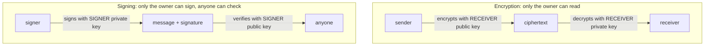
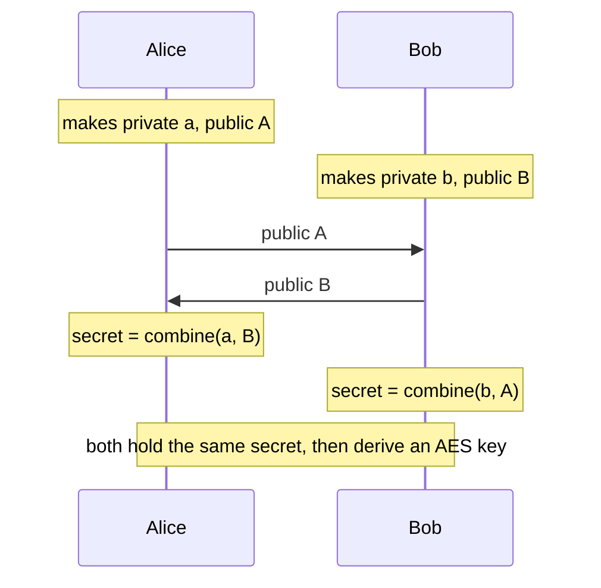

# Public-key encryption and signatures

After this you can say what a key pair does for encryption and for signing, explain how two strangers agree on a key, and sign and verify a message in Python.

Before this: [Symmetric encryption](02-symmetric-encryption.md) and [Hashing and salts](01-hashing-and-salts.md).

## The idea

Your browser has never met a bank's server, yet within a fraction of a second they share a secret key. Symmetric encryption needs that shared key first, and sending it in the clear defeats the purpose. A second problem is proof: how does a package manager know a release really came from its author?

**Public-key cryptography** (also called asymmetric cryptography) solves both with a **key pair**: a public key you give to everyone and a private key you never share. What one key does, only the other can undo. The two jobs use the pair in opposite directions.



In the diagram, encryption uses the receiver's pair, and signing uses the signer's pair. Mixing them up is the commonest confusion.

## Key terms

A **public key** can be published. A **private key** (secret key) must stay with its owner. Knowing the public key does not let you find the private key.

A **digital signature** is a value computed from a message and a private key that anyone can check with the matching public key. It proves who signed and that the message is unchanged.

**Diffie-Hellman** (DH) key exchange lets two parties agree on a shared secret over a public channel. Each sends only a public value, and each combines the other's public value with their own private one to get the same result. An eavesdropper sees both public values but cannot compute the secret.

**Elliptic-curve cryptography** (ECC) builds the same ideas on the maths of points on a curve. It gives the same security as RSA with much smaller keys: a 256-bit curve key is comparable to a 3072-bit RSA key. **Ed25519** is a modern signature scheme on such a curve, and **X25519** is a key exchange on the same curve.

**Hybrid encryption** uses public-key tools only to agree on a symmetric key, then encrypts the data with AES-GCM or ChaCha20-Poly1305.

## How it works

Public-key operations are slow and handle only small inputs, so real systems combine the two kinds of cryptography. A signature is computed over the hash of the message, which is why the hash functions from [Hashing and salts](01-hashing-and-salts.md) matter here. Encryption is nearly always hybrid. Diffie-Hellman is the usual way to get the symmetric key, because each session can use fresh throwaway keys, and the TLS handshake does exactly that.



An eavesdropper sees only the two public values. The "combine" step is easy with the private value and infeasible to reverse without it. A plain exchange does not prove who you are talking to, so a man in the middle can pose as each side. That is why signatures and certificates are added, as in [The TLS handshake](05-the-tls-handshake.md).

## Worked examples

<div class="example" markdown>

### Example 1: sign and verify with Ed25519

1. Generate a private key and take its public key.
2. Sign the bytes `release v1.2.0`.
3. Verify with the public key. A correct signature passes silently.
4. Verify the same signature against a changed message.

```python
from cryptography.hazmat.primitives.asymmetric.ed25519 import Ed25519PrivateKey
from cryptography.exceptions import InvalidSignature

private = Ed25519PrivateKey.generate()
public = private.public_key()
sig = private.sign(b"release v1.2.0")
print(len(sig), "byte signature")
public.verify(sig, b"release v1.2.0")
print("valid")
try:
    public.verify(sig, b"release v1.2.1")
except InvalidSignature:
    print("InvalidSignature: message was changed")
```

```text
64 byte signature
valid
InvalidSignature: message was changed
```

Check: a one-character change to the message fails verification. Ed25519 hashes the message internally, so you do not hash it first.

</div>

<div class="example" markdown>

### Example 2: hybrid encryption to a public key

Alice encrypts to Bob using only Bob's public key. She makes a throwaway X25519 key pair for this message, derives an AES key from the shared secret with HKDF, and sends her throwaway public key beside the ciphertext.

```python
import os
from cryptography.hazmat.primitives import hashes
from cryptography.hazmat.primitives.asymmetric.x25519 import X25519PrivateKey
from cryptography.hazmat.primitives.ciphers.aead import AESGCM
from cryptography.hazmat.primitives.kdf.hkdf import HKDF

def key_from(shared):
    return HKDF(hashes.SHA256(), 32, None, b"demo").derive(shared)

bob = X25519PrivateKey.generate()          # Bob keeps this private key
bob_public = bob.public_key()              # Bob publishes this

# Alice: a fresh key pair per message, shared secret from Bob's public key
eph = X25519PrivateKey.generate()
key = key_from(eph.exchange(bob_public))
nonce = os.urandom(12)
ct = AESGCM(key).encrypt(nonce, b"meet at noon", None)
message = (eph.public_key(), nonce, ct)    # what travels over the network

# Bob: his private key and Alice's ephemeral public key give the same secret
eph_pub, nonce, ct = message
key2 = key_from(bob.exchange(eph_pub))
print(AESGCM(key2).decrypt(nonce, ct, None))
```

```text
b'meet at noon'
```

The shared secret is never sent, and HKDF turns it into a uniform key. This is the shape behind PGP, age and many messaging apps.

</div>

## Common mistakes

<div class="warning" markdown>

Watch out: thinking "encrypting with the private key" is how signatures work. Use the signing API of the library; it handles hashing and padding for you.

Watch out: trusting a public key you received over an unauthenticated channel. If an attacker swapped it, you encrypt to them. Public keys must be verified, by a certificate or by comparing a fingerprint.

Watch out: sharing or committing a private key. Private keys never go in a repo, a chat message or a log.

</div>

## Working with AI

<div class="ai" markdown>

Words to use: key pair, signature, verify, Diffie-Hellman, ephemeral key, Ed25519, X25519, hybrid encryption.

Prompts to try:

- "In Python with the `cryptography` package, generate an Ed25519 key pair, sign a JSON release manifest, and show how a client verifies it. What exactly does the signature cover?"
- "Explain how this code gets a shared secret from X25519, and where an attacker in the middle could substitute a public key."

What to check:

- Code that "encrypts with the private key" or signs with an encryption call. Signing and encryption use different library functions.
- A signature verified over different bytes than were signed, for example JSON re-serialised with a different key order. Sign and verify the exact bytes.
- Raw key bytes written to logs or source files. Search the diff for key material.

</div>

## Quiz

1\. Alice wants to send Bob a message only he can read. Whose key does she use, and which one?

<details class="solution" markdown>
<summary>Answer</summary>

Bob's public key to encrypt; Bob's private key decrypts. Alice's own pair is not involved.

</details>

2\. Predict: you verify `sig` from Example 1 with a different, freshly generated public key. What happens?

<details class="solution" markdown>
<summary>Answer</summary>

`InvalidSignature`. A signature verifies only under the public key that matches the private key that made it.

</details>

3\. Why do real systems use public-key operations to agree on a key, then switch to AES?

<details class="solution" markdown>
<summary>Answer</summary>

Public-key operations are much slower and limited in message size. Symmetric ciphers are fast, so the slow step runs once per session and AES handles the data.

</details>

4\. An attacker can alter the traffic between two parties running plain Diffie-Hellman. What attack is this, and what fixes it?

<details class="solution" markdown>
<summary>Answer</summary>

A man-in-the-middle attack: the attacker runs one exchange with each side. Authenticate the exchange with signatures backed by certificates.

</details>

## Lab

<div class="lab" markdown>

### Lab: sign a file and catch a change

Goal: sign a file and detect an edit. Time: about 10 minutes. Runs in: Python 3 with `cryptography` installed in a virtual environment.

1. Create `note.txt` with one line of text.
2. Generate an Ed25519 key pair and sign the file's bytes. Save the signature to `note.sig`.
3. Verify the signature against the file.
4. Edit one character in `note.txt` and verify again.
5. Cleanup: delete `note.txt` and `note.sig`.

Expected result: the first verification passes, the second raises `InvalidSignature`.

<details class="solution" markdown>
<summary>Solution</summary>

```python
from pathlib import Path
from cryptography.hazmat.primitives.asymmetric.ed25519 import Ed25519PrivateKey
from cryptography.exceptions import InvalidSignature

Path("note.txt").write_text("pay Alice 10\n")
private = Ed25519PrivateKey.generate()
public = private.public_key()
Path("note.sig").write_bytes(private.sign(Path("note.txt").read_bytes()))

def check():
    try:
        public.verify(Path("note.sig").read_bytes(), Path("note.txt").read_bytes())
        print("valid")
    except InvalidSignature:
        print("InvalidSignature")

check()
Path("note.txt").write_text("pay Alice 90\n")
check()
```

```text
valid
InvalidSignature
```

</details>

</div>

## Where this shows up

- The mathematics of the oldest scheme: [RSA step by step](04-rsa-step-by-step.md).
- Certificates are public keys signed by a certificate authority: [TLS, HTTPS and certificates](../../07-networking/02-web-protocols/03-tls-https-and-certificates.md).
- SSH keys, signed commits and signed packages all use signing.
