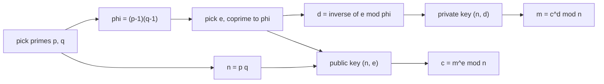

# RSA step by step

After this you can generate an RSA key pair by hand with small numbers, encrypt, decrypt and sign with it, and explain why real RSA needs padding and large keys.

Before this: [Public-key encryption and signatures](03-public-key-encryption-and-signatures.md) and [Modular arithmetic](../../04-discrete-math-for-cs/07-modular-arithmetic.md).

## The idea

RSA (Rivest, Shamir, Adleman) is the best-known public-key scheme, and every step is arithmetic you can do in a few lines of Python. The idea: multiplying two large primes is easy, but recovering the primes from the product is not. The public key contains the product, and the private key needs the primes.

The scheme encrypts a number $m$ by raising it to a public power modulo $n$, and decrypts by raising the result to a private power. The two powers are inverses of each other.



In the diagram, the right-hand column is the whole public interface and the left-hand column is the key generation that only the key owner does.

## Key terms

A **modulus** $n$ is the product of two distinct primes $p$ and $q$. The number $\varphi(n)$ is Euler's totient: for a product of two primes, $\varphi(n) = (p-1)(q-1)$, the count of numbers below $n$ that share no factor with $n$.

The **public exponent** $e$ is a number coprime to $\varphi(n)$ (real keys almost always use 65537). The **private exponent** $d$ is the modular inverse of $e$ modulo $\varphi(n)$, so $e d \equiv 1 \pmod{\varphi(n)}$.

**Padding** is a randomised, structured wrapping of the message before the RSA operation. **OAEP** is the padding for encryption and **PSS** is the padding for signatures.

## How it works

Key generation:

1. Pick two large primes $p$ and $q$.
2. Compute $n = pq$ and $\varphi = (p-1)(q-1)$.
3. Pick $e$ coprime to $\varphi$.
4. Compute $d$ with $e d \equiv 1 \pmod{\varphi}$. The public key is $(n, e)$ and the private key is $(n, d)$.

Using the key, for a message $m$ with $0 \le m < n$:

$$c = m^e \bmod n \qquad m = c^d \bmod n$$

This works because $e d = 1 + k\varphi$ for some integer $k$, and Euler's theorem says $m^{\varphi} \equiv 1 \pmod n$ when $m$ shares no factor with $n$, so $m^{ed} = m \cdot (m^{\varphi})^k \equiv m$. A signature runs the same operation backwards: $s = m^d \bmod n$, and anyone checks $s^e \bmod n = m$. (Real signatures apply this to a padded hash of the message, not to the message.)

The security rests on **factoring**: from $(n, e)$ you could get $d$ if you could find $p$ and $q$. The best known classical attacks on large $n$ are far faster than trial division, yet they remain infeasible for a 2048-bit modulus. As of 2026, 2048-bit RSA is the usual minimum and 3072 bits matches 128-bit security (see [NIST SP 800-57](https://csrc.nist.gov/pubs/sp/800/57/pt1/r5/final)).

A quantum computer running Shor's algorithm would factor large numbers quickly, which would break RSA and elliptic curves. No such machine exists yet, but data recorded today could be decrypted later. NIST finalised **ML-KEM** (FIPS 203, August 2024) as the standard post-quantum key-exchange method and **ML-DSA** (FIPS 204) for signatures; see [FIPS 203](https://csrc.nist.gov/pubs/fips/203/final). Browsers and servers already use hybrid exchanges that combine X25519 with ML-KEM, as the next-but-one lesson shows.

## Worked examples

<div class="example" markdown>

### Example 1: textbook RSA with $p = 61$ and $q = 53$

1. $n = 61 \times 53 = 3233$.
2. $\varphi = 60 \times 52 = 3120$.
3. Choose $e = 17$. It has no common factor with 3120.
4. $d = 17^{-1} \bmod 3120 = 2753$, because $17 \times 2753 = 46801 = 15 \times 3120 + 1$.
5. Encrypt $m = 65$: $c = 65^{17} \bmod 3233 = 2790$.
6. Decrypt: $2790^{2753} \bmod 3233 = 65$.
7. Sign: $s = 65^{2753} \bmod 3233 = 588$, and $588^{17} \bmod 3233 = 65$.

Check in Python, using `pow(base, exp, mod)` and `pow(e, -1, phi)` from the modular arithmetic lesson:

```python
p, q, e = 61, 53, 17
n, phi = p * q, (p - 1) * (q - 1)
d = pow(e, -1, phi)
print(n, phi, d, e * d % phi)
m = 65
c = pow(m, e, n)
print(c, pow(c, d, n))
s = pow(m, d, n)
print(s, pow(s, e, n))
```

```text
3233 3120 2753 1
2790 65
588 65
```

The fourth number on the first line is 1, which confirms $e d \equiv 1$.

</div>

<div class="example" markdown>

### Example 2: why the numbers must be big, and why padding exists

Trial division finds the factors of a small $n$ at once, and the time grows quickly with the size:

```python
import time
def factor(n):
    f = 2
    while n % f:
        f += 1
    return f, n // f

for p, q in [(61, 53), (1000003, 1000033), (100000007, 100000037)]:
    n = p * q
    t = time.perf_counter()
    print(n.bit_length(), "bits:", factor(n), f"{time.perf_counter() - t:.3f} s")
```

```text
12 bits: (53, 61) 0.000 s
40 bits: (1000003, 1000033) 0.038 s
54 bits: (100000007, 100000037) 3.547 s
```

Each extra 14 bits costs about 100 times more here, and 2048 bits is out of reach even for far better algorithms. Now real RSA with the `cryptography` package, 2048 bits, OAEP and PSS padding:

```python
from cryptography.hazmat.primitives.asymmetric import rsa, padding
from cryptography.hazmat.primitives import hashes
key = rsa.generate_private_key(public_exponent=65537, key_size=2048)
pub = key.public_key()
oaep = padding.OAEP(mgf=padding.MGF1(hashes.SHA256()), algorithm=hashes.SHA256(), label=None)
c1 = pub.encrypt(b"hi", oaep)
c2 = pub.encrypt(b"hi", oaep)
print(len(c1), "bytes,", "same ciphertext twice:", c1 == c2, key.decrypt(c1, oaep))
pss = padding.PSS(mgf=padding.MGF1(hashes.SHA256()), salt_length=padding.PSS.DIGEST_LENGTH)
sig = key.sign(b"msg", pss, hashes.SHA256())
pub.verify(sig, b"msg", pss, hashes.SHA256())
print("signature ok, e =", pub.public_numbers().e, ", n has", pub.public_numbers().n.bit_length(), "bits")
```

```text
256 bytes, same ciphertext twice: False b'hi'
signature ok, e = 65537 , n has 2048 bits
```

Textbook RSA from Example 1 always maps the same message to the same ciphertext, so an attacker can encrypt every guess and compare. OAEP adds randomness, so the two ciphertexts differ. Padding also blocks attacks that exploit RSA's algebra, such as multiplying ciphertexts. In practice RSA encrypts only a symmetric key, as in the hybrid scheme of the previous lesson.

</div>

## Common mistakes

<div class="warning" markdown>

Watch out: using textbook RSA ($m^e \bmod n$ with no padding) outside a class exercise. It is deterministic and malleable. Use OAEP for encryption and PSS (or PKCS#1 v1.5 signatures where a protocol demands them) for signing.

Watch out: choosing key sizes below 2048 bits, or writing your own prime generation. Use a library to generate keys.

Watch out: encrypting a long message directly with RSA. The message must be shorter than the modulus. Encrypt a symmetric key and use AES-GCM for the data.

</div>

## Working with AI

<div class="ai" markdown>

Words to use: modulus, public exponent, private exponent, totient, OAEP, PSS, key size, factoring.

Prompts to try:

- "Using only Python's `pow`, walk through RSA with p = 61, q = 53, e = 17 for the message 65. Show each value and check that $e d \equiv 1$ modulo $\varphi$."
- "Replace this hand-rolled RSA encryption with the `cryptography` package using OAEP and SHA-256, and explain which parameters must match on both sides."

What to check:

- Hand-written RSA with `m ** e % n`, which is slow for large numbers and unpadded. Run it with `pow(m, e, n)` and check for padding.
- Key sizes of 512 or 1024 bits in sample code, and `e = 3`. Compare with the 2048-bit minimum above.
- Mismatched hash or label between encrypt and decrypt, which fails with an unhelpful error. Print the parameters on both sides.

</div>

## Quiz

1\. Which numbers are public and which are secret among $p$, $q$, $n$, $\varphi$, $e$, $d$?

<details class="solution" markdown>
<summary>Answer</summary>

Public: $n$ and $e$. Secret: $p$, $q$, $\varphi$ and $d$. Anyone who learns $p$ and $q$ can recompute $d$.

</details>

2\. Predict: with $p = 5$, $q = 11$, $e = 3$, what are $n$, $\varphi$ and $d$?

<details class="solution" markdown>
<summary>Answer</summary>

$n = 55$, $\varphi = 4 \times 10 = 40$, and $d = 27$, because $3 \times 27 = 81 = 2 \times 40 + 1$. Check with `pow(3, -1, 40)`.

</details>

3\. A developer encrypts a 500-byte JSON document directly with a 2048-bit RSA key and gets an error. Why, and what is the fix?

<details class="solution" markdown>
<summary>Answer</summary>

RSA can only encrypt data smaller than the modulus (and less once OAEP padding is added). Generate a random AES key, encrypt the document with AES-GCM, and encrypt only the AES key with RSA.

</details>

4\. Why does the post-quantum risk matter now, when no quantum computer can break RSA?

<details class="solution" markdown>
<summary>Answer</summary>

Traffic recorded today could be decrypted later ("harvest now, decrypt later"). Data that must stay secret for many years should use post-quantum or hybrid key exchange now.

</details>

## Lab

<div class="lab" markdown>

### Lab: break a tiny key

Goal: recover a private key from a public key that is too small. Time: about 15 minutes. Runs in: any terminal with Python 3.

1. Use the public key $n = 1000036000099$, $e = 65537$ and the ciphertext $c = 331100830763$.
2. Factor $n$ with trial division, as in Example 2.
3. Compute $\varphi$ and $d = $ `pow(e, -1, phi)`.
4. Decrypt with `pow(c, d, n)` and read the number.

Expected result: you recover the message number 31337 in about a second, which shows why 40-bit keys are worthless.

<details class="solution" markdown>
<summary>Solution</summary>

The key above is $p = 1000003$, $q = 1000033$.

```python
n, e, c = 1000036000099, 65537, 331100830763
f = 2
while n % f:
    f += 1
p, q = f, n // f
d = pow(e, -1, (p - 1) * (q - 1))
print(p, q, pow(c, d, n))
```

```text
1000003 1000033 31337
```

</details>

</div>

## Where this shows up

- RSA and elliptic-curve signatures sit inside certificates in [The TLS handshake](05-the-tls-handshake.md).
- SSH keys and signed software updates use the same ideas.
