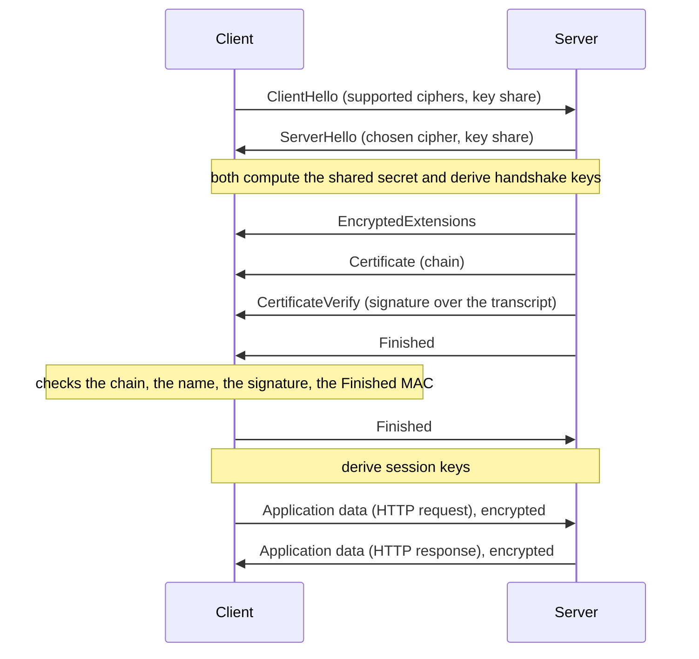

# The TLS handshake

After this you can follow the TLS 1.3 handshake message by message, say what each side proves, and read a real handshake with `openssl s_client`.

Before this: [Public-key encryption and signatures](03-public-key-encryption-and-signatures.md), [Symmetric encryption](02-symmetric-encryption.md) and [TLS, HTTPS and certificates](../../07-networking/02-web-protocols/03-tls-https-and-certificates.md), which covers what the padlock and the certificate checks mean.

## The idea

When you open `https://example.com`, your browser and the server have never shared a secret, and anyone on the network path can read every byte they exchange. In about one round trip they must agree on a fresh key and the client must be sure it is talking to the real `example.com`.

The **TLS handshake** does three jobs in that exchange: key exchange (agree on a secret with Diffie-Hellman), authentication (the server proves its identity with a certificate and a signature), and negotiation (agree on the cipher). After it, all data is encrypted with the session keys using AES-GCM or ChaCha20-Poly1305, so the slow public-key steps run once per connection.



In the diagram, the client gets a response after one round trip (1-RTT): its request goes out right after its Finished message.

## Key terms

A **key share** is the sender's public Diffie-Hellman value, sent in the first message so the key exchange needs no extra round trip.

A **certificate** binds a domain name to a public key and is signed by a certificate authority (CA). A **chain** runs from the server's certificate through intermediate CAs to a root CA that the client already trusts.

**CertificateVerify** is a signature, made with the private key of the certificate, over a hash of everything said so far (the **transcript**). It proves the server holds the private key and was part of this exact exchange.

**Finished** is a MAC over the transcript under the handshake keys. It proves nobody tampered with the negotiation.

**Forward secrecy** means that stealing the server's long-term private key later does not reveal past sessions, because each session's key came from throwaway Diffie-Hellman values that were deleted.

## How it works

1. **ClientHello.** The client lists its supported cipher suites and sends a key share for one or more groups (X25519 and, in current browsers, a hybrid with ML-KEM). It also sends the server name it wants.
2. **ServerHello.** The server picks a cipher and a group and sends its own key share. Both sides now compute the same shared secret from their private value and the other's key share, and derive the handshake keys. Everything after this message is encrypted.
3. **Certificate and CertificateVerify.** The server sends its chain and a signature over the transcript. The client checks the chain up to a trusted root, the validity dates, that the certificate names the host it asked for, and the signature. Failing any check ends the connection.
4. **Finished.** Each side sends a MAC of the transcript. Both then derive the session keys and switch to them.

Because the shared secret comes from fresh key shares, every connection gets new keys, which gives forward secrecy. TLS 1.2 needed two round trips and allowed key exchanges without forward secrecy; TLS 1.3 removed those.

**0-RTT** ("early data") lets a client that has connected before send a request in its first flight, using a key from the earlier session. It saves a round trip but the data can be replayed by an attacker, so only safe, repeatable requests (such as plain `GET`s) should use it.

## Worked examples

<div class="example" markdown>

### Example 1: read a real handshake

`openssl s_client` opens a TLS connection and prints what happened. `-tls1_3` forces version 1.3 and `-trace` prints each message. In WSL or Git Bash (output trimmed to the handshake messages, run in 2026):

```bash
echo | openssl s_client -connect example.com:443 -servername example.com -tls1_3 -trace 2>&1 | grep -E "^(Sent|Received) TLS|^ +(ClientHello|ServerHello|EncryptedExtensions|Certificate,|CertificateVerify|Finished)|NamedGroup"
```

```text
Sent TLS Record
    ClientHello, Length=1469
            NamedGroup: X25519MLKEM768 (4588)
            NamedGroup: ecdh_x25519 (29)
Received TLS Record
    ServerHello, Length=1206
            NamedGroup: X25519MLKEM768 (4588)
Received TLS Record
Received TLS Record
    EncryptedExtensions, Length=6
    Certificate, Length=3682
    CertificateVerify, Length=74
    Finished, Length=48
Sent TLS Record
Sent TLS Record
    Finished, Length=48
```

1. The client offers two key shares, a hybrid post-quantum one and classic X25519. The ClientHello is 1,469 bytes because the ML-KEM share is large.
2. The server picks the hybrid group in its ServerHello.
3. Four messages follow, all encrypted: EncryptedExtensions, the 3,682-byte certificate chain, CertificateVerify and Finished.
4. The client answers with its own Finished.

Check: the order matches the diagram. Now the summary lines:

```bash
echo | openssl s_client -connect example.com:443 -servername example.com -tls1_3 2>&1 | grep -E "Verification|Negotiated|Cipher is|Protocol|Peer signing|Early data"
```

```text
Peer signing digest: SHA256
Negotiated TLS1.3 group: X25519MLKEM768
Verification: OK
New, TLSv1.3, Cipher is TLS_AES_256_GCM_SHA384
Protocol: TLSv1.3
Early data was not sent
```

`Verification: OK` means the chain led to a trusted root and the name matched. The cipher `TLS_AES_256_GCM_SHA384` is AES-256-GCM for the data, with SHA-384 used in key derivation. The group and cipher depend on your OpenSSL version and the server, so yours may differ.

</div>

<div class="example" markdown>

### Example 2: force an older version

The same server will usually still accept TLS 1.2:

```bash
echo | openssl s_client -connect example.com:443 -servername example.com -tls1_2 2>&1 | grep -E "Cipher is|Protocol"
```

```text
New, TLSv1.2, Cipher is ECDHE-ECDSA-CHACHA20-POLY1305
Protocol: TLSv1.2
```

TLS 1.2 names the key exchange (`ECDHE`) and signature (`ECDSA`) in the suite name; TLS 1.3 suite names list only the bulk cipher and hash, because it always uses a Diffie-Hellman exchange.

</div>

## Common mistakes

<div class="warning" markdown>

Watch out: turning off certificate verification (`verify=False`, `curl -k`, `NODE_TLS_REJECT_UNAUTHORIZED=0`) to make an error go away. The connection is then encrypted, but to anyone, including an attacker in the middle. Fix the chain or the trust store instead.

Watch out: believing the padlock means the site is safe. It means the connection is encrypted to the named host, not that the host is honest.

Watch out: enabling 0-RTT on endpoints that change state, such as a payment `POST`. A replayed request would run twice.

</div>

## Working with AI

<div class="ai" markdown>

Words to use: ClientHello, key share, forward secrecy, certificate chain, CertificateVerify, 1-RTT, 0-RTT, cipher suite.

Prompts to try:

- "Here is the output of `openssl s_client -connect api.example.com:443 -tls1_3 -trace`. Walk through each handshake message and tell me which one carries the server certificate and which proves the server holds its private key."
- "Our Python client fails with `CERTIFICATE_VERIFY_FAILED`. List the possible causes (missing intermediate, wrong host name, expired date, corporate proxy) and the `openssl` command that tests each."

What to check:

- Advice to disable verification. Reject it, and ask for the cause instead.
- Outdated claims, such as RC4, SSLv3 or TLS 1.0 and 1.1 being acceptable, or "TLS 1.3 needs two round trips". Compare with the diagram above.
- Cipher-suite names from memory. Run the `openssl` commands and read the real values.

</div>

## Quiz

1\. What does forward secrecy protect against, and what in the handshake provides it?

<details class="solution" markdown>
<summary>Answer</summary>

It protects recorded past traffic if the server's long-term private key is stolen later. Fresh Diffie-Hellman key shares per connection give it, because the private values are discarded after the handshake.

</details>

2\. Predict: in Example 1, what would an attacker who sits on the network see in plaintext?

<details class="solution" markdown>
<summary>Answer</summary>

The ClientHello and ServerHello, including both key shares and the server name. Everything after the ServerHello, including the certificate, is encrypted in TLS 1.3.

</details>

3\. A client gets a valid certificate for `evil.example` while connecting to `bank.example`. Which check stops the connection?

<details class="solution" markdown>
<summary>Answer</summary>

The host name check: the certificate must name the host the client asked for. The chain and signature would be valid, but the name does not match.

</details>

4\. Why is the server's signature in CertificateVerify over the whole transcript and not just a nonce?

<details class="solution" markdown>
<summary>Answer</summary>

Signing the transcript ties the proof to this exact exchange, including both key shares, so an attacker cannot replay it or splice in their own key share.

</details>

## Lab

<div class="lab" markdown>

### Lab: inspect the handshake of three sites

Goal: compare version, cipher and key group across sites. Time: about 10 minutes. Runs in: WSL (Ubuntu) or Git Bash with `openssl`.

1. Run the summary command from Example 1 against `example.com`, `github.com` and one site you use.
2. Record protocol, cipher and `Negotiated TLS1.3 group` for each.
3. Add `-tls1_2` to one command. Does it work? What changes in the cipher name?
4. Add `-showcerts` and count the certificates in the chain.

Expected result: all three negotiate TLS 1.3, and the groups and ciphers may differ per site (some servers print no group line). A site that rejects TLS 1.2 prints an error instead.

<details class="solution" markdown>
<summary>Solution</summary>

```bash
for h in example.com github.com; do
  echo "== $h"
  echo | openssl s_client -connect $h:443 -servername $h -tls1_3 2>&1 | grep -E "Negotiated|Cipher is|Verification"
done
```

Counting `-----BEGIN CERTIFICATE-----` lines in the `-showcerts` output gives the chain length. Results vary by site and OpenSSL version.

</details>

</div>

## Where this shows up

- The certificate checks themselves: [TLS, HTTPS and certificates](../../07-networking/02-web-protocols/03-tls-https-and-certificates.md).
- Post-quantum key exchange and why hybrids exist: [RSA step by step](04-rsa-step-by-step.md).
- Encrypting connections to a database or between services in [Privacy and PIPEDA](06-privacy-and-pipeda.md).
