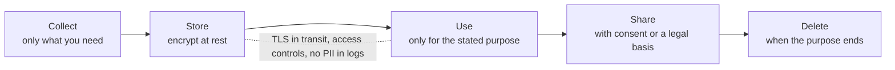
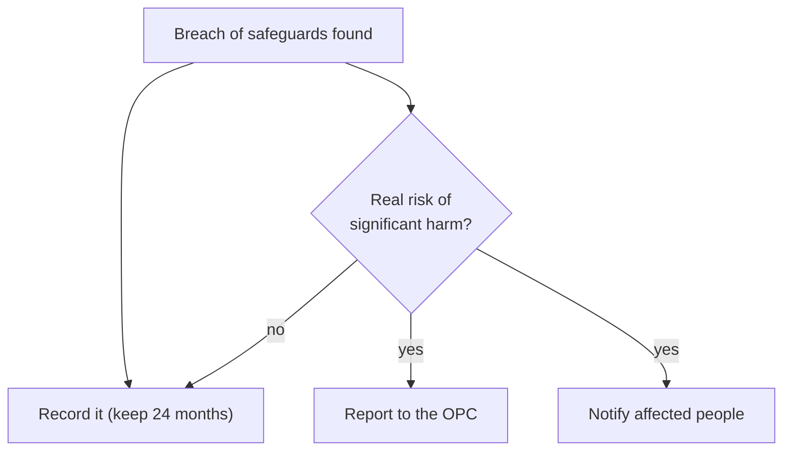

# Privacy and PIPEDA

After this you can name the main obligations Canada's federal private-sector privacy law puts on an organization, and turn them into concrete choices about the data your code collects, stores, logs and keeps.

Before this: [Symmetric encryption](02-symmetric-encryption.md) and [The TLS handshake](05-the-tls-handshake.md).

This lesson is general information as of 2026, not legal advice. A real product needs its organization's privacy officer or a lawyer.

## The idea

You add a signup form that asks for name, email, birth date and phone number "in case we need it later". Six months on, the table is in a backup, in analytics events, and in a log file that a contractor can read. Then one of those copies leaks.

Cryptography protects data in transit and at rest. **Privacy** law asks earlier questions: why you collected it, who agreed, how long you keep it, and what you owe people when it goes wrong. For a developer, most of the law becomes decisions about what to collect and where it goes.



## Key terms

**Personal information** is information about an identifiable individual, such as a name, email address, IP address, account ID tied to a person, or purchase history.

**PIPEDA** is the Personal Information Protection and Electronic Documents Act, the federal law that governs how private-sector organizations collect, use and disclose personal information in the course of commercial activity. Some provinces (Quebec, Alberta, British Columbia) have their own private-sector laws that replace it within the province.

**Consent** is the individual's agreement to the collection, use or disclosure, which must be meaningful: they understand what for.

A **breach of security safeguards** is a loss of, unauthorized access to, or unauthorized disclosure of personal information caused by a failure of safeguards.

**Data minimization** is collecting and keeping only what the stated purpose needs.

## How it works

PIPEDA rests on 10 fair information principles, which the [Office of the Privacy Commissioner of Canada](https://www.priv.gc.ca/en/privacy-topics/privacy-laws-in-canada/the-personal-information-protection-and-electronic-documents-act-pipeda/p_principle/) (OPC) publishes. Here is each one with its meaning for code.

| Principle | In plain words | What it means for a developer |
|---|---|---|
| 1. Accountability | Someone is responsible | A named privacy contact, and a list of where personal data lives |
| 2. Identifying purposes | Say why you collect it | A purpose per field, written down before collection |
| 3. Consent | People agree | Clear consent screens, a way to withdraw, no pre-ticked boxes |
| 4. Limiting collection | Only what you need | Drop fields with no purpose |
| 5. Limiting use, disclosure and retention | Use for the stated purpose, keep only as long as needed | Retention periods and deletion jobs, and care with third-party SDKs |
| 6. Accuracy | Keep it correct | Let users edit their data |
| 7. Safeguards | Protect it to match its sensitivity | Encryption, access control, logging, secrets management |
| 8. Openness | Publish your practices | A privacy policy that matches the code |
| 9. Individual access | People can see and correct their data | An export and a correction path |
| 10. Challenging compliance | People can complain | A contact and a process |

When there is a breach, PIPEDA requires an organization to report it to the OPC, and to notify the affected individuals, as soon as feasible if it is reasonable to believe the breach creates a real risk of significant harm. It must keep a record of every breach, whatever the risk, for 24 months. Knowingly failing to report or keep records is an offence with fines up to \$100,000. Sources: [PIPEDA section 28](https://laws-lois.justice.gc.ca/eng/acts/p-8.6/section-28.html) and the [Breach of Security Safeguards Regulations](https://gazette.gc.ca/rp-pr/p2/2018/2018-04-18/html/sor-dors64-eng.html).



In the diagram, the record is kept in every case, and the two notices depend on the risk test. The test looks at how sensitive the data is and how likely it is to be misused.

Public bodies are covered by other laws. In Ontario, the Freedom of Information and Protection of Privacy Act (FIPPA) covers the provincial public sector, and health information has its own act (PHIPA). The federal law itself may change: a replacement bill, C-36, was tabled in June 2026 and is not law as of this writing (see this [Bennett Jones summary](https://www.bennettjones.com/Insights/Blogs/2026/06/Bill-C-36-and-Canadian-Privacy-Reform)), so check the OPC site for the current rules.

## Worked examples

<div class="example" markdown>

### Example 1: keep personal data out of logs

A log line with an email address copies personal data into every log store, with its own retention and its own readers. A filter in the logging library can redact it before it is written.

1. Write a `logging.Filter` that replaces anything shaped like an email with `[email]`.
2. Attach it to the logger.
3. Log one line with an email and one with only an ID.

```python
import logging, re

class RedactEmail(logging.Filter):
    pattern = re.compile(r"[\w.+-]+@[\w-]+\.[\w.]+")
    def filter(self, record):
        record.msg = self.pattern.sub("[email]", str(record.msg))
        return True

logging.basicConfig(level=logging.INFO, format="%(levelname)s %(message)s")
log = logging.getLogger("app")
log.addFilter(RedactEmail())
log.info("signup from ada@example.com")
log.info("user_id=42 plan=free")
```

```text
INFO signup from [email]
INFO user_id=42 plan=free
```

Check: the email is gone and the opaque ID stays, which is enough to debug. Redaction is a safety net, not a plan; the better fix is not to log the value at all. A pattern also misses names, addresses and request bodies.

</div>

<div class="example" markdown>

### Example 2: a retention rule

Principle 5 says to keep data only as long as needed. A scheduled job finds accounts past the retention period:

```python
from datetime import date, timedelta
RETENTION_DAYS = 365
rows = [("ada", date(2026, 1, 5)), ("bo", date(2025, 3, 1))]
today = date(2026, 10, 25)
cutoff = today - timedelta(days=RETENTION_DAYS)
print([name for name, last_login in rows if last_login < cutoff])
```

```text
['bo']
```

In a real system this becomes a `DELETE` in a nightly job, and the retention period should also cover backups and analytics copies.

</div>

## Common mistakes

<div class="warning" markdown>

Watch out: assuming encryption alone makes you compliant. Encrypting at rest is one safeguard (principle 7). Collection, consent, retention and breach handling still apply, and a key stored with the data protects nothing.

Watch out: copying production personal data into a test or staging database. Use synthetic or masked data.

Watch out: sending personal data to a third-party service (analytics, an AI API, error tracking) without checking the purpose and consent. The organization stays accountable for data it hands to a processor.

</div>

## Working with AI

<div class="ai" markdown>

Words to use: personal information, data minimization, retention period, consent, breach of security safeguards, real risk of significant harm, PII, encryption at rest.

Prompts to try:

- "List the personal data fields in this Django model and suggest which could be dropped, hashed or given a retention limit. I am under PIPEDA, not GDPR."
- "Review this logging configuration and tell me which log lines could contain personal information, and how to stop them."

What to check:

- Answers that treat GDPR rules as Canadian law. Check names and thresholds against priv.gc.ca.
- Pasting real customer data into an AI tool. Use synthetic rows, since that is a disclosure to a third party.
- Legal claims stated as fact. Treat them as questions for the privacy officer.

</div>

## Quiz

1\. Which PIPEDA principle most directly justifies deleting accounts after a year of inactivity?

<details class="solution" markdown>
<summary>Answer</summary>

Limiting use, disclosure and retention (principle 5): keep personal information only as long as needed for the stated purpose.

</details>

2\. Predict: the log filter in Example 1 receives `"user ada@example.com paid"`. What does the log show?

<details class="solution" markdown>
<summary>Answer</summary>

`user [email] paid`. The regular expression matches and replaces the address.

</details>

3\. A laptop with an unencrypted customer export is stolen. What are the first steps under PIPEDA?

<details class="solution" markdown>
<summary>Answer</summary>

Record the breach, judge whether there is a real risk of significant harm (the data is sensitive and unencrypted, so likely yes), and then report to the OPC and notify the affected individuals as soon as feasible. Involve the privacy officer.

</details>

4\. Why is a `phone_number` column "in case we need it later" a problem?

<details class="solution" markdown>
<summary>Answer</summary>

It has no stated purpose, which breaks limiting collection and identifying purposes. It is also a liability if there is a breach.

</details>

## Lab

<div class="lab" markdown>

### Lab: a data inventory for a small app

Goal: write a one-page inventory of personal data for an app you have built. Time: about 20 minutes. Runs in: any editor.

1. List every field you store about a person (database columns, logs, analytics events).
2. For each, write the purpose, where it is stored, and who can read it.
3. Mark fields with no purpose, then fields that would be sensitive in a breach.
4. Propose a retention period and one safeguard for each sensitive field.
5. Decide who you would tell, and what you would record, if the database leaked.

Expected result: a table with a column for purpose, location, retention and safeguard, and at least one field you would stop collecting.

<details class="solution" markdown>
<summary>Solution</summary>

A sample row:

```text
field: email | purpose: login and receipts | stored: users table, mail provider | readers: app, support | retention: 12 months after last login | safeguard: encrypted disk, TLS, not logged
```

</details>

</div>

## Where this shows up

- Safe storage of passwords and tokens: [Hashing and salts](01-hashing-and-salts.md) and [Secure authentication](../01-web-security/05-secure-authentication.md).
- Logging and retention in [operations](../../13-devops-and-cloud/04-operations/01-logging-metrics-and-monitoring.md).
