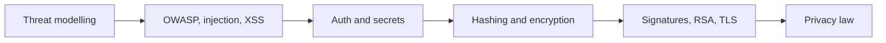

# Security

How web applications get attacked and defended, and the cryptography behind hashing, encryption, signatures and TLS.

Before this folder: Networking, Back end, and Databases, SQL and Postgres.

This folder has two chapters. Web security teaches the mindset of threat modelling, the OWASP Top 10, injection, XSS and CSRF, secure authentication, and keeping secrets and dependencies safe. Cryptography explains hashing and salts, symmetric and public-key encryption, signatures, RSA step by step, the TLS handshake, and privacy law in Canada (PIPEDA).

AI-generated code often looks fine and is insecure: string-built SQL, a hard-coded key, a weak password hash, an outdated dependency. You do not need to implement cryptography, but you do need to know which primitive does what, so you can tell when a suggestion uses the wrong one.

It builds on [Networking](../07-networking/index.md) (TLS), [Back end](../09-back-end/index.md) (auth and APIs) and [Databases, SQL and Postgres](../10-databases-sql-and-postgres/index.md) (SQL injection), with modular arithmetic from [Discrete math for CS](../05-discrete-math-for-cs/index.md) behind RSA. It feeds [DevOps and cloud](../13-devops-and-cloud/index.md) and [Software and system design](../14-software-and-system-design/index.md).

### How to use this folder

- Keep the Web security cheat sheet open when you review code.
- RSA step by step is the most mathematical lesson. Read it after modular arithmetic.
- The TLS lab uses `openssl` in WSL or Git Bash.

<!-- lessons:start -->
## Lessons

### 1. [Web security](01-web-security/index.md)

1. [Security mindset and threat modelling](01-web-security/01-security-mindset-and-threat-modelling.md)
2. [OWASP top 10](01-web-security/02-owasp-top-10.md)
3. [Injection and input validation](01-web-security/03-injection-and-input-validation.md)
4. [XSS, CSRF and browser security](01-web-security/04-xss-csrf-and-browser-security.md)
5. [Secure authentication](01-web-security/05-secure-authentication.md)
6. [Secrets and dependency security](01-web-security/06-secrets-and-dependency-security.md)

### 2. [Cryptography](02-cryptography/index.md)

1. [Hashing and salts](02-cryptography/01-hashing-and-salts.md)
2. [Symmetric encryption](02-cryptography/02-symmetric-encryption.md)
3. [Public-key encryption and signatures](02-cryptography/03-public-key-encryption-and-signatures.md)
4. [RSA step by step](02-cryptography/04-rsa-step-by-step.md)
5. [The TLS handshake](02-cryptography/05-the-tls-handshake.md)
6. [Privacy and PIPEDA](02-cryptography/06-privacy-and-pipeda.md)

<!-- lessons:end -->
