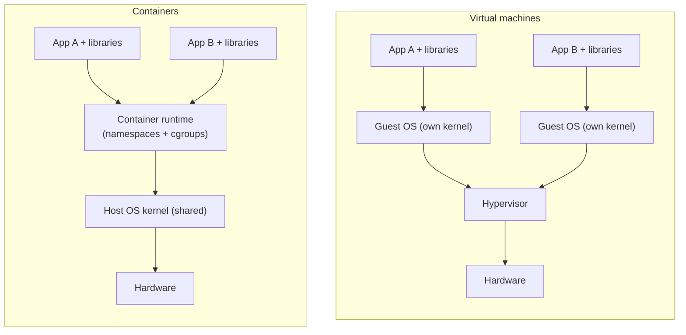

# VMs vs containers

After this you can explain what a container is and how it differs from a virtual machine, and run, inspect and remove a container with Docker.

Before this: [Processes, threads and scheduling](../../02-operating-systems-and-linux/01-os-concepts/02-processes-threads-and-scheduling.md), [System calls and kernel mode](../../02-operating-systems-and-linux/01-os-concepts/05-system-calls-and-kernel-mode.md) and [Setting up your machine](../../00-start-here/setting-up-your-machine.md) (Docker Desktop installed).

## The idea

Your API runs on your laptop with Node 24 and Postgres 18. A teammate has Node 20 and a different library version, and the app crashes on their machine. "Works on my machine" means the program depends on things around it (the runtime, libraries, config files, environment variables) that differ between machines.

The fix is to ship the program together with everything it needs, as one package that runs the same way anywhere. A virtual machine does that by packaging a whole computer. A container does it by packaging only the program's files and starting it as an ordinary process that the kernel keeps isolated from the others.



In the diagram, each virtual machine carries its own guest kernel, so two VMs need two full operating systems. The containers share the one host kernel, so each adds only its own files.

## Key terms

A **virtual machine** (VM) is software that emulates a complete computer. A **hypervisor** creates and runs VMs and shares the real hardware between them. Each VM boots its own **guest operating system** with its own kernel.

A **container** is a process (or group of processes) that runs on the host's kernel but sees its own isolated view of the system: its own file system, process list and network.

A **namespace** is a Linux kernel feature that gives a process its own view of one kind of resource, such as process IDs, network interfaces, mount points or hostnames. A **cgroup** (control group) is a kernel feature that limits and measures what a group of processes may use: CPU, memory, disk and process count.

An **image** is a read-only package holding the file system and default settings a container starts from. A container is a running (or stopped) instance of an image, the way a process is a running instance of a program. One image can start many containers.

## How it works

A container is not a lightweight VM. There is no second kernel and no hardware emulation. Docker asks the Linux kernel for four things when it starts one:

1. A new set of namespaces. Inside, the process sees itself as PID 1, sees only the container's files, and has its own network interface and hostname.
2. A cgroup, so the container can be capped, for example at 256 MB of memory.
3. A root file system built from the image's layers (the next lesson covers layers).
4. The process to run, started on the host kernel like any other.

Isolation is therefore weaker than a VM's. A VM isolates with the CPU's virtualization hardware; a container isolates with kernel features, so a kernel bug can cross the boundary. That is why cloud providers run different customers' code in VMs, and put containers inside them.

Containers start fast because nothing boots. Starting one is about creating a process, usually well under a second, while a VM boots a whole OS in many seconds. Containers are also small: megabytes to a few hundred megabytes, against gigabytes for a VM disk.

A shared kernel has one consequence. A Linux container needs a Linux kernel. On Windows, Docker Desktop runs a small Linux VM through WSL2 and starts your containers inside it, so on your laptop you use a VM and containers together ([Docker Desktop WSL 2 backend](https://docs.docker.com/desktop/features/wsl/)).

| | Virtual machine | Container |
|---|---|---|
| Kernel | Its own | The host's |
| Start time | Seconds to minutes | Under a second, typically |
| Size | Gigabytes | Megabytes to hundreds of MB |
| Isolation | Strong (hardware-assisted) | Weaker (kernel features) |
| Runs a different OS | Yes | Only the host's kernel type |

## Worked examples

<div class="example" markdown>

### Example 1: proving the kernel is shared

We run a tiny Alpine Linux container and compare it with the host. In WSL (Ubuntu):

```bash
uname -r
docker run --rm alpine uname -r
docker run --rm alpine ps
```

`docker run` creates a container from the image `alpine` (downloading it the first time), runs the command after the image name, and `--rm` deletes the container when it exits.

```text
6.6.87.2-microsoft-standard-WSL2
6.6.87.2-microsoft-standard-WSL2
PID   USER     TIME  COMMAND
    1 root      0:00 ps
```

1. The two kernel versions match, because Alpine has no kernel of its own. (Your version number will differ.)
2. `ps` inside the container lists one process, with PID 1. The PID namespace hides every host process.

Check: run `ps` in WSL and count the lines. It lists many processes, none of which the container could see.

</div>

## Common mistakes

<div class="warning" markdown>

Watch out: treating a container as a small VM. Containers are meant to run one main process. Data written inside a container is lost when the container is removed (volumes, in [the next lessons](03-volumes-networks-and-compose.md), fix this).

Watch out: assuming containers are a security boundary equal to a VM. Running untrusted code needs extra isolation; do not run an unknown image as root with `--privileged`.

Watch out: mixing up image and container. You build and share images. You run, stop and delete containers.

</div>

## Working with AI

<div class="ai" markdown>

Words to use: image, container, namespace, cgroup, shared kernel, hypervisor, isolation.

Prompts to try:

- "Explain how Linux namespaces and cgroups make a Docker container on WSL2 behave like a separate machine. Which namespace types does `docker run` create by default?"
- "My container is killed with exit code 137 after a few minutes. Here is `docker inspect` output (paste). Is it a cgroup memory limit, and how do I check?"

What to check:

- Answers that call a container "a lightweight VM" without saying the kernel is shared. Ask what runs the kernel.
- Invented `docker run` flags. Compare with `docker run --help` or the [reference](https://docs.docker.com/reference/cli/docker/container/run/).
- Claims that containers are "completely isolated" or "secure by default". Ask what a compromised container could reach.

</div>

## Quiz

1\. Why does a container start faster than a VM?

<details class="solution" markdown>
<summary>Answer</summary>

It does not boot an operating system. It starts a process on the already running host kernel, inside new namespaces and a cgroup.

</details>

2\. You run `docker run --rm alpine uname -r` and the output matches `uname -r` on the host. What does that tell you?

<details class="solution" markdown>
<summary>Answer</summary>

The container uses the host's kernel. The image contains only user-space files (the Alpine file system), not a kernel.

</details>

3\. A teammate says "my container wrote a file, I removed the container, and now the file is gone." Is that a bug?

<details class="solution" markdown>
<summary>Answer</summary>

No. The container's writable layer is deleted with the container. Data that must survive belongs in a volume or a bind mount.

</details>

4\. Which gives stronger isolation between two customers' code, two containers on one host or two VMs, and why?

<details class="solution" markdown>
<summary>Answer</summary>

Two VMs. Each has its own kernel and is separated by hardware virtualization. Containers share a kernel, so a kernel vulnerability can affect all of them.

</details>

## Lab

<div class="lab" markdown>

### Lab: look inside a running container

Goal: start a web server container, publish its port, inspect it, limit its memory and remove it. Time: about 15 minutes. Runs in: WSL (Ubuntu), with Docker Desktop running.

1. Start nginx in the background. `-d` detaches, `--name` names the container, `-p 8080:80` publishes container port 80 on host port 8080.

   ```bash
   docker run -d --name web -p 8080:80 nginx
   curl -s localhost:8080 | head -n 4
   ```

2. List running containers and read its log.

   ```bash
   docker ps
   docker logs web
   ```

3. Run a command inside it, then check the processes the host sees for it.

   ```bash
   docker exec web ls /usr/share/nginx/html
   docker top web
   ```

4. Start a second container with a 64 MB memory limit and read the cgroup file that holds the limit.

   ```bash
   docker run --rm -m 64m alpine cat /sys/fs/cgroup/memory.max
   ```

5. Cleanup: stop and remove the container.

   ```bash
   docker stop web
   docker rm web
   ```

Expected result: step 1 prints the start of the nginx welcome page, `docker ps` shows `web` with `0.0.0.0:8080->80/tcp`, and step 4 prints `67108864` (64 x 1024 x 1024 bytes).

```text
<!DOCTYPE html>
<html>
<head>
<title>Welcome to nginx!</title>
```

<details class="solution" markdown>
<summary>Solution</summary>

The commands above are the full solution. If port 8080 is busy, use another host port, such as `-p 8081:80`. If step 4 prints `max` or fails, your Docker engine uses cgroup v1; the file is then `/sys/fs/cgroup/memory/memory.limit_in_bytes`. After step 5, `docker ps -a` should not list `web`.

</details>

</div>

## Where this shows up

- Writing the package that a container starts from: [Docker images and Dockerfiles](02-docker-images-and-dockerfiles.md).
- Cloud services such as AWS Lambda and Fargate run your code in VM-isolated containers; see [EC2](../03-aws/03-ec2.md) for the VM side.
