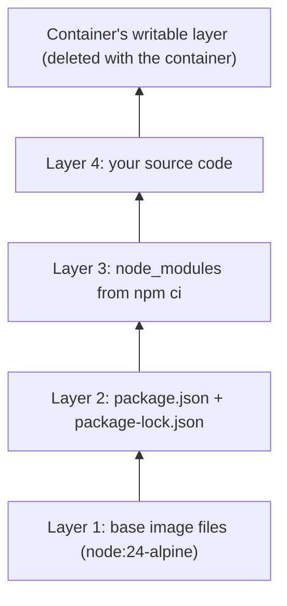
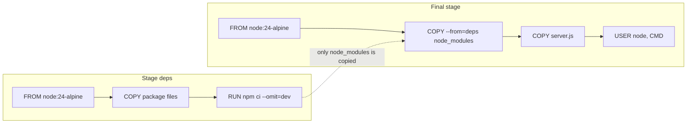

# Docker images and Dockerfiles

After this you can write a Dockerfile for a Node or Python app, order its instructions so rebuilds are fast, and build and run it as a non-root user.

Before this: [VMs vs containers](01-vms-vs-containers.md) and [Node.js and its runtime](../../09-back-end/01-servers-and-apis/02-nodejs-and-its-runtime.md).

## The idea

Last lesson you started containers from images other people made. Now you make your own. You write a recipe called a Dockerfile, run `docker build`, and get an image that holds your code, its dependencies and the runtime, ready to start anywhere Docker runs.

An image is not one big file. It is a stack of read-only layers, one per instruction that changes files. Docker saves each layer and reuses it when nothing it depends on has changed, which makes rebuilds fast if you order the instructions well.



In the diagram, layers 1 to 4 belong to the image and are shared by every container started from it. Each container adds only its own thin writable layer on top.

## Key terms

A **Dockerfile** is a text file of instructions that `docker build` runs, top to bottom, to produce an image. The **build context** is the folder of files that `docker build` sends to the builder, and `COPY` can only read from it.

A **base image** is the image named by `FROM`, which your image starts from. A **tag** is a human-readable name for a version of an image, such as `node:24-alpine`. Tags can move: the same tag can point to a different image next month. A **digest** (`sha256:...`) identifies exact image content and never changes.

A **multi-stage build** uses several `FROM` lines in one Dockerfile. Earlier stages can have compilers and dev tools; the last stage copies in only the results, so the final image stays small.

## How it works

The instructions you will use most ([Dockerfile reference](https://docs.docker.com/reference/dockerfile/)):

| Instruction | What it does |
|---|---|
| `FROM image` | Start from a base image (starts a stage) |
| `WORKDIR dir` | Set the working directory, creating it if needed |
| `COPY src dest` | Copy files from the build context (or `--from=stage`) |
| `RUN cmd` | Run a command at build time and keep the result as a layer |
| `ENV KEY=value` | Set an environment variable for build and run |
| `EXPOSE port` | Document the port the app listens on (it does not publish it) |
| `USER name` | Run later instructions and the container as this user |
| `CMD [...]` | Default command when the container starts |
| `ENTRYPOINT [...]` | The fixed program to start, with `CMD` as default arguments |

Write `CMD` and `ENTRYPOINT` in exec form, a JSON array with double quotes: `CMD ["node", "server.js"]`. The shell form runs your app under `/bin/sh -c`, so signals such as the one `docker stop` sends may not reach it. The usual split: `ENTRYPOINT` is the program, `CMD` the arguments the user can override at `docker run`.

Layer caching works like this: Docker walks the instructions in order, and an instruction reuses its saved layer if the instruction and its input files are unchanged. The first instruction that changes invalidates every layer after it. So put what changes rarely first (base image, dependency install) and what changes often last (your source).



Here is the Node Dockerfile the lab builds. It copies the two package files before the source, so editing `server.js` reuses the `npm ci` layer.

```dockerfile
# syntax=docker/dockerfile:1
FROM node:24-alpine AS deps
WORKDIR /app
COPY package.json package-lock.json ./
RUN npm ci --omit=dev

FROM node:24-alpine
ENV NODE_ENV=production
WORKDIR /app
COPY --from=deps /app/node_modules ./node_modules
COPY server.js ./
USER node
EXPOSE 3000
CMD ["node", "server.js"]
```

`npm ci` installs exactly what `package-lock.json` lists. A `.dockerignore` file lists paths to leave out of the build context (`node_modules`, `.git`, `.env`), which speeds up builds and keeps secrets and your host's `node_modules` out of the image.

Other habits: use a small base (`-alpine` or `-slim` variants), run as a non-root user so an attacker who breaks into the app is not root in the container, and pin the base by tag, or by digest (`FROM node:24-alpine@sha256:...`) when builds must be reproducible. Versions and tags change, so check Docker Hub's [node tags](https://hub.docker.com/_/node) and pick a current LTS (as of 2026, Node 24 or newer).

<details class="code" markdown>
<summary>Python version of the same idea</summary>

```dockerfile
# syntax=docker/dockerfile:1
FROM python:3.13-slim AS build
RUN python -m venv /opt/venv
ENV PATH="/opt/venv/bin:$PATH"
WORKDIR /app
COPY requirements.txt .
RUN pip install --no-cache-dir -r requirements.txt

FROM python:3.13-slim
RUN useradd --create-home app
COPY --from=build /opt/venv /opt/venv
ENV PATH="/opt/venv/bin:$PATH"
WORKDIR /app
COPY . .
USER app
EXPOSE 8000
CMD ["uvicorn", "main:app", "--host", "0.0.0.0", "--port", "8000"]
```

The build stage creates a virtual environment; the final stage copies it. The final image has no pip cache and no build tools. For FastAPI, see [Python back ends](../../09-back-end/01-servers-and-apis/07-python-back-ends-fastapi-and-django.md).

</details>

Image architecture matters too. Your Windows laptop is probably `linux/amd64`; Apple Silicon Macs and AWS Graviton servers are `linux/arm64`. Docker pulls the matching variant automatically. To build for another one, use `docker build --platform linux/amd64 ...`, or `docker buildx build --platform linux/amd64,linux/arm64 ...` for both ([multi-platform builds](https://docs.docker.com/build/building/multi-platform/)).

## Worked examples

<div class="example" markdown>

### Example 1: how cache order changes a rebuild

Compare two orderings of a Node Dockerfile.

```dockerfile
# slow: any code edit reinstalls everything
COPY . .
RUN npm ci --omit=dev
```

```dockerfile
# fast: dependencies reinstall only when package files change
COPY package.json package-lock.json ./
RUN npm ci --omit=dev
COPY . .
```

1. In the slow version, `COPY . .` includes `server.js`. Edit one line there and the `COPY` layer changes, so `npm ci` runs again.
2. In the fast version, the first `COPY` sees the same two package files, so Docker reuses the layer and the `npm ci` layer after it. Only the last `COPY` reruns.

Check: build twice with a one-line source edit between. The second build's output shows `CACHED` beside the `npm ci` step in the fast version only. The lab does this.

</div>

## Common mistakes

<div class="warning" markdown>

Watch out: the app listens on `127.0.0.1` inside the container. Published ports reach the container's network address, not its loopback, so `curl` from the host fails. Listen on `0.0.0.0`.

Watch out: baking secrets into an image with `COPY .env .` or `ENV API_KEY=...`. Layers keep them forever and anyone who pulls the image can read them. Pass secrets at run time and list `.env` in `.dockerignore`.

Watch out: `FROM node:latest`. The tag moves, so a build next month can differ from today's. Pin a major version, or a digest.

</div>

## Working with AI

<div class="ai" markdown>

Words to use: base image, layer, build context, multi-stage build, `.dockerignore`, `ENTRYPOINT` vs `CMD`, non-root `USER`, digest.

Prompts to try:

- "Here is my Dockerfile and `package.json` for a Node 24 Express app (paste). Reorder it for layer caching, add a multi-stage build and a non-root user, and explain each change."
- "`docker build` fails with `COPY failed: file not found in build context`. Here is my Dockerfile and `ls -a` of the project (paste). Which path is wrong?"

What to check:

- Instructions or flags that do not exist; compare with the [Dockerfile reference](https://docs.docker.com/reference/dockerfile/).
- `COPY . .` before the dependency install, or the shell form of `CMD`.
- A final stage that runs as root, or that still contains compilers and dev dependencies. Run `docker run --rm IMAGE whoami` and `docker images` to check.
- `.env` files or tokens in the build context. Ask for a `.dockerignore`.

</div>

## Quiz

1\. Which instruction invalidates the cache for every instruction after it?

<details class="solution" markdown>
<summary>Answer</summary>

The first one whose instruction text or input files changed. Layers after it must be rebuilt, because each layer builds on the one before.

</details>

2\. What does `EXPOSE 3000` do?

<details class="solution" markdown>
<summary>Answer</summary>

It only records, as metadata, that the app listens on port 3000. It does not publish the port. You publish with `docker run -p 8080:3000`.

</details>

3\. Your build takes three minutes on every small code change, and `npm ci` shows up each time. What is wrong?

<details class="solution" markdown>
<summary>Answer</summary>

The source is probably copied before `npm ci` (for example `COPY . .` first). Copy `package.json` and `package-lock.json`, run `npm ci`, then copy the source.

</details>

4\. Why does a multi-stage build give a smaller image?

<details class="solution" markdown>
<summary>Answer</summary>

Only the last stage becomes the image. Compilers, dev dependencies and caches stay in earlier stages, and you copy over only the files you need with `COPY --from`.

</details>

## Lab

<div class="lab" markdown>

### Lab: build, run and rebuild a Node image

Goal: containerize a small Express app and watch the cache work. Time: about 20 minutes. Runs in: WSL (Ubuntu), Docker Desktop running, Node installed as in [Setting up your machine](../../00-start-here/setting-up-your-machine.md).

1. Create the project and install Express. This writes `package.json` and `package-lock.json`.

   ```bash
   mkdir -p ~/hello-api && cd ~/hello-api
   npm init -y
   npm install express
   ```

2. Create `server.js`:

   ```javascript
   const express = require("express");
   const os = require("node:os");
   const app = express();
   app.get("/", (req, res) => res.send(`hello from ${os.hostname()}, uid ${process.getuid()}\n`));
   app.listen(3000, "0.0.0.0");
   ```

3. Create `.dockerignore` with the lines `node_modules`, `.git` and `.env`, and `Dockerfile` with the contents shown in How it works.

4. Build, run and test. `-t` names the image.

   ```bash
   docker build -t hello-api:1 .
   docker run -d --rm --name hello -p 3000:3000 hello-api:1
   curl localhost:3000
   docker exec hello whoami
   ```

5. Edit the message in `server.js`, then rebuild with `docker build --progress=plain -t hello-api:2 .` and look for `CACHED` next to the `npm ci` step.

6. Cleanup: `docker stop hello` (the container deletes itself because of `--rm`), then `docker rmi hello-api:1 hello-api:2`.

Expected result: `curl` prints the container ID as the hostname and `uid 1000`, and `whoami` prints `node`.

```text
hello from 3f2a9c1b7d4e, uid 1000
node
```

<details class="solution" markdown>
<summary>Solution</summary>

The hostname differs on your machine. In step 5 the output has a line like `CACHED [deps 4/4] RUN npm ci --omit=dev`, while the final stage's `COPY server.js` step runs again. If `curl` fails with "connection reset", the server is listening on `127.0.0.1`; keep `"0.0.0.0"` in `listen`. Compare image sizes with `docker images hello-api`.

</details>

</div>

## Where this shows up

- Running this image with a database and saved data: [Volumes, networks and Compose](03-volumes-networks-and-compose.md).
- Building images automatically on every push: [CI/CD concepts](../02-ci-cd/01-ci-cd-concepts.md).
