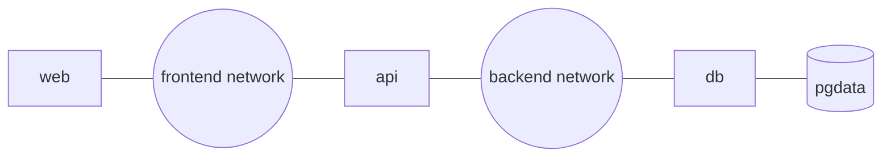

# Volumes, networks and Compose

After this you can keep a container's data when it is replaced, let containers talk to each other by name, and run an API with a Postgres database from one `compose.yaml`.

Before this: [Docker images and Dockerfiles](02-docker-images-and-dockerfiles.md), [Ports and sockets](../../07-networking/01-how-the-internet-works/04-ports-and-sockets.md) and [SQL from code and SQL injection](../../10-databases-sql-and-postgres/05-databases-in-apps/01-sql-from-code-and-sql-injection.md).

## The idea

You run Postgres in a container, create some tables, then upgrade the image. The new container starts with an empty database. A container's file system is its image plus a thin writable layer, and that layer is deleted with the container. Data you want to keep must live outside the container, in a **volume**.

A real app also has several containers: an API, a database, maybe a front end. They need to find each other, and you want one command to start them all. **Docker Compose** does that: you describe the services in a YAML file and run `docker compose up`.


In the diagram, only the API's port is published to the host. The database is reachable by the API through the network, using the service name `db` as its hostname, and keeps its files in the volume `pgdata`, which survives container removal.

## Key terms

A **named volume** is storage managed by Docker, referred to by name (`pgdata`). It survives `docker compose down` and is the normal home for database files. A **bind mount** maps a folder from the host into the container (`./src:/app/src`), so edits on the host show up inside immediately. It suits source code during development.

A **network** is a virtual network that containers join. Containers on the same user-defined network (Compose creates one per project) reach each other by **service name**, because Docker runs a DNS server that resolves service names to container IP addresses ([Compose networking](https://docs.docker.com/compose/how-tos/networking/)).

**Port publishing** (`-p host:container`) forwards a host port into a container. Containers on the same network need no published ports to talk to each other.

A **Compose file** (`compose.yaml`) declares `services`, `volumes` and `networks`. A **healthcheck** is a command Docker runs repeatedly inside a container to decide whether the service is ready.

## How it works

| | Named volume | Bind mount |
|---|---|---|
| Written as | `pgdata:/var/lib/postgresql` | `./src:/app/src` |
| Managed by | Docker | You (a host path) |
| Typical use | Database files | Source code in development |
| Survives `docker compose down` | Yes | Yes (it is your folder) |
| Removed by `docker compose down -v` | Yes | No |

Here is a Compose file for an API and Postgres. The Postgres 18 image keeps data under `/var/lib/postgresql`, and earlier versions use `/var/lib/postgresql/data`, so mount the path for your version ([postgres image docs](https://hub.docker.com/_/postgres), as of 2026).

```yaml
services:
  api:
    build: .
    ports:
      - "3000:3000"
    env_file: .env
    environment:
      PGHOST: db
    depends_on:
      db:
        condition: service_healthy
  db:
    image: postgres:18
    env_file: .env
    volumes:
      - pgdata:/var/lib/postgresql
    healthcheck:
      test: ["CMD-SHELL", "pg_isready -U $${POSTGRES_USER} -d $${POSTGRES_DB}"]
      interval: 5s
      timeout: 3s
      retries: 10

volumes:
  pgdata:
```

`depends_on` with `condition: service_healthy` makes Compose start `api` only after `db` passes its healthcheck ([startup order](https://docs.docker.com/compose/how-tos/startup-order/)). Without it, a container that has "started" may not yet accept connections. The `$$` stops Compose from substituting the variables itself, so the shell inside the container reads them instead.

`env_file: .env` loads variables from a file into the container. Keep real secrets out of git: add `.env` to `.gitignore` and commit a `.env.example` instead. The `.env` here is for local development only.

Day-to-day commands, all run in the project folder ([CLI reference](https://docs.docker.com/reference/cli/docker/compose/)):

| Command | What it does |
|---|---|
| `docker compose up -d --build` | Build images, create and start everything in the background |
| `docker compose ps` | Show services and their status |
| `docker compose logs -f api` | Follow one service's output |
| `docker compose exec db psql -U app -d app` | Run a command in a running service |
| `docker compose down` | Stop and remove containers and the network (volumes stay) |
| `docker compose down -v` | Also delete named volumes (deletes the data) |

<details class="code" markdown>
<summary>Separate networks for a web, API and database</summary>

By listing `networks` on each service you decide who can talk to whom. Here `web` cannot reach `db` at all.

```yaml
services:
  web:
    image: nginx:stable-alpine
    ports: ["8080:80"]
    networks: [frontend]
  api:
    build: ./api
    networks: [frontend, backend]
  db:
    image: postgres:18
    networks: [backend]
    volumes: [pgdata:/var/lib/postgresql]
networks:
  frontend:
  backend:
volumes:
  pgdata:
```



</details>

## Worked examples

<div class="example" markdown>

### Example 1: data survives, then does not

The API in the lab counts visits in a table. We watch the count across restarts.

1. `docker compose up -d --build` starts both services.
2. Three `curl localhost:3000` calls print `visits: 1`, `visits: 2`, `visits: 3`.
3. `docker compose down` removes both containers and the network. The volume stays.
4. `docker compose up -d`, then `curl localhost:3000` prints `visits: 4`, because the new database container mounted the old volume.
5. `docker compose down -v` deletes the volume. After the next `up`, the count restarts at 1.

Check: `docker volume ls` shows `notes_pgdata` after step 3 and not after step 5.

</div>

## Common mistakes

<div class="warning" markdown>

Watch out: using `localhost` as the database host inside a container. `localhost` there means the container itself. Use the service name (`db`).

Watch out: `docker compose down -v` in a project whose volume holds data you want. It deletes the data with no confirmation.

Watch out: publishing the database port (`5432:5432`) on every interface. Anyone on your network can then try to connect. Leave it unpublished, or bind to the loopback address: `"127.0.0.1:5432:5432"`.

</div>

## Working with AI

<div class="ai" markdown>

Words to use: named volume, bind mount, service name, user-defined network, published port, healthcheck, `depends_on` condition, `env_file`.

Prompts to try:

- "Write a `compose.yaml` for a Node 24 API (build context `./api`, listens on 3000) and Postgres 18 with a named volume, a `pg_isready` healthcheck, and credentials from an env file. The database must not be published to the host."
- "My API container fails with `ECONNREFUSED 127.0.0.1:5432` under Compose. Here is my compose file and the connection code (paste). Why?"

What to check:

- The Postgres volume path for your image version (`/var/lib/postgresql` for 18, `/var/lib/postgresql/data` before).
- The obsolete top-level `version:` key. Current Compose ignores it and warns.
- Passwords written into `compose.yaml` itself, or an `.env` file that would be committed.
- A `depends_on` with no health condition: it only orders startup and does not wait for readiness.

</div>

## Quiz

1\. What is the difference between a named volume and a bind mount?

<details class="solution" markdown>
<summary>Answer</summary>

A named volume is created and managed by Docker and referred to by name. A bind mount maps a specific host folder into the container. Use volumes for database files and bind mounts for source code in development.

</details>

2\. In Compose, how does the `api` container reach Postgres, and does it need a published port?

<details class="solution" markdown>
<summary>Answer</summary>

It connects to host `db`, port 5432, over the project's network. No published port is needed. Published ports are for traffic from the host.

</details>

3\. You run these two commands. What happens to the rows in the database?

```bash
docker compose down -v
docker compose up -d
```

<details class="solution" markdown>
<summary>Answer</summary>

They are gone. The `-v` deleted the `pgdata` volume, so Postgres initializes an empty database and all rows are gone.

</details>

4\. The API crashes at startup with "connection refused" even though `db` is listed first in the file. What fixes it?

<details class="solution" markdown>
<summary>Answer</summary>

Listing order does not wait for readiness. Add a healthcheck to `db` and `depends_on` with `condition: service_healthy` on `api`. Retrying the connection in the app also helps.

</details>

## Lab

<div class="lab" markdown>

### Lab: an API with Postgres and persistent data

Goal: run the visit counter with Compose and prove the data persists. Time: about 20 minutes. Runs in: WSL (Ubuntu), Docker Desktop running.

1. Reuse the Dockerfile and `.dockerignore` from the last lesson in a new folder, and install the Postgres client library.

   ```bash
   mkdir -p ~/notes && cd ~/notes
   cp ~/hello-api/Dockerfile ~/hello-api/.dockerignore .
   npm init -y
   npm install pg
   ```

2. Create `server.js`. `new Pool()` reads `PGHOST`, `PGUSER`, `PGPASSWORD` and `PGDATABASE` from the environment.

   ```javascript
   const http = require("node:http");
   const { Pool } = require("pg");
   const pool = new Pool();

   async function start() {
     await pool.query("CREATE TABLE IF NOT EXISTS visits (id serial PRIMARY KEY, at timestamptz DEFAULT now())");
     http.createServer(async (req, res) => {
       try {
         await pool.query("INSERT INTO visits DEFAULT VALUES");
         const { rows } = await pool.query("SELECT count(*) AS n FROM visits");
         res.end(`visits: ${rows[0].n}\n`);
       } catch (err) {
         res.statusCode = 500;
         res.end("database error\n");
       }
     }).listen(3000, "0.0.0.0");
   }
   start();
   ```

3. Create `.env`, and `compose.yaml` from How it works. Add `.env` to `.gitignore`.

   ```text
   POSTGRES_USER=app
   POSTGRES_PASSWORD=devpassword
   POSTGRES_DB=app
   PGUSER=app
   PGPASSWORD=devpassword
   PGDATABASE=app
   ```

4. Start and test.

   ```bash
   docker compose up -d --build
   docker compose ps --format "table {{.Service}}\t{{.Status}}\t{{.Ports}}"
   curl localhost:3000
   curl localhost:3000
   ```

5. Open a psql session in the database container and count the rows. Then run `docker compose down`, `docker compose up -d` and `curl localhost:3000` again.

   ```bash
   docker compose exec db psql -U app -d app -c "SELECT count(*) FROM visits;"
   ```

6. Cleanup: `docker compose down -v`, which also deletes the volume.

Expected result: the first two calls print `visits: 1` and `visits: 2`, `ps` shows `db` as healthy, the psql count is `2`, and after the restart the next call prints `visits: 3`.

```text
SERVICE   STATUS                    PORTS
api       Up 6 seconds              0.0.0.0:3000->3000/tcp
db        Up 12 seconds (healthy)   5432/tcp
```

<details class="solution" markdown>
<summary>Solution</summary>

If `up` complains about a port in use, change the left side of `"3000:3000"`. If `api` logs `password authentication failed`, the volume was created earlier with a different password; run `docker compose down -v` and start again. `docker compose exec api getent hosts db` shows the address Docker's DNS gives the name `db`.

</details>

</div>

## Where this shows up

- Pushing the built image to a shared place and running it on a cluster: [Registries and Kubernetes basics](04-registries-and-kubernetes-basics.md).
- Choosing a managed database instead of a container: RDS managed Postgres<!-- link: ../03-aws/05-rds-managed-postgres.md -->.
