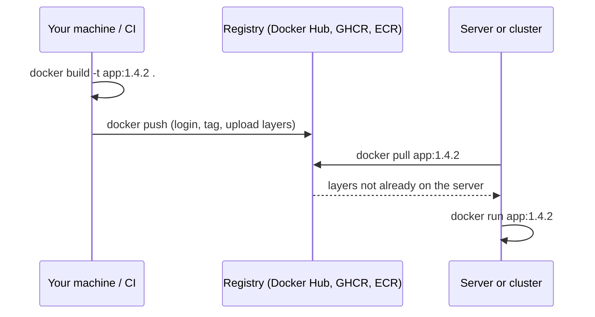
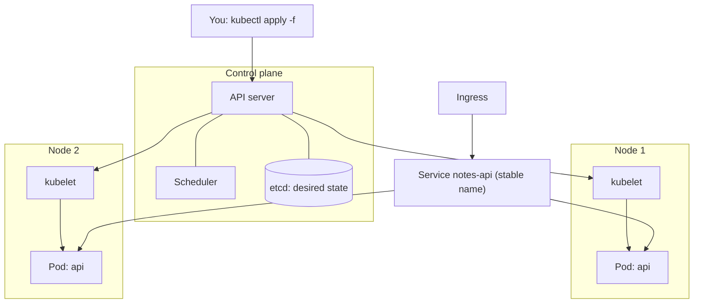

# Registries and Kubernetes basics

After this you can push an image to a registry with a good tag and pull it elsewhere, and read a basic Kubernetes Deployment and Service well enough to know what problem Kubernetes solves and when you can skip it.

Before this: [Docker images and Dockerfiles](02-docker-images-and-dockerfiles.md) and [Volumes, networks and Compose](03-volumes-networks-and-compose.md).

## The idea

You built an image on your laptop. The server that must run it is somewhere else. You do not copy files by hand; you push the image to a **registry** (a server that stores images), and the server pulls it from there. Build once, run the same bytes everywhere.



In the diagram, only layers the server does not already have are transferred, which is the same layer sharing as in the build cache.

Once you run many containers across many servers, a new problem appears: which server runs which container, what restarts one that crashes, and how do you update without downtime? Kubernetes is the most common answer.

## Key terms

A **registry** stores and serves images. A **repository** is one image name in a registry with all its tags. A full image name has the form `registry/owner/repository:tag`. With no registry, Docker assumes Docker Hub.

**Kubernetes** (also written K8s) is an open source system that runs containers across a group of machines and keeps them in the state you describe. You declare the desired state in YAML, and Kubernetes works continuously to match it.

A **cluster** is the machines Kubernetes manages. The **control plane** decides what runs where. **Nodes** are the machines that run containers. A **pod** is the smallest unit Kubernetes runs: one or more containers sharing a network address. A **Deployment** keeps a set number of identical pods running and rolls out new versions. A **Service** gives a group of pods one stable address and name and spreads traffic across them. An **Ingress** routes HTTP requests from outside the cluster to Services by host name or path. A **ConfigMap** holds settings and a **Secret** holds sensitive values, both injected into pods as environment variables or files ([Kubernetes concepts](https://kubernetes.io/docs/concepts/)).

## How it works

Three common registries ([Docker Hub](https://hub.docker.com/), [GitHub Container Registry](https://docs.github.com/en/packages/working-with-a-github-packages-registry/working-with-the-container-registry), [Amazon ECR](https://docs.aws.amazon.com/AmazonECR/latest/userguide/getting-started-cli.html)):

| Registry | Image name looks like | Log in with |
|---|---|---|
| Docker Hub | `alice/notes-api:1.4.2` | `docker login` (username and access token) |
| GHCR | `ghcr.io/alice/notes-api:1.4.2` | `docker login ghcr.io` with a GitHub token |
| ECR | `123456789012.dkr.ecr.ca-central-1.amazonaws.com/notes-api:1.4.2` | `aws ecr get-login-password` piped to `docker login` |

Pushing is two commands: give the local image a name that includes the registry, then upload it.

```bash
docker tag notes-api:latest ghcr.io/alice/notes-api:1.4.2
docker push ghcr.io/alice/notes-api:1.4.2
```

Tag with something that identifies the build: a version (`1.4.2`) or the Git commit hash (`3f2a9c1`). Avoid deploying `latest`, since it is only a default name that moves, and you cannot tell which build a server is running. A digest (`ghcr.io/alice/notes-api@sha256:...`) pins exact content. Registries can be private; a pull from a private registry also needs a login (in Kubernetes, an image pull Secret).



In the diagram, you send YAML to the API server, which stores the desired state. The scheduler picks nodes, and each node's kubelet starts the pods. The Service gives the two pods one address, and the Ingress brings in outside traffic.

Here is a Deployment and Service for the notes API. The Deployment asks for 2 replicas; the Service finds the pods by the label `app: notes-api`.

```yaml
apiVersion: apps/v1
kind: Deployment
metadata:
  name: notes-api
spec:
  replicas: 2
  selector:
    matchLabels:
      app: notes-api
  template:
    metadata:
      labels:
        app: notes-api
    spec:
      containers:
        - name: api
          image: ghcr.io/alice/notes-api:1.4.2
          ports:
            - containerPort: 3000
          envFrom:
            - configMapRef:
                name: notes-config
            - secretRef:
                name: notes-secret
---
apiVersion: v1
kind: Service
metadata:
  name: notes-api
spec:
  selector:
    app: notes-api
  ports:
    - port: 80
      targetPort: 3000
```

The `kubectl` commands you will use most ([kubectl reference](https://kubernetes.io/docs/reference/kubectl/)):

| Command | What it does |
|---|---|
| `kubectl apply -f file.yaml` | Create or update objects to match the file |
| `kubectl get pods` | List pods and their status |
| `kubectl describe pod NAME` | Show details and recent events |
| `kubectl logs NAME` | Print a pod's output |
| `kubectl rollout status deployment/notes-api` | Wait for a rollout to finish |
| `kubectl delete -f file.yaml` | Remove what the file created |

Note one trap: a Secret is only base64-encoded by default, which is encoding, not encryption. Anyone who can read the Secret object can decode it, so limit access and enable encryption at rest ([Secrets docs](https://kubernetes.io/docs/concepts/configuration/secret/)).

You often do not need Kubernetes. One server running Compose, or a managed service that runs containers for you (the [AWS chapter](../03-aws/index.md) covers options), covers many apps. Kubernetes pays off with many services, many servers and teams that need rolling updates and self-healing, and it brings real operating cost. Most teams use a managed cluster rather than run the control plane themselves.

## Worked examples

<div class="example" markdown>

### Example 1: reading what happens when a pod dies

Suppose `kubectl get pods` shows:

```text
NAME                         READY   STATUS    RESTARTS   AGE
notes-api-6d8f5b7c9d-4kq2x   1/1     Running   0          3m
notes-api-6d8f5b7c9d-t9wzp   1/1     Running   0          3m
```

1. The Deployment asked for 2 replicas, and 2 pods are running. The name has the Deployment name, a hash of the pod template, and a random suffix.
2. If you delete one pod (`kubectl delete pod notes-api-6d8f5b7c9d-4kq2x`), the Deployment sees 1 running where it wants 2 and creates a new pod with a new suffix.
3. Traffic through the Service keeps flowing to the remaining pod meanwhile.

Check: run `kubectl get pods` again a few seconds after the delete. Two pods are listed, and one is younger than the other.

</div>

## Common mistakes

<div class="warning" markdown>

Watch out: deploying the `latest` tag. Kubernetes and servers cache images by tag, so an updated `latest` may not be pulled, and you cannot say what is running. Use a unique tag per build.

Watch out: pushing an image that contains secrets, to a public repository. Check the repository's visibility on Docker Hub and GHCR; a leaked token in a layer must be revoked, not just deleted.

Watch out: a `docker push` that is denied or reports "requested access to the resource is denied". The image name lacks the registry or your account name, or you are not logged in. Re-run `docker tag` with the full name and `docker login`.

</div>

## Working with AI

<div class="ai" markdown>

Words to use: registry, repository, tag, digest, pod, Deployment, Service, Ingress, ConfigMap, Secret, `kubectl apply`.

Prompts to try:

- "Write a Kubernetes Deployment and Service for image `ghcr.io/alice/notes-api:1.4.2` that listens on port 3000, with 2 replicas, readiness probe on `/health`, and settings from a ConfigMap. Use `apps/v1`."
- "`kubectl get pods` shows `ImagePullBackOff`. Here is `kubectl describe pod` output (paste). List the likely causes in order and the command that checks each."

What to check:

- Manifests with an old `apiVersion` such as `extensions/v1beta1`; run `kubectl apply --dry-run=client -f file.yaml` to catch errors.
- A `selector` that does not match the pod template labels, so the Deployment is rejected or the Service finds no pods.
- Real passwords written into a Secret file that is committed to Git.
- Advice to add Kubernetes to an app with one container and one server. Ask what problem it would solve.

</div>

## Quiz

1\. What does `docker tag notes-api:latest ghcr.io/alice/notes-api:1.4.2` do, and does it upload anything?

<details class="solution" markdown>
<summary>Answer</summary>

It adds a second name to the same local image. Nothing is uploaded until `docker push`.

</details>

2\. Why is a tag like `1.4.2` safer to deploy than `latest`?

<details class="solution" markdown>
<summary>Answer</summary>

A version or commit tag identifies one build, so you know what runs and can roll back to the previous tag. `latest` moves with each push.

</details>

3\. A Service has `selector: {app: notes-api}` but the pods are labelled `app: notesapi`. What happens?

<details class="solution" markdown>
<summary>Answer</summary>

The labels do not match, so the Service selects no pods and requests to it fail. Fix the label or the selector.

</details>

4\. Your app is one API container and one Postgres, deployed to one server. Do you need Kubernetes?

<details class="solution" markdown>
<summary>Answer</summary>

Probably not. Compose on one server, or a managed container service, covers it. Kubernetes helps with many services across many machines, and it adds operating cost.

</details>

## Lab

<div class="lab" markdown>

### Lab: push to a registry and pull it back

Goal: run a local registry, push your image with a version tag, delete it locally and run it from the registry. Time: about 15 minutes. Runs in: WSL (Ubuntu), Docker Desktop running. This uses a registry on your own machine, so no account is needed.

1. Start a registry on port 5000 and rebuild the image from the earlier lab if you removed it.

   ```bash
   docker run -d --name registry -p 5000:5000 registry:3
   cd ~/hello-api && docker build -t hello-api:1 .
   ```

2. Tag with the registry name and a version, then push.

   ```bash
   docker tag hello-api:1 localhost:5000/hello-api:1.0.0
   docker push localhost:5000/hello-api:1.0.0
   ```

3. Ask the registry what it holds.

   ```bash
   curl -s localhost:5000/v2/_catalog
   curl -s localhost:5000/v2/hello-api/tags/list
   ```

4. Delete both local names, then run from the registry. Docker pulls it first.

   ```bash
   docker image rm hello-api:1 localhost:5000/hello-api:1.0.0
   docker run -d --rm --name hello -p 3000:3000 localhost:5000/hello-api:1.0.0
   curl localhost:3000
   docker images --digests localhost:5000/hello-api
   ```

5. Cleanup:

   ```bash
   docker stop hello registry
   docker rm registry
   docker image rm localhost:5000/hello-api:1.0.0
   ```

Expected result: the catalog lists `hello-api`, the tags list shows `1.0.0`, and `curl` prints the greeting from a freshly pulled image. The digest column shows a `sha256:` value.

```text
{"repositories":["hello-api"]}
{"name":"hello-api","tags":["1.0.0"]}
hello from 8d1c77ab52f0, uid 1000
```

<details class="solution" markdown>
<summary>Solution</summary>

The commands above are the full solution. In step 4, `docker run` prints `Unable to find image ... locally` and pulls the layers from `localhost:5000`, which proves the registry served them. The registry's data is inside its container, so the cleanup in step 5 deletes everything it stored. To use a real registry, change the name to `ghcr.io/YOURUSER/hello-api:1.0.0` after `docker login ghcr.io`.

</details>

</div>

## Where this shows up

- CI pipelines build and push an image on each commit: [CI/CD concepts](../02-ci-cd/01-ci-cd-concepts.md) and [GitHub Actions](../02-ci-cd/02-github-actions.md).
- Deployment strategies such as rolling updates build on Deployments: [Deployment strategies](../02-ci-cd/03-deployment-strategies.md).
