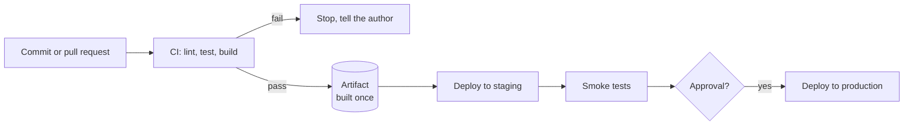

# CI/CD concepts

After this you can explain what a CI/CD pipeline does between a commit and production, and name the choices (delivery or deployment, which environments, which checks) that you or an AI would be configuring.

Before this: [GitHub, pull requests and code review](../../04-developer-tools-and-workflow/01-editor-and-git/04-github-pull-requests-and-code-review.md) and [config, environment variables and secrets](../../04-developer-tools-and-workflow/02-project-plumbing/02-config-env-vars-and-secrets.md).

## The idea

A team of five merges code several times a day. Without automation, someone pulls the branch, runs the tests by hand, builds the app on their laptop, copies it to a server and hopes the laptop matched the server. Each manual step is a chance to skip a check or ship something different from what was tested.

CI/CD replaces those steps with a pipeline: a fixed sequence of automated stages that every commit goes through. A failure stops the line and tells the author within minutes, while the change is still fresh in their head.



## Key terms

**Continuous integration** (CI) is the practice of merging small changes into a shared branch often, and running an automated build and test on every change.

**Continuous delivery** is CI plus the ability to release any passing commit to production at any time. A human still presses the button. **Continuous deployment** removes the button: every commit that passes all stages goes to production automatically. Both are abbreviated CD, so ask which one is meant.

A **pipeline** is the sequence of stages. An **artifact** is the build output that gets deployed: a container image, a zip file, a wheel. An **environment** is a separate copy of the running system. Typical ones are **dev** (the developer's machine or a shared sandbox), **staging** (as close to production as is affordable, used for final checks) and **production** (real users and real data).

A **secret** is a credential the pipeline needs, such as a deploy token. **Trunk-based development** means everyone merges to one main branch in small steps, with short-lived branches of a day or two, instead of long-lived feature branches.

## How it works

Four rules shape a good pipeline.

1. Fast feedback. If CI takes 40 minutes, people stop waiting for it and merge anyway. Put the cheap checks (lint, unit tests) first so most failures show up in under five minutes.
2. Build once, deploy many. The artifact is built a single time, in CI, and the same bytes go to staging and production. Rebuilding for each environment means production runs something nobody tested. Only configuration (database URL, feature settings) differs by environment, and it comes from outside the artifact.
3. Small changes. A pipeline can only tell you "something in these 20 lines broke". Trunk-based development keeps changes small, so failures are easy to locate and to revert.
4. Secrets stay out of the repo. The CI system stores them and hands them to a job as environment variables. They are masked in logs, but a script that prints one in an encoded form can still leak it.

Rule 2 can be shown in a few lines. This script builds once, "deploys" the same bytes to two environments and compares fingerprints.

```python
import hashlib

def build(source: str) -> bytes:
    return f"app built from: {source}".encode()

def digest(artifact: bytes) -> str:
    return hashlib.sha256(artifact).hexdigest()[:12]

artifact = build("commit 3f9a1c2")      # built once, in CI
deployed = {env: artifact for env in ("staging", "production")}

for env, a in deployed.items():
    print(env, digest(a))
print("same artifact:", digest(deployed["staging"]) == digest(deployed["production"]))
```

```text
staging ca6c91c38e86
production ca6c91c38e86
same artifact: True
```

Real systems use the same idea with a container image tagged by commit hash, so "what is running in production?" has an exact answer. See [Docker images and Dockerfiles](../01-containers/02-docker-images-and-dockerfiles.md).

## Worked examples

<div class="example" markdown>

### Example 1: following one commit

You push a small fix on a branch and open a pull request.

1. CI starts on the pull request. It checks out the code, installs dependencies, runs the linter and the tests. One test fails because the fix broke an edge case.
2. You push a second commit. CI runs again and passes. The pull request shows a green check, and the repository rule "require status checks" now lets you merge.
3. You merge to `main`. CI runs once more on the merged code, because `main` may now differ from your branch. It builds the artifact and stores it.
4. The pipeline deploys that artifact to staging and runs a smoke test (a few requests against the live staging URL).
5. For continuous delivery, a reviewer approves and production gets the same artifact. For continuous deployment, step 4 passing is enough.

Check: open any pull request on a GitHub repository with Actions and find the list of checks near the merge button. Each line is one job from step 1 or 3.

</div>

## Common mistakes

<div class="warning" markdown>

Watch out: rebuilding per environment. A build for production that pulls newer dependency versions than the staging build tests something different. Build once and promote.

Watch out: ignoring a flaky test. A test that fails one run in ten teaches the team to click "re-run". Fix it or quarantine it, or real failures will be ignored too.

Watch out: a green pipeline means the checks passed, not that the change is correct. Missing tests pass silently.

</div>

## Working with AI

<div class="ai" markdown>

Words to use: continuous delivery, continuous deployment, artifact, environment, staging, build once deploy many, required status check, secret.

Prompts to try:

- "Our Python service has unit tests, one Docker image and two environments (staging, production). Describe a pipeline with stages and say which stage builds the image, and where manual approval belongs."
- "Here is our CI config (pasted). Which stages could run in parallel, and which checks would give the fastest feedback if put first?"

What to check:

- AI-written code makes CI matter more, because the author did not reason through every line. Require tests and a passing pipeline before merge, and read what the tests actually assert, since an AI will happily write tests that pass without checking anything.
- The pipeline builds the artifact once. Search the config for a second `build` or `docker build` in the deploy stage.
- Secrets come from the CI secret store, never pasted into the YAML.
- Any step that deploys has an approval or a branch condition, so a pull request from a fork cannot reach production.

</div>

## Quiz

1\. A team deploys every merged commit to production with no human approval. Which term describes this, and how does it differ from continuous delivery?

<details class="solution" markdown>
<summary>Answer</summary>

Continuous deployment. Continuous delivery keeps the pipeline always ready to release but leaves the final production step to a person.

</details>

2\. Staging passed, but production shows a bug that staging did not. The deploy script runs `docker build` again for production. What is the likely problem and the fix?

<details class="solution" markdown>
<summary>Answer</summary>

Production runs a different artifact than the one tested (for example, newer dependency versions were pulled). Build the image once in CI and deploy that image to both environments.

</details>

3\. Your CI takes 35 minutes and developers have started merging before it finishes. Name two changes.

<details class="solution" markdown>
<summary>Answer</summary>

Run lint and fast unit tests first so failures show early, run independent jobs in parallel, and cache dependencies. Slow end-to-end tests can run after merge or on a schedule.

</details>

4\. Why is a long-lived feature branch a problem for CI?

<details class="solution" markdown>
<summary>Answer</summary>

CI only checks the branch in isolation. Merging weeks of changes at once produces large conflicts and a failure that is hard to trace to one change. Merging small changes often keeps each integration cheap.

</details>

## Lab

<div class="lab" markdown>

### Lab: read a real pipeline

Goal: identify the stages of a real project's CI. Time: about 15 minutes. Runs in: a browser.

1. Open the Actions tab of a public repository you use, for example `github.com/pallets/flask`.
2. Open one recent run on `main` and list its jobs.
3. Mark each job as lint, test, build or deploy.
4. Find one job that runs in parallel with another, and one that waits for another.
5. Write down: where is the artifact made, and is there a human approval anywhere?

Expected result: a short list such as "lint, 3 test jobs in parallel, build after tests".

<details class="solution" markdown>
<summary>Solution</summary>

Answers vary by repository. A typical result: the lint and test jobs have no dependencies and run together, the build job lists the test jobs as its prerequisites, and no job asks for approval because the repository only publishes a package on release.

</details>

</div>

## Where this shows up

- Writing the pipeline file: [GitHub Actions](02-github-actions.md).
- Releasing without downtime: [Deployment strategies](03-deployment-strategies.md).
