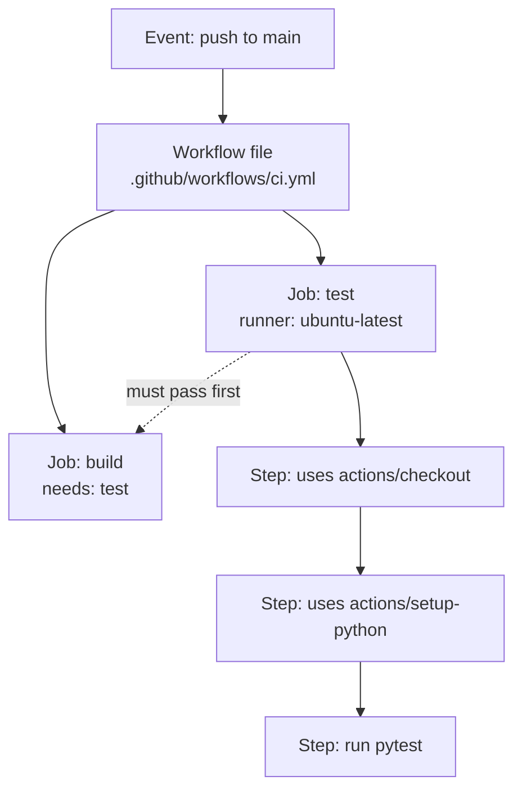
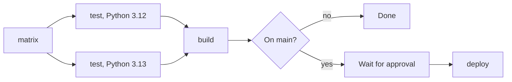

# GitHub Actions

After this you can read and write a GitHub Actions workflow that lints, tests, builds and deploys a project, and name the part (trigger, job, step, runner) that each line belongs to.

Before this: [CI/CD concepts](01-ci-cd-concepts.md) and [data formats: JSON, YAML and CSV](../../06-developer-tools-and-workflow/02-project-plumbing/03-data-formats-json-yaml-csv.md).

## The idea

You want every pull request to run the tests, and every merge to `main` to publish the app. GitHub Actions does this from a YAML file stored in the repository, at `.github/workflows/`. GitHub watches for events (a push, a pull request, a schedule), and when one matches the file's trigger, it starts a fresh virtual machine and runs your commands on it.



## Key terms

A **workflow** is one YAML file describing an automated process. Its **trigger** is the `on:` key: `push`, `pull_request`, `workflow_dispatch` (a manual button) or `schedule` (a cron time).

A **job** is a group of steps that runs on one **runner**, a machine GitHub provides (`ubuntu-latest` is a Linux virtual machine) or that you host yourself. Jobs run in parallel unless one lists another under `needs:`. Each job starts on a clean machine, so nothing carries over between jobs except what you save as an **artifact**.

A **step** is one command (`run:`) or one reusable **action** (`uses:`). An action is a packaged step written by someone else, referenced as `owner/repo@version`. A **matrix** runs the same job once per combination of values, such as Python versions.

`GITHUB_TOKEN` is a temporary credential GitHub creates for each run. Its permissions are set by the `permissions:` key. A **secret** is an encrypted value stored in the repository settings and read as `${{ secrets.NAME }}`. An **environment** is a named deployment target (such as `production`) that can require a human approval and hold its own secrets.

## How it works

Here is a complete workflow for a Python repository. The file is `.github/workflows/ci.yml`. It parses as YAML and passes `actionlint` 1.7.12. The actions are at their latest major versions as of 2026: [checkout v7](https://github.com/actions/checkout/releases), [setup-python v7](https://github.com/actions/setup-python/releases), [upload-artifact v7](https://github.com/actions/upload-artifact/releases), [download-artifact v8](https://github.com/actions/download-artifact/releases).

```yaml
name: CI
on:
  pull_request:
  push:
    branches: [main]
  workflow_dispatch:
permissions:
  contents: read
jobs:
  test:
    runs-on: ubuntu-latest
    strategy:
      matrix:
        python-version: ["3.12", "3.13"]
    steps:
      - uses: actions/checkout@v7
      - uses: actions/setup-python@v7
        with:
          python-version: ${{ matrix.python-version }}
          cache: pip
      - run: pip install -r requirements.txt
      - run: ruff check .
      - run: pytest
  build:
    needs: test
    runs-on: ubuntu-latest
    steps:
      - uses: actions/checkout@v7
      - run: python -m build
      - uses: actions/upload-artifact@v7
        with:
          name: dist
          path: dist/
  deploy:
    needs: build
    if: github.ref == 'refs/heads/main'
    runs-on: ubuntu-latest
    environment: production
    steps:
      - uses: actions/download-artifact@v8
        with:
          name: dist
      - run: ./deploy.sh
        env:
          DEPLOY_TOKEN: ${{ secrets.DEPLOY_TOKEN }}
```

Reading it from the top:

1. The `on:` block runs the workflow for every pull request, every push to `main`, and from the Actions tab by hand.
2. `permissions: contents: read` limits `GITHUB_TOKEN` to reading the repository. Grant more per job only when needed (for example `pages: write`).
3. The `test` job uses a matrix, so GitHub starts two copies in parallel, one per Python version.
4. `uses:` calls an action; `run:` runs a shell command. `cache: pip` saves downloaded packages between runs, which is the cheapest speed-up for most pipelines.
5. `build` waits for `test` through `needs:`, and saves `dist/` with `upload-artifact`. `deploy` fetches that same artifact: build once, deploy many.
6. `environment: production` pauses the job until the approvers configured for that environment click approve. The `if:` skips the deploy on pull requests.



## Worked examples

<div class="example" markdown>

### Example 1: this book's own deploy workflow

This book publishes its site with `.github/workflows/docs.yml` in its repository:

```yaml
name: Documentation
on:
  push:
    branches: [main]
  workflow_dispatch:
permissions:
  contents: read
  pages: write
  id-token: write
concurrency:
  group: pages
  cancel-in-progress: false
jobs:
  deploy:
    environment:
      name: github-pages
      url: ${{ steps.deployment.outputs.page_url }}
    runs-on: ubuntu-latest
    steps:
      - uses: actions/configure-pages@v6
      - uses: actions/checkout@v7
      - uses: actions/setup-python@v6
        with:
          python-version: "3.13"
      - run: pip install -r requirements.txt
      - run: zensical build --clean
      - uses: actions/upload-pages-artifact@v5
        with:
          path: site
      - uses: actions/deploy-pages@v5
        id: deployment
```

1. Trigger: every push to `main`, or the manual button.
2. Permissions: the Pages deploy needs `pages: write` and `id-token: write` (to prove to Pages who is deploying). Everything else is left at read.
3. `concurrency` makes two overlapping deploys queue instead of cancelling one that is half-finished.
4. The steps are install, build (`zensical build --clean` writes the `site` folder), upload the folder as an artifact, deploy that artifact. It is the same pipeline shape as the CI example with one job.
5. `id: deployment` names the last step so the `environment.url` can read `steps.deployment.outputs.page_url`.

Its actions are one major version behind `setup-python` v7 (as of 2026), which is normal: upgrade on purpose, not by accident.

Check: the `github-pages` environment appears in the repository's Deployments panel with a link to the live site.

</div>

## Common mistakes

<div class="warning" markdown>

Watch out: tabs or wrong indentation in YAML. Spaces only, two per level. A misplaced `with:` silently becomes a different key. Run `actionlint` on the file before pushing.

Watch out: pinning an action to a floating tag from an unknown author, such as `someone/tool@main`. Code you did not review then runs with your secrets. Prefer actions from `actions/` or well-known publishers at a major version, and for anything sensitive pin a full commit hash.

Watch out: assuming files persist between jobs. Each job starts on a clean runner, so pass files with artifacts, as `build` and `deploy` do above.

</div>

## Working with AI

<div class="ai" markdown>

Words to use: workflow, job, step, runner, trigger, matrix, `needs`, `GITHUB_TOKEN` permissions, environment, artifact.

Prompts to try:

- "Write a GitHub Actions workflow for a Node 22 project (npm, ESLint, Vitest) that lints and tests on pull requests with caching, and uploads the `dist` folder as an artifact. Use the current major versions of the actions."
- "Review this workflow for security problems: token permissions, secret handling and untrusted pull request input." (paste the file)

What to check:

- Action versions. AI often writes `checkout@v3` or `setup-node@v3`, which are old. Compare against each action's Releases page.
- `permissions:` exists and is minimal. Generated files often omit it, which leaves the default token broader than needed.
- Secrets are referenced as `${{ secrets.X }}`, not typed in. Never echo them.
- Run `actionlint` and read the result before trusting a generated workflow. It catches invented keys and bad expressions.

</div>

## Quiz

1\. What is the difference between `uses:` and `run:`?

<details class="solution" markdown>
<summary>Answer</summary>

`run:` runs a shell command you write. `uses:` calls a packaged, reusable action identified by `owner/repo@version`.

</details>

2\. The workflow has `test` and `build` jobs with no `needs:`. In what order do they run?

<details class="solution" markdown>
<summary>Answer</summary>

In parallel. Add `needs: test` to `build` to make it wait.

</details>

3\. A deploy job fails with "dist: no such file". The `build` job created `dist/`. What is missing?

<details class="solution" markdown>
<summary>Answer</summary>

Each job runs on a clean machine. `build` must upload `dist/` with `upload-artifact`, and `deploy` must fetch it with `download-artifact`.

</details>

4\. A matrix has `python-version: ["3.12", "3.13"]` and `os: [ubuntu-latest, windows-latest]`. How many job runs does it create?

<details class="solution" markdown>
<summary>Answer</summary>

Four, one per combination ($2 \times 2$).

</details>

## Lab

<div class="lab" markdown>

### Lab: write and check a workflow

Goal: write a CI workflow for a small project and check it without pushing. Time: about 15 minutes. Runs in: WSL (Ubuntu) or PowerShell, with Python.

1. Create a folder with `git init`, and a file `.github/workflows/ci.yml` with the workflow from this lesson.
2. Parse it with Python (below) and confirm the job names and `needs:` match the diagram.
3. Install [actionlint](https://github.com/rhysd/actionlint) (a single binary from its releases page) and run `actionlint` in the folder. It should print nothing.
4. Break it on purpose: change `needs: test` to `needs: tests` and run `actionlint` again. Read the error.
5. Cleanup: delete the folder.

Expected result: the parse output below, then an actionlint error naming the unknown job.

```python
import yaml

with open(".github/workflows/ci.yml") as f:
    wf = yaml.safe_load(f)

print(list(wf.keys()))
print(wf[True])  # YAML 1.1 reads the key `on` as the boolean True
for name, job in wf["jobs"].items():
    print(name, "needs:", job.get("needs", "-"), "steps:", len(job["steps"]))
```

```text
['name', True, 'permissions', 'jobs']
{'pull_request': None, 'push': {'branches': ['main']}, 'workflow_dispatch': None}
test needs: - steps: 5
build needs: test steps: 3
deploy needs: build steps: 2
```

<details class="solution" markdown>
<summary>Solution</summary>

The Python above needs `pip install pyyaml`, ideally in a virtual environment. The `True` key is a YAML 1.1 quirk of PyYAML: GitHub reads `on` as a string, so the file is fine. With `needs: tests`, `actionlint` 1.7.12 reports `job "build" needs job "tests" which does not exist in this workflow`.

</details>

</div>

## Where this shows up

- The next step after a green build: [Deployment strategies](03-deployment-strategies.md).
- Keeping tokens out of the pipeline: [secrets and dependency security](../../12-security/01-web-security/06-secrets-and-dependency-security.md).
