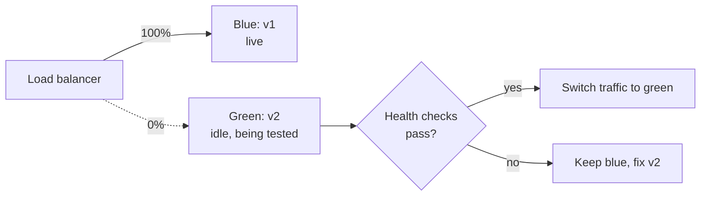
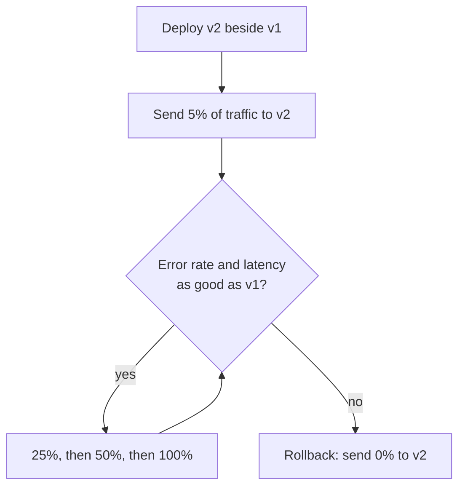

# Deployment strategies

After this you can choose between recreate, rolling, blue-green and canary releases for a change, and say how a database migration and a rollback fit in.

Before this: [GitHub Actions](02-github-actions.md).

## The idea

A deploy replaces version 1 of a service with version 2 while users are using it. The naive way is to stop the old one and start the new one, which means downtime for as long as the start takes. The strategies below trade cost, speed and risk differently. All of them answer the same two questions: how do users avoid seeing an outage, and how fast can we go back if version 2 is bad?



## Key terms

A **load balancer** spreads incoming requests across several copies of a service. Most strategies work by changing where it sends traffic.

**Recreate** stops all old instances, then starts the new ones. It is simple and causes downtime. **Rolling** replaces instances a few at a time, so old and new versions run together briefly. **Blue-green** runs two full environments: blue is live, green gets the new version, and traffic switches in one step. **Canary** sends a small share of real traffic (say 5%) to the new version first and widens it while the numbers look healthy.

A **feature flag** is a runtime setting that turns code on or off without a deploy. A **health check** is a request the platform sends to an instance (often `GET /health`) to decide whether it may receive traffic. A **rollback** returns to the previous version.

## How it works

The table compares the four.

| Strategy | Downtime | Extra capacity needed | Rollback speed | Main risk |
|---|---|---|---|---|
| Recreate | Yes | None | Slow (redeploy old) | Outage during the deploy |
| Rolling | No | A little | Medium (roll back the same way) | Two versions serve traffic at once |
| Blue-green | No | A full second copy | Fast (switch back) | Cost, and shared database state |
| Canary | No | A little | Fast (send 0% to the canary) | Needs good metrics to judge |

In a canary release, the percentage moves up only while the checks pass.



Two things sit beside the traffic strategy.

First, **database migrations**. During a rolling or canary deploy, v1 and v2 both talk to the same database, and rolling back means v1 must still work after the schema changed. So changes are made backward compatible, in steps: add the new column (nullable) while v1 still runs, deploy v2 which writes both, backfill old rows, and only later drop the old column in a separate release. Renaming a column in one step breaks whichever version does not know the new name. See [ORMs and migrations](../../10-databases-sql-and-postgres/05-databases-in-apps/02-orms-and-migrations.md).

Second, **feature flags** split deploying from releasing. The code ships switched off, and the flag turns it on for 1%, then 50%, then everyone, without another deploy. The same flag turns it off in seconds if something breaks. The rollout must be sticky: the same user must see the same answer each time, so it is based on a hash of the user id.

```python
import hashlib

def in_rollout(user_id: str, percent: int) -> bool:
    h = int(hashlib.sha256(user_id.encode()).hexdigest(), 16)
    return h % 100 < percent

users = [f"user{i}" for i in range(1000)]
for pct in (0, 5, 50, 100):
    n = sum(in_rollout(u, pct) for u in users)
    print(pct, n)
print(in_rollout("user7", 5) == in_rollout("user7", 5))
print(all(in_rollout(u, 50) for u in users if in_rollout(u, 5)))
```

```text
0 0
5 42
50 498
100 1000
True
True
```

Each percentage selects about that share of users (42 of 1000 for 5% is normal variation). The last line shows that everyone in the 5% group is still in the 50% group, so widening a rollout never switches anyone back off.

## Worked examples

<div class="example" markdown>

### Example 1: a safe release with a bad build

A team ships a new checkout with a canary and a flag.

1. The pipeline deploys v2 next to v1. Health checks (`GET /health` returns 200) pass, so v2 may receive traffic.
2. The load balancer sends 5% of requests to v2. The dashboard shows v2's error rate at 4% against v1's 0.3%.
3. The rule "abort if the canary error rate is more than twice the baseline" fires. The load balancer goes back to 0% for v2. About 5% of users saw errors for a few minutes, not all of them.
4. The team finds a bug in the payment code, fixes it, and runs the pipeline again.

Check: during step 2, the question to ask is "compared with what?" A canary judged against a fixed number rather than against the old version at the same time misses problems that affect both.

</div>

## Common mistakes

<div class="warning" markdown>

Watch out: a rollback plan that ignores the data. Rolling code back is easy. If v2 wrote rows v1 cannot read, or dropped a column, the rollback fails. Make schema changes backward compatible and test the rollback, not only the deploy.

Watch out: a health check that only returns 200. If `/health` never touches the database, a broken instance still takes traffic. Check what the service needs to do its job, but not so deeply that one slow dependency takes every instance out at once.

Watch out: leaving flags in forever. Old flags multiply the code paths you must test. Remove a flag once the rollout is complete.

</div>

## Working with AI

<div class="ai" markdown>

Words to use: rolling update, blue-green, canary, feature flag, health check, readiness, backward compatible migration, rollback.

Prompts to try:

- "We run three instances behind a load balancer and use PostgreSQL. Plan a deploy that renames the `users.fullname` column to `users.name` with no downtime, as separate release steps."
- "Compare blue-green and canary for a service with a 2 GB in-memory cache that takes 5 minutes to warm. State the trade-offs."

What to check:

- Does the migration plan work when old and new code run at the same time? A one-step rename or `NOT NULL` column without a default should be rejected.
- A rollback step exists and says what happens to data written by the new version.
- The canary's abort condition is a measurable number, not "if it looks bad".
- Generated Kubernetes or cloud config uses real field names. Check them against the platform's documentation.

</div>

## Quiz

1\. Which strategy needs a full second copy of production, and what does it give in return?

<details class="solution" markdown>
<summary>Answer</summary>

Blue-green. In return you switch traffic in one step and can switch back just as fast.

</details>

2\. What does `in_rollout("user7", 5)` return on the second call, and why does that matter?

<details class="solution" markdown>
<summary>Answer</summary>

The same value as the first call, because it depends only on the hash of the user id. A user then does not flicker between old and new behaviour.

</details>

3\. You rename a column in the same release that changes the code to use the new name, with a rolling deploy. What goes wrong?

<details class="solution" markdown>
<summary>Answer</summary>

While the rollout is partway, old instances still query the old name and new instances the new name, so one group fails. Add the new column first, write both, backfill, switch reads, then drop the old column later.

</details>

4\. After a bad deploy, the canary strategy sent 10% of traffic to v2 for five minutes. How do you roll back?

<details class="solution" markdown>
<summary>Answer</summary>

Set v2's traffic share to 0%, which takes effect immediately, and keep v1 running as it was. No redeploy is needed.

</details>

## Lab

<div class="lab" markdown>

### Lab: a sticky rollout

Goal: build a percentage rollout and check that it behaves. Time: about 10 minutes. Runs in: any terminal with Python.

1. Save the `in_rollout` function from this lesson in `flag.py`.
2. Add a loop that counts how many of 10,000 users are in a 10% rollout.
3. Check that the count is near 1000 but not exactly 1000.
4. Check that a user in the 10% group is also in the 30% group.
5. Cleanup: delete `flag.py`.

Expected result: a count near 1000, and `True` for the subset check.

<details class="solution" markdown>
<summary>Solution</summary>

```python
users = [f"user{i}" for i in range(10000)]
ten = {u for u in users if in_rollout(u, 10)}
thirty = {u for u in users if in_rollout(u, 30)}
print(len(ten), ten <= thirty)
```

The count varies with the hash function, but it stays within a few percent of 1000, and `ten <= thirty` is `True` because $h \bmod 100 < 10$ implies $h \bmod 100 < 30$.

</details>

</div>

## Where this shows up

- Kubernetes rolling updates and readiness probes: Registries and Kubernetes basics<!-- link: ../01-containers/04-registries-and-kubernetes-basics.md -->.
- Describing the servers and load balancers as code: [Infrastructure as code](04-infrastructure-as-code.md).
