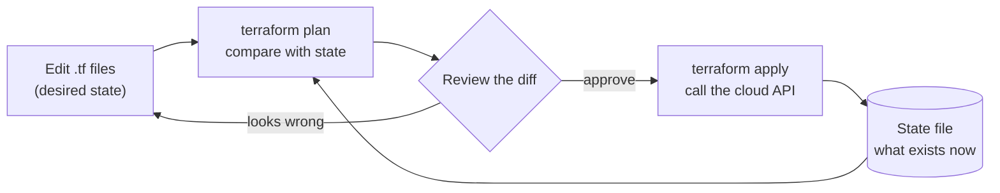

# Infrastructure as code

After this you can explain what infrastructure as code (IaC) is, read a small Terraform file and the plan it produces, and say what drift is.

Before this: [Deployment strategies](03-deployment-strategies.md). This lesson is optional: you can skip it until a job or project needs it.

## The idea

You create an S3 bucket by clicking through the AWS console. Six months later nobody remembers which settings you chose, staging was set up slightly differently, and recreating the whole thing after a mistake means clicking again from memory.

Infrastructure as code writes the same setup down in text files, stored in Git and reviewed in pull requests, and a tool makes the real world match the files. The loop is the same one used for application code: change the file, preview the effect, apply it.



## Key terms

**Infrastructure as code** is managing servers, networks, buckets and other cloud resources through configuration files instead of manual steps.

A **declarative** tool takes a description of the end result ("one bucket with versioning on") and works out the steps. An **imperative** tool takes the steps ("create bucket, then enable versioning"). Terraform is declarative, which is why running it twice is safe: the second run finds nothing to change. A script of AWS CLI commands is imperative and run twice may fail or create duplicates.

**Terraform** is a tool from HashiCorp that reads `.tf` files written in its own configuration language, HCL. A **provider** is a plugin that knows one platform's API, such as `hashicorp/aws`. A **resource** is one thing to manage. The **state** is Terraform's record, in a file named `terraform.tfstate`, of which real resources match which entries in your files.

**Drift** is the gap that opens when the real infrastructure no longer matches the files, usually because someone changed it by hand in the console.

## How it works

Three commands do the work (Terraform is not installed in this book's lab environment, so the commands below are unverified here; they follow the [Terraform CLI documentation](https://developer.hashicorp.com/terraform/cli/commands)).

1. `terraform init` downloads the providers the files ask for.
2. `terraform plan` compares your files, the state and the real resources, and prints what would be created, changed or destroyed. Nothing changes yet.
3. `terraform apply` shows the plan again, asks for `yes`, then makes the calls.

The tool's core idea can be written in a few lines of Python. A plan is the difference between the desired set of resources and the actual one.

```python
desired = {"logs-bucket": {"versioning": True}, "site-bucket": {"versioning": False}}
actual = {"logs-bucket": {"versioning": False}, "old-bucket": {"versioning": False}}

def plan(desired, actual):
    steps = []
    for name in desired:
        if name not in actual:
            steps.append(("create", name))
        elif desired[name] != actual[name]:
            steps.append(("update", name))
    for name in actual:
        if name not in desired:
            steps.append(("destroy", name))
    return steps

for step in plan(desired, actual):
    print(*step)
print(plan(desired, desired))
```

```text
update logs-bucket
create site-bucket
destroy old-bucket
[]
```

The last line shows why declarative tools are safe to rerun: when the world already matches, the plan is empty. The most important habit follows from the first lines: read every `destroy` before approving.

Here is a small real configuration, following the examples in the Terraform registry for the [AWS provider](https://registry.terraform.io/providers/hashicorp/aws/latest/docs), [`aws_s3_bucket`](https://registry.terraform.io/providers/hashicorp/aws/latest/docs/resources/s3_bucket) and [`aws_s3_bucket_versioning`](https://registry.terraform.io/providers/hashicorp/aws/latest/docs/resources/s3_bucket_versioning). The provider version `~> 6.0` is the one its documentation shows as of 2026. This file has not been run here.

```terraform
terraform {
  required_providers {
    aws = {
      source  = "hashicorp/aws"
      version = "~> 6.0"
    }
  }
}

provider "aws" {
  region = "ca-central-1"
}

resource "aws_s3_bucket" "logs" {
  bucket = "my-team-logs-example-12345"

  tags = {
    Environment = "Dev"
  }
}

resource "aws_s3_bucket_versioning" "logs" {
  bucket = aws_s3_bucket.logs.id
  versioning_configuration {
    status = "Enabled"
  }
}
```

The reference `aws_s3_bucket.logs.id` tells Terraform that the versioning resource depends on the bucket, so it creates the bucket first. Bucket names are unique across all AWS accounts, so the name must be changed to your own.

Other tools fill the same role. AWS CloudFormation is AWS's own declarative format (JSON or YAML). The AWS CDK and Pulumi let you write the description in a general language such as TypeScript or Python, which then produces the same kind of resource plan. The ideas in this lesson (desired state, plan, apply, state, drift) carry over.

## Worked examples

<div class="example" markdown>

### Example 1: reading a plan

You change `status = "Enabled"` to `"Suspended"` and run `terraform plan`. The output has this shape (abridged):

```text
  # aws_s3_bucket_versioning.logs will be updated in-place
  ~ resource "aws_s3_bucket_versioning" "logs" {
      ~ versioning_configuration {
          ~ status = "Enabled" -> "Suspended"
        }
    }

Plan: 0 to add, 1 to change, 0 to destroy.
```

1. The `~` marks an in-place change. `+` means create and `-` means destroy.
2. The last line is the summary to read first. "0 to destroy" means no resource is deleted.
3. Had it said "1 to destroy", the next question is why: a change to some settings forces Terraform to replace the resource, which deletes and recreates it.

Check: the plan should list only what you changed. Extra lines mean drift or an unintended edit.

</div>

## Common mistakes

<div class="warning" markdown>

Watch out: committing `terraform.tfstate` to Git. The state can contain secrets and passwords in plain text. Keep it in a remote backend with locking (an S3 bucket plus a lock, or Terraform's cloud service) and add `*.tfstate` to `.gitignore`.

Watch out: fixing a problem in the console "just this once". The next `apply` reverts it, or hides it as drift. Change the files instead.

Watch out: running `apply` without reading `plan`. A rename can look like "destroy the old, create the new", which deletes a database.

</div>

## Working with AI

<div class="ai" markdown>

Words to use: declarative, provider, resource, state, plan, apply, drift, remote backend.

Prompts to try:

- "Write Terraform for an S3 bucket with versioning and default encryption, for provider `hashicorp/aws` version 6. Use separate resources as that provider version expects."
- "Here is a `terraform plan` output (pasted). List every resource it will destroy or replace, and why replacement is needed."

What to check:

- Arguments exist in the provider version you use. Older tutorials put `versioning` inside `aws_s3_bucket`, which newer provider versions replaced with a separate resource. Check the registry page.
- No credentials, access keys or passwords in the `.tf` files.
- The plan has no unexpected `destroy` or `replace` lines.
- Cost: a plan that adds NAT gateways, databases or large instances. Estimate before applying.

</div>

## Quiz

1\. What is the difference between declarative and imperative infrastructure tools?

<details class="solution" markdown>
<summary>Answer</summary>

A declarative tool is given the end result and works out the steps. An imperative tool is given the steps. Declarative runs are safe to repeat.

</details>

2\. What does `terraform plan` change in your AWS account?

<details class="solution" markdown>
<summary>Answer</summary>

Nothing. It only compares and prints. `terraform apply` makes the changes.

</details>

3\. Someone turned versioning off in the console. What is this called, and what will the next `plan` show?

<details class="solution" markdown>
<summary>Answer</summary>

Drift. The plan will show a change to set versioning back to `Enabled`, as the files are the desired state.

</details>

4\. Why should `terraform.tfstate` stay out of Git?

<details class="solution" markdown>
<summary>Answer</summary>

It can hold secret values in plain text, and several people editing a Git copy can overwrite each other. Use a remote backend with locking.

</details>

## Lab

<div class="lab" markdown>

### Lab: write a plan function

Goal: extend the toy planner to detect an update. Time: about 10 minutes. Runs in: any terminal with Python. No cloud account needed.

1. Copy the `plan` example from this lesson into `plan.py`.
2. Change `desired` so `old-bucket` is kept with `{"versioning": False}`.
3. Predict the new output, then run it.
4. Make the desired state equal the actual state and confirm the plan is empty.
5. Cleanup: delete `plan.py`.

Expected result:

```text
update logs-bucket
create site-bucket
```

<details class="solution" markdown>
<summary>Solution</summary>

Add `"old-bucket": {"versioning": False}` to `desired`. `old-bucket` now exists in both and matches, so it no longer appears as a destroy. With `desired = actual`, the plan is `[]`.

</details>

</div>

## Where this shows up

- Creating the cloud resources a deploy runs on: [Cloud models and regions](../03-aws/01-cloud-models-and-regions.md).
- Running the plan in a pipeline for review, using [GitHub Actions](02-github-actions.md).
