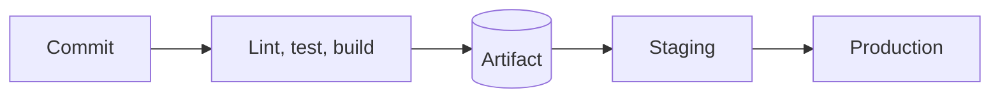

# CI/CD

A compact reference for the chapter. The teaching is in the lessons: [CI/CD concepts](01-ci-cd-concepts.md), [GitHub Actions](02-github-actions.md), [Deployment strategies](03-deployment-strategies.md) and [Infrastructure as code](04-infrastructure-as-code.md) (optional).

## Key terms

| Term | Meaning |
|---|---|
| Continuous integration | Merge small changes often, and build and test every one automatically |
| Continuous delivery | Every passing commit can be released, a person presses the button |
| Continuous deployment | Every passing commit goes to production with no button |
| Artifact | The build output that is deployed, built once and promoted through environments |
| Environment | A separate copy of the system: dev, staging, production |
| Trunk-based development | Short-lived branches merged to one main branch |
| Feature flag | A runtime switch that turns code on for some or all users |
| Health check | A request that decides whether an instance may receive traffic |
| Declarative | Describe the end state, the tool finds the steps |
| Drift | Real infrastructure no longer matches the files |

## The pipeline



Rules: fast checks first, build once and deploy the same artifact, secrets from the secret store, small changes.

## Workflow skeleton (GitHub Actions)

```yaml
name: CI
on:
  pull_request:
  push:
    branches: [main]
  workflow_dispatch:
permissions:
  contents: read
jobs:
  test:
    runs-on: ubuntu-latest
    strategy:
      matrix:
        python-version: ["3.12", "3.13"]
    steps:
      - uses: actions/checkout@v7
      - uses: actions/setup-python@v7
        with:
          python-version: ${{ matrix.python-version }}
          cache: pip
      - run: pip install -r requirements.txt
      - run: pytest
  deploy:
    needs: test
    if: github.ref == 'refs/heads/main'
    runs-on: ubuntu-latest
    environment: production
    steps:
      - run: ./deploy.sh
        env:
          DEPLOY_TOKEN: ${{ secrets.DEPLOY_TOKEN }}
```

| Key | Meaning |
|---|---|
| `on:` | Triggers: `push`, `pull_request`, `workflow_dispatch`, `schedule` |
| `jobs.<id>.runs-on` | The runner machine |
| `needs:` | Wait for another job (jobs run in parallel otherwise) |
| `uses:` / `run:` | Call an action / run a shell command |
| `strategy.matrix` | One job per combination of values |
| `permissions:` | What `GITHUB_TOKEN` may do, keep minimal |
| `environment:` | Named target with optional approvals and secrets |
| `${{ secrets.NAME }}` | A stored secret |

Check a file before pushing with `actionlint`. Action major versions as of 2026: checkout v7, setup-python v7, upload-artifact v7, download-artifact v8.

## Deployment strategies

| Strategy | Downtime | Extra capacity | Rollback | Main risk |
|---|---|---|---|---|
| Recreate | Yes | None | Redeploy old | Outage during deploy |
| Rolling | No | A little | Roll back the same way | Two versions at once |
| Blue-green | No | Full second copy | Switch back | Cost, shared database |
| Canary | No | A little | Send 0% to the canary | Needs good metrics |

Database changes during a deploy: add the new column, write both, backfill, switch reads, drop the old column in a later release.

## Terraform

```bash
terraform init     # download providers
terraform plan     # show what would change, changes nothing
terraform apply    # make the changes after confirmation
```

Read every destroy line in a plan. Keep state in a remote backend, never in Git.
