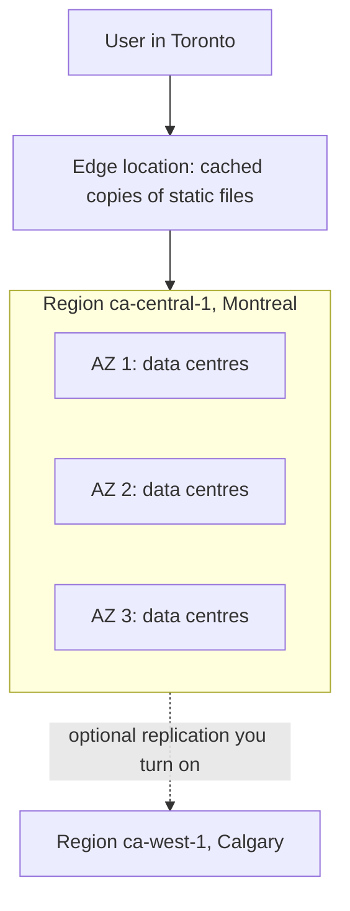

# Cloud models and regions

After this you can say which part of a system you run and which part the provider runs (IaaS, PaaS, FaaS, SaaS), and choose an AWS Region with reasons.

Before this: [VMs vs containers](../01-containers/01-vms-vs-containers.md) and [IP addresses, subnets and NAT](../../07-networking/01-how-the-internet-works/02-ip-addresses-subnets-and-nat.md).

## The idea

Your side project works on your laptop. To put it on the internet you need a computer that is always on, has a public address, and sits close to your users. You could buy a server and rent rack space, or you could rent the same capacity by the hour from a provider that has already built thousands of them. Renting is **cloud computing**: you ask for resources through an API, get them in minutes, and pay for what you use.

The first question is how much of the work you hand over. Renting a bare virtual machine leaves you patching the operating system. Renting a platform leaves you only the code. The second question is where the machines are, because distance costs latency and some data has to stay in a country.

```mermaid
flowchart LR
    subgraph IaaS["IaaS, for example EC2"]
        direction TB
        I1["You: app, data, runtime, OS, patches"]
        I2["Provider: hypervisor, hardware, data centre"]
    end
    subgraph PaaS["PaaS, for example Elastic Beanstalk"]
        direction TB
        P1["You: app and data"]
        P2["Provider: runtime, OS, servers"]
    end
    subgraph FaaS["FaaS, for example Lambda"]
        direction TB
        F1["You: function code and data"]
        F2["Provider: everything else, scaling included"]
    end
    subgraph SaaS["SaaS, for example Microsoft 365"]
        direction TB
        S1["You: your content and settings"]
        S2["Provider: the whole application"]
    end
    IaaS --> PaaS --> FaaS --> SaaS
```



Reading left to right in the diagram, you manage less and the provider manages more. You also control less: a Lambda function cannot have its operating system tuned.

## Key terms

**Infrastructure as a service (IaaS)** gives you virtual machines, disks and networks. **Platform as a service (PaaS)** gives you a place to run code, with the operating system and runtime handled. **Function as a service (FaaS)**, also called serverless compute, runs a single function per event and bills per run. **Software as a service (SaaS)** is a finished application used through a browser. The boundaries are blurry, and AWS sells services that sit between two of these.

The **shared responsibility model** splits security in two. AWS describes its half as ["security of the cloud"](https://aws.amazon.com/compliance/shared-responsibility-model/): the hardware, software, networking and facilities that run its services. Yours is "security in the cloud", and its size depends on the service. With EC2 you manage the guest operating system, your applications and the security group firewall. With S3 you manage your data, encryption choices and IAM permissions.

A **Region** is a physical location where AWS clusters data centres. An **Availability Zone (AZ)** is one or more discrete data centres with redundant power, networking and connectivity inside a Region ([AWS global infrastructure](https://aws.amazon.com/about-aws/global-infrastructure/regions_az/)). An **edge location** is a smaller site that caches content close to users, used by services such as CloudFront.

## How it works



Each AZ in the diagram has its own power and network, so a fire or outage in one leaves the other two running. The docs say AZs are separated by many kilometres and all sit within 100 km of each other, which keeps traffic between them fast ([S3 data protection](https://docs.aws.amazon.com/AmazonS3/latest/userguide/DataDurability.html)). To survive a failed AZ you run copies of your service in at least two. A resource you create belongs to one Region, and moving between Regions is something you set up deliberately.

As of 2026, both Canadian Regions have 3 AZs: `ca-central-1` (Canada Central, Montreal) is enabled by default, and `ca-west-1` (Calgary) must be enabled in your account first ([AWS Regions](https://docs.aws.amazon.com/global-infrastructure/latest/regions/aws-regions.html)). The names `ca-central-1a`, `ca-central-1b` and so on are labels your account sees; the mapping of those letters to physical zones differs per account, and the AZ ID is the stable name (unverified, see the AZ documentation).

Choosing a Region comes down to four checks, in this order.

1. Data residency. If a contract, a customer or a public-sector rule says data stays in Canada, you are limited to the two Canadian Regions. PIPEDA, covered in [privacy and PIPEDA](../../12-security/02-cryptography/06-privacy-and-pipeda.md), asks you to stay accountable for personal data wherever it goes; ask the person who owns the legal question before assuming a US Region is allowed.
2. Latency. Distance sets a floor on round-trip time. Measure instead of guessing, as in the lab.
3. Service availability. Not every service or newer feature exists in every Region, so check [AWS Services by Region](https://aws.amazon.com/about-aws/global-infrastructure/regional-product-services/).
4. Price. Prices differ by Region. Read the pricing page for your Region and never assume `us-east-1` prices apply to Montreal.

## Worked examples

<div class="example" markdown>

### Example 1: classify what you run

A team has three needs: a Postgres database they tune themselves on a VM, a nightly image-resize job triggered by uploads, and email through a hosted service.

1. The tuned database on a VM is IaaS. They patch the OS and manage backups.
2. The upload-triggered job is FaaS, because the unit of work is one function call per event.
3. Hosted email is SaaS. They manage the account and the content.

Check: for each, ask "who patches the operating system?" For the VM the answer is the team. For the other two it is the provider.

</div>

## Common mistakes

<div class="warning" markdown>

Watch out: picking a Region by habit. Tutorials default to `us-east-1`, and resources created there are invisible when the console is set to Montreal. Always check the Region selector, or set it in the CLI profile.

Watch out: reading "managed" as "secured for me". Under shared responsibility the provider secures the platform, but a public S3 bucket or an open SSH port is your configuration.

</div>

## Working with AI

<div class="ai" markdown>

Words to use: IaaS, PaaS, FaaS, shared responsibility model, Region, Availability Zone, data residency, latency.

Prompts to try:

- "I run a small Express API with a Postgres database for Ontario customers whose contract requires Canadian data residency. Which AWS Regions qualify, and what changes if I need the app to survive the loss of one Availability Zone?"
- "Classify these three components as IaaS, PaaS, FaaS or SaaS and say who patches the operating system in each: (list)."

What to check:

- Region names and codes against the [AWS Regions page](https://docs.aws.amazon.com/global-infrastructure/latest/regions/aws-regions.html); AI answers often list outdated or invented Regions.
- Claims that a service "is available everywhere". Look it up in AWS Services by Region.
- Any price quoted from memory. Open the pricing page for your Region.

</div>

## Quiz

1\. What does the shared responsibility model say you are responsible for when you run an EC2 instance?

<details class="solution" markdown>
<summary>Answer</summary>

The guest operating system and its patches, the applications, the data, and the security group configuration. AWS is responsible for the hardware, the hypervisor and the facilities.

</details>

2\. A Region has three AZs. One AZ loses power. Does a service running in all three AZs stay up, and why?

<details class="solution" markdown>
<summary>Answer</summary>

It can stay up on the other two, because AZs have independent power and networking. It only works if the service runs enough capacity in the remaining AZs, which is a design choice, not automatic.

</details>

3\. You launch an instance, then cannot find it in the console. Your CLI says `ca-central-1` and the console shows N. Virginia. What happened?

<details class="solution" markdown>
<summary>Answer</summary>

Resources are Region-scoped, and the console shows one Region at a time. Switch the console to Montreal, or use the CLI with the same Region.

</details>

4\. A client says personal data must stay in Canada. Name two Regions you can use and one thing you still need to check.

<details class="solution" markdown>
<summary>Answer</summary>

`ca-central-1` and `ca-west-1`. You still need to check that every service you use exists in that Region, and that features such as backups or logging do not copy data to another Region.

</details>

## Lab

<div class="lab" markdown>

### Lab: measure the distance to five Regions

Goal: measure round-trip time from your machine to five Regions and use the numbers to choose one. Time: about 10 minutes. Runs in: any terminal with Python 3. This lab needs no AWS account and creates nothing.

1. Save the script below as `region_latency.py`. It requests the public DynamoDB endpoint of each Region five times (an error status still counts, because the server answered) and prints the fastest time. Each request includes opening a new TLS connection, so the numbers are a rough comparison, not a precise ping.

   ```python
   import time
   import urllib.error
   import urllib.request

   REGIONS = ["ca-central-1", "ca-west-1", "us-east-1", "eu-west-1", "ap-southeast-2"]

   def one_request(url):
       start = time.perf_counter()
       try:
           urllib.request.urlopen(url, timeout=10).read()
       except urllib.error.HTTPError:
           pass  # an error status still means the server answered
       return (time.perf_counter() - start) * 1000

   for region in REGIONS:
       url = f"https://dynamodb.{region}.amazonaws.com/"
       times = [one_request(url) for _ in range(5)]
       print(f"{region:15} best {min(times):4.0f} ms")
   ```

2. Run it with `python region_latency.py` (on Windows, `py region_latency.py`). Output from one run in Ontario:

   ```text
   ca-central-1    best   44 ms
   ca-west-1       best  148 ms
   us-east-1       best   74 ms
   eu-west-1       best  288 ms
   ap-southeast-2  best  588 ms
   ```

3. Write down which Region is fastest for you, which two Canadian Regions you could pick for residency, and the extra milliseconds you would pay for Calgary.
4. Cleanup: nothing to delete. No account, resources or charges are involved.

Expected result: Montreal is fastest or close to it from Ontario, and distance grows the gap for Europe and Australia. Your numbers will differ.

<details class="solution" markdown>
<summary>Solution</summary>

From Ontario, `ca-central-1` is the sensible lab and project Region: Canadian, three AZs, enabled by default, and the lowest latency. `ca-west-1` also satisfies residency but needs opt-in and added about 100 ms in the sample run. The rest of this chapter uses `ca-central-1`.

</details>

</div>

## Where this shows up

- Opening an account and locking it down in [AWS account, IAM and billing](02-aws-account-iam-and-billing.md).
- Regions and AZs return when you place databases and subnets in [VPCs and security groups](06-vpcs-and-security-groups.md).
- Edge locations are the CDN idea from [proxies and CDNs](../../07-networking/02-web-protocols/05-proxies-and-cdns.md).
