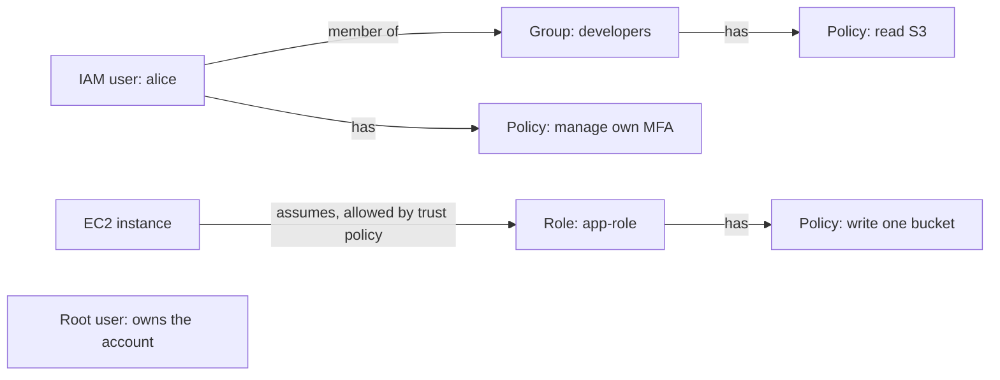
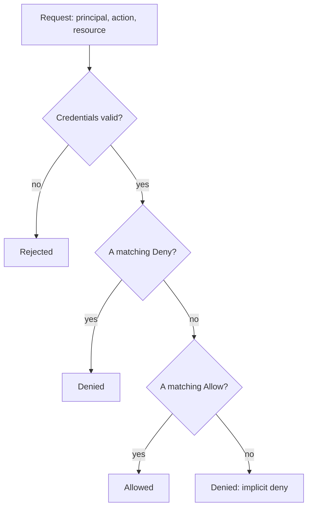

# AWS account, IAM and billing

After this you can open an AWS account safely, read and write a basic IAM policy, and set up the billing alert that protects you in every later lab.

Before this: [Cloud models and regions](01-cloud-models-and-regions.md) and [secrets and dependency security](../../12-security/01-web-security/06-secrets-and-dependency-security.md).

## The idea

Two things go wrong on a new AWS account. Someone gets hold of a credential and uses your account to mine cryptocurrency, or you forget a running resource and the bill arrives a month later. Both are preventable on day one, and both are why this lesson comes before any resource is created.

Everything in AWS is an API call, and every call is checked: who is asking, what do they want to do, and to which resource? **IAM** (Identity and Access Management) is the service that answers. It is global, not tied to a Region, and the permissions it holds decide what every other lesson in this chapter can do.



In the diagram, people get a user (usually through a group), and software gets a role. The root user stands apart because it is not limited by policies.

## Key terms

The **root user** is the identity created with the account, signed in with the email address. It can do everything, including closing the account. An **IAM user** is an identity you create inside the account, with its own password and optional access keys. A **group** is a set of users that share policies. A **role** is an identity with no password or keys of its own: a person, service or application **assumes** it and receives temporary credentials. A **policy** is a JSON document that allows or denies actions on resources. **MFA** (multi-factor authentication) adds a second proof, such as a passkey or an authenticator app code.

**Least privilege** means granting only the permissions a task needs. A **tag** is a key-value label such as `Project=lab` that you attach to a resource. **AWS Budgets** sends alerts when cost or usage crosses a threshold you set. **Cost Explorer** is the chart view of your spending by service, Region and tag.

## How it works

A policy lists statements. Each statement has an `Effect` (`Allow` or `Deny`), the `Action` values it covers, and the `Resource` ARNs it applies to. An ARN (Amazon Resource Name) is the unique name of one resource. This policy lets a principal list one bucket and read its objects, and nothing else ([IAM policy reference](https://docs.aws.amazon.com/IAM/latest/UserGuide/reference_policies_elements.html)):

```json
{
  "Version": "2012-10-17",
  "Statement": [
    {
      "Effect": "Allow",
      "Action": "s3:ListBucket",
      "Resource": "arn:aws:s3:::my-lab-bucket"
    },
    {
      "Effect": "Allow",
      "Action": "s3:GetObject",
      "Resource": "arn:aws:s3:::my-lab-bucket/*"
    }
  ]
}
```

The bucket and its objects have separate ARNs (`my-lab-bucket` and `my-lab-bucket/*`), so listing and reading need separate statements. The date in `Version` is the policy language version, not today's date.

Every request is evaluated as in this diagram. The default is deny, an explicit `Deny` beats any `Allow`, and one matching `Allow` is needed ([policy evaluation logic](https://docs.aws.amazon.com/IAM/latest/UserGuide/reference_policies_evaluation-logic.html)). Real accounts add more layers, such as organization policies and permission boundaries, which this lesson skips.



A role is paired with a second JSON document, the **trust policy**, which says who may assume it. This one lets EC2 assume the role, so a program on an instance gets temporary credentials from the instance itself and no key is stored on disk:

```json
{
  "Version": "2012-10-17",
  "Statement": [
    {
      "Effect": "Allow",
      "Principal": { "Service": "ec2.amazonaws.com" },
      "Action": "sts:AssumeRole"
    }
  ]
}
```

Access keys (an access key ID plus a secret) are long-term credentials. Anyone who holds them is you, from anywhere, until the key is deactivated. Bots scan public repositories for them within minutes, so never commit them (see [secrets and dependency security](../../12-security/01-web-security/06-secrets-and-dependency-security.md)). Prefer temporary credentials from roles, `aws login` or IAM Identity Center.

Free-tier rules changed in 2025. As of 2026, a new account chooses a Free plan or a Paid plan. Both give USD 100 in credits at sign-up and up to USD 100 more for completing activities. The Free plan ends after six months or when the credits are used, whichever comes first, then the account closes, and AWS keeps your content for 90 days so you can upgrade to the Paid plan to keep it. On the Free plan you cannot be charged, but some services are not available ([choosing a plan](https://docs.aws.amazon.com/awsaccountbilling/latest/aboutv2/free-tier-plans.html), [AWS Free Tier](https://aws.amazon.com/free/)). Joining AWS Organizations upgrades a Free plan account to Paid automatically, so this chapter does not use it. Re-read those pages before you sign up, because AWS changes them.

Budgets are an alert, not a cap. AWS Budgets data updates up to three times a day, and the docs warn that charges can pass your threshold before the notification arrives ([AWS Budgets](https://docs.aws.amazon.com/cost-management/latest/userguide/budgets-managing-costs.html)). So the real protection is the Cleanup step in every lab.

## Worked examples

<div class="example" markdown>

### Example 1: read a policy

A developer runs `aws s3 cp s3://my-lab-bucket/notes.txt .` with only the first policy above.

1. The action is `s3:GetObject` on `arn:aws:s3:::my-lab-bucket/notes.txt`.
2. No `Deny` matches.
3. The second statement allows `s3:GetObject` on `my-lab-bucket/*`, and the object ARN matches the pattern. Result: allowed.
4. Running `aws s3 ls s3://my-lab-bucket` needs `s3:ListBucket`, which the first statement allows. Running `aws s3 ls` with no bucket needs `s3:ListAllMyBuckets`, which neither statement grants. Result: denied by default.

Check: the lab ends with `aws sts get-caller-identity`, which shows which identity every command uses. Policy mistakes usually come from running as a different identity than you assumed.

</div>

## Common mistakes

<div class="warning" markdown>

Watch out: working as the root user. It has no permission limits, so a leaked session or a typo has no safety net. Use it once to set up, then lock it away with MFA.

Watch out: a policy with `"Action": "*"` and `"Resource": "*"` because "it works". It grants full control, and AI assistants suggest it often. Start with the specific actions the error message names.

Watch out: trusting the budget alert as a limit. It lags by hours. Delete what you create, every time.

</div>

## Working with AI

<div class="ai" markdown>

Words to use: root user, IAM user, role, trust policy, least privilege, ARN, explicit deny, MFA.

Prompts to try:

- "Write an IAM policy that lets a role read and write objects under the prefix `uploads/` in one S3 bucket, and nothing else. Explain each statement and the ARN patterns."
- "My command fails with: (paste the full AccessDenied message). Which action and resource were denied, and what is the smallest policy change that fixes it?"

What to check:

- Wildcards: reject `"Action": "*"` or `"Resource": "*"` unless you can say why.
- ARN shape: bucket-level actions need the bucket ARN, object-level actions need `bucket/*`.
- Action names against the [Service Authorization Reference](https://docs.aws.amazon.com/service-authorization/latest/reference/reference.html). Models invent actions that look right.
- Whether the answer puts access keys in code or a Dockerfile. Ask for a role instead.

</div>

## Quiz

1\. Why shouldn't you use the root user for daily work?

<details class="solution" markdown>
<summary>Answer</summary>

Root is not limited by IAM policies, so any mistake or stolen session has full power, including closing the account. Use root for the few tasks that require it and sign in as an IAM user otherwise.

</details>

2\. A policy allows `s3:GetObject` on `arn:aws:s3:::data/*`. Another policy attached to the same user denies `s3:GetObject` on `arn:aws:s3:::data/secret.txt`. Can the user read `data/secret.txt`?

<details class="solution" markdown>
<summary>Answer</summary>

No. An explicit `Deny` always overrides an `Allow`.

</details>

3\. Your app runs on EC2 and needs to write to S3. A teammate suggests pasting an access key into the app's config file. What is the better design?

<details class="solution" markdown>
<summary>Answer</summary>

Attach an IAM role (through an instance profile) to the instance. The SDK gets temporary credentials from the instance, so no secret sits on disk or in git.

</details>

4\. You set a USD 5 budget and an experiment costs USD 12 overnight. Why did you not get an alert in time?

<details class="solution" markdown>
<summary>Answer</summary>

Budgets data updates up to three times a day and charges can pass the threshold before the notification arrives. A budget is an alert, not a spending cap.

</details>

## Lab

<div class="lab" markdown>

### Lab: open a locked-down account and sign in from the CLI

Goal: create an AWS account with MFA, a budget alert and a non-root admin identity, then confirm the CLI works. Time: about 30 minutes. Runs in: a browser and a terminal. Every console and CLI step here is unverified (written from the official docs, not run against a live account), so read the screen and follow the docs if a label differs.

You need an email address, a phone number and a payment card. Choose the Free plan when asked, which AWS says avoids charges ([as of 2026](https://aws.amazon.com/free/)).

1. Sign up at [aws.amazon.com/free](https://aws.amazon.com/free/) and choose the Free plan. Use a mailbox you control, because the root user's email receives billing and free-tier alerts.
2. Secure the root user. Sign in as root, open the account menu, choose Security credentials, and under Multi-factor authentication assign a device (a passkey or an authenticator app). Sign out, sign in again, and confirm MFA is asked.
3. Still as root, open Account settings and turn on "IAM user and role access to Billing information". Then open Billing and Cost Management, then Budgets, create a cost budget with a monthly amount of USD 5, and add your email at an 80% actual-cost alert. Check the [Budgets pricing page](https://aws.amazon.com/aws-cost-management/aws-budgets/pricing/) if you plan to create several.
4. Create the daily identity. In IAM, create a user named `admin-yourname` with console access and attach the managed policies `AdministratorAccess` and `SignInLocalDevelopmentAccess`. Assign MFA to this user too. Sign out of root and sign in as this user from now on. Do not create access keys for it. (IAM Identity Center and `aws configure sso` are the workplace standard, but they need an Organizations instance, which would upgrade the Free plan, so this lab uses `aws login`.)
5. Install [AWS CLI v2](https://docs.aws.amazon.com/cli/latest/userguide/getting-started-install.html) version 2.32.0 or later, which `aws login` needs ([sign-in docs](https://docs.aws.amazon.com/cli/latest/userguide/cli-configure-sign-in.html)). Then sign in, set the Region, and check the identity. In Git Bash:

   ```bash
   aws --version
   aws login --profile lab
   aws configure set region ca-central-1 --profile lab
   export AWS_PROFILE=lab
   aws sts get-caller-identity
   ```

   In PowerShell, set the profile with `$env:AWS_PROFILE = "lab"`. The last command prints an account id and your user's ARN (unverified):

   ```text
   {
       "UserId": "AIDAEXAMPLEEXAMPLE",
       "Account": "123456789012",
       "Arn": "arn:aws:iam::123456789012:user/admin-yourname"
   }
   ```

6. Cleanup and confirm. This lab created no billable resources, so keep the budget and the users. To confirm nothing is billing, open Billing and Cost Management and check that month-to-date cost is 0.00 and your credit balance and plan end date match what you expect.

Expected result: root has MFA and is not used, `get-caller-identity` shows `user/admin-yourname`, and a USD 5 budget exists.

<details class="solution" markdown>
<summary>Solution</summary>

The budget can also be created from the CLI. Save the two files below, then run the command with your account id and mailbox. The shapes follow the [`create-budget` reference](https://awscli.amazonaws.com/v2/documentation/api/latest/reference/budgets/create-budget.html) (unverified).

`budget.json`:

```json
{
  "BudgetName": "monthly-5-usd",
  "BudgetLimit": { "Amount": "5", "Unit": "USD" },
  "TimeUnit": "MONTHLY",
  "BudgetType": "COST"
}
```

`notifications.json`:

```json
[
  {
    "Notification": {
      "NotificationType": "ACTUAL",
      "ComparisonOperator": "GREATER_THAN",
      "Threshold": 80,
      "ThresholdType": "PERCENTAGE"
    },
    "Subscribers": [
      { "SubscriptionType": "EMAIL", "Address": "you@example.com" }
    ]
  }
]
```

```bash
aws budgets create-budget --account-id 123456789012 \
  --budget file://budget.json \
  --notifications-with-subscribers file://notifications.json
```

If you must use long-term access keys instead, run `aws configure`, never commit `~/.aws/credentials`, and deactivate the key when finished.

</details>

</div>

## Where this shows up

- Launching a first server with a key pair and security group in [EC2](03-ec2.md), and a bucket with a bucket policy in [S3](04-s3.md).
- Roles and policies return in [Lambda and serverless](07-lambda-and-serverless.md), where each function has an execution role.
- The authentication and authorization ideas behind IAM are in [authentication vs authorization](../../09-back-end/02-auth/01-authentication-vs-authorization.md).
