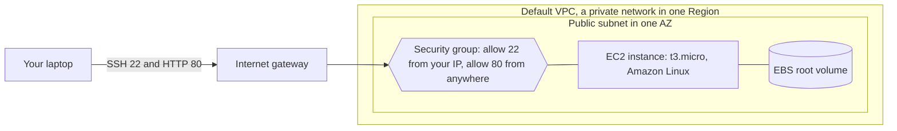
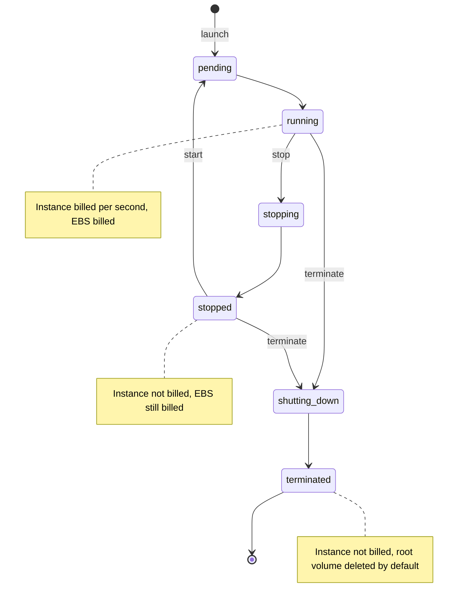

# EC2

After this you can launch a Linux server on EC2, open exactly the ports it needs, connect to it, and shut it down so nothing keeps billing.

Before this: [AWS account, IAM and billing](02-aws-account-iam-and-billing.md) and [users, groups and permissions](../../02-operating-systems-and-linux/02-linux-command-line/03-users-groups-and-permissions.md).

## The idea

You have a small web app and want it reachable from a public address. On your own machine you would install Linux, open a port on the router and keep the computer on. On AWS you ask for a virtual machine, tell AWS which firewall rules apply, and it boots in about a minute.

**Amazon EC2** (Elastic Compute Cloud) rents you virtual servers, which AWS calls **instances**. It is the IaaS layer from [cloud models and regions](01-cloud-models-and-regions.md): you get root on a machine and you patch it. The diagram shows what surrounds an instance.



Traffic reaches the instance only if it passes the security group. The instance's disk is a separate object, an EBS volume, which matters for billing.

## Key terms

An **AMI** (Amazon Machine Image) is the template an instance boots from: an operating system plus any preinstalled software. An **instance type** is the hardware size, named by family, generation and size. In `t3.micro`, `t` is the family (burstable general purpose), `3` is the generation and `micro` is the size. Common families are `t` and `m` (general purpose), `c` (compute), `r` (memory) and `g`/`p` (GPUs); a `g` after the generation, as in `m7g`, means an Arm Graviton processor ([instance types](https://docs.aws.amazon.com/AWSEC2/latest/UserGuide/instance-types.html)).

**EBS** (Elastic Block Store) is the network disk an instance boots from. It lives independently of the instance's power state.

A **key pair** is an SSH public key that AWS stores and a private key that you keep. You log in with the private key and no password. A **security group** is a virtual firewall attached to an instance. Rules are allow-only, and traffic that matches no rule is dropped. Security groups are **stateful**: if a request is allowed in, its response is allowed out, and the reverse, whatever the other direction's rules say ([security groups](https://docs.aws.amazon.com/AWSEC2/latest/UserGuide/ec2-security-groups.html)).

**User data** is a script you pass at launch that runs once as root on first boot. An **Elastic IP** is a public IPv4 address you reserve so it survives stop and start.

## How it works

An instance moves through the states in the diagram. The billing facts come from the [instance lifecycle docs](https://docs.aws.amazon.com/AWSEC2/latest/UserGuide/ec2-instance-lifecycle.html).



Stop and terminate are different actions. Stopping keeps the instance and its EBS volume, so you can start it again, but you keep paying for the volume. A stopped instance also gets a new public IPv4 address when it restarts, unless it has an Elastic IP. Terminating deletes the instance, and by default its root volume (`DeleteOnTermination` is true for the root volume and false for extra volumes you attach). Terminate is how you stop all charges.

Public IPv4 addresses cost money while in use, and an Elastic IP that is not attached to anything is billed as idle ([VPC pricing](https://aws.amazon.com/vpc/pricing/), as of 2026). Release any Elastic IP you allocate in a lab.

On the free plan, AWS says credits cover usage and the plan limits which services and features you can use ([free tier plans](https://docs.aws.amazon.com/awsaccountbilling/latest/aboutv2/free-tier-plans.html), as of 2026). It does not list EC2 instance types there, so pick a type the console marks as eligible for your plan, and check your credit balance in Billing before and after the lab.

Launching from the CLI takes five ingredients: an AMI id, an instance type, a key pair name, a security group id, and optional user data. Find the current Amazon Linux 2023 AMI id from a public Systems Manager parameter ([AWS CLI `run-instances`](https://awscli.amazonaws.com/v2/documentation/api/latest/reference/ec2/run-instances.html)), because AMI ids differ by Region and go out of date:

```bash
aws ssm get-parameter --region ca-central-1 \
  --name /aws/service/ami-amazon-linux-latest/al2023-ami-kernel-default-x86_64 \
  --query Parameter.Value --output text
```

```text
ami-0abcdef1234567890
```

(That id is a placeholder; you get a real one. Unverified.) In Git Bash, prefix the command with `MSYS_NO_PATHCONV=1`, otherwise Git Bash rewrites the leading `/aws/...` into a Windows path.

To connect, `ssh -i lab-key.pem ec2-user@PUBLIC_IP`. The private key file must not be readable by others, or SSH refuses it, as in the permissions lesson. Amazon Linux's default user is `ec2-user`; Ubuntu AMIs use `ubuntu`.

## Worked examples

<div class="example" markdown>

### Example 1: why can't I reach my server?

You launched an instance with user data that installs a web server, but `curl http://PUBLIC_IP` hangs.

1. A hang (no reply at all) usually means a firewall dropped the packets. A refused connection would mean the packet arrived but nothing listens.
2. Check the security group inbound rules. If there is no rule for TCP 80, port 80 is dropped, because the default is deny.
3. Check the source of the rule. `0.0.0.0/0` is anyone. A `/32` is a single address, and your home IP may have changed.
4. If the rules are right, connect with SSH and check the service: `systemctl status httpd`, and `sudo cat /var/log/cloud-init-output.log` for user data errors.

Check: after adding the missing rule, `curl` should return the page within seconds, with no restart needed, because rule changes apply immediately.

</div>

## Common mistakes

<div class="warning" markdown>

Watch out: opening SSH (port 22) to `0.0.0.0/0`. Bots scan the whole internet for it within minutes. Allow only your own IP as `/32`, or skip SSH and use Session Manager.

Watch out: stopping an instance and believing it is free. The EBS volume, and any Elastic IP, still bill. Terminate what you do not need.

Watch out: committing the `.pem` file or leaving it world-readable. Keep it out of git and run `chmod 400` on it.

</div>

## Working with AI

<div class="ai" markdown>

Words to use: AMI, instance type, key pair, security group, inbound rule, user data, EBS volume, terminate vs stop.

Prompts to try:

- "Write AWS CLI v2 commands to create a key pair and a security group allowing SSH from my IP only and HTTP from anywhere, then launch one t3.micro Amazon Linux 2023 instance in ca-central-1 with a user data script that installs nginx. Tag everything Project=lab."
- "My `ssh` to an EC2 instance times out. Here are the security group rules and the output of `describe-instances`: (paste). List the possible causes in order of likelihood."

What to check:

- Open ports: any `0.0.0.0/0` on port 22 or a database port.
- Hard-coded AMI ids from memory; they are Region-specific and stale. Use the SSM parameter.
- Missing cleanup commands in the answer. A launch with no terminate step is a billing risk.
- Flags that do not exist: check each against the [`ec2` command reference](https://awscli.amazonaws.com/v2/documentation/api/latest/reference/ec2/index.html).

</div>

## Quiz

1\. What is the difference between stopping and terminating an instance, in terms of cost?

<details class="solution" markdown>
<summary>Answer</summary>

A stopped instance is not billed for compute, but its EBS volume (and any Elastic IP) still bills. A terminated instance stops billing, and its root volume is deleted by default.

</details>

2\. A security group has one inbound rule: TCP 443 from `0.0.0.0/0`. Your server answers the HTTPS request. Is an outbound rule needed for the response?

<details class="solution" markdown>
<summary>Answer</summary>

No. Security groups are stateful, so a response to an allowed inbound request is allowed out regardless of the outbound rules.

</details>

3\. You stop an instance overnight and restart it. SSH to the old IP fails. Why, and what avoids it?

<details class="solution" markdown>
<summary>Answer</summary>

The instance gets a new public IPv4 address after a stop and start. Read the new address from `describe-instances`, or attach an Elastic IP (which bills while allocated).

</details>

4\. What is `m7g.large` telling you?

<details class="solution" markdown>
<summary>Answer</summary>

Family `m` (general purpose), generation 7, the `g` means a Graviton (Arm) processor, size `large`. An Arm instance needs an Arm AMI and Arm-compatible software.

</details>

## Lab

<div class="lab" markdown>

### Lab: launch, reach and delete a web server

Goal: launch an instance that serves a web page, reach it over HTTP and SSH, then delete everything. Time: about 25 minutes. Runs in: Git Bash with the CLI profile from the previous lesson. All commands and outputs here are unverified because no account was available when this was written; compare each with the CLI reference and your screen.

Keep the instance running for as short a time as you can. Check your credit balance in Billing at the start and the end.

1. Set up the key pair, the user data file and the security group. Save this as `user-data.sh` first:

   ```bash
   #!/bin/bash
   dnf install -y httpd
   systemctl enable --now httpd
   echo "hello from my first EC2 instance" > /var/www/html/index.html
   ```

   Then run:

   ```bash
   export AWS_PROFILE=lab
   aws ec2 create-key-pair --key-name lab-key \
     --query KeyMaterial --output text > lab-key.pem
   chmod 400 lab-key.pem
   MYIP=$(curl -s https://checkip.amazonaws.com)
   SG=$(aws ec2 create-security-group --group-name lab-web-sg \
     --description "lab web server" --query GroupId --output text)
   aws ec2 authorize-security-group-ingress --group-id "$SG" \
     --protocol tcp --port 22 --cidr "$MYIP/32"
   aws ec2 authorize-security-group-ingress --group-id "$SG" \
     --protocol tcp --port 80 --cidr 0.0.0.0/0
   ```

2. Launch the instance. If AWS rejects `t3.micro` for your plan, use the type the console shows as eligible.

   ```bash
   AMI=$(MSYS_NO_PATHCONV=1 aws ssm get-parameter \
     --name /aws/service/ami-amazon-linux-latest/al2023-ami-kernel-default-x86_64 \
     --query Parameter.Value --output text)
   ID=$(aws ec2 run-instances --image-id "$AMI" --instance-type t3.micro \
     --key-name lab-key --security-group-ids "$SG" \
     --user-data file://user-data.sh \
     --tag-specifications 'ResourceType=instance,Tags=[{Key=Project,Value=lab}]' \
     --query "Instances[0].InstanceId" --output text)
   aws ec2 wait instance-running --instance-ids "$ID"
   IP=$(aws ec2 describe-instances --instance-ids "$ID" \
     --query "Reservations[0].Instances[0].PublicIpAddress" --output text)
   echo "$ID $IP"
   ```

3. Test it. The web server needs a minute after boot, so retry if the first request fails.

   ```bash
   curl http://$IP
   ssh -i lab-key.pem ec2-user@$IP "uname -r"
   ```

   ```text
   hello from my first EC2 instance
   6.1.xxx-xxx.amzn2023.x86_64
   ```

4. Stop it and look at the state. The public address is released when the instance stops.

   ```bash
   aws ec2 stop-instances --instance-ids "$ID"
   aws ec2 wait instance-stopped --instance-ids "$ID"
   aws ec2 describe-instances --instance-ids "$ID" \
     --query "Reservations[0].Instances[0].[State.Name,PublicIpAddress]" --output text
   ```

   ```text
   stopped	None
   ```

5. Cleanup. Terminate the instance, then remove the security group, key pair and local key file.

   ```bash
   aws ec2 terminate-instances --instance-ids "$ID"
   aws ec2 wait instance-terminated --instance-ids "$ID"
   aws ec2 delete-security-group --group-id "$SG"
   aws ec2 delete-key-pair --key-name lab-key
   rm lab-key.pem
   ```

6. Confirm nothing is billing. Each of these should print an empty list.

   ```bash
   aws ec2 describe-instances \
     --filters Name=instance-state-name,Values=pending,running,stopping,stopped \
     --query "Reservations[].Instances[].InstanceId"
   aws ec2 describe-volumes --query "Volumes[].VolumeId"
   aws ec2 describe-addresses --query "Addresses[].PublicIp"
   ```

   ```text
   []
   []
   []
   ```

Expected result: the page text from `curl`, an `uname` line from SSH, state `stopped` with no IP, and three empty lists at the end. If `describe-volumes` shows a volume, delete it with `aws ec2 delete-volume --volume-id VOLUME_ID`. Also open the console in `ca-central-1` and check EC2 shows no instances, since the CLI only sees the Region set in your `lab` profile.

<details class="solution" markdown>
<summary>Solution</summary>

The commands above are the full solution. The key points: the security group is the only reason the page is reachable (remove the port 80 rule and `curl` hangs); the instance keeps its volume while stopped; and `terminate-instances` plus deleting the group and key pair leaves nothing to bill. Check `delete-security-group` ran after the instance reached `terminated`, otherwise AWS refuses because the group is still in use.

</details>

</div>

## Where this shows up

- The VPC, subnet and security group pieces in the diagram get their own lesson in [VPCs and security groups](06-vpcs-and-security-groups.md).
- Putting a real app on this kind of server is [Deploying an app to EC2](08-deploying-an-app-to-ec2.md).
- Keys and `ssh` are covered in SSH and keys<!-- link: ../../02-operating-systems-and-linux/02-linux-command-line/10-ssh-and-keys.md -->.
