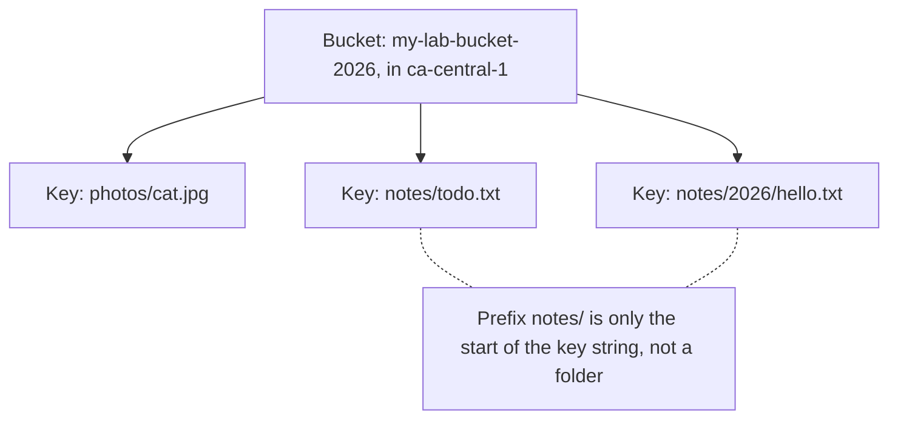
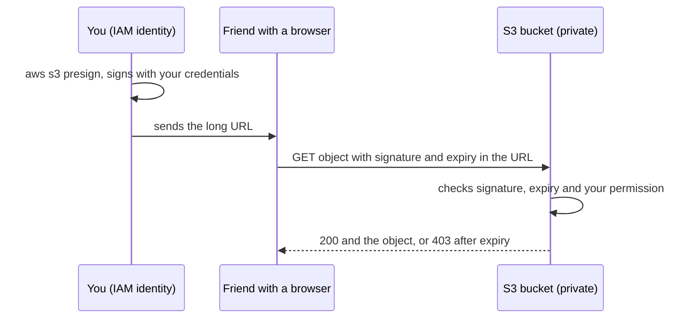

# S3

After this you can store files in S3, keep them private, recover an overwritten file, share one with a time limit, and choose a storage class.

Before this: [AWS account, IAM and billing](02-aws-account-iam-and-billing.md).

## The idea

Your app lets users upload profile photos. Storing them on the web server's disk breaks the moment you run two servers or replace the instance. You need storage that outlives any one server, holds any number of files, and is reached over HTTP.

**Amazon S3** (Simple Storage Service) is object storage: you put a whole file in, you get a whole file out, and you address it by name. There are no partial in-place edits and no real directories. In exchange, S3 is designed to hold any number of objects, and AWS says it stores each object redundantly across at least three Availability Zones in a Region for most storage classes ([data protection](https://docs.aws.amazon.com/AmazonS3/latest/userguide/DataDurability.html)).



In the diagram, the console draws `notes/` as a folder, but S3 stores three flat keys.

## Key terms

A **bucket** is a container for objects. Its name is unique across all of AWS, and the bucket lives in one Region. An **object** is the data plus metadata, found by its **key**, the full name such as `notes/2026/hello.txt`. A **prefix** is the leading part of a key; listing "by folder" means listing keys with a shared prefix and a `/` delimiter. An object can be up to 5 TB ([presigned URLs](https://docs.aws.amazon.com/AmazonS3/latest/userguide/ShareObjectPreSignedURL.html)).

A **storage class** sets how the object is stored and billed. **Block Public Access** is a set of switches that override any policy or ACL that would make data public. A **bucket policy** is a resource-based JSON policy attached to the bucket. **Versioning** keeps every version of an object. A **lifecycle rule** moves or deletes objects automatically by age or prefix. A **presigned URL** is a link that carries a signature made with someone's credentials, granting one action on one object for a limited time.

## How it works

Durability and availability are separate numbers. As of 2026, S3 Standard is designed for 99.999999999% durability ("11 nines") and 99.99% availability over a year ([storage classes](https://docs.aws.amazon.com/AmazonS3/latest/userguide/storage-class-intro.html)). Durability is the chance an object is lost; availability is the chance a request succeeds right now. The durability number sounds abstract, so here is what it means for 10 million objects:

```python
durability = 0.99999999999          # 11 nines, per year, per object
loss_per_object = 1 - durability
objects = 10_000_000
expected_losses_per_year = objects * loss_per_object
print(f"{expected_losses_per_year:.4f} objects lost per year")
print(f"one loss every {1 / expected_losses_per_year:,.0f} years")
```

```text
0.0001 objects lost per year
one loss every 10,000 years
```

That covers hardware failure. It does not cover you deleting or overwriting an object, which is what versioning is for.

Storage classes trade price against access. Figures below come from the [AWS comparison table](https://docs.aws.amazon.com/AmazonS3/latest/userguide/storage-class-intro.html#sc-compare) (as of 2026); prices are on the [S3 pricing page](https://aws.amazon.com/s3/pricing/) and not copied here.

| Class | Use | Availability | Minimum storage |
|---|---|---|---|
| Standard | frequently accessed data | 99.99% | none |
| Intelligent-Tiering | unknown or changing access | 99.9% | none |
| Standard-IA | infrequent access, millisecond reads | 99.9% | 30 days |
| One Zone-IA | re-creatable data, one AZ only | 99.5% | 30 days |
| Glacier Instant Retrieval | archive, millisecond reads | 99.9% | 90 days |
| Glacier Flexible Retrieval | archive, minutes to hours to restore | 99.99% after restore | 90 days |
| Glacier Deep Archive | archive, hours to restore | 99.99% after restore | 180 days |

Access is checked by IAM as in the previous lesson, plus the bucket policy. Block Public Access has four settings (`BlockPublicAcls`, `IgnorePublicAcls`, `BlockPublicPolicy`, `RestrictPublicBuckets`), and by default new buckets do not allow public access ([Block Public Access](https://docs.aws.amazon.com/AmazonS3/latest/userguide/access-control-block-public-access.html)). Leave all four on. This bucket policy denies any request that does not use HTTPS, a safe example because it only denies:

```json
{
  "Version": "2012-10-17",
  "Statement": [
    {
      "Sid": "DenyInsecureTransport",
      "Effect": "Deny",
      "Principal": "*",
      "Action": "s3:*",
      "Resource": [
        "arn:aws:s3:::my-lab-bucket-2026",
        "arn:aws:s3:::my-lab-bucket-2026/*"
      ],
      "Condition": { "Bool": { "aws:SecureTransport": "false" } }
    }
  ]
}
```

A lifecycle rule is JSON too. This one moves objects under `logs/` to Standard-IA after 30 days (the minimum for that class) and deletes them after 365 days ([lifecycle configuration](https://awscli.amazonaws.com/v2/documentation/api/latest/reference/s3api/put-bucket-lifecycle-configuration.html), unverified):

```json
{
  "Rules": [
    {
      "ID": "age-out-logs",
      "Status": "Enabled",
      "Filter": { "Prefix": "logs/" },
      "Transitions": [{ "Days": 30, "StorageClass": "STANDARD_IA" }],
      "Expiration": { "Days": 365 }
    }
  ]
}
```

With versioning on, an overwrite adds a new version and a delete adds a **delete marker**, so old data stays and still bills until a rule removes it. Add a rule for noncurrent versions before you version a busy bucket.

A presigned URL lets someone without AWS credentials fetch a private object. The URL is signed with the credentials of whoever generated it, so the request is allowed only if that identity could do it. In the CLI the maximum lifetime is 7 days, and in the console 12 hours ([sharing objects](https://docs.aws.amazon.com/AmazonS3/latest/userguide/ShareObjectPreSignedURL.html)). If you sign with temporary credentials, the link can stop working when those credentials expire (unverified).



Static website hosting is a bucket setting that serves `index.html` over HTTP, which needs public read access, so it conflicts with Block Public Access. For a public site, keep the bucket private and put CloudFront, the CDN from [proxies and CDNs](../../07-networking/02-web-protocols/05-proxies-and-cdns.md), in front of it for HTTPS.

## Worked examples

<div class="example" markdown>

### Example 1: choose a class

A photo app keeps new uploads that users open daily, thumbnails nobody opens after 90 days, and yearly tax PDFs that must be kept 7 years.

1. New uploads: Standard. Frequent access, no minimum duration.
2. Thumbnails: Intelligent-Tiering, or a lifecycle rule to Standard-IA at 30 days. Keep in mind Standard-IA bills at least 30 days and 128 KB per object, so tiny thumbnails cost more there than their size suggests.
3. Tax PDFs: lifecycle to Glacier Flexible Retrieval or Deep Archive, accepting a restore wait before reading.

Check: for each choice, ask "how often is it read, and how long can the reader wait?" If the answer is "I don't know", Intelligent-Tiering exists for that case.

</div>

## Common mistakes

<div class="warning" markdown>

Watch out: making a bucket public to share one file. Use a presigned URL, or CloudFront. Public buckets are a common source of leaked data, and a wildcard principal in a policy is the cause.

Watch out: deleting a versioned bucket with `aws s3 rb --force` and expecting it to be empty. Old versions and delete markers remain, and the bucket cannot be deleted until they are removed. The lab shows how.

Watch out: assuming folders exist. Renaming a "folder" means copying every object to a new key and deleting the old one.

</div>

## Working with AI

<div class="ai" markdown>

Words to use: bucket, object key, prefix, storage class, Block Public Access, bucket policy, versioning, lifecycle rule, presigned URL.

Prompts to try:

- "Write an S3 lifecycle configuration JSON that moves objects under `reports/` to Glacier Flexible Retrieval after 90 days and deletes noncurrent versions after 30 days. Explain each field and the AWS CLI command to apply it."
- "I generated a presigned URL with `aws s3 presign` and get `403 Request has expired` after a few minutes. I signed in with `aws login`. What are the likely causes?"

What to check:

- A policy with `"Principal": "*"` and `s3:GetObject`. That makes data public. Ask what it is for.
- Missing `/*` on object-level actions, or `/*` on bucket-level ones.
- Lifecycle rules that transition tiny objects to IA classes, which charge a 128 KB minimum.
- A deletion script that ignores versions and delete markers.

</div>

## Quiz

1\. What does "11 nines of durability" mean, and what does it not protect against?

<details class="solution" markdown>
<summary>Answer</summary>

S3 Standard is designed so that the chance of losing a given object in a year is about 0.000000001%. It does not protect against you deleting or overwriting data, or against deleting the bucket. Versioning and backups cover that.

</details>

2\. The key is `reports/2026/q1.pdf`. What are the bucket's folders?

<details class="solution" markdown>
<summary>Answer</summary>

There are none. S3 stores one flat key. The console shows `reports/` and `reports/2026/` as folders because it groups keys by prefix and the `/` delimiter.

</details>

3\. You run `aws s3 rm s3://b/file.txt` on a versioned bucket. The console now shows no `file.txt`. Is the data gone, and how do you get it back?

<details class="solution" markdown>
<summary>Answer</summary>

No. The delete added a delete marker. Remove the marker (with `aws s3api delete-object --version-id MARKER_ID`) and the previous version is current again.

</details>

4\. A teammate wants a customer to download one 200 MB report from a private bucket for the next hour. What do you do?

<details class="solution" markdown>
<summary>Answer</summary>

Generate a presigned URL with `aws s3 presign s3://bucket/report.pdf --expires-in 3600` and send it. Keep Block Public Access on.

</details>

## Lab

<div class="lab" markdown>

### Lab: a private bucket with versions and a presigned link

Goal: create a private bucket, see prefixes and versions, share one object with a link that expires, and delete everything including old versions. Time: about 20 minutes. Runs in: Git Bash with the `lab` profile. Commands and outputs are unverified (no account was available when this was written); check each against the [S3 CLI reference](https://awscli.amazonaws.com/v2/documentation/api/latest/reference/s3api/index.html).

1. Create the bucket. Names are global, so add a random suffix. In `ca-central-1`, `LocationConstraint` is required.

   ```bash
   export AWS_PROFILE=lab
   B=lab-s3-$(date +%s)
   aws s3api create-bucket --bucket "$B" --region ca-central-1 \
     --create-bucket-configuration LocationConstraint=ca-central-1
   aws s3api get-public-access-block --bucket "$B"
   ```

   The second command should show all four settings as `true`.

2. Upload objects under prefixes and list them two ways.

   ```bash
   echo "version one" > hello.txt
   aws s3 cp hello.txt "s3://$B/notes/2026/hello.txt"
   aws s3 cp hello.txt "s3://$B/photos/hello.txt"
   aws s3 ls "s3://$B/"
   aws s3api list-objects-v2 --bucket "$B" --prefix notes/ --query "Contents[].Key"
   ```

   ```text
                              PRE notes/
                              PRE photos/
   [
       "notes/2026/hello.txt"
   ]
   ```

3. Turn on versioning, overwrite the file, and list both versions.

   ```bash
   aws s3api put-bucket-versioning --bucket "$B" \
     --versioning-configuration Status=Enabled
   echo "version two" > hello.txt
   aws s3 cp hello.txt "s3://$B/notes/2026/hello.txt"
   aws s3api list-object-versions --bucket "$B" --prefix notes/ \
     --query "Versions[].[Key,VersionId,IsLatest]" --output text
   ```

   Expect two lines for the key, one with `True` and one with `False` for `IsLatest`.

4. Share the object for 60 seconds. The signed link works; the plain URL does not; after a minute the signed link fails too.

   ```bash
   URL=$(aws s3 presign "s3://$B/notes/2026/hello.txt" --expires-in 60)
   curl -s "$URL"
   curl -s "https://$B.s3.ca-central-1.amazonaws.com/notes/2026/hello.txt"
   sleep 65 && curl -s "$URL"
   ```

   ```text
   version two
   <?xml version="1.0" encoding="UTF-8"?>
   <Error><Code>AccessDenied</Code><Message>Access Denied</Message>...
   <Error><Code>AccessDenied</Code><Message>Request has expired</Message>...
   ```

5. Cleanup. A versioned bucket must have every version and delete marker removed before it can be deleted.

   ```bash
   aws s3api list-object-versions --bucket "$B" \
     --query "{Objects: Versions[].{Key:Key,VersionId:VersionId}}" --output json > v.json
   aws s3api delete-objects --bucket "$B" --delete file://v.json
   aws s3api delete-bucket --bucket "$B"
   rm hello.txt v.json
   ```

   If `list-object-versions` also reports `DeleteMarkers`, repeat the first two commands with `DeleteMarkers` in place of `Versions` before `delete-bucket`.

6. Confirm nothing is billing. `aws s3 ls` should not list the bucket, and the Billing console month-to-date cost should stay at 0.00 (it can lag by hours).

Expected result: three listings as shown, a signed link that works once and then expires, and no bucket left.

<details class="solution" markdown>
<summary>Solution</summary>

The commands above are the full solution. Step 4 proves the object is private: the plain URL fails because Block Public Access and the missing policy deny anonymous reads, and the signed URL succeeds because S3 checks the signature against your permission. In step 5 the version-aware delete matters; `aws s3 rb s3://BUCKET --force` removes only current objects, so use the `delete-objects` route on versioned buckets.

</details>

</div>

## Where this shows up

- Uploads, build artifacts and backups in [CI/CD concepts](../02-ci-cd/01-ci-cd-concepts.md) and in [Deploying an app to EC2](08-deploying-an-app-to-ec2.md).
- The same object-store idea in data lakes and files for analytics, in the data engineering chapter.
