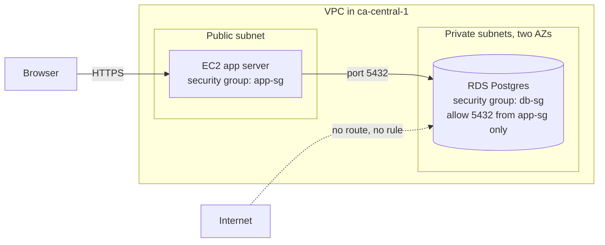
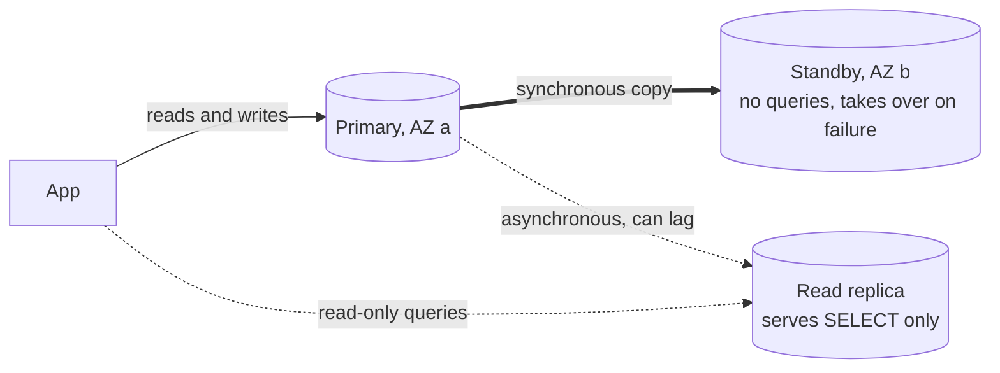

# RDS managed Postgres

After this you can create a Postgres database on RDS that only your own servers can reach, connect to it from an EC2 instance, and explain what backups, Multi-AZ and read replicas protect you from.

Before this: [EC2](03-ec2.md), [Postgres and psql](../../10-databases-sql-and-postgres/01-database-basics/03-postgres-and-psql.md) and [backups, replication and pooling](../../10-databases-sql-and-postgres/04-postgres-in-depth/08-backups-replication-and-pooling.md).

## The idea

Your app works with Postgres on your laptop. In production you could install Postgres on an EC2 instance and run it yourself. Then you also own the operating system patches, the nightly backups, the disk filling up, the restore you have never tested, and the failover at 3 a.m. Many teams pay AWS to do those parts instead.

**Amazon RDS** (Relational Database Service) runs a database engine for you on an instance you cannot log in to. You choose the engine (Postgres here), the size and the storage. AWS installs it, patches it, backs it up and replaces failed hardware. You still design the schema, write the queries and control who can connect. In the diagram, the database sits in a private subnet and accepts traffic only from the app's security group.



## Key terms

A **DB instance** is one running database server managed by RDS. Its **instance class** is the hardware size, named like EC2: `db.t3.micro` is a burstable (`t`) third-generation class, size micro. **Storage** is a separate EBS-backed disk whose type (for example gp3, a general purpose SSD) and size you pick, and storage bills even when the database is idle.

The **endpoint** is the DNS name you connect to, such as `lab-pg.abc123.ca-central-1.rds.amazonaws.com`. Use the name, never an IP, because RDS may change the address behind it during a failover.

A **DB subnet group** lists the subnets (in at least two AZs) where RDS may place the instance. A **parameter group** is a set of Postgres settings (`max_connections`, `log_min_duration_statement`) that you can edit, unlike `postgresql.conf` on a managed server.

**Publicly accessible** is a setting that gives the instance a public IP address. Leave it off.

## How it works

Backups come in two kinds. **Automated backups** are daily snapshots plus transaction logs, kept for a retention period you set; together they allow point-in-time restore to any second inside the window. They are deleted with the instance by default. A **manual snapshot** is one you create yourself, and it stays until you delete it, even after the instance is gone. Snapshot storage bills, so an old snapshot is a quiet cost ([delete-db-instance](https://docs.aws.amazon.com/cli/latest/reference/rds/delete-db-instance.html), as of 2026). A restore always creates a new instance; it never overwrites the old one.

Two features sound alike and solve different problems, as in the diagram. **Multi-AZ** keeps a standby copy in another AZ, updated synchronously. If the primary fails, RDS switches the endpoint to the standby. The standby serves no queries; it is insurance for availability. A **read replica** is a copy updated asynchronously that does serve read queries, so it spreads read load, and it can lag behind. Multi-AZ doubles the instance cost, since you pay for both instances ([RDS pricing](https://aws.amazon.com/rds/postgresql/pricing/), as of 2026).



**Aurora** is AWS's own database engine with Postgres-compatible and MySQL-compatible editions. It stores data in a shared, replicated storage layer instead of per-instance disks, which makes replicas and failover faster, and it bills differently (including a serverless option). Plain RDS Postgres is the simpler, more predictable first choice.

Compare running Postgres yourself on EC2 with RDS. EC2 gives you root, any extension, any version and a smaller bill at small sizes. RDS gives you backups, patching, monitoring and failover with a few settings, but you cannot log in to the host and you can use only the extensions RDS allows.

Pricing and the free allowance depend on your plan and Region. As of 2026, AWS lists RDS as available on both the Free and Paid plans ([AWS Free Tier](https://aws.amazon.com/free/)), and the [RDS Postgres pricing page](https://aws.amazon.com/rds/postgresql/pricing/) lists a legacy allowance of 750 instance-hours, 20 GB of storage and 20 GB of backup storage. Use the pricing calculator for `ca-central-1` figures rather than a number from this book.

For the connection, the app needs the endpoint, port 5432, a user and a password. Do not paste the password into code. Either let RDS keep it in Secrets Manager (`--manage-master-user-password`, [create-db-instance](https://docs.aws.amazon.com/cli/latest/reference/rds/create-db-instance.html)) or load it from an environment variable, as in [secrets and dependency security](../../12-security/01-web-security/06-secrets-and-dependency-security.md). Connections should use TLS (`sslmode=require` in a `psql` string).

## Worked examples

<div class="example" markdown>

### Example 1: why does the app time out?

Your app on EC2 reports `connection timed out` to the database, and `psql` from your laptop also hangs.

1. For the laptop, a hang is correct and desired. The instance is not publicly accessible, so there is no route from the internet.
2. For the app, a timeout (no reply) points to a firewall, as in the EC2 lesson. A refusal would mean the packet arrived and nothing listened.
3. Open the database's security group. It needs an inbound rule: type PostgreSQL, port 5432, source set to the app's security group id (`sg-...`), not an IP range.
4. Confirm both are in the same VPC, and that the app uses the endpoint name.

Check: after adding the rule, `psql` from the app server connects within a second, with no restart.

</div>

## Common mistakes

<div class="warning" markdown>

Watch out: setting Publicly accessible to yes, or allowing 5432 from `0.0.0.0/0`, "to test from my laptop". Bots find open database ports quickly. Connect from a server in the VPC, or through an SSH tunnel to one.

Watch out: deleting the instance and keeping the bill. A manual snapshot, a read replica or a final snapshot keeps costing until you delete it. A stopped RDS instance also restarts itself after seven days and still bills for storage (check [stopping an instance](https://docs.aws.amazon.com/AmazonRDS/latest/UserGuide/USER_StopInstance.html) for the current rule).

Watch out: treating Multi-AZ as a backup. It copies mistakes instantly; a `DROP TABLE` is dropped on the standby too. Backups and point-in-time restore cover that.

</div>

## Working with AI

<div class="ai" markdown>

Words to use: DB instance, instance class, endpoint, DB subnet group, security group, Multi-AZ, read replica, point-in-time restore.

Prompts to try:

- "Write AWS CLI v2 commands to create a Postgres RDS instance in ca-central-1, db.t3.micro, 20 GB gp3, not publicly accessible, reachable on 5432 only from security group sg-APP. Include the delete commands and the commands that confirm nothing is left billing."
- "Here is my app's connection error and my db security group rules: (paste). Is it a network problem or an authentication problem, and how do I tell?"

What to check:

- `--publicly-accessible` or a `0.0.0.0/0` rule in the answer. Search the commands for both.
- A password written in the command history or code. It should come from `read -s`, an environment variable or Secrets Manager.
- Flags that do not exist. Compare each with the `rds` command reference.
- A missing delete step for snapshots, which are separate objects from the instance.

</div>

## Quiz

1\. Multi-AZ or a read replica: which one helps when the primary instance's hardware fails, and which one helps when reads overload the primary?

<details class="solution" markdown>
<summary>Answer</summary>

Multi-AZ handles the hardware failure: the standby in another AZ takes over the same endpoint. A read replica spreads read load, but it replicates asynchronously, so it can lag and is not an automatic failover target for the same endpoint.

</details>

2\. The database security group allows port 5432 from `0.0.0.0/0`, yet `publicly accessible` is off. Is the database reachable from the internet?

<details class="solution" markdown>
<summary>Answer</summary>

Not directly, because the instance has no public IP address. The rule is still wrong: it would let any host with a route to the VPC in, and one setting change would expose the database. Allow only the app's security group.

</details>

3\. You delete an RDS instance with `--skip-final-snapshot` and `--delete-automated-backups`. A manual snapshot you made last week exists. What happens to it?

<details class="solution" markdown>
<summary>Answer</summary>

It stays, and keeps billing, because manual snapshots are not deleted with the instance. Delete it with `aws rds delete-db-snapshot`.

</details>

4\. Why connect to the endpoint name instead of the instance's current IP address?

<details class="solution" markdown>
<summary>Answer</summary>

During a Multi-AZ failover or a maintenance replacement the address behind the endpoint changes. The DNS name is updated, so clients that use the name follow it.

</details>

## Lab

<div class="lab" markdown>

### Lab: a private Postgres reached from EC2

Goal: create a private RDS Postgres instance, query it from an EC2 instance, prove your laptop cannot reach it, then delete everything. Time: about 40 minutes (RDS takes several minutes to create and delete). Runs in: Git Bash with the `lab` profile from [AWS account, IAM and billing](02-aws-account-iam-and-billing.md). Commands are unverified (written from the CLI reference, not run against an account). The instance and any snapshot bill, even when idle, so do the cleanup the same session.

Check your credit balance in Billing before you start. If the CLI rejects `db.t3.micro`, use the class the console offers for your plan.

1. Create the key pair and two security groups in the default VPC. The database group accepts 5432 only from the app group.

   ```bash
   export AWS_PROFILE=lab AWS_PAGER=""
   MYIP=$(curl -s https://checkip.amazonaws.com)
   VPC=$(aws ec2 describe-vpcs --filters Name=isDefault,Values=true \
     --query "Vpcs[0].VpcId" --output text)
   aws ec2 create-key-pair --key-name lab-key \
     --query KeyMaterial --output text > lab-key.pem && chmod 400 lab-key.pem
   APPSG=$(aws ec2 create-security-group --group-name lab-app-sg \
     --description "lab app" --vpc-id "$VPC" --query GroupId --output text)
   DBSG=$(aws ec2 create-security-group --group-name lab-db-sg \
     --description "lab db" --vpc-id "$VPC" --query GroupId --output text)
   aws ec2 authorize-security-group-ingress --group-id "$APPSG" \
     --protocol tcp --port 22 --cidr "$MYIP/32"
   aws ec2 authorize-security-group-ingress --group-id "$DBSG" \
     --protocol tcp --port 5432 --source-group "$APPSG"
   ```

2. Launch an Ubuntu instance with the Postgres client.

   ```bash
   AMI=$(MSYS_NO_PATHCONV=1 aws ssm get-parameter --name \
     /aws/service/canonical/ubuntu/server/24.04/stable/current/amd64/hvm/ebs-gp3/ami-id \
     --query Parameter.Value --output text)
   ID=$(aws ec2 run-instances --image-id "$AMI" --instance-type t3.micro \
     --key-name lab-key --security-group-ids "$APPSG" \
     --tag-specifications 'ResourceType=instance,Tags=[{Key=Project,Value=lab}]' \
     --query "Instances[0].InstanceId" --output text)
   aws ec2 wait instance-running --instance-ids "$ID"
   IP=$(aws ec2 describe-instances --instance-ids "$ID" \
     --query "Reservations[0].Instances[0].PublicIpAddress" --output text)
   ssh -i lab-key.pem ubuntu@$IP "sudo apt-get update -q && sudo apt-get install -y -q postgresql-client"
   ```

3. Create the database. The password must be at least 8 characters and cannot contain `/`, `"`, `@` or spaces.

   ```bash
   read -s -p "Choose a DB password: " DBPW; echo
   aws rds create-db-instance --db-instance-identifier lab-pg \
     --db-instance-class db.t3.micro --engine postgres \
     --master-username labadmin --master-user-password "$DBPW" \
     --allocated-storage 20 --storage-type gp3 --db-name labdb \
     --no-publicly-accessible --vpc-security-group-ids "$DBSG" \
     --backup-retention-period 1 --no-multi-az --tags Key=Project,Value=lab
   aws rds wait db-instance-available --db-instance-identifier lab-pg
   EP=$(aws rds describe-db-instances --db-instance-identifier lab-pg \
     --query "DBInstances[0].Endpoint.Address" --output text)
   echo "$EP"
   ```

   ```text
   lab-pg.abc123xyz.ca-central-1.rds.amazonaws.com
   ```

4. Connect from the EC2 instance, then try from your laptop. The first prints rows; the second hangs until you press Ctrl+C (or `timeout 8`).

   ```bash
   ssh -i lab-key.pem ubuntu@$IP "PGPASSWORD='$DBPW' psql 'host=$EP user=labadmin dbname=labdb sslmode=require' \
     -c 'CREATE TABLE hello (msg text)' -c \"INSERT INTO hello VALUES ('from the app server')\" -c 'SELECT * FROM hello'"
   timeout 8 psql "host=$EP user=labadmin dbname=labdb connect_timeout=5" -c "SELECT 1"
   ```

   ```text
   CREATE TABLE
   INSERT 0 1
           msg
   --------------------
    from the app server
   (1 row)
   ```

   The laptop attempt prints a timeout error (or nothing, if you have no local `psql`). That is the success case.

5. Take a manual snapshot and watch it appear, to see that it is a separate billable object.

   ```bash
   aws rds create-db-snapshot --db-instance-identifier lab-pg --db-snapshot-identifier lab-pg-snap
   aws rds wait db-snapshot-available --db-snapshot-identifier lab-pg-snap
   aws rds describe-db-snapshots --query "DBSnapshots[].DBSnapshotIdentifier"
   ```

6. Cleanup. Delete the snapshot, the database (no final snapshot, no kept backups), the instance, and the rest.

   ```bash
   aws rds delete-db-snapshot --db-snapshot-identifier lab-pg-snap
   aws rds delete-db-instance --db-instance-identifier lab-pg \
     --skip-final-snapshot --delete-automated-backups
   aws rds wait db-instance-deleted --db-instance-identifier lab-pg
   aws ec2 terminate-instances --instance-ids "$ID"
   aws ec2 wait instance-terminated --instance-ids "$ID"
   aws ec2 delete-security-group --group-id "$DBSG"
   aws ec2 delete-security-group --group-id "$APPSG"
   aws ec2 delete-key-pair --key-name lab-key && rm lab-key.pem
   ```

   Confirm nothing bills. Each of these prints an empty list:

   ```bash
   aws rds describe-db-instances --query "DBInstances[].DBInstanceIdentifier"
   aws rds describe-db-snapshots --query "DBSnapshots[].DBSnapshotIdentifier"
   aws ec2 describe-volumes --query "Volumes[].VolumeId"
   ```

   ```text
   []
   []
   []
   ```

   Also look in the console, in `ca-central-1`, under RDS (Databases, Snapshots, Automated backups) and EC2, and check Billing the next day.

Expected result: rows from `psql` on the app server, a timeout from your laptop, and empty lists at the end.

<details class="solution" markdown>
<summary>Solution</summary>

The commands above are the full solution. The database is reachable only because `lab-db-sg` allows 5432 from `lab-app-sg`; delete that rule and step 4's first command hangs. Delete the groups last, after the instances using them are gone, or AWS refuses.

</details>

</div>

## Where this shows up

- The private subnet and security group in the first diagram are built by hand in [VPCs and security groups](06-vpcs-and-security-groups.md).
- A real app connects to this kind of database in [Deploying an app to EC2](08-deploying-an-app-to-ec2.md), and connection pools sit in front of it as in [backups, replication and pooling](../../10-databases-sql-and-postgres/04-postgres-in-depth/08-backups-replication-and-pooling.md).
