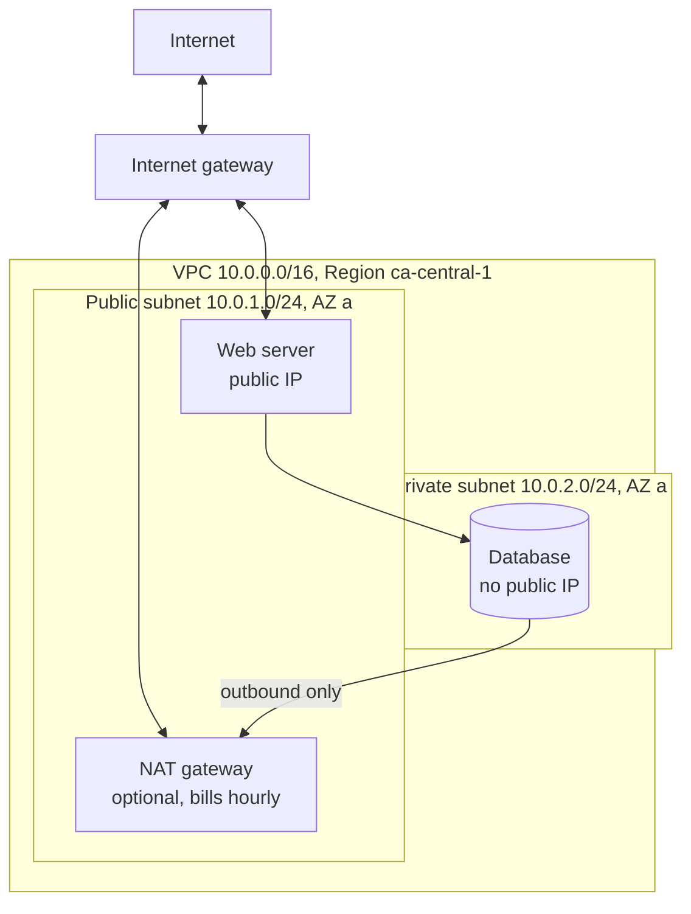
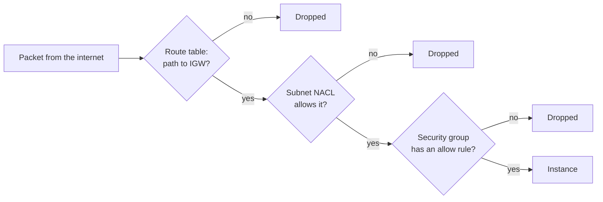

# VPCs and security groups

After this you can draw a VPC with public and private subnets, say what each route table entry does, and decide which traffic a security group lets through.

Before this: [EC2](03-ec2.md), [RDS managed Postgres](05-rds-managed-postgres.md) and [IP addresses, subnets and NAT](../../07-networking/01-how-the-internet-works/02-ip-addresses-subnets-and-nat.md).

## The idea

In the last two lessons you launched servers and a database, and AWS put them in a "default VPC". The network around them decides why the web server is reachable from the internet and the database is not, and this lesson builds it yourself.

A **VPC** (Virtual Private Cloud) is your own private network inside one Region. You choose its address range, split it into subnets, and decide which subnets have a path to the internet. The usual layout has two kinds of subnet: **public** ones for things the internet must reach (a load balancer, a web server) and **private** ones for things it must not (databases, internal services).



## Key terms

A **CIDR block** such as `10.0.0.0/16` is a range of addresses: the number after the slash is how many leading bits are fixed, so `/16` leaves 16 bits for hosts, which is 65,536 addresses. A VPC has one, and each subnet takes a non-overlapping slice of it, as in the networking lesson. AWS reserves five addresses in every subnet (the first four and the last), so a `/24` holds 256 minus 5, which is 251 usable addresses ([subnet sizing](https://docs.aws.amazon.com/vpc/latest/userguide/subnet-sizing.html), as of 2026). A subnet lives in exactly one AZ.

A **route table** is a list of rules, each mapping a destination range to a target. Every subnet is associated with one. The most specific matching rule wins. The rule `10.0.0.0/16 -> local` is always present and keeps traffic inside the VPC.

An **internet gateway** (IGW) connects a VPC to the internet. A subnet is public if its route table sends `0.0.0.0/0` to the IGW, and a server there also needs a public IP address. A subnet is private if it has no such route.

A **NAT gateway** sits in a public subnet and lets private servers start connections out (to download packages, say) while the internet cannot start connections in. It is the managed version of the NAT in your home router.

A **security group** is a stateful allow-list firewall attached to a network interface. A **network ACL** (NACL) is a stateless firewall attached to a subnet, with numbered rules that can allow or deny.

## How it works

The route table decides everything about reachability, so read it first. The table below belongs to the public subnet in the diagram, and the private one has the first row only.

| Destination | Target | Meaning |
|---|---|---|
| `10.0.0.0/16` | local | anything inside the VPC stays inside |
| `0.0.0.0/0` | `igw-...` | everything else goes to the internet gateway |

A private subnet that needs outbound access adds `0.0.0.0/0 -> nat-...` instead. The NAT gateway bills per hour while it exists and per GB processed, even if idle. As of 2026 the VPC pricing page lists \$0.045 per hour and \$0.045 per GB for US East (Ohio), the example Region on that page; the `ca-central-1` figure is on the [VPC pricing page](https://aws.amazon.com/vpc/pricing/), so check it before you create one. A public IPv4 address is also billed hourly, whether or not it is in use (\$0.005 per hour on the same page). Because of this, the lab below builds the private subnet without a NAT gateway.

Security groups and network ACLs both filter, at different levels.

| | Security group | Network ACL |
|---|---|---|
| Attached to | network interface (instance, database) | subnet |
| Rules | allow only | allow and deny, numbered, first match wins |
| State | stateful: replies allowed automatically | stateless: replies need their own rule |
| Default | nothing in, everything out | the default NACL allows everything |

Most teams leave NACLs at the default. A security group rule's source can be another security group, as in RDS: "port 5432 from `app-sg`" follows the app servers even when their addresses change. A packet must pass the route table, the NACL and the security group, as in the diagram.



How do you administer a private server? The older answer is a **bastion host**: a small public server you SSH into first, then hop to the private one. It needs an open port 22 and key management. The current answer is **Session Manager** from AWS Systems Manager: the instance runs the SSM Agent, has an IAM role that allows it, and you start a shell with `aws ssm start-session`, with no inbound port, no key and a log of who connected ([Session Manager docs](https://docs.aws.amazon.com/systems-manager/latest/userguide/session-manager.html), as of 2026). The instance needs a route to the service (a NAT gateway or VPC endpoints), and your laptop needs the Session Manager plugin.

## Worked examples

<div class="example" markdown>

### Example 1: what can a packet from the internet reach?

The VPC in the diagram has two subnets. Public: route `0.0.0.0/0 -> igw`, security group allows TCP 443 from anywhere. Private: only the `local` route, security group allows TCP 5432 from the web server's security group.

1. A request to the web server's public IP on 443: the route to the IGW exists, the NACL is default, the security group allows 443. It arrives.
2. A request to the same IP on port 22: no security group rule, so it is dropped silently. The client sees a timeout.
3. A request to the database on 5432: the database has no public IP, so nothing routes to it from the internet.
4. The web server connects to the database on 5432: the `local` route reaches it, and the source is the web server's security group, so it is allowed.

Check: the lab builds this layout and tests steps 1 and 4 from a shell.

</div>

## Common mistakes

<div class="warning" markdown>

Watch out: overlapping CIDR blocks. Two VPCs that both use `10.0.0.0/16` cannot be connected later. Pick distinct ranges per environment from the start.

Watch out: leaving a NAT gateway running after a lab. It bills hourly and per GB even with no traffic. The same goes for an Elastic IP that is not attached to anything.

Watch out: putting a database in a public subnet "for convenience". A subnet is public because of its route table, so a missing or wrong route can silently expose it. Put databases in private subnets and keep Publicly accessible off.

</div>

## Working with AI

<div class="ai" markdown>

Words to use: CIDR block, public subnet, private subnet, route table, internet gateway, NAT gateway, security group, stateful.

Prompts to try:

- "Design a VPC for a web app and a Postgres database in ca-central-1: CIDR blocks for two AZs, which subnets are public, the route table for each, and the security group rules. List which parts cost money while idle."
- "Explain this route table and these security group rules (paste), and tell me whether the instance in subnet-x can reach the internet and whether the internet can reach it."

What to check:

- A `0.0.0.0/0` rule on port 22 or a database port.
- Subnets whose CIDR blocks overlap or fall outside the VPC range. Check with Python's `ipaddress` module.
- A NAT gateway in the design with no mention of its cost, or placed in a private subnet. It must sit in a public subnet.
- CLI flags that do not exist. Check each against the `ec2` reference.

</div>

## Quiz

1\. What makes a subnet public?

<details class="solution" markdown>
<summary>Answer</summary>

Its route table has a route for `0.0.0.0/0` to an internet gateway. An instance there also needs a public IP address. The name of the subnet does not matter.

</details>

2\. A security group allows inbound TCP 443 and has no outbound rule for ephemeral ports. Does the HTTPS response get out? What if the filter were a network ACL?

<details class="solution" markdown>
<summary>Answer</summary>

Yes for a security group, since it is stateful and replies to allowed requests are allowed. A network ACL is stateless, so it also needs an outbound rule for the reply ports.

</details>

3\. How many usable IPv4 addresses does a `/28` subnet in AWS have?

<details class="solution" markdown>
<summary>Answer</summary>

A `/28` has $2^4 = 16$ addresses and AWS reserves 5, so 11.

</details>

4\. A server in a private subnet runs `apt-get update` and hangs. The subnet's route table has only the `local` route. What are two ways to fix it?

<details class="solution" markdown>
<summary>Answer</summary>

Add a NAT gateway in a public subnet and route `0.0.0.0/0` to it, which costs hourly and per GB. Or add VPC endpoints for the specific services needed (a package mirror on S3, for example), which avoids the NAT gateway for those services.

</details>

## Lab

<div class="lab" markdown>

### Lab: build a public and a private subnet

Goal: create a VPC with one public and one private subnet, show that the public server reaches the internet and the private one does not, and delete everything. Time: about 30 minutes. Runs in: Git Bash with the `lab` profile. Commands are unverified (written from the CLI reference). The VPC, subnets, route tables, internet gateway and security groups are free, but the two instances bill while they run, and this lab deliberately creates no NAT gateway.

1. Create the VPC, the two subnets and the internet gateway.

   ```bash
   export AWS_PROFILE=lab AWS_PAGER=""
   VPC=$(aws ec2 create-vpc --cidr-block 10.0.0.0/16 --query Vpc.VpcId --output text)
   PUB=$(aws ec2 create-subnet --vpc-id "$VPC" --cidr-block 10.0.1.0/24 \
     --availability-zone ca-central-1a --query Subnet.SubnetId --output text)
   PRIV=$(aws ec2 create-subnet --vpc-id "$VPC" --cidr-block 10.0.2.0/24 \
     --availability-zone ca-central-1a --query Subnet.SubnetId --output text)
   aws ec2 modify-subnet-attribute --subnet-id "$PUB" --map-public-ip-on-launch
   IGW=$(aws ec2 create-internet-gateway \
     --query InternetGateway.InternetGatewayId --output text)
   aws ec2 attach-internet-gateway --internet-gateway-id "$IGW" --vpc-id "$VPC"
   ```

2. Make the public subnet public: a route table with `0.0.0.0/0` to the gateway. The private subnet keeps the VPC's main route table, which has only the local route.

   ```bash
   RT=$(aws ec2 create-route-table --vpc-id "$VPC" \
     --query RouteTable.RouteTableId --output text)
   aws ec2 create-route --route-table-id "$RT" \
     --destination-cidr-block 0.0.0.0/0 --gateway-id "$IGW"
   ASSOC=$(aws ec2 associate-route-table --route-table-id "$RT" \
     --subnet-id "$PUB" --query AssociationId --output text)
   aws ec2 describe-route-tables --route-table-ids "$RT" \
     --query "RouteTables[0].Routes[].[DestinationCidrBlock,GatewayId]" --output text
   ```

   ```text
   10.0.0.0/16	local
   0.0.0.0/0	igw-0abc123example
   ```

3. Create two security groups (the private one accepts SSH only from the public one), a key pair, and launch one instance in each subnet.

   ```bash
   MYIP=$(curl -s https://checkip.amazonaws.com)
   PUBSG=$(aws ec2 create-security-group --group-name lab-pub-sg \
     --description "lab public" --vpc-id "$VPC" --query GroupId --output text)
   PRIVSG=$(aws ec2 create-security-group --group-name lab-priv-sg \
     --description "lab private" --vpc-id "$VPC" --query GroupId --output text)
   aws ec2 authorize-security-group-ingress --group-id "$PUBSG" \
     --protocol tcp --port 22 --cidr "$MYIP/32"
   aws ec2 authorize-security-group-ingress --group-id "$PRIVSG" \
     --protocol tcp --port 22 --source-group "$PUBSG"
   aws ec2 create-key-pair --key-name lab-key \
     --query KeyMaterial --output text > lab-key.pem && chmod 400 lab-key.pem
   AMI=$(MSYS_NO_PATHCONV=1 aws ssm get-parameter --name \
     /aws/service/canonical/ubuntu/server/24.04/stable/current/amd64/hvm/ebs-gp3/ami-id \
     --query Parameter.Value --output text)
   PUBI=$(aws ec2 run-instances --image-id "$AMI" --instance-type t3.micro \
     --key-name lab-key --subnet-id "$PUB" --security-group-ids "$PUBSG" \
     --query "Instances[0].InstanceId" --output text)
   PRIVI=$(aws ec2 run-instances --image-id "$AMI" --instance-type t3.micro \
     --key-name lab-key --subnet-id "$PRIV" --security-group-ids "$PRIVSG" \
     --query "Instances[0].InstanceId" --output text)
   aws ec2 wait instance-running --instance-ids "$PUBI" "$PRIVI"
   ```

4. Test. The public instance has a public IP and reaches the internet. The private one has no public IP, but the public instance can reach its port 22 over the local route.

   ```bash
   PUBIP=$(aws ec2 describe-instances --instance-ids "$PUBI" \
     --query "Reservations[0].Instances[0].PublicIpAddress" --output text)
   PRIVIP=$(aws ec2 describe-instances --instance-ids "$PRIVI" \
     --query "Reservations[0].Instances[0].PrivateIpAddress" --output text)
   aws ec2 describe-instances --instance-ids "$PRIVI" \
     --query "Reservations[0].Instances[0].PublicIpAddress" --output text
   ssh -i lab-key.pem ubuntu@$PUBIP "curl -s -m 5 https://checkip.amazonaws.com; nc -vz -w 5 $PRIVIP 22"
   ```

   ```text
   None
   203.0.113.20
   Connection to 10.0.2.58 22 port [tcp/ssh] succeeded!
   ```

   Read the first line: the private instance has `None` for a public address. The reachability test may need a minute after boot; retry if it fails.

5. Cleanup. Terminate the instances first, then delete in reverse order of creation. A VPC cannot be deleted while anything is still attached to it.

   ```bash
   aws ec2 terminate-instances --instance-ids "$PUBI" "$PRIVI"
   aws ec2 wait instance-terminated --instance-ids "$PUBI" "$PRIVI"
   aws ec2 delete-security-group --group-id "$PRIVSG"
   aws ec2 delete-security-group --group-id "$PUBSG"
   aws ec2 disassociate-route-table --association-id "$ASSOC"
   aws ec2 delete-route-table --route-table-id "$RT"
   aws ec2 detach-internet-gateway --internet-gateway-id "$IGW" --vpc-id "$VPC"
   aws ec2 delete-internet-gateway --internet-gateway-id "$IGW"
   aws ec2 delete-subnet --subnet-id "$PUB"
   aws ec2 delete-subnet --subnet-id "$PRIV"
   aws ec2 delete-vpc --vpc-id "$VPC"
   aws ec2 delete-key-pair --key-name lab-key && rm lab-key.pem
   ```

6. Confirm nothing is billing. Each command should print an empty list.

   ```bash
   aws ec2 describe-instances \
     --filters Name=instance-state-name,Values=pending,running,stopping,stopped \
     --query "Reservations[].Instances[].InstanceId"
   aws ec2 describe-nat-gateways \
     --filter Name=state,Values=pending,available --query "NatGateways[].NatGatewayId"
   aws ec2 describe-addresses --query "Addresses[].PublicIp"
   ```

   ```text
   []
   []
   []
   ```

Expected result: a public IP address printed from the public instance, a successful port 22 check to the private address, and three empty lists.

<details class="solution" markdown>
<summary>Solution</summary>

The commands above are the full solution. The one route entry in step 2 is the whole difference between the subnets. To see the effect, remove the `0.0.0.0/0` route with `aws ec2 delete-route` before step 4, and the `curl` times out even though the instance still has a public IP.

</details>

</div>

## Where this shows up

- Lambda functions can be attached to a VPC to reach private databases, as in [Lambda and serverless](07-lambda-and-serverless.md).
- Subnets, NAT and CIDR in more depth: [IP addresses, subnets and NAT](../../07-networking/01-how-the-internet-works/02-ip-addresses-subnets-and-nat.md).
