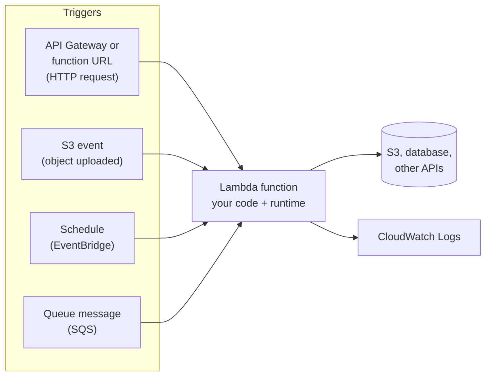
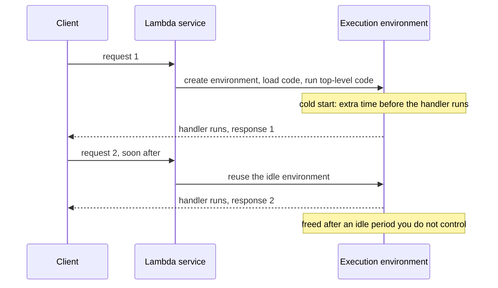

# Lambda and serverless

After this you can write a Python Lambda handler, test it locally, expose it over HTTPS, estimate what it costs, and say when a function fits better than a server.

Before this: [AWS account, IAM and billing](02-aws-account-iam-and-billing.md), [S3](04-s3.md), and [cloud models and regions](01-cloud-models-and-regions.md) for the FaaS idea.

## The idea

Your app needs a small piece of code that runs when someone uploads a photo: make a thumbnail, then stop. On EC2 you would rent a server, keep it patched, and pay for it all month to do a few seconds of work a day. With **AWS Lambda** you upload only the function. AWS runs it when an event arrives, scales the number of copies with the load, and bills for the time the code actually runs. When nothing happens, nothing runs and nothing bills.

"Serverless" does not mean there are no servers. It means you do not provision, patch or scale them. The diagram shows the pattern: an event source triggers the function, and the function reads or writes other services.



## Key terms

A **function** is your code plus its configuration (runtime, memory, timeout, permissions). The **handler** is the entry point Lambda calls: in Python, a function `lambda_handler(event, context)` in a file you name in the configuration, such as `lambda_function.lambda_handler`. The **event** is a JSON document describing what triggered the call (its shape depends on the trigger), and the **context** carries metadata such as the remaining time.

A **runtime** is the language environment, named like `python3.14`. An **execution environment** is the small isolated container Lambda starts to run your code. The **execution role** is an IAM role the function assumes; it needs permission to write logs, plus whatever else the code touches (least privilege, as in the IAM lesson).

A **cold start** happens when Lambda has no idle environment and must create one: download the code, start the runtime and run your top-level code. A **warm start** reuses an idle environment, skipping that work.

A **function URL** is a built-in HTTPS endpoint for one function. **API Gateway** is a separate service that puts routes, authorization, throttling and request mapping in front of functions.

## How it works

The sequence below is one function across two requests. The first pays for a cold start, and the second reuses the environment.



Code outside the handler runs once per environment, so put expensive setup there (a database connection, a loaded config) and reuse it. Never store anything important in memory or `/tmp` between calls: another call may land on a different environment, and an environment can disappear at any time. Lambda holds no state for you.

Limits shape the design. As of 2026 a function can run for at most 900 seconds (15 minutes), have 128 MB to 10,240 MB of memory, and handle request and response payloads of up to 6 MB each when called synchronously ([Lambda quotas](https://docs.aws.amazon.com/lambda/latest/dg/gettingstarted-limits.html)). CPU power scales with the memory setting: more memory means faster code and a higher per-millisecond price. The default account limit is 1,000 concurrent executions, and new accounts start lower. The default timeout when you create a function from the CLI is 3 seconds, so slow code fails with a timeout until you raise it.

Billing has two parts: a charge per request and a charge for duration, measured in GB-seconds (memory in GB times seconds run). The [Lambda pricing page](https://aws.amazon.com/lambda/pricing/) lists, as of 2026, \$0.20 per million requests and \$0.0000166667 per GB-second for x86 in US East (N. Virginia), and a free tier of 1 million requests and 400,000 GB-seconds per month. It does not list `ca-central-1` figures in the text we could read, so check the page for your Region before relying on a number. Take a function with 128 MB of memory that runs 200 ms and is called a million times in a month: $1{,}000{,}000 \times 0.125 \times 0.2 = 25{,}000$ GB-seconds. At US East prices that is about \$0.42 for compute plus \$0.20 for requests, \$0.62 before the free tier, and zero inside it.

Lambda can invoke the function over HTTP in two ways. A function URL is the shortest path: one setting, one address like `https://<id>.lambda-url.<region>.on.aws`, with auth type `AWS_IAM` or `NONE` ([function URLs](https://docs.aws.amazon.com/lambda/latest/dg/urls-configuration.html)). API Gateway costs more and takes longer to set up, but gives you routes, API keys, usage plans and request validation.

Here is a handler for a function URL. The event for a function URL carries the query string in `queryStringParameters`, and the return value with `statusCode`, `headers` and `body` becomes the HTTP response.

```python
import json
import time

started = time.time()   # top-level code: runs once per environment
calls = 0


def lambda_handler(event, context):
    global calls
    calls += 1
    params = event.get("queryStringParameters") or {}
    name = params.get("name", "world")
    body = {"message": f"hello, {name}", "calls_in_this_environment": calls}
    return {
        "statusCode": 200,
        "headers": {"Content-Type": "application/json"},
        "body": json.dumps(body),
    }
```

Test it without AWS by calling it with a fake event. The second call shows the module-level counter surviving, which is what a warm environment does.

```python
from lambda_function import lambda_handler

print(lambda_handler({"queryStringParameters": {"name": "Ada"}}, None))
print(lambda_handler({}, None)["body"])
```

```text
{'statusCode': 200, 'headers': {'Content-Type': 'application/json'}, 'body': '{"message": "hello, Ada", "calls_in_this_environment": 1}'}
{"message": "hello, world", "calls_in_this_environment": 2}
```

## Worked examples

<div class="example" markdown>

### Example 1: serverless or a server?

Decide for three jobs.

1. Thumbnails after S3 uploads, a few hundred a day, each taking two seconds. Event-driven, short, bursty, idle most of the time: Lambda fits, triggered by an S3 event.
2. A chat server holding thousands of open WebSocket connections. Long-lived connections and in-memory state are what Lambda avoids: use a server or a container.
3. A nightly report that takes 40 minutes. It exceeds the 15-minute limit, so split it into steps, or run it on a container or EC2 instance on a schedule.

Check: for each job ask four questions. Is it triggered by an event? Does it finish in well under 15 minutes? Can it keep no state between calls? Is the traffic uneven? Four yeses is a good Lambda candidate; each no is a reason to look at a server.

</div>

## Common mistakes

<div class="warning" markdown>

Watch out: a public function URL (auth type `NONE`) lets anyone on the internet run your code at your expense. Use `AWS_IAM` or put API Gateway with authorization in front of anything real, set a reserved concurrency limit, and delete lab URLs when finished.

Watch out: relying on a database connection or global variable surviving. Environments come and go, and many run in parallel, so a busy function can open hundreds of database connections at once. Put a pooler such as RDS Proxy between Lambda and Postgres.

Watch out: infinite loops through triggers, such as a function that writes to the same S3 bucket that triggers it. Write results to a different bucket or prefix.

</div>

## Working with AI

<div class="ai" markdown>

Words to use: handler, event, execution role, cold start, timeout, memory, concurrency, function URL, GB-seconds.

Prompts to try:

- "Write a Python 3.14 Lambda handler for a function URL that returns JSON, plus a local test that calls it with a fake event. List the AWS CLI v2 commands to deploy it with a least-privilege execution role, and the commands to delete everything."
- "My Lambda behind API Gateway returns 502 and the logs say `Task timed out after 3.00 seconds`. Here is the handler: (paste). What are the likely causes and what should I measure?"

What to check:

- An execution role with `AdministratorAccess` or `*` actions. It should have the basic logging policy plus the one resource it needs.
- A response that is not in the shape the trigger expects. API Gateway and function URLs need `statusCode` and a string `body`; return a dict as `body` and you get a 502.
- A runtime identifier that is deprecated or does not exist. Compare with the [supported runtimes](https://docs.aws.amazon.com/lambda/latest/dg/lambda-runtimes.html).
- Cost claims for "free" that ignore API Gateway, NAT gateway, data transfer and CloudWatch Logs.

</div>

## Quiz

1\. What runs once per execution environment rather than once per request?

<details class="solution" markdown>
<summary>Answer</summary>

The code outside the handler (imports, setup, module-level variables). The handler runs on every request.

</details>

2\. A function configured with 512 MB runs 400 ms per call. How many GB-seconds does one call use?

<details class="solution" markdown>
<summary>Answer</summary>

512 MB is 0.5 GB, and 0.5 times 0.4 s is 0.2 GB-seconds per call.

</details>

3\. Your function writes a counter in a global variable and returns it. Two users report different counts for the same page. Why?

<details class="solution" markdown>
<summary>Answer</summary>

Each concurrent request can run in a different execution environment, and each has its own copy of the variable. Store shared state in a database or another service.

</details>

4\. Why is a Lambda function a poor fit for a job that processes a 2 GB video for 30 minutes?

<details class="solution" markdown>
<summary>Answer</summary>

The limit is 15 minutes per invocation, and the synchronous payload is 6 MB, so the work must be split into steps, with the video in S3. A container task or EC2 instance is simpler for one long job.

</details>

## Lab

<div class="lab" markdown>

### Lab: deploy a function and call it over HTTPS

Goal: deploy the handler above, invoke it from the CLI and from `curl`, read its logs, then delete everything. Time: about 25 minutes. Runs in: Git Bash with the `lab` profile. Commands are unverified (written from the CLI reference); the handler itself was run locally. Lambda bills per use and a single test is far inside the free tier listed above, but the public URL must not outlive the lab.

1. Save the handler as `lambda_function.py`, test it locally with the two-line script above, then zip it. Python's `zipfile` module avoids needing a `zip` command in Git Bash.

   ```bash
   python -m zipfile -c lambda.zip lambda_function.py
   ```

2. Create the execution role with only the basic logging policy.

   ```bash
   export AWS_PROFILE=lab AWS_PAGER=""
   cat > trust.json <<'EOF'
   {"Version":"2012-10-17","Statement":[{"Effect":"Allow",
    "Principal":{"Service":"lambda.amazonaws.com"},"Action":"sts:AssumeRole"}]}
   EOF
   ROLE=$(aws iam create-role --role-name lab-lambda-role \
     --assume-role-policy-document file://trust.json \
     --query Role.Arn --output text)
   aws iam attach-role-policy --role-name lab-lambda-role \
     --policy-arn arn:aws:iam::aws:policy/service-role/AWSLambdaBasicExecutionRole
   sleep 10
   ```

3. Create the function and invoke it with a test event.

   ```bash
   aws lambda create-function --function-name lab-hello \
     --runtime python3.14 --handler lambda_function.lambda_handler \
     --role "$ROLE" --zip-file fileb://lambda.zip --timeout 10 --memory-size 128
   aws lambda wait function-active-v2 --function-name lab-hello
   aws lambda invoke --function-name lab-hello \
     --cli-binary-format raw-in-base64-out \
     --payload '{"queryStringParameters":{"name":"Ada"}}' out.json
   cat out.json
   ```

   ```text
   {"statusCode": 200, "headers": {"Content-Type": "application/json"}, "body": "{\"message\": \"hello, Ada\", \"calls_in_this_environment\": 1}"}
   ```

4. Add a function URL. With the CLI you must add both permission statements yourself ([access control](https://docs.aws.amazon.com/lambda/latest/dg/urls-auth.html)). Then call it twice.

   ```bash
   URL=$(aws lambda create-function-url-config --function-name lab-hello \
     --auth-type NONE --query FunctionUrl --output text)
   aws lambda add-permission --function-name lab-hello \
     --statement-id UrlPolicyInvokeURL --action lambda:InvokeFunctionUrl \
     --principal '*' --function-url-auth-type NONE
   aws lambda add-permission --function-name lab-hello \
     --statement-id UrlPolicyInvokeFunction --action lambda:InvokeFunction \
     --principal '*' --invoked-via-function-url
   curl "$URL?name=Grace"; echo
   curl "$URL"; echo
   ```

   ```text
   {"message": "hello, Grace", "calls_in_this_environment": 1}
   {"message": "hello, world", "calls_in_this_environment": 2}
   ```

   The counter rises on the second call because the same warm environment served both. After a long idle period it would start again at 1.

5. Read the log lines the runtime wrote, which show duration and memory used.

   ```bash
   aws logs tail /aws/lambda/lab-hello --since 10m
   ```

6. Cleanup. Delete the URL first so nothing public is left, then the function, its log group and the role. Confirm that the lists are empty.

   ```bash
   aws lambda delete-function-url-config --function-name lab-hello
   aws lambda delete-function --function-name lab-hello
   aws logs delete-log-group --log-group-name /aws/lambda/lab-hello
   aws iam detach-role-policy --role-name lab-lambda-role \
     --policy-arn arn:aws:iam::aws:policy/service-role/AWSLambdaBasicExecutionRole
   aws iam delete-role --role-name lab-lambda-role
   rm -f trust.json out.json lambda.zip
   aws lambda list-functions --query "Functions[].FunctionName"
   aws logs describe-log-groups --log-group-name-prefix /aws/lambda/lab \
     --query "logGroups[].logGroupName"
   ```

   ```text
   []
   []
   ```

   Log groups cost nothing when empty, but they are the one resource Lambda creates silently, so check for it. Also confirm in the console, in `ca-central-1`, that Lambda lists no functions.

Expected result: the CLI invoke and both `curl` calls print JSON, the counter rises between the two `curl` calls, and the final lists are empty.

<details class="solution" markdown>
<summary>Solution</summary>

The commands above are the full solution. If `curl` returns `403 Forbidden`, one of the two permission statements is missing. If the function reports a timeout, raise `--timeout` with `aws lambda update-function-configuration`.

</details>

</div>

## Where this shows up

- A database behind a Lambda function is reached through a VPC and a pooler, as in [RDS managed Postgres](05-rds-managed-postgres.md) and [VPCs and security groups](06-vpcs-and-security-groups.md).
- Lambda logs flow to CloudWatch, covered in [Logging, metrics and monitoring](../04-operations/01-logging-metrics-and-monitoring.md).
- The container-based alternative for long-running code is in [registries and Kubernetes basics](../01-containers/04-registries-and-kubernetes-basics.md).
