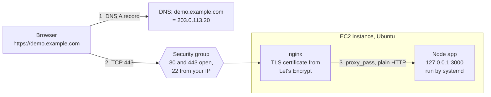
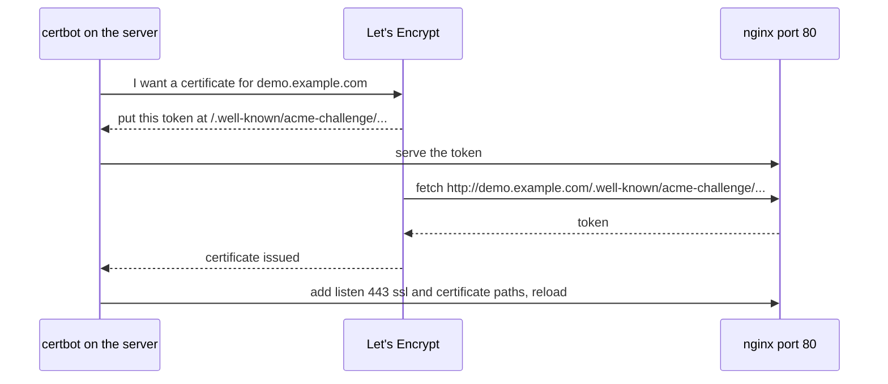

# Deploying an app to EC2

After this you can put a Node app on an EC2 server so it runs under systemd, sits behind nginx, answers on a domain name over HTTPS, and shows its logs with `journalctl`.

Before this: [EC2](03-ec2.md), [VPCs and security groups](06-vpcs-and-security-groups.md), [Node.js and its runtime](../../09-back-end/01-servers-and-apis/02-nodejs-and-its-runtime.md), [DNS and domains](../../07-networking/01-how-the-internet-works/05-dns-and-domains.md), [TLS, HTTPS and certificates](../../07-networking/02-web-protocols/03-tls-https-and-certificates.md) and [proxies and CDNs](../../07-networking/02-web-protocols/05-proxies-and-cdns.md).

## The idea

Your Node app works on `localhost:3000`. To give it to the public you need five things in a row: a server that stays on, a process manager that restarts the app when it crashes, a front door that speaks HTTPS on the standard ports, a certificate the browser trusts, and a name in DNS that points at the server. This lesson assembles all five by hand, once, so you can recognise each piece when a platform hides it later.



## Key terms

A **reverse proxy** is a server that accepts requests from clients and forwards them to another server behind it. **nginx** (pronounced "engine x") is a web server that is commonly used this way. Here it terminates TLS (decrypts HTTPS) and passes plain HTTP to the app on the same machine, so the app never listens on a public port.

A **systemd unit** is a text file that tells systemd how to run a service: which command, as which user, and when to restart it. **journald** collects the output of services, and `journalctl` reads it.

An **A record** maps a hostname to an IPv4 address. **Let's Encrypt** is a free certificate authority, and **certbot** is its recommended client program: it proves to Let's Encrypt that you control the domain, fetches a certificate, edits nginx to use it, and renews it before it expires.

## How it works

The app is a small Node server. It listens on the loopback address only (`127.0.0.1`), which is why nothing outside the machine can reach it except through nginx.

```javascript
const http = require("node:http");

const port = Number(process.env.PORT || 3000);

const server = http.createServer((req, res) => {
  console.log(`${req.method} ${req.url} from ${req.headers["x-forwarded-for"] || req.socket.remoteAddress}`);
  res.setHeader("Content-Type", "application/json");
  res.end(JSON.stringify({ message: "hello from behind nginx", host: req.headers.host }));
});

server.listen(port, "127.0.0.1", () => console.log(`listening on 127.0.0.1:${port}`));
```

Running it locally and requesting `/health` with a forwarded-for header printed this (checked on Node 24):

```text
{"message":"hello from behind nginx","host":"localhost:3456"}
GET /health from 203.0.113.9
```

systemd runs it. The unit file `/etc/systemd/system/demoapp.service` names a dedicated user with no login, so a bug in the app can touch only what that user can, as in the permissions lesson. `Restart=on-failure` brings it back after a crash, and `WantedBy=multi-user.target` starts it at boot ([systemd.service(5)](https://manpages.ubuntu.com/manpages/noble/man5/systemd.service.5.html)).

```ini
[Unit]
Description=Demo Node app
After=network.target

[Service]
User=app
WorkingDirectory=/opt/demoapp
Environment=PORT=3000
ExecStart=/usr/bin/node /opt/demoapp/server.js
Restart=on-failure

[Install]
WantedBy=multi-user.target
```

The commands to use it are `sudo systemctl daemon-reload` after editing a unit, `sudo systemctl enable --now demoapp` to start now and at every boot, `systemctl status demoapp`, and `sudo systemctl restart demoapp` after a deploy. Services, systemd and logs<!-- link: ../../02-operating-systems-and-linux/02-linux-command-line/07-services-systemd-and-logs.md --> covers these in depth.

nginx needs one server block. On Ubuntu, files go in `/etc/nginx/sites-available/` and a link in `sites-enabled/` turns one on. The `proxy_set_header` lines pass the original host and client address on, because otherwise the app sees every request as coming from nginx ([nginx reverse proxy docs](https://docs.nginx.com/nginx/admin-guide/web-server/reverse-proxy/)).

```nginx
server {
    listen 80;
    server_name demo.example.com;

    location / {
        proxy_pass http://127.0.0.1:3000;
        proxy_set_header Host $host;
        proxy_set_header X-Real-IP $remote_addr;
        proxy_set_header X-Forwarded-For $proxy_add_x_forwarded_for;
        proxy_set_header X-Forwarded-Proto $scheme;
    }
}
```

Always run `sudo nginx -t` before `sudo systemctl reload nginx`. A syntax error caught by `-t` costs nothing; one found by a reload can take the site down.

Certbot's job has to happen over port 80, which is why that port must stay open. In the diagram, Let's Encrypt gives certbot a secret token, certbot makes nginx serve it at a known URL, and Let's Encrypt fetches that URL using the domain name. Only whoever controls the DNS record for the name, and the server it points to, can pass ([certbot instructions for nginx on Linux](https://certbot.eff.org/instructions?ws=nginx&os=snap), as of 2026).



After issuing, certbot rewrites the nginx server block to listen on 443 and redirect port 80 to HTTPS, and installs a timer that renews the certificate. `sudo certbot renew --dry-run` tests renewal without changing anything.

Three habits keep the server healthy. Read logs with `sudo journalctl -u demoapp -f` for the app, and `/var/log/nginx/access.log` and `error.log` for nginx. Apply operating-system updates with `sudo apt-get update && sudo apt-get upgrade`, and restart the service you changed. Deploy new code by copying the file, then `sudo systemctl restart demoapp`, and watch the log. Keep secrets out of the unit file and out of git: put them in an `EnvironmentFile=` with mode `600`, as in [secrets and dependency security](../../12-security/01-web-security/06-secrets-and-dependency-security.md).

## Worked examples

<div class="example" markdown>

### Example 1: the page is "502 Bad Gateway"

You browse to your domain and nginx answers `502 Bad Gateway`.

1. A 502 means nginx is running but its upstream, the app, did not answer. The problem is behind nginx, not in DNS or TLS.
2. On the server, run `systemctl status demoapp`. If it says `failed`, read the cause with `sudo journalctl -u demoapp -n 30`.
3. If it is `active`, test the app directly: `curl http://127.0.0.1:3000`. A refused connection means the app listens on a different port or address than `proxy_pass` names.
4. Fix the port in the unit file or nginx, run `daemon-reload` or `nginx -t` as needed, then restart or reload.

Check: `curl -I https://your-host` returns `200`, and `journalctl` shows the request line.

</div>

## Common mistakes

<div class="warning" markdown>

Watch out: running the app as root, or on port 80 directly. Run it as a dedicated user on a high port and let nginx take the privileged ports.

Watch out: opening port 3000 in the security group "to test". The app should be reachable only through nginx. Test with `curl localhost:3000` on the server.

Watch out: asking for certificates repeatedly while debugging. Let's Encrypt limits failures and duplicates; fix DNS and the security group first, and use certbot's `--dry-run` or staging option to practise ([rate limits](https://letsencrypt.org/docs/rate-limits/)).

</div>

## Working with AI

<div class="ai" markdown>

Words to use: reverse proxy, `proxy_pass`, systemd unit, `Restart=on-failure`, A record, certificate authority, HTTP-01 challenge, `journalctl`.

Prompts to try:

- "Write a systemd unit for a Node 20 app at /opt/demoapp that runs as a dedicated user, restarts on failure, and reads secrets from /etc/demoapp.env. Then write the nginx server block that proxies demo.example.com to it on Ubuntu 24.04, and the certbot command."
- "nginx returns 502 for my app. Here is `systemctl status demoapp`, the last 30 `journalctl` lines and my nginx config: (paste). Walk through the checks in order."

What to check:

- An app that listens on `0.0.0.0` or a security group that opens 3000 or 22 to `0.0.0.0/0`.
- Config copied from another distribution. Ubuntu uses `sites-available`, and the Node path comes from `which node`.
- `chmod 777`, `sudo` in the unit's `ExecStart`, or `User=root`.
- Certbot flags and paths that do not exist. Check with `certbot --help` and the official instructions.

</div>

## Quiz

1\. Why does the Node app listen on `127.0.0.1` instead of `0.0.0.0`?

<details class="solution" markdown>
<summary>Answer</summary>

Loopback accepts connections only from the same machine, so the only way in from the internet is through nginx, which handles TLS and the standard ports.

</details>

2\. After a reboot, the app is down but nginx is up. Which systemd command did you forget when you installed it?

<details class="solution" markdown>
<summary>Answer</summary>

`systemctl enable` (or `enable --now`). `start` runs the service once; `enable` makes it start at boot.

</details>

3\. Certbot fails with a timeout fetching the challenge URL. Name two things to check.

<details class="solution" markdown>
<summary>Answer</summary>

The security group must allow port 80 from anywhere, and the A record must point at this instance's current public IP. DNS changes can take up to the record's TTL to spread.

</details>

4\. You edit the unit file and run `systemctl restart demoapp`, but the old settings stay. What is missing?

<details class="solution" markdown>
<summary>Answer</summary>

`sudo systemctl daemon-reload`, which makes systemd re-read unit files.

</details>

## Lab

<div class="lab" markdown>

### Lab: a Node app on HTTPS, then delete it

Goal: deploy the app above to a new EC2 instance behind nginx with a Let's Encrypt certificate, check its logs, then tear everything down. Time: about 45 minutes. Runs in: Git Bash with the `lab` profile, plus a hostname. All server commands and AWS commands are unverified (checked against the CLI reference, man pages, nginx.org and certbot.eff.org, not run on a live server), and the outputs shown (versions, addresses) are examples. The instance bills while it runs, so do this in one sitting and finish with the cleanup.

For the hostname use a domain you own (add an A record at your registrar), or the free wildcard DNS name `203-0-113-20.sslip.io` style, which resolves to the IP written inside it. Wildcard services like this are run by third parties and share Let's Encrypt limits with other users, so use your own domain if you have one.

1. Create the security group, key pair and instance. Port 22 is limited to your address; 80 and 443 are open; nothing else is.

   ```bash
   export AWS_PROFILE=lab AWS_PAGER=""
   MYIP=$(curl -s https://checkip.amazonaws.com)
   SG=$(aws ec2 create-security-group --group-name lab-web-sg \
     --description "lab web" --query GroupId --output text)
   for P in 80 443; do aws ec2 authorize-security-group-ingress --group-id "$SG" \
     --protocol tcp --port $P --cidr 0.0.0.0/0; done
   aws ec2 authorize-security-group-ingress --group-id "$SG" \
     --protocol tcp --port 22 --cidr "$MYIP/32"
   aws ec2 create-key-pair --key-name lab-key \
     --query KeyMaterial --output text > lab-key.pem && chmod 400 lab-key.pem
   AMI=$(MSYS_NO_PATHCONV=1 aws ssm get-parameter --name \
     /aws/service/canonical/ubuntu/server/24.04/stable/current/amd64/hvm/ebs-gp3/ami-id \
     --query Parameter.Value --output text)
   ID=$(aws ec2 run-instances --image-id "$AMI" --instance-type t3.micro \
     --key-name lab-key --security-group-ids "$SG" \
     --tag-specifications 'ResourceType=instance,Tags=[{Key=Project,Value=lab}]' \
     --query "Instances[0].InstanceId" --output text)
   aws ec2 wait instance-running --instance-ids "$ID"
   IP=$(aws ec2 describe-instances --instance-ids "$ID" \
     --query "Reservations[0].Instances[0].PublicIpAddress" --output text)
   echo "$IP"
   ```

2. Point the name at the server. With your own domain, create an A record for `demo.yourdomain.com` with value `$IP` and a short TTL. With sslip.io, set `HOST=$(echo $IP | tr . -).sslip.io`. Then check that the name resolves to the instance.

   ```bash
   HOST=demo.yourdomain.com   # or the sslip.io name
   nslookup "$HOST"
   ```

   ```text
   Name:    demo.yourdomain.com
   Address: 203.0.113.20
   ```

3. Save `server.js`, `demoapp.service` and `demo.nginx` (the three blocks above, with your `HOST` in `server_name`) in the current folder, copy them over, and install everything. Check `node --version` in the output: this lab needs Node 18 or later for `node:http`.

   ```bash
   scp -i lab-key.pem -o StrictHostKeyChecking=accept-new \
     server.js demoapp.service demo.nginx ubuntu@$IP:~
   ssh -i lab-key.pem ubuntu@$IP '
     sudo apt-get update -q && sudo apt-get install -y -q nodejs nginx
     node --version
     sudo useradd --system --no-create-home --shell /usr/sbin/nologin app
     sudo mkdir -p /opt/demoapp && sudo mv server.js /opt/demoapp/
     sudo mv demoapp.service /etc/systemd/system/
     sudo systemctl daemon-reload && sudo systemctl enable --now demoapp
     curl -s http://127.0.0.1:3000
   '
   ```

   ```text
   v18.19.1
   {"message":"hello from behind nginx","host":"127.0.0.1:3000"}
   ```

4. Turn on the nginx site and test over HTTP.

   ```bash
   ssh -i lab-key.pem ubuntu@$IP '
     sudo mv demo.nginx /etc/nginx/sites-available/demo
     sudo ln -s /etc/nginx/sites-available/demo /etc/nginx/sites-enabled/demo
     sudo rm -f /etc/nginx/sites-enabled/default
     sudo nginx -t && sudo systemctl reload nginx
   '
   curl "http://$HOST"
   ```

   ```text
   {"message":"hello from behind nginx","host":"demo.yourdomain.com"}
   ```

5. Get the certificate, test renewal, and read the logs. Replace the email.

   ```bash
   ssh -i lab-key.pem ubuntu@$IP "
     sudo snap install --classic certbot
     sudo ln -sf /snap/bin/certbot /usr/local/bin/certbot
     sudo certbot --nginx -d $HOST -m you@example.com --agree-tos --no-eff-email -n
     sudo certbot renew --dry-run
     sudo journalctl -u demoapp -n 5 --no-pager
   "
   curl -I "https://$HOST"
   ```

   ```text
   HTTP/1.1 200 OK
   Server: nginx/1.24.0 (Ubuntu)
   Content-Type: application/json
   ```

   The `journalctl` lines include a `GET / from 203.0.113.x` line from the app, with your real address taken from `X-Forwarded-For`. Try `http://$HOST` again: it should redirect to HTTPS.

6. Cleanup. Terminate the instance, delete the group and key, and remove your DNS record (a leftover A record pointing at a released IP can later point at someone else's server).

   ```bash
   aws ec2 terminate-instances --instance-ids "$ID"
   aws ec2 wait instance-terminated --instance-ids "$ID"
   aws ec2 delete-security-group --group-id "$SG"
   aws ec2 delete-key-pair --key-name lab-key && rm lab-key.pem
   aws ec2 describe-instances \
     --filters Name=instance-state-name,Values=pending,running,stopping,stopped \
     --query "Reservations[].Instances[].InstanceId"
   aws ec2 describe-volumes --query "Volumes[].VolumeId"
   aws ec2 describe-addresses --query "Addresses[].PublicIp"
   ```

   ```text
   []
   []
   []
   ```

   This lab allocated no Elastic IP and no NAT gateway. Look in the console in `ca-central-1` as well, and check Billing the next day.

Expected result: the JSON page over HTTPS with a valid certificate, journal lines showing the request, and three empty lists at the end.

<details class="solution" markdown>
<summary>Solution</summary>

The commands above are the full solution. If `certbot` cannot fetch the challenge, check the A record against `$IP`, then the security group for port 80. If nginx shows 502, follow Example 1. Stopping the instance instead of terminating it would keep the volume, and billing, and would change the public IP, breaking the A record.

</details>

</div>

## Where this shows up

- Packaging the same app as a container is in [Docker images and Dockerfiles](../01-containers/02-docker-images-and-dockerfiles.md), and automating this deploy from a pipeline is in [GitHub Actions](../02-ci-cd/02-github-actions.md).
- Watching the app after it is live is the subject of Logging, metrics and monitoring<!-- link: ../04-operations/01-logging-metrics-and-monitoring.md -->.
