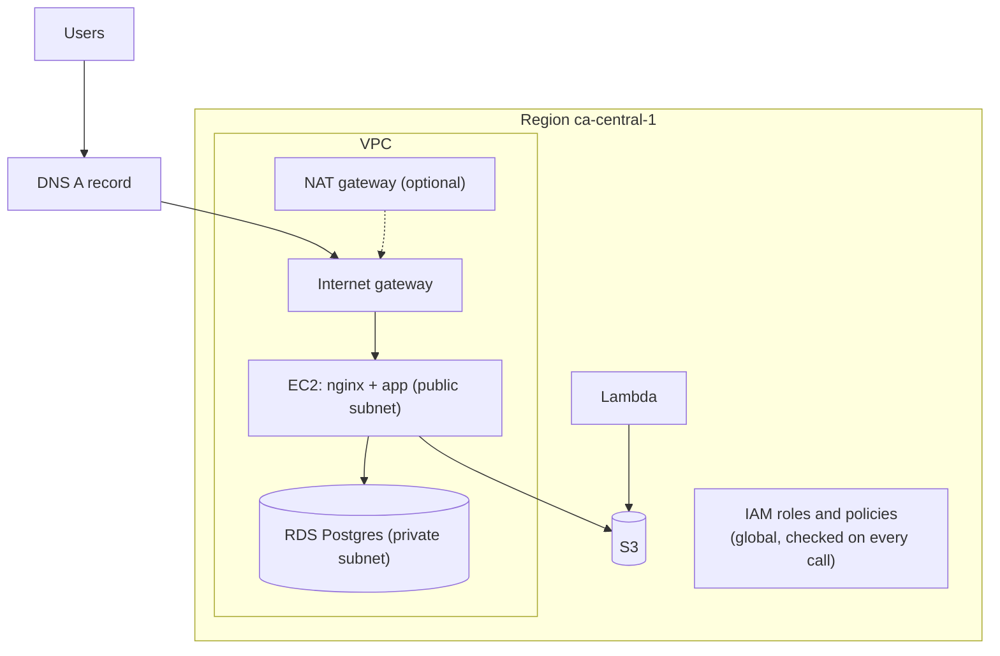

# AWS

Cheat sheet for the chapter. Prices, free-plan rules and limits are as of 2026 and live in the lessons, with their sources; check the linked official pages before relying on a number.

## Lessons

1. [Cloud models and regions](01-cloud-models-and-regions.md): IaaS, PaaS, FaaS, SaaS, shared responsibility, Regions and AZs.
2. [AWS account, IAM and billing](02-aws-account-iam-and-billing.md): root user, IAM users and roles, policies, MFA, budgets.
3. [EC2](03-ec2.md): instances, AMIs, instance types, key pairs, security groups, EBS.
4. [S3](04-s3.md): buckets, keys, storage classes, versioning, presigned URLs.
5. [RDS managed Postgres](05-rds-managed-postgres.md): DB instances, backups, Multi-AZ, read replicas.
6. [VPCs and security groups](06-vpcs-and-security-groups.md): subnets, route tables, gateways, filtering.
7. [Lambda and serverless](07-lambda-and-serverless.md): handlers, triggers, cold starts, pricing.
8. [Deploying an app to EC2](08-deploying-an-app-to-ec2.md): systemd, nginx, DNS, HTTPS.

## How the pieces fit

## Terms

| Term | Meaning |
|---|---|
| Region, AZ | a location with several data centres, and one isolated data centre group inside it |
| IAM user, role, policy | a person's identity, a temporary identity something assumes, a JSON allow/deny document |
| Root user | the account's first identity: enable MFA, then do not use it |
| EC2 instance, AMI | a virtual server, and the image it boots from |
| EBS | the network disk of an instance |
| S3 bucket, key | a container of objects, and an object's full name |
| RDS DB instance | a managed database server; reached by its endpoint name |
| Multi-AZ | synchronous standby in another AZ for failover (no queries) |
| Read replica | asynchronous copy that serves reads and can lag |
| VPC, subnet | your private network in a Region, and a slice of it in one AZ |
| Route table | destination range to target rules for a subnet |
| Internet gateway, NAT gateway | VPC door to the internet, and a way for private servers to go out only |
| Security group, network ACL | stateful allow-list on an interface, stateless allow/deny list on a subnet |
| Lambda function, handler | code run per event, and its entry point `lambda_handler(event, context)` |
| Cold start | extra time to create a new execution environment |
| Function URL, API Gateway | a built-in HTTPS endpoint for one function, and a full API front door |
| Reverse proxy | nginx forwards requests to the app behind it |
| systemd unit | file describing how to run a service |
| A record | hostname to IPv4 address |
| Let's Encrypt, certbot | free certificate authority, and its client |

## Safe-account rules

- Enable MFA on the root user, then work as a non-root identity. Create a budget alert first.
- Work in `ca-central-1`. Check the Region shown in the console matches your CLI profile.
- Every lab ends with a cleanup step and an empty-list check. Check Billing the next day.
- Never open 22 or a database port to `0.0.0.0/0`. Databases are never publicly accessible.

## Cost traps

| Resource | Why it keeps billing |
|---|---|
| Stopped EC2 instance | the EBS volume (and any Elastic IP) still bill |
| Elastic IP / public IPv4 | billed hourly, in use or idle ([VPC pricing](https://aws.amazon.com/vpc/pricing/)) |
| NAT gateway | hourly plus per GB, even with no traffic |
| RDS instance | instance and storage hours; a manual snapshot lives on after the instance is deleted |
| S3 old versions | versioned buckets keep deleted data until all versions are removed |
| Public Lambda URL | anyone can run it at your expense |

## Commands

Unverified against a live account; checked against the [AWS CLI v2 reference](https://docs.aws.amazon.com/cli/latest/reference/). Set `export AWS_PROFILE=lab` first.

| Task | Command |
|---|---|
| Who am I | `aws sts get-caller-identity` |
| Latest Amazon Linux AMI | `aws ssm get-parameter --name /aws/service/ami-amazon-linux-latest/al2023-ami-kernel-default-x86_64 --query Parameter.Value --output text` |
| Launch / terminate | `aws ec2 run-instances ...` / `aws ec2 terminate-instances --instance-ids ID` |
| Open a port | `aws ec2 authorize-security-group-ingress --group-id SG --protocol tcp --port 443 --cidr 0.0.0.0/0` |
| Allow from another group | same, with `--source-group SG2` |
| Copy / list S3 | `aws s3 cp FILE s3://BUCKET/KEY` / `aws s3 ls s3://BUCKET/` |
| Create private DB | `aws rds create-db-instance ... --no-publicly-accessible --vpc-security-group-ids SG` |
| Delete DB | `aws rds delete-db-instance --db-instance-identifier ID --skip-final-snapshot --delete-automated-backups` |
| Snapshot / delete snapshot | `aws rds create-db-snapshot ...` / `aws rds delete-db-snapshot --db-snapshot-identifier ID` |
| VPC pieces | `aws ec2 create-vpc`, `create-subnet`, `create-internet-gateway`, `create-route-table`, `create-route` |
| Deploy a function | `aws lambda create-function --function-name N --runtime python3.14 --handler lambda_function.lambda_handler --role ARN --zip-file fileb://lambda.zip` |
| Invoke / delete function | `aws lambda invoke --function-name N --cli-binary-format raw-in-base64-out --payload JSON out.json` / `aws lambda delete-function --function-name N` |
| Lambda logs | `aws logs tail /aws/lambda/N --since 10m` |

## On the server

| Task | Command |
|---|---|
| Reload unit files / start now and at boot | `sudo systemctl daemon-reload` / `sudo systemctl enable --now demoapp` |
| Status, restart | `systemctl status demoapp`, `sudo systemctl restart demoapp` |
| App logs | `sudo journalctl -u demoapp -f` |
| Test nginx config, apply it | `sudo nginx -t`, `sudo systemctl reload nginx` |
| nginx logs | `/var/log/nginx/access.log`, `/var/log/nginx/error.log` |
| Certificate | `sudo certbot --nginx -d HOST`, test renewal with `sudo certbot renew --dry-run` |
| Check DNS | `nslookup HOST` |

## Rules of thumb

- Reachability needs three things: a route, a security group rule and a listening process. A hang means a firewall or missing route; a refusal means nothing is listening.
- Security groups are stateful allow lists. Network ACLs are stateless. Reference another security group rather than an IP range when both sides are yours.
- Multi-AZ is for availability, read replicas are for read load, and backups are for mistakes.
- Lambda fits short, event-driven, stateless work; a long job or a connection-heavy server fits a container or EC2.
- Delete in reverse order of creation, instances first.
