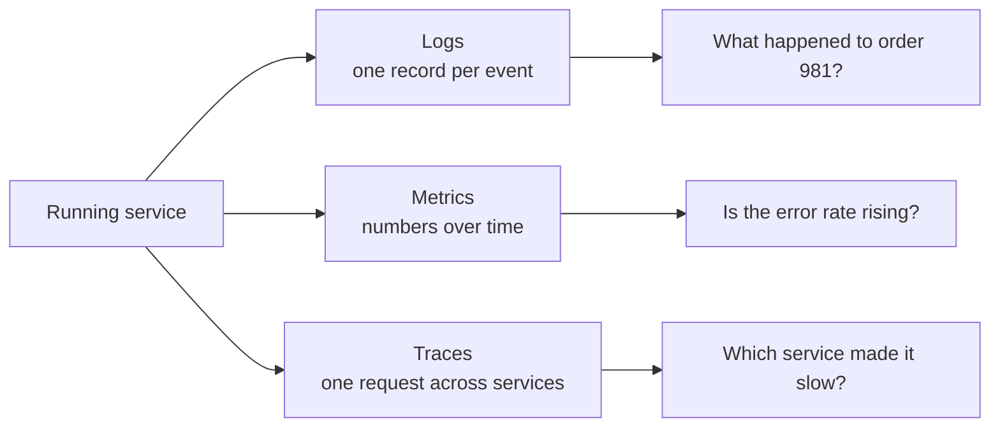
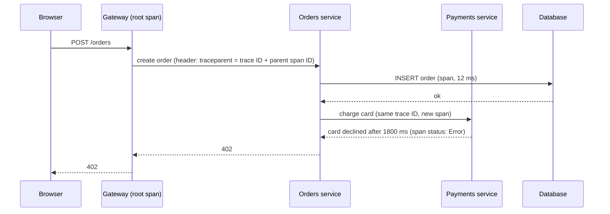

# Logging metrics and monitoring

After this you can add structured logs, metrics and traces to a service, read a latency percentile, and say which alerts should wake someone up.

Before this: [Express routing and middleware](../../09-back-end/01-servers-and-apis/03-express-routing-and-middleware.md) and [deployment strategies](../02-ci-cd/03-deployment-strategies.md).

## The idea

A user reports that checkout "is slow sometimes". You cannot attach a debugger to a production server, and by the time you look the slow request is over. You have only what the system wrote down.

Systems write down three kinds of evidence, and each answers a different question. Logs say what happened in one event. Metrics say how much, how often and how fast, summed over many events. Traces say where one request spent its time as it crossed several services. Together they make a system **observable**: you can work out what it is doing from the data it emits.



In the diagram, a metric usually tells you something is wrong, a trace narrows down where, and a log explains why.

## Key terms

A **log** is a timestamped record of one event. A **structured log** writes each record as key-value fields (usually one JSON object per line) so a tool can filter on `status` or `user_id` instead of searching text.

A **log level** says how serious a record is. Python's `logging` uses `DEBUG` (10), `INFO` (20), `WARNING` (30), `ERROR` (40) and `CRITICAL` (50). The service logs at one level or above and drops the rest, so `DEBUG` stays quiet in production.

A **request ID** (or **correlation ID**) is a unique value created when a request arrives and attached to every log line it causes, so you can pull out one request's story.

A **metric** is a number measured over time. A **counter** only goes up (requests served). A **gauge** goes up and down (queue length). A **histogram** counts values into buckets, which lets you compute percentiles ([OpenTelemetry metrics](https://opentelemetry.io/docs/concepts/signals/metrics/)).

A **percentile** is the value below which a given share of observations fall. The **p95** latency is the time that 95% of requests beat; 5% are slower. **p50** is the median.

A **trace** is the full path of one request, made of **spans**. A **span** is one unit of work (an HTTP handler, a database query) with a name, start and end time, and a parent. All spans of a trace share a trace ID. **Context propagation** passes that ID from service to service, normally in an HTTP header, so the spans can be joined ([OpenTelemetry traces](https://opentelemetry.io/docs/concepts/signals/traces/)).

## How it works

Logs first. Print JSON, one object per line, to standard output; the platform collects it. Include the level, a short message, the request ID and the facts you would want later (an order ID, a duration). Python's `logging` needs a small formatter for this. In Node, `pino` writes JSON by default and `log.child({ request_id })` stamps every line.

Never log secrets or personal information: passwords, tokens, API keys, full card numbers, health data. Logs are copied, kept for months and read by many people. Log an ID (`user_id: 42`), not an email address. See [privacy and PIPEDA](../../12-security/02-cryptography/06-privacy-and-pipeda.md) and [secrets and dependency security](../../12-security/01-web-security/06-secrets-and-dependency-security.md).

Metrics next. Two checklists say which numbers to collect. The **RED method** is for a request-handling service: Rate (requests per second), Errors (failed requests per second) and Duration (latency, as percentiles). The **USE method** ([Brendan Gregg](https://www.brendangregg.com/usemethod.html)) is for a resource such as a CPU, disk or connection pool: Utilization, Saturation and Errors. Google's SRE book lists four "golden signals", which are latency, traffic, errors and saturation ([Monitoring distributed systems](https://sre.google/sre-book/monitoring-distributed-systems/)).

Use percentiles, not averages. The SRE book warns that a simple average can obscure tail latencies. 

Traces last. In the diagram below, the gateway starts the trace and each service continues it, so one trace ID covers every span.



In this trace, about 1800 of 1830 ms went to the payments span.

Tools split the work. OpenTelemetry is the vendor-neutral standard for producing logs, metrics and traces. Prometheus stores metrics and Grafana draws dashboards from them. CloudWatch is AWS's built-in service for logs, metrics and alarms. Datadog is a paid service that collects all three in one place.

A **dashboard** is a page of charts for one service, with the RED numbers on top.

An **alert** is a rule that notifies a person when a metric crosses a threshold. Alert on symptoms users feel (error rate above 2%, p99 latency above 1 second), not on causes (CPU at 85%). A busy CPU that harms nobody is not worth a 3 a.m. call, and a symptom alert also catches problems you did not predict. Too many alerts cause **alert fatigue**: people start ignoring the pager, including the real ones.

## Worked examples

<div class="example" markdown>

### Example 1: structured logs and a percentile

We log one request as JSON with a request ID, then compute latency percentiles from 100 measured durations.

1. A formatter turns each log record into one JSON object. A `contextvars` variable holds the request ID, so every line in that request carries it without passing it around.
2. The level is set to `INFO`, so the `DEBUG` line is dropped.
3. For percentiles, sort the values and take the one at position $\lceil p/100 \times n \rceil$ (the nearest-rank method).

<details class="code" markdown>
<summary>In code</summary>

```python
import contextvars, json, logging, sys

request_id = contextvars.ContextVar("request_id", default="-")

class JsonFormatter(logging.Formatter):
    def format(self, record):
        entry = {"time": "2026-01-01T12:00:00Z", "level": record.levelname,
                 "message": record.getMessage(), "request_id": request_id.get()}
        entry.update(getattr(record, "fields", {}))
        return json.dumps(entry)

handler = logging.StreamHandler(sys.stdout)
handler.setFormatter(JsonFormatter())
log = logging.getLogger("shop")
log.addHandler(handler)
log.setLevel(logging.INFO)

request_id.set("req-7f3a")
log.info("order created", extra={"fields": {"user_id": 42, "status": 201}})
log.debug("cart contents loaded")
log.error("payment failed", extra={"fields": {"order_id": 981}})
```

```text
{"time": "2026-01-01T12:00:00Z", "level": "INFO", "message": "order created", "request_id": "req-7f3a", "user_id": 42, "status": 201}
{"time": "2026-01-01T12:00:00Z", "level": "ERROR", "message": "payment failed", "request_id": "req-7f3a", "order_id": 981}
```

The time is fixed so the output is repeatable; real code uses the current time. The `pino` version in Node (`pino({ base: null })`, then `log.child({ request_id: "req-7f3a" })`) prints the same shape, with `"level":30` for info and `50` for error.

```python
import math

latencies = [40 + i % 20 for i in range(95)] + [900, 1100, 1500, 2000, 2400]

def percentile(values, p):
    ordered = sorted(values)
    return ordered[math.ceil(p / 100 * len(ordered)) - 1]

print("mean", sum(latencies) / len(latencies))
for p in (50, 95, 99):
    print(f"p{p}", percentile(latencies, p))
```

```text
mean 125.65
p50 49
p95 59
p99 2000
```

</details>

Check: the `DEBUG` line is absent from the output, and the mean (125.65 ms) is more than double the median (49 ms) because five slow requests pull it up. The p95 of 59 ms still looks healthy, while the p99 of 2000 ms exposes those five. Which percentile you alert on decides which problems you see.

A tiny OpenTelemetry example (installed with `pip install opentelemetry-sdk`, version 1.45.1 here) shows context propagation inside one process. A span started inside another becomes its child:

```python
from opentelemetry.sdk.trace import TracerProvider
from opentelemetry.sdk.trace.export import SimpleSpanProcessor
from opentelemetry.sdk.trace.export.in_memory_span_exporter import InMemorySpanExporter

exporter = InMemorySpanExporter()
provider = TracerProvider()
provider.add_span_processor(SimpleSpanProcessor(exporter))
tracer = provider.get_tracer("demo")

with tracer.start_as_current_span("POST /orders"):
    with tracer.start_as_current_span("charge card") as span:
        span.set_attribute("order_id", 981)

for s in exporter.get_finished_spans():
    parent = f"{s.parent.span_id:016x}" if s.parent else None
    print(s.name, f"trace={s.context.trace_id:032x}"[:19], f"span={s.context.span_id:016x}", "parent=", parent)
```

```text
charge card trace=9b377d29d7b40 span=412d5206a2726e70 parent= 32dcbdd504457c2f
POST /orders trace=9b377d29d7b40 span=32dcbdd504457c2f parent= None
```

Both spans share a trace ID, and the child's parent is the root's span ID. The IDs are random and differ on each run. Across services, the same ID travels in the `traceparent` HTTP header instead.

</div>

## Common mistakes

<div class="warning" markdown>

Watch out: logging whole request bodies or headers "for debugging". They contain passwords, tokens and personal data, and log storage is rarely locked down. Log chosen fields, and redact the rest.

Watch out: alerting on the average. One slow user in a hundred does not move a mean, so use p95 or p99 and the error rate.

Watch out: a metric label with unbounded values, such as a user ID or a full URL. Every distinct value creates a new time series and overloads the metrics store. Use route names and status classes.

</div>

## Working with AI

<div class="ai" markdown>

Words to use: structured logging, log level, request ID, histogram, p99, RED method, span, context propagation.

Prompts to try:

- "Add structured JSON logging to this FastAPI app using the standard library. Attach a request ID from an `X-Request-ID` header (or a generated one) to every log line. Never log request bodies or Authorization headers."
- "I have a Grafana panel showing average latency of 120 ms but users complain. Which histogram metrics and percentiles should I chart, and what alert would catch a slow tail?"

What to check:

- Secrets or personal data in log calls. Search the generated code for `password`, `token`, `email`, `headers` and `body`.
- Alerts on causes (CPU, memory) with no symptom alert. Ask what a user would notice.
- Invented OpenTelemetry package names or functions. Check them against [opentelemetry.io](https://opentelemetry.io/docs/) and run the code.
- Metric labels built from IDs or raw URLs.

</div>

## Quiz

1\. Which of logs, metrics and traces would you use first to notice that error rates doubled, and which to find the failing service?

<details class="solution" markdown>
<summary>Answer</summary>

Metrics notice the change (the error-rate chart). A trace shows which service in the request path failed, and the logs of that service, found with the request ID, say why.

</details>

2\. Ten requests take 100 ms and one takes 1100 ms. What are the mean and the p50?

<details class="solution" markdown>
<summary>Answer</summary>

The mean is $2100 / 11 \approx 191$ ms. The p50 is 100 ms (the 6th of 11 sorted values). The single slow request moves the mean but not the median.

</details>

3\. A teammate adds a metric `http_requests_total{user_email="..."}`. What goes wrong?

<details class="solution" markdown>
<summary>Answer</summary>

Each distinct email creates its own time series, so the number of series grows with users and overloads the metrics store. The email is also personal information that does not belong in telemetry. Use a route and status label instead.

</details>

4\. CPU on a web server is at 90% but the error rate and p99 are normal. Should this page someone at night?

<details class="solution" markdown>
<summary>Answer</summary>

No. No user is harmed, so it is a cause, not a symptom. Show it on a dashboard or send a ticket. Page when the symptoms (errors, latency) cross their thresholds.

</details>

## Lab

<div class="lab" markdown>

### Lab: logs, a percentile and a trace

Goal: produce the three kinds of evidence from a small Python script. Time: about 15 minutes. Runs in: WSL (Ubuntu) or PowerShell, with Python 3.

1. Create a folder with a virtual environment and install `opentelemetry-sdk`: `python -m venv venv`, activate it, then `pip install opentelemetry-sdk`.
2. In `app.py`, copy the `JsonFormatter` from Example 1 and log three events, one at each of `INFO`, `WARNING` and `ERROR`.
3. Time 50 calls of a function that sleeps a random 10 to 50 ms (`time.perf_counter()`) and print the p50 and p95.
4. Add the two nested spans from the example with an `InMemorySpanExporter`, and print each span's name and parent.
5. Cleanup: delete the folder.

Expected result: three JSON lines, two percentiles with p95 at least as large as p50, and a child span whose parent is the root span.

<details class="solution" markdown>
<summary>Solution</summary>

Combine the snippets from Example 1. For step 3:

```python
import random, time

durations = []
for _ in range(50):
    start = time.perf_counter()
    time.sleep(random.uniform(0.01, 0.05))
    durations.append((time.perf_counter() - start) * 1000)
print(percentile(durations, 50), percentile(durations, 95))
```

Step 4 uses the `InMemorySpanExporter` code from the example.

</details>

</div>

## Where this shows up

- [Incidents and on-call](02-incidents-and-on-call.md) turns these signals into alerts, targets and a response process.
- Splitting a system into services makes traces necessary; see [monoliths and microservices](../../14-software-and-system-design/01-software-design/05-monoliths-and-microservices.md).
