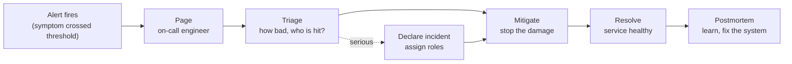
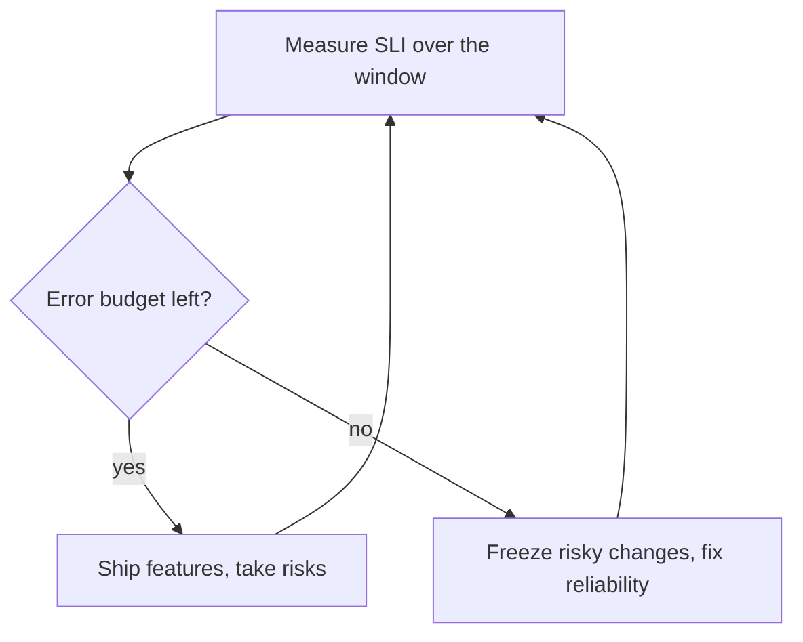

# Incidents and on-call

After this you can set a reliability target with an error budget, take part in the first 15 minutes of an incident, and write a blameless postmortem.

Before this: [logging, metrics and monitoring](01-logging-metrics-and-monitoring.md) and [deployment strategies](../02-ci-cd/03-deployment-strategies.md).

## The idea

At 02:10 your phone buzzes: the checkout error rate is 12%. The person who wrote the payment code is on holiday. What happens in the next hour decides whether customers lose 20 minutes of service or four hours.

Nothing can be 100% reliable, and chasing the last fraction costs more than it earns. So teams pick a target below 100%, measure against it, and treat the gap as a budget they may spend on change. When something breaks anyway, a rehearsed process (alert, page, triage, mitigate, postmortem) replaces improvising at 2 a.m.



## Key terms

A **service level indicator (SLI)** is "a carefully defined quantitative measure of some aspect of the level of service that is provided" ([SRE book](https://sre.google/sre-book/service-level-objectives/)). Example: the share of requests that return without a server error.

A **service level objective (SLO)** is a target value for an SLI over a period, such as "99.9% of requests succeed over 30 days". A **service level agreement (SLA)** is a contract with consequences if the target is missed, for example a refund. If missing it has no consequence, it is an SLO.

An **error budget** is the amount of failure the SLO allows: $1 - \text{SLO}$ ([SRE book](https://sre.google/sre-book/embracing-risk/)).

**On-call** means one engineer is reachable and responsible for the service during a set period. An **on-call rotation** shares that duty across the team, typically one week each. A **runbook** is a written procedure for a known alert: what it means, how to check it, how to fix it.

A **severity level** ranks how bad an incident is, which sets who is woken and how fast. Each company defines its own; a typical scheme is below.

| Level | Meaning | Response |
|---|---|---|
| SEV1 | Core feature down for many users, or data loss | Page now, incident commander, status updates every 30 min |
| SEV2 | Major feature degraded, workaround exists | Page on-call, fix within hours |
| SEV3 | Minor problem, few users | Ticket, fix in working hours |

A **rollback** returns production to the previous known-good release. A **postmortem** is a written review of an incident, and it is **blameless** when it looks for the contributing causes in systems and processes, not in who made the mistake.

## How it works

Start with the budget. If the SLO is 99.9% of requests succeeding over 30 days, then 0.1% may fail. The bar below shows the budget after 12 of 30 days, 60% spent.

```text
budget  [############........]  18,000 of 30,000 failed requests used
days    [########............]  12 of 30 days elapsed
```

The budget turns a reliability argument into a rule. With budget left, the team ships features. With it spent, the team stops risky releases and fixes reliability until the budget recovers.



During an incident, the Google SRE book describes separate roles ([Managing incidents](https://sre.google/sre-book/managing-incidents/)):

- The **incident commander** holds the overall state, assigns work and removes obstacles. The commander coordinates and does not debug.
- The **ops lead** is the only person who changes the system, so changes do not collide.
- The **communications lead** posts updates to stakeholders and customers at fixed intervals.

The first 15 minutes:

1. Acknowledge the page so others know you have it.
2. Check the dashboard: which symptom, since when, how many users?
3. Ask what changed. Most incidents follow a deploy, a config change or a traffic spike.
4. Set a severity. If it is SEV1, or you are stuck, declare an incident and pull in help. The SRE book says to declare early.
5. Mitigate before root-causing. Mitigation stops the harm; the cause can wait for daylight. The usual mitigations are rolling back the last release (see [deployment strategies](../02-ci-cd/03-deployment-strategies.md)), turning off a feature flag, scaling up, or failing over.
6. Post an update, even if it says "investigating".

A rollback is safe only if the old code works with the current database. A migration that dropped a column cannot be undone by redeploying old code, which is why migrations should be backward compatible.

## Worked examples

<div class="example" markdown>

### Example 1: spending an error budget

Our SLO: 99.9% of requests succeed over 30 days. Traffic is about 30 million requests. After 12 days the metrics show 18,000 failed requests. Are we on track?

1. Budget: $(1 - 0.999) \times 30{,}000{,}000 = 30{,}000$ failed requests.
2. Used: $18{,}000 / 30{,}000 = 60\%$.
3. Time elapsed: $12 / 30 = 40\%$.
4. Burn rate is the share of budget used divided by the share of time elapsed: $0.60 / 0.40 = 1.5$. A burn rate above 1 means the budget will run out before the window ends.
5. At 1.5 the budget is gone on day $30 / 1.5 = 20$.

<details class="code" markdown>
<summary>In code</summary>

```python
slo = 0.999
requests = 30_000_000
budget = (1 - slo) * requests
print("budget:", round(budget), "failed requests")

failed_so_far = 18_000
print("used:", f"{failed_so_far / budget:.0%}", "of the budget")

minutes = 30 * 24 * 60
print("as downtime:", round((1 - slo) * minutes, 1), "minutes per 30 days")

elapsed = 12 / 30
print("burn rate:", round((failed_so_far / budget) / elapsed, 2))
```

```text
budget: 30000 failed requests
used: 60% of the budget
as downtime: 43.2 minutes per 30 days
burn rate: 1.5
```

</details>

Check: 43.2 minutes is $0.001 \times 43{,}200$ minutes in 30 days. We are burning too fast, so the team slows risky releases. Alerting on a high burn rate is a symptom alert that warns before the SLO is actually missed.

</div>

<div class="example" markdown>

### Example 2: a postmortem template

A short blameless postmortem has these headings:

```text
Title, date, authors, severity
Summary: what happened, in two sentences
Impact: who was affected, for how long, how many failed requests
Timeline: time-stamped events (alert, page, first action, mitigation, resolved)
Root cause and contributing causes: why it happened, and why it was not caught
What went well / what went badly / where we got lucky
Action items: each with an owner and a due date
```

The wording matters. "The deploy skipped the migration check" describes a system gap. "Sam forgot the check" blames a person and teaches people to hide mistakes. The SRE book says to focus on contributing causes and that "you can't fix people, but you can fix systems and processes" ([Postmortem culture](https://sre.google/sre-book/postmortem-culture/)). Action items without an owner and a date do not get done.

</div>

## Common mistakes

<div class="warning" markdown>

Watch out: hunting for the root cause while customers are still failing. Roll back or switch the feature off first, then investigate.

Watch out: changing things in parallel. Two people restarting services and editing config make the cause impossible to read afterwards. Route changes through the ops lead and write each one in the incident channel.

Watch out: a postmortem that ends with "be more careful". Pick an action that changes the system, such as a check in the pipeline, an alert or a runbook step.

</div>

## Working with AI

<div class="ai" markdown>

Words to use: SLI, SLO, error budget, burn rate, severity, runbook, mitigation, blameless postmortem.

Prompts to try:

- "Here are our alert rules and dashboards for a Node API. Draft a runbook for the alert 'error rate above 5% for 5 minutes' with checks in order, and mark which step is a mitigation."
- "Turn this incident timeline and Slack log into a blameless postmortem draft using these headings. Phrase causes as system gaps, not people."

What to check:

- During an incident, AI can summarise logs and suggest causes, but it guesses. Treat each suggestion as a hypothesis and test it against the graphs before acting.
- Suggested commands that change production (`kubectl delete`, `DROP`, force restarts). Do not run one you cannot explain.
- Pasting logs with customer data or secrets into an AI tool. Redact first, and follow your employer's rules.
- A postmortem draft that invents timeline entries or a cause. Check every time and number against the real record.

</div>

## Quiz

1\. What is the difference between an SLI, an SLO and an SLA?

<details class="solution" markdown>
<summary>Answer</summary>

The SLI is the measurement (share of successful requests), the SLO is the target for it (99.9% over 30 days), and the SLA is a contract with consequences if the target is missed.

</details>

2\. An SLO is 99.95% over 30 days. How many minutes of full downtime does that allow?

<details class="solution" markdown>
<summary>Answer</summary>

$0.0005 \times 43{,}200 = 21.6$ minutes.

</details>

3\. A release at 14:00 is followed by a spike in errors at 14:05. You think a slow query is the cause but are not sure. What do you do first?

<details class="solution" markdown>
<summary>Answer</summary>

Roll back the release (mitigate), confirm the errors drop, and investigate the query afterwards with the saved logs and traces. Rolling back needs no certainty about the cause.

</details>

4\. Why should a postmortem avoid naming who made the mistake?

<details class="solution" markdown>
<summary>Answer</summary>

Blame makes people hide problems, which raises risk. The same mistake can be made by anyone, so the fix is a change to the system (a check, a guard, an alert), not to a person.

</details>

## Lab

<div class="lab" markdown>

### Lab: a mock incident on paper

Goal: practise the first 15 minutes and write a postmortem. Time: about 20 minutes. Runs in: any text editor.

1. Pick a service you know (a project of yours, or an imaginary shop API). Write one SLI, an SLO, and its error budget in failed requests for 30 days.
2. Invent an incident: a deploy at 10:00 causes 10% errors until 10:40. Write a timeline with times for the alert, the page, the decision to roll back and the recovery.
3. Fill in the template from Example 2, with at least two action items that have an owner and a date.
4. Compute how much of your budget the incident used, if traffic is 20 requests per second.

Expected result: a one-page postmortem and a percentage of budget spent.

<details class="solution" markdown>
<summary>Solution</summary>

With 99.9% over 30 days at 20 requests per second, total requests are $20 \times 2{,}592{,}000 = 51{,}840{,}000$, so the budget is 51,840 failed requests. The incident has 40 minutes at 10% errors: $20 \times 2400 \times 0.10 = 4{,}800$ failed requests, which is $4{,}800 / 51{,}840 \approx 9.3\%$ of the budget.

</details>

</div>

## Where this shows up

- Every cloud team runs an on-call rotation, and an interview may ask how you would handle a failing deploy.
- The same numbers drive system design: see [scalability basics](../../14-software-and-system-design/02-system-design/01-scalability-basics.md).
