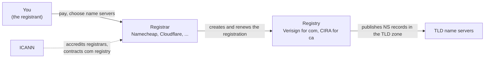

# Buying and owning a domain

After this you can buy a domain name, read its registration data, and set it up so that it can't expire, be transferred away or be hijacked by mistake.

Before this: [DNS and domains](../../07-networking/01-how-the-internet-works/05-dns-and-domains.md).

## The idea

You want your portfolio at `yourname.ca` instead of `yourname.github.io`. You search for the name at a company such as Namecheap, pay for a year, and the name is yours. Except "yours" has limits: you rent the name, the rental runs out unless you renew it, and three different organizations are involved in the rental.



In the diagram, you only ever deal with the registrar. The registry keeps the master list of every name in its TLD, and its name servers are the TLD servers from the DNS lesson. ICANN sets the rules for generic TLDs such as `com`; country-code TLDs such as `ca` set their own.

## Key terms

A **registrant** is the person or organization that holds a domain registration. A **registry** operates one TLD and keeps its database of names: Verisign runs `com`, and CIRA (the Canadian Internet Registration Authority) runs `ca`. A **registrar** is a company accredited to sell registrations in a TLD and to change them on the registrant's behalf. A **reseller** sells through a registrar's accreditation without holding one.

A domain has a **registration period** (one to ten years) and an **expiration date**. **Auto-renew** charges your card before the expiration date so the period extends without action from you.

**RDAP** (Registration Data Access Protocol) is the JSON-over-HTTPS service that answers "who registered this name, through which registrar, and until when". It replaced the older WHOIS protocol for generic TLDs in January 2025 ([ICANN lookup](https://lookup.icann.org/)). **Domain privacy** (WHOIS privacy) replaces your personal contact details in that data with a proxy service's details.

**EPP status codes** are flags on a registration. `clientTransferProhibited`, shown by RDAP as "client transfer prohibited", is the **registrar lock**: while it is on, no other registrar can take the domain. The **auth code** (also called EPP code or transfer authorization code) is a password you get from your current registrar when you do want to move the domain.

## How it works

Buying the name is the easy part. The steps that matter happen right after it.

1. Register the name at a registrar, with an email address you will still read in five years. Renewal reminders and transfer approvals go there.
2. Turn on two-factor authentication for the registrar account. Whoever logs in there controls your website and your email.
3. Turn on auto-renew and check the card on file. Note the renewal price: first-year prices are often discounted ([Namecheap pricing](https://www.namecheap.com/domains/), as of 2026).
4. Check that the registrar lock is on and domain privacy is on. Namecheap includes privacy free for eligible domains ([Namecheap domain privacy](https://www.namecheap.com/security/domain-privacy/), as of 2026).
5. Leave the name servers on the registrar's DNS for now. The next lesson decides where DNS lives.

If a domain does expire, it doesn't vanish at once. Under ICANN's rules for generic TLDs, the registrar must send reminders about a month and a week before expiry, and must stop the domain resolving if it isn't renewed. After deletion there is a 30-day redemption period in which you can still restore it, for a fee ([ICANN Expired Registration Recovery Policy](https://www.icann.org/resources/pages/errp-2013-02-28-en)). Your site and email are down the whole time, so the real protection is step 3.

The `.ca` TLD has one extra rule: the registrant must meet CIRA's Canadian Presence Requirements, for example by being a Canadian citizen, a permanent resident or a Canadian corporation. CIRA can audit this and cancel a registration that doesn't qualify ([CIRA](https://www.cira.ca/), Canadian Presence Requirements for Registrants, as of 2026). A `.com` has no such requirement.

Transfers between registrars are possible but slow on purpose. A registrar may refuse a transfer within 60 days of registration or of a previous transfer ([ICANN Transfer Policy](https://www.icann.org/resources/pages/transfer-policy-2024-02-21-en), as of 2026). To move, you unlock the domain, get the auth code, and give it to the new registrar, which usually adds a year to the registration.

## Worked example

<div class="example" markdown>

### Example 1: reading registration data with RDAP

RDAP answers are plain JSON, so a short script can pull out what matters. `rdap.org` is a public redirector that forwards each query to the right registry's RDAP server. Save this as `rdap.py`:

```python
import json, sys, urllib.request

domain = sys.argv[1]
with urllib.request.urlopen(f"https://rdap.org/domain/{domain}") as r:
    data = json.load(r)

print("status:", ", ".join(data["status"]))
for e in data["events"]:
    print(f'{e["eventAction"]}: {e["eventDate"][:10]}')
print("name servers:", ", ".join(ns["ldhName"].lower() for ns in data["nameservers"]))
for ent in data["entities"]:
    if "registrar" in ent["roles"]:
        print("registrar:", ent["vcardArray"][1][1][3])
```

```powershell
py rdap.py github.com
```

```text
status: client delete prohibited, client transfer prohibited, client update prohibited
registration: 2007-10-09
expiration: 2028-10-09
last changed: 2026-09-07
last update of RDAP database: 2026-11-09
name servers: dns1.p08.nsone.net, dns2.p08.nsone.net, dns3.p08.nsone.net, dns4.p08.nsone.net, ns-1283.awsdns-32.org, ns-1707.awsdns-21.co.uk, ns-421.awsdns-52.com, ns-520.awsdns-01.net
registrar: MarkMonitor Inc.
```

Reading it line by line:

1. The three "client ... prohibited" flags are locks set by the registrar. "Client transfer prohibited" is the registrar lock from step 4.
2. The expiration date is two years out. Large companies register for several years at a time and use auto-renew as a backup.
3. The name servers are the ones the `com` registry hands out. GitHub uses two DNS providers at once, so one provider's outage doesn't take the name down.
4. The registrar is MarkMonitor, a registrar that specializes in corporate brands.

Run it for `cira.ca` and the same fields come from CIRA's server, with extra "server ... prohibited" flags, which are locks set by the registry itself (registry lock).

Check: the name servers printed here match `nslookup -type=NS github.com`. If they differ, the registry and the DNS host disagree, which is the first thing to fix after a name server change.

</div>

## Common mistakes

<div class="warning" markdown>

Watch out: registering the domain with a school or work email. When that address stops working, you miss the expiry reminders and can't approve a transfer or reset the account. Use a personal address you control, ideally not one on the same domain.

Watch out: letting a web designer or a friend register the domain in their own account "to save time". The registrant on record owns it. Register it yourself and give others access to DNS only.

Watch out: buying the domain from the hosting company by default. It works, but it ties your domain to that host. Keeping the registrar separate from the host makes changing hosts a DNS edit instead of a transfer.

</div>

## Working with AI

<div class="ai" markdown>

Words to use: registrant, registrar, registry, RDAP, registrar lock, auth code, auto-renew, Canadian Presence Requirements.

Prompts to try:

- "I'm a Canadian student buying a domain for a portfolio site. Compare registering `.ca` and `.com`: eligibility rules, privacy of my contact details, and transfer restrictions. Link the CIRA and ICANN policy pages for each claim."
- "Here is the RDAP output for my domain (paste). Explain each status flag and tell me whether the domain is protected against an unauthorized transfer."

What to check:

- Prices and promotions quoted by a model. They change often; check the registrar's own price list for both first year and renewal.
- Claims that a `.ca` has the same rules as a `.com`. Check the CIRA policy for eligibility and privacy.
- Transfer timelines. The 60-day rule is an ICANN rule for generic TLDs; check the registry's policy for a country code TLD.

</div>

## Quiz

1\. Name the registry, a registrar and the registrant for a `.ca` domain that you buy through Namecheap.

<details class="solution" markdown>
<summary>Answer</summary>

CIRA is the registry, Namecheap is the registrar, and you are the registrant.

</details>

2\. RDAP shows "client transfer prohibited" for your domain. Is that a problem?

<details class="solution" markdown>
<summary>Answer</summary>

No, it is the registrar lock and you want it on. Turn it off only while you are moving the domain to another registrar.

</details>

3\. Your card expired, auto-renew failed, and your site has been down for five days since the expiration date. What do you do, and what happens if you wait six more weeks?

<details class="solution" markdown>
<summary>Answer</summary>

Log in to the registrar and renew now; during the grace period after expiry this usually costs the normal renewal price. If you wait until after deletion, you can still restore it during the 30-day redemption period for an extra fee. After that it is released and anyone can register it.

</details>

4\. You registered a domain 3 weeks ago and want to move it to a cheaper registrar. What will probably happen?

<details class="solution" markdown>
<summary>Answer</summary>

The current registrar may refuse, because the request falls within 60 days of registration under ICANN's transfer policy. Wait until the 60 days pass.

</details>

## Lab

<div class="lab" markdown>

### Lab: buy and secure your domain

Goal: own a domain you will use for the rest of this chapter and the next ones, set up safely. Time: about 20 minutes. Runs in: a browser and PowerShell. Costs money: one year of registration.

1. Run Example 1's script on two domains you use (your school's domain, a favourite site). Note each registrar and expiration date.
2. Choose a name and TLD. For `.ca`, check that you meet the Canadian Presence Requirements. Compare the first-year and the renewal price at two registrars.
3. Register it with a personal email address. Turn on two-factor authentication for the registrar account.
4. Turn on auto-renew, the registrar lock and domain privacy.
5. Run the script on your new domain. Check that the status shows "client transfer prohibited", and note the name servers and the expiration date.
6. Put a reminder in your calendar one month before the expiration date to check the card on file.

Expected result: RDAP shows your registrar, an expiration date a year or more away, a transfer lock, and the registrar's default name servers.

<details class="solution" markdown>
<summary>Solution</summary>

For a new `.com` at Namecheap, the output looks like this (dates and server names will differ):

```text
status: client transfer prohibited
registration: 2026-11-09
expiration: 2027-11-09
name servers: dns1.registrar-servers.com, dns2.registrar-servers.com
registrar: NameCheap, Inc.
```

This output is illustrative: a domain wasn't bought while writing this lesson. If the lock is missing, it is usually a toggle called "Domain Lock" or "Registrar Lock" on the domain's page; some registrars turn it on only after the first 60 days. If RDAP shows the old data, wait a few minutes; the registry updates on its own schedule.

</details>

</div>

## Where this shows up

- The name servers from step 5 decide where your DNS records live, the subject of [pointing a domain at a host](02-pointing-a-domain-at-a-host.md).
- Registrar accounts are a target for account takeover; the same rules as in [secure authentication](../../12-security/01-web-security/05-secure-authentication.md) apply.
