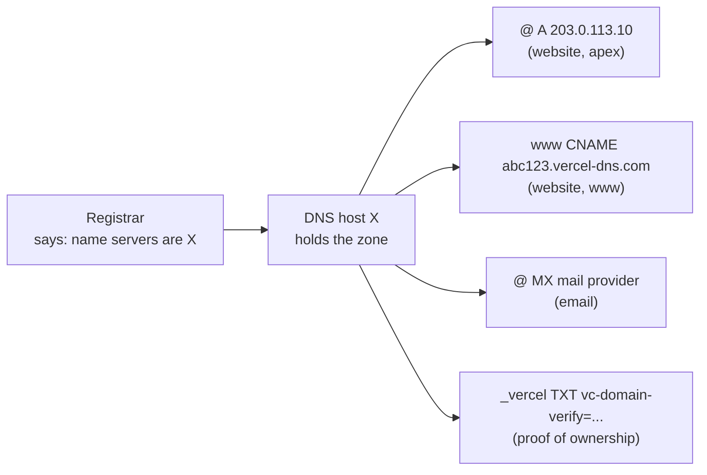

# Pointing a domain at a host

After this you can connect a domain you own to a hosting platform, choose where its DNS records live, and avoid the records that break email or let someone else take over a subdomain.

Before this: [Buying and owning a domain](01-buying-and-owning-a-domain.md) and [DNS and domains](../../07-networking/01-how-the-internet-works/05-dns-and-domains.md).

## The idea

Your domain is registered and your site runs at `my-site.vercel.app`. The platform's "Add domain" screen now asks you to create two records "at your DNS provider". Which provider is that, what goes in each box, and why does the platform want an A record for one name and a CNAME for the other?

A domain's DNS is one table of records, called a **zone**, kept by whoever runs its name servers. Each service you use (website, email, verification for a tool) needs a few rows in that table. Pointing a domain at a host means adding the website's rows without disturbing anyone else's.



In the diagram, the registrar only stores which name servers are in charge. Every record lives with the DNS host, and the website rows sit beside the email and verification rows.

## Key terms

A **zone** is the set of DNS records for a domain, held by its authoritative name servers. The **apex** (also root or naked domain) is the domain itself, `example.com`, written `@` in most DNS dashboards. `www.example.com` is a subdomain like any other.

A **DNS host** is the service that runs the name servers for your zone: the registrar's free DNS, Cloudflare, a cloud provider, or the hosting platform itself. You pick one by setting the domain's name servers at the registrar.

A **CNAME record** makes a name an alias for another name, so the platform can change its IP addresses without asking you. The DNS standard forbids a CNAME at the apex, because the apex must also hold records such as NS and MX. **CNAME flattening** (also sold as ALIAS or ANAME) is a DNS host feature that accepts a CNAME-like target at the apex and answers with the target's current addresses ([Cloudflare docs](https://developers.cloudflare.com/dns/cname-flattening/)).

A **verification record** is a TXT (or CNAME) record with a value the service gave you. Only someone who controls the zone can add it, so it proves you control the domain.

A **proxied record** is one where the DNS host also sits in front of your site as a reverse proxy and CDN. At Cloudflare, a proxied A or CNAME record answers with Cloudflare's addresses instead of your host's ([Cloudflare proxy status](https://developers.cloudflare.com/dns/proxy-status/)).

## How it works

There are two ways to connect a domain, and platforms offer both.

1. Keep your current DNS host and add records. The platform shows the values: for Vercel, an A record for the apex and a project-specific CNAME for subdomains such as `www` ([Vercel: add a domain](https://vercel.com/docs/domains/working-with-domains/add-a-domain), as of 2026). Everything else in the zone stays as it is.
2. Move the whole zone to the platform by changing the name servers at the registrar. The platform then manages every record, including the ones you add for email. Before switching, copy every existing record across, or email and verifications stop working the moment the change takes effect.

Option 1 is the safer default. Option 2 makes sense when the platform's DNS gives you something you need, such as wildcard certificates.

The platform then checks the records, and once they resolve to it, it requests a TLS certificate for each name using the same domain-control check as [certbot](../03-aws/08-deploying-an-app-to-ec2.md). That is why a new domain shows "invalid configuration" or "pending certificate" for a few minutes: the platform is waiting for DNS caches, the TTL from the DNS lesson.

## Worked example

<div class="example" markdown>

### Example 1: how a Vercel-hosted site is wired

`nextjs.org` is hosted on Vercel. Ask a public resolver for both names:

```powershell
nslookup nextjs.org 1.1.1.1
nslookup www.nextjs.org 1.1.1.1
```

```text
Name:    nextjs.org
Address:  64.239.123.65

Name:    7db0c515ced5a8a7.vercel-dns.com
Address:  64.239.109.65
Aliases:  www.nextjs.org
```

1. The apex answers with an address directly: an A record (or a flattened CNAME; from outside, the two look the same).
2. `www` is an alias. "Aliases: www.nextjs.org" means `www.nextjs.org` is a CNAME for `7db0c515ced5a8a7.vercel-dns.com`, a name unique to this project, as the Vercel docs describe.
3. The address behind that name belongs to Vercel. If Vercel moves the project to other servers, it changes its own record and `www` follows without the site's owner editing anything.

Check: ask for the CNAME type directly.

```powershell
nslookup -type=CNAME www.nextjs.org 1.1.1.1
nslookup -type=CNAME nextjs.org 1.1.1.1
```

```text
www.nextjs.org	canonical name = 7db0c515ced5a8a7.vercel-dns.com

nextjs.org
	primary name server = ns1.vercel-dns.com
```

The apex has no CNAME, as the standard requires; `nslookup` shows the zone's SOA record instead, which also reveals that this zone's DNS host is Vercel itself (option 2 in How it works).

</div>

## Common mistakes

<div class="warning" markdown>

Watch out: changing name servers to a new host without copying the old records. MX and TXT records disappear with the old zone, and email stops arriving within the TTL. Export or screenshot the zone first, and compare it after the switch.

Watch out: leaving the registrar's default records in place. Many registrars create a parking record for `@` and `www` at purchase. A second A record for `@` makes some visitors land on the parking page. Delete defaults you didn't create.

Watch out: a **dangling record**, a CNAME that still points at a deleted app or bucket. If someone else can create an app with that target name, they serve their content on your subdomain: a subdomain takeover ([MDN](https://developer.mozilla.org/en-US/docs/Web/Security/Attacks/Subdomain_takeover)). When you delete an app, delete its DNS records the same day.

</div>

## Working with AI

<div class="ai" markdown>

Words to use: zone, apex, name servers, A record, CNAME, CNAME flattening, verification TXT record, proxied record.

Prompts to try:

- "My domain `example.ca` uses Namecheap's DNS and has MX records for Google Workspace. I want the site on Vercel with `www` as the main name. List the records to add and remove (type, host, value placeholder), and say which existing records must not change."
- "Vercel shows 'invalid configuration' for my apex domain. Here is `nslookup -type=A example.ca 1.1.1.1` and `nslookup -type=NS example.ca` output (paste). What is wrong?"

What to check:

- Exact record values. Copy them from the platform's dashboard; a model will invent plausible IP addresses and target names.
- Advice to change name servers when adding records would do. Ask what happens to your MX and TXT records.
- A CNAME suggested for the apex. Check whether your DNS host supports flattening or ALIAS before using one.

</div>

## Quiz

1\. Where is a domain's A record stored: at the registrar, the registry or the DNS host?

<details class="solution" markdown>
<summary>Answer</summary>

At the DNS host, in the zone. The registrar and registry store only which name servers are authoritative, unless the registrar is also your DNS host.

</details>

2\. Why does Vercel give you an A record for `example.com` but a CNAME for `www.example.com`?

<details class="solution" markdown>
<summary>Answer</summary>

A CNAME isn't allowed at the apex, because the apex also has NS and other records. Subdomains can be CNAMEs, which lets the platform change addresses without you editing anything.

</details>

3\. You change your name servers from Namecheap to Cloudflare, and the next morning nobody can email you. What happened, and how do you fix it?

<details class="solution" markdown>
<summary>Answer</summary>

The new zone at Cloudflare has no MX records (and probably no SPF TXT record), because they were only in the old zone. Add the mail provider's records to Cloudflare. Next time, copy the whole zone before switching.

</details>

4\. Your club's old event site `events.club.ca` was a CNAME to a hosting app you deleted last year. Today it shows a casino ad. What is this, and what is the fix?

<details class="solution" markdown>
<summary>Answer</summary>

A subdomain takeover through a dangling CNAME: someone created an app with the target name your record still points to. Delete the CNAME (or point it at something you control), then check the zone for other records pointing at services you no longer use.

</details>

## Lab

<div class="lab" markdown>

### Lab: connect your domain to a first deploy

Goal: serve a one-page site on both the apex and `www` of your domain over HTTPS. Time: about 20 minutes. Runs in: a browser and PowerShell. Needs: your domain from the last lesson, a GitHub account and a free Vercel account.

1. Write down your zone as it is now: the records shown in the registrar's DNS page.
2. Create a GitHub repository with one file, `index.html`, containing `<h1>Hello from my domain</h1>`. In Vercel, import the repository and deploy it with the default settings. Open the `vercel.app` URL.
3. In the project's Domains settings, add your apex domain and accept the suggested `www` domain. Copy the records Vercel shows.
4. At your DNS host, delete the registrar's parking records for `@` and `www`, then add Vercel's A record for `@` and CNAME for `www`.
5. Check with `nslookup yourdomain.ca 1.1.1.1` and `nslookup www.yourdomain.ca 1.1.1.1` until both point at Vercel, then wait for both domains to show as valid in Vercel.
6. Open `https://yourdomain.ca` and `https://www.yourdomain.ca`. Compare the zone with step 1: only the website records should differ.

Expected result: both names load the page over HTTPS, `www` resolves through a CNAME ending in `vercel-dns.com`, and any MX or TXT records from step 1 are unchanged.

<details class="solution" markdown>
<summary>Solution</summary>

The zone ends up with these website rows (values come from your Vercel dashboard):

```text
Type   Host  Value
A      @     <apex address shown by Vercel>
CNAME  www   <project-specific name shown by Vercel, ending in a vercel-dns domain>
```

Not run while writing this lesson, since it needs a purchased domain; the steps follow [Vercel's domain docs](https://vercel.com/docs/domains/working-with-domains/add-a-domain) as of 2026. If the certificate stays pending, check for a second A or AAAA record on the same name, which is the most common cause of "invalid configuration". One of the two names may already redirect to the other; the next lesson decides which should win.

</details>

</div>

## Where this shows up

- Choosing between the apex and `www`, and redirecting the other one, is [redirects and canonical domains](03-redirects-and-canonical-domains.md).
- Email and verification records for mail providers go in the same zone, in receiving mail and email authentication<!-- link: ../06-email-from-your-domain/01-receiving-mail-and-email-authentication.md -->.
- Cloudflare's proxy mode is the reverse proxy and CDN from [proxies and CDNs](../../07-networking/02-web-protocols/05-proxies-and-cdns.md).
