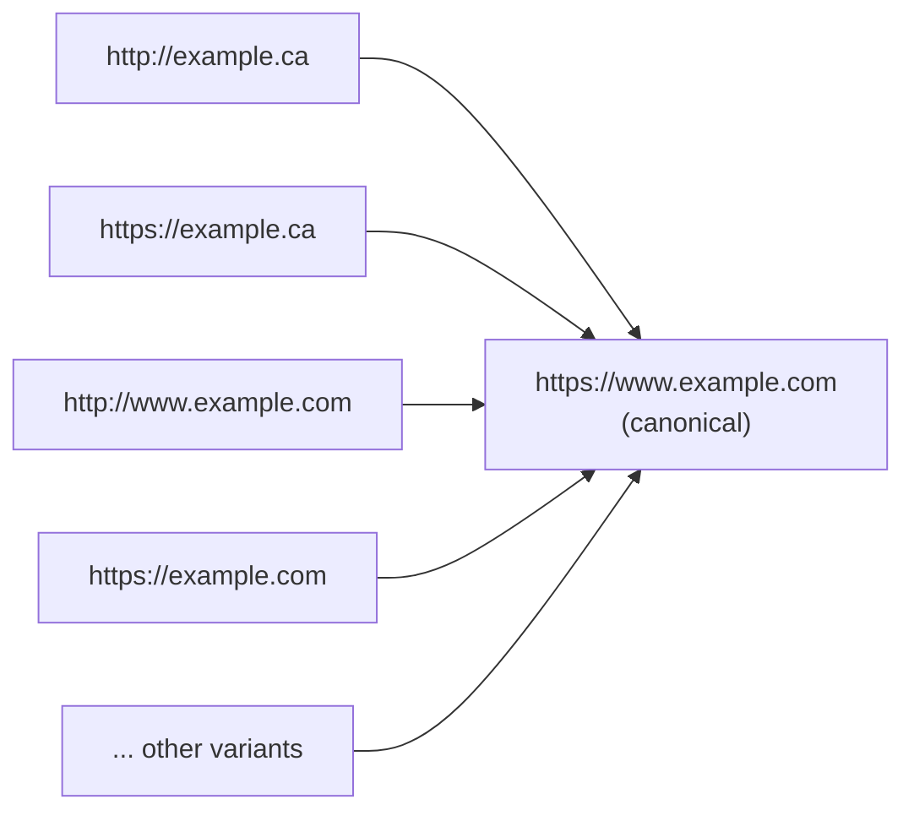

# Redirects and canonical domains

After this you can pick one canonical address for a site, send every other variant (`www`, the other TLD, plain HTTP) to it in one permanent redirect, and check the result with `curl`.

Before this: [Pointing a domain at a host](02-pointing-a-domain-at-a-host.md), [HTTP requests and responses](../../07-networking/02-web-protocols/01-http-requests-and-responses.md) and [TLS, HTTPS and certificates](../../07-networking/02-web-protocols/03-tls-https-and-certificates.md).

## The idea

You own `example.ca` and `example.com`. Each has an apex and a `www`, and each can be typed with `http://` or `https://`. That is eight addresses for one home page. If all eight serve the page, search engines see duplicates, cookies set on one name don't apply on another, and analytics splits your visitors four ways.

The fix is to choose one **canonical** address and make the other seven answer with a redirect to it.



In the diagram, every arrow is one HTTP response with status 301 or 308 and a `Location` header. Each variant reaches the canonical address in one hop, with the path kept: `example.ca/about` goes to `www.example.com/about`, not to the home page.

## Key terms

A **redirect** is an HTTP response with a 3xx status and a `Location` header giving the URL to request instead. The browser follows it on its own. The four codes you will meet ([RFC 9110, section 15.4](https://www.rfc-editor.org/rfc/rfc9110#section-15.4)):

| Code | Meaning | Method on the next request |
|---|---|---|
| 301 Moved Permanently | the resource has a new permanent URL | browsers may change POST to GET |
| 308 Permanent Redirect | same, newer code | kept (POST stays POST) |
| 302 Found | temporarily elsewhere | browsers may change POST to GET |
| 307 Temporary Redirect | temporarily elsewhere | kept |

A permanent redirect (301 or 308) tells browsers and search engines to use the new URL from now on; Google treats both as a strong signal of the canonical URL ([Google: redirects](https://developers.google.com/search/docs/crawling-indexing/301-redirects)). A temporary one (302 or 307) says the old URL is still the real one.

The **canonical URL** is the one address you want people, links and search results to use. A **redirect chain** is a sequence of redirects before the final page.

**HSTS** (HTTP Strict Transport Security) is a response header, `Strict-Transport-Security: max-age=...`, that tells the browser to use HTTPS for this host for `max-age` seconds without trying HTTP first ([RFC 6797](https://www.rfc-editor.org/rfc/rfc6797)). The **preload list** is a list of HSTS hosts built into browsers, so even the first visit uses HTTPS ([hstspreload.org](https://hstspreload.org/)).

## How it works

DNS can't redirect. A DNS answer is an address, and a redirect is an HTTP response, so some web server has to receive the request for the old name and answer 301 or 308. That server must also hold a certificate for the old name, or `https://` requests to it fail before the redirect is sent.

There are three common places for that server:

1. The hosting platform. Add every variant to the project, then set each one to redirect to the canonical domain. Vercel has a "Redirect to" option per domain, and the platform issues certificates for every name you add ([Vercel: redirecting domains](https://vercel.com/docs/domains/working-with-domains/deploying-and-redirecting), as of 2026).
2. The registrar's "URL redirect" or "forwarding" record. The registrar points the name at its own web server, which answers with the redirect. Check whether it supports HTTPS and keeps the path; many don't.
3. Your own server, such as an nginx `server` block that returns `301` for the old names, as certbot set up for HTTP in [deploying an app to EC2](../03-aws/08-deploying-an-app-to-ec2.md).

Path-level redirects, such as `/blog/...` moving to `/news/...` after a redesign, belong in the site's configuration. In Vercel that is `vercel.json`, where `permanent` defaults to `true` and sends a 308 ([Vercel: redirects](https://vercel.com/docs/project-configuration/vercel-json#redirects)):

```json
{
  "redirects": [
    { "source": "/blog/:path*", "destination": "/news/:path*" }
  ]
}
```

Which name should win, apex or `www`? Either works if you are consistent. Vercel recommends `www`, because a CNAME lets the platform steer traffic without you changing an IP address ([Vercel docs](https://vercel.com/docs/domains/working-with-domains/deploying-and-redirecting#redirecting-www-domains)). For a Canadian business with both TLDs, pick the one on your business cards and redirect the other.

## Worked example

<div class="example" markdown>

### Example 1: reading redirect chains with curl

`curl -sIL` sends HEAD requests (`-I`), follows redirects (`-L`) and stays quiet about progress (`-s`). The `grep` keeps the status lines, `Location` headers and HSTS headers. In WSL or Git Bash (in PowerShell, write `curl.exe`):

```bash
curl -sIL http://www.github.com | grep -i -E "^HTTP/|^location:|^strict-transport"
```

```text
HTTP/1.1 301 Moved Permanently
Location: https://www.github.com/
HTTP/1.1 301 Moved Permanently
Location: https://github.com/
Strict-Transport-Security: max-age=31536000; includeSubDomains; preload
HTTP/1.1 200 OK
Strict-Transport-Security: max-age=31536000; includeSubdomains; preload
```

1. The first hop upgrades the scheme: same name, HTTPS. It must happen first, because HSTS headers only count over HTTPS.
2. The second hop goes from `www` to the canonical apex, permanently.
3. The final `200 OK` carries HSTS for one year (31,536,000 seconds), with `preload`, so browsers skip the first hop next time.

Now a site with two TLDs:

```bash
curl -sIL http://shopify.ca | grep -i -E "^HTTP/|^location:"
```

```text
HTTP/1.1 301 Moved Permanently
Location: https://shopify.ca:443/
HTTP/1.1 301 Moved Permanently
location: https://www.shopify.com/ca/
HTTP/1.1 301 Moved Permanently
Location: https://www.shopify.com/ca
HTTP/1.1 200 OK
```

Three hops: scheme, then TLD, then a trailing slash. Each hop costs a round trip on a slow phone. The last one comes from the destination and the target in the second hop disagreeing about a trailing slash.

Check: the last line of each chain is `200 OK`, and each URL in the chain is one you expected. Compare `curl -sI https://www.nextjs.org`, which answers `307 Temporary Redirect`: that works for visitors but tells search engines the move isn't final.

</div>

## Common mistakes

<div class="warning" markdown>

Watch out: a temporary code (302 or 307) for a permanent change. Search engines may keep the old URL as canonical. Use 301 or 308 for domain moves and renamed pages.

Watch out: redirecting every old path to the home page. Bookmarks and search results then land on the wrong page. Keep the path (`/:path*` in `vercel.json`) or map old paths to new ones.

Watch out: turning on HSTS with `includeSubDomains` and preload before every subdomain serves HTTPS. Browsers will refuse HTTP on those subdomains for months. Start with a short `max-age`, then raise it.

</div>

## Working with AI

<div class="ai" markdown>

Words to use: canonical domain, 301, 308, 307, redirect chain, `Location` header, HSTS, preload.

Prompts to try:

- "I own `example.ca` and `example.com`, both on Vercel. `https://www.example.com` is canonical. List every variant that must redirect, the status code for each, and where to configure it so each reaches the canonical URL in one hop with the path kept."
- "Here is `curl -sIL` output for my site (paste). Count the hops, say which can be removed, and whether any redirect is temporary."

What to check:

- 302 used where 301 or 308 is meant. Read the codes in the answer against the table above.
- Redirect rules without a path parameter, which send everything to the home page. Test a deep URL with `curl -sIL`.
- A claim that a DNS record can redirect. A redirect needs a web server and a certificate for the old name.

</div>

## Quiz

1\. What is the difference between 301 and 308, and when does it matter?

<details class="solution" markdown>
<summary>Answer</summary>

Both are permanent. With 308, the client must repeat the same method and body; with 301, browsers may switch POST to GET. It matters for redirected form posts or API calls, not for ordinary page links.

</details>

2\. A registrar's free "URL forwarding" sends `http://example.ca` to your site, but `https://example.ca` shows a certificate error. Why?

<details class="solution" markdown>
<summary>Answer</summary>

The forwarding server has no certificate for `example.ca`, so the TLS handshake fails before any redirect can be sent. Add `example.ca` to your hosting platform (which issues a certificate) and redirect there, or use a forwarding service that supports HTTPS.

</details>

3\. Predict the number of hops for `http://example.ca/about` if the host first upgrades to HTTPS, then redirects `example.ca` to `www.example.com`. How would you make it one?

<details class="solution" markdown>
<summary>Answer</summary>

Two hops: `http://example.ca/about` to `https://example.ca/about`, then to `https://www.example.com/about`. Make the HTTP response redirect straight to `https://www.example.com/about`. (HSTS on `example.ca` makes later visits skip the first hop anyway.)

</details>

4\. Why should the HTTP to HTTPS hop stay on the same host before redirecting to another domain?

<details class="solution" markdown>
<summary>Answer</summary>

So the browser receives the HSTS header for that host over HTTPS. If `http://example.ca` jumps directly to another domain, `example.ca` never sends HSTS, and later visits can still start over plain HTTP.

</details>

## Lab

<div class="lab" markdown>

### Lab: one canonical address

Goal: every variant of your domain reaches one canonical URL in as few permanent hops as possible. Time: about 15 minutes. Runs in: the Vercel dashboard and WSL or Git Bash. Needs: the site from the last lesson.

1. Run `curl -sIL` on `http://`, `https://`, apex and `www` for your domain (four commands). Write down each chain.
2. Decide the canonical name (apex or `www`). In the project's Domains settings, edit the other name and set it to redirect to the canonical one with a permanent code.
3. Add a page `about.html`, deploy, and add a `vercel.json` that redirects `/old-about` to `/about.html`. Deploy again.
4. Repeat step 1 with `/about.html` at the end of each URL, and run `curl -sIL https://yourdomain/old-about`.
5. Optional, if you own a second TLD: add it to the project, set it to redirect to the canonical name, and check it the same way.

Expected result: every chain ends in `200 OK` on the canonical name, uses only 301 or 308, keeps the path, and has at most two hops (HTTP upgrade, then name).

<details class="solution" markdown>
<summary>Solution</summary>

`vercel.json` for step 3 (308 by default):

```json
{
  "redirects": [
    { "source": "/old-about", "destination": "/about.html" }
  ]
}
```

With `www` canonical, `curl -sIL http://yourdomain.ca/about.html` should show a redirect to `https://yourdomain.ca/about.html` (or straight to `https://www.yourdomain.ca/about.html`), then a 301 or 308 to the `www` name, then `200 OK`. Not run while writing this lesson, since it needs a purchased domain; the Vercel steps follow the [domain redirect docs](https://vercel.com/docs/domains/working-with-domains/deploying-and-redirecting) as of 2026. If a hop shows 307, edit the domain redirect and choose a permanent status.

</details>

</div>

## Where this shows up

- Search engines use redirects and the canonical link to decide which URL to index, in SEO basics<!-- link: ../07-search-and-launch/01-seo-basics.md -->.
- Moving a site to a new domain uses these redirects plus the change of address tool in Google Search Console<!-- link: ../07-search-and-launch/02-google-search-console-and-analytics.md -->.
