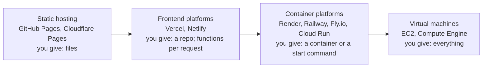

# Hosting platforms

After this you can sort hosting options into four kinds, pick one for a given project by asking five questions, and read a free tier's terms for the limits that bite.

Before this: [Cloud models and regions](../03-aws/01-cloud-models-and-regions.md), [Lambda and serverless](../03-aws/07-lambda-and-serverless.md) and [VMs vs containers](../01-containers/01-vms-vs-containers.md).

## The idea

A portfolio page, a Next.js shop, a FastAPI app with a background worker and a Discord bot all need "hosting", but not the same kind. The portfolio is files. The shop needs code at request time. The worker and the bot need a process that stays up. Choosing the wrong kind shows up later as a bill, a timeout or a rewrite.

Hosting options sit on one scale: the more the platform does for you, the less you can change.



In the diagram, moving right adds long-running processes, any language and full control, and also adds work: patches, scaling and monitoring become yours. Moving left gets you HTTPS, a CDN and deploy-on-push for free, inside the platform's limits.

## Key terms

A **static site** is a set of files (HTML, CSS, JavaScript, images) that is the same for every visitor. **Static hosting** serves those files from a CDN and runs no code of yours.

A **build step** is the command a platform runs on each push to turn your repository into deployable output, such as `npm run build` producing a `dist/` folder.

A **frontend platform** builds your repository, serves the static output from a CDN, and runs server-side code as **serverless functions**: short-lived handlers started per request, as in [Lambda](../03-aws/07-lambda-and-serverless.md). This is the PaaS idea from [cloud models](../03-aws/01-cloud-models-and-regions.md), specialized for websites.

A **container platform** runs your container image (or builds one from a start command) as a long-running service, and may scale it down to zero when idle. **Spin-down** is that scale to zero; the next request waits while the service starts again.

**Usage-based billing** charges for what you consume: requests, function CPU time, and **data transfer** (bytes sent to visitors, also called bandwidth or egress). A **free tier** is an allowance of that usage at no cost, with its own terms of use.

## How it works

Five questions place most projects.

1. Does any page need code at request time (logins, a database, server-side rendering)? If not, use static hosting.
2. Does anything need to run longer than a request: a worker, a WebSocket server, a bot, a scheduled job that runs for minutes? If so, you need a container platform or a VM, at least for that part.
3. Where does the data live? Frontend platforms don't host databases themselves; you add a managed database from a partner or another provider.
4. Is it commercial? Several free tiers exclude commercial use, and a client's site is commercial.
5. What happens at the limit: does the platform pause the site, or bill you?

Free tiers as of 2026, from each provider's docs:

| Platform | Runs | Free tier, as of 2026 | Terms that bite |
|---|---|---|---|
| [GitHub Pages](https://docs.github.com/en/pages/getting-started-with-github-pages/github-pages-limits) | static files | 1 GB site, 100 GB a month bandwidth (soft) | not for e-commerce or commercial SaaS |
| [Vercel Hobby](https://vercel.com/docs/plans/hobby) | static, functions | 100 GB fast data transfer, 1,000,000 function invocations a month | personal, non-commercial use only; over a limit, features pause up to 30 days |
| [Netlify Free](https://www.netlify.com/pricing/) | static, functions | 300 credits; bandwidth costs 20 credits a GB | usage is pooled in credits, so read what each feature costs |
| [Cloudflare Pages](https://developers.cloudflare.com/pages/platform/limits/) | static, functions | 500 builds a month, 20,000 files a site | 25 MiB per file |
| [Render Free](https://render.com/docs/free) | containers, Postgres | 750 instance hours a month | spins down after 15 minutes idle, about a minute to start; free Postgres expires after 30 days |

Notice what the table doesn't say: none of the frontend platforms keep a WebSocket server or a background worker running on the free tier. That is question 2.

## Worked example

<div class="example" markdown>

### Example 1: telling where a site is hosted

Response headers usually name the platform. In WSL or Git Bash:

```bash
curl -sI https://nextjs.org | grep -i -E "^server|^x-vercel|^age"
curl -sI https://faiyaz-svg.github.io/CSFromTheGroundUp/ | grep -i -E "^server|^cache-control|^x-github"
```

```text
Age: 2319
Server: Vercel
X-Vercel-Cache: HIT
X-Vercel-Id: yul1::m754q-1794257190560-fea4a23f6473
Server: GitHub.com
Cache-Control: max-age=600
X-GitHub-Request-Id: C628:16AA7A:6F1D5D:86D35A:6AF23126
```

1. `Server: Vercel` and `X-Vercel-Cache: HIT` mean the page came from Vercel's CDN cache, not from a function. `Age: 2319` says the cached copy is about 39 minutes old.
2. The `X-Vercel-Id` starts with `yul1`, the Vercel region that handled the request: Montréal, the closest one to Ontario ([Vercel regions](https://vercel.com/docs/regions), as of 2026).
3. This book is on GitHub Pages: `Server: GitHub.com`, and browsers may cache each page for 600 seconds (`max-age=600`), so a fix can take up to 10 minutes to appear for a returning reader.

Check: run the same commands twice. The `Age` value grows between runs while the page stays cached, and the request id changes every time.

</div>

## Common mistakes

<div class="warning" markdown>

Watch out: building a client's or a startup's site on a free tier that excludes commercial use, such as Vercel Hobby. The fix is the paid plan or a platform whose terms allow it; budget for it from the start.

Watch out: running a long task inside a serverless function, such as sending 2,000 emails in a loop. Functions have a maximum duration and are stopped when it runs out. Put long work on a queue processed by a worker, as in [background jobs](../../09-back-end/03-api-quality/01-background-jobs.md).

Watch out: a free database that expires or sleeps. A demo for an interview that worked last month may now return errors. Read the tier's expiry rule and back up the data.

</div>

## Working with AI

<div class="ai" markdown>

Words to use: static hosting, build step, serverless function, container platform, spin-down, data transfer, free tier terms, commercial use.

Prompts to try:

- "I'm deploying a Next.js app with Postgres, a nightly job that runs 10 minutes, and email sending. Compare Vercel, Render and a single EC2 instance for this: what runs where, what each costs at low traffic, and what breaks on each free tier. Link the pricing page for every number."
- "Here are the response headers from a site (paste). Which hosting platform and CDN served it, and was the response cached?"

What to check:

- Free-tier numbers from a model. They change several times a year; open the provider's pricing or limits page.
- Recommendations that put a WebSocket server, a worker or a long job in a serverless function. Check the platform's maximum function duration.
- Missing terms of use. Ask directly whether the plan permits commercial use.

</div>

## Quiz

1\. Which kind of hosting fits each: a course notes site generated by a static site generator; a Discord bot; a Next.js app with logins?

<details class="solution" markdown>
<summary>Answer</summary>

Static hosting for the notes. A container platform or VM for the bot, since it must stay connected. A frontend platform (or a container platform) for the Next.js app, since it needs code at request time.

</details>

2\. Your Render free service takes 50 seconds to answer the first request in the morning and is fast afterwards. Why?

<details class="solution" markdown>
<summary>Answer</summary>

It spun down after 15 minutes without traffic, and the first request waits while it starts again. Upgrade to a paid instance that stays on, or accept the delay for a demo.

</details>

3\. A friend wants to host their bakery's online order site on Vercel Hobby because it's free. What do you tell them?

<details class="solution" markdown>
<summary>Answer</summary>

Hobby is for personal, non-commercial use, and a bakery's order site is commercial. Use a paid plan or a provider whose terms allow commercial use; GitHub Pages also excludes e-commerce.

</details>

4\. `curl -sI` shows `X-Vercel-Cache: MISS` on every request to a page that never changes. What does that suggest?

<details class="solution" markdown>
<summary>Answer</summary>

The page isn't being cached at the CDN, so a function probably renders it each time, costing invocations and time. Check the `Cache-Control` header and whether the page could be generated at build time as static output.

</details>

## Lab

<div class="lab" markdown>

### Lab: the same page on two hosts

Goal: deploy one static page to GitHub Pages and Vercel, compare what each sends, and place three projects on the hosting scale. Time: about 15 minutes. Runs in: a browser and WSL or Git Bash. No extra cost.

1. In the repository from the earlier lab, open Settings, then Pages, and publish from the `main` branch root. Wait for the `github.io` URL to work.
2. Run `curl -sI` on the `github.io` URL and on your Vercel URL. Write down `Server`, `Cache-Control` and any platform-specific headers.
3. Change the `<h1>` text, push, and time how long each URL takes to show the change in a private window.
4. For each project, write the kind of hosting and one platform: your portfolio; a FastAPI app with a Postgres database and a worker that sends emails; a Slack bot that replies to messages.
5. Cleanup: in Settings, Pages, unpublish the GitHub Pages site so only Vercel serves your domain.

Expected result: two sets of headers that name the platforms, two deploy times of a minute or less, and three placements with a reason each.

<details class="solution" markdown>
<summary>Solution</summary>

The headers look like those in Example 1. Vercel usually shows `Cache-Control: public, max-age=0, must-revalidate` for HTML, so browsers check for a new version on each visit, while GitHub Pages uses `max-age=600`. That is why the GitHub Pages change can take up to 10 minutes to appear in a normal window. Placements: the portfolio on static hosting; the FastAPI app on a container platform with a managed Postgres and a separate worker service (or one VM running both); the Slack bot as a function if it uses Slack's HTTP events, or a container if it holds a socket connection open.

</details>

</div>

## Where this shows up

- The next lesson, [Vercel: deployments, previews and environments](05-vercel-deployments-and-environments.md), goes inside one frontend platform.
- Cloud Run, Google's container platform, is deployed by hand in [deploying to Cloud Run](../08-google-cloud/04-deploying-to-cloud-run.md).
