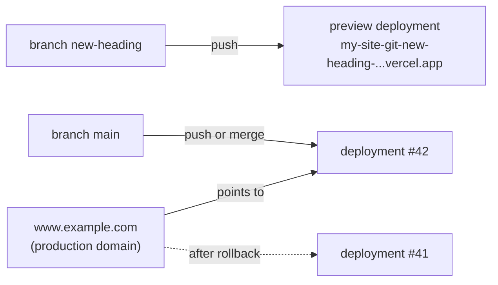

# Vercel: deployments, previews and environments

After this you can follow a change from a branch to production on Vercel, give each environment its own variables, and roll back a bad release in seconds.

Before this: [Hosting platforms](04-hosting-platforms.md), [CI/CD concepts](../02-ci-cd/01-ci-cd-concepts.md), [deployment strategies](../02-ci-cd/03-deployment-strategies.md) and [config, environment variables and secrets](../../04-developer-tools-and-workflow/02-project-plumbing/02-config-env-vars-and-secrets.md).

## The idea

You open a pull request that changes the home page. A minute later a bot comments on it with a link: your change, built and running at its own URL, while the real site is untouched. You merge, and the real site updates. The next morning you find a bug and click one button to put yesterday's version back.

All of this follows from one rule: every build is a separate, unchangeable **deployment** with its own URL, and your domain is a pointer to one of them.



In the diagram, going live means moving the arrow from the production domain to a new deployment. Rolling back moves it back to #41, which still exists, so nothing is rebuilt.

## Key terms

A **project** is one site or app on Vercel, linked to one Git repository. A **deployment** is the result of one build of that project. It is immutable: a new commit makes a new deployment instead of changing an old one.

The **production branch** (usually `main`) is the branch whose deployments become production. A **preview deployment** is a deployment of any other branch or pull request. Each preview gets **generated URLs**: a commit-specific URL that always shows that exact build, and a branch URL that follows the branch's latest commit ([Vercel environments](https://vercel.com/docs/deployments/environments), as of 2026).

An **environment** is the context a deployment runs in. Vercel has three: Development (your machine), Preview and Production. An **environment variable** on Vercel is scoped to one or more of them, so previews can use a test database and production the real one. The **system environment variables** are set by Vercel itself; `VERCEL_ENV` is `production`, `preview` or `development` ([system variables](https://vercel.com/docs/environment-variables/system-environment-variables)).

To **promote** a deployment is to point the production domains at it. An **instant rollback** points them back at an earlier production deployment without rebuilding ([instant rollback](https://vercel.com/docs/instant-rollback)).

## How it works

A change goes through these steps:

1. Push a branch or open a pull request. Vercel runs the build command and creates a preview deployment, using variables scoped to Preview.
2. Review the preview URL. Previews are behind Vercel login by default and send `X-Robots-Tag: noindex`, so strangers and search engines don't see them.
3. Merge to `main`. Vercel builds a production deployment with Production variables and, when it succeeds, moves the production domains to it.
4. If production breaks, roll back. On the free Hobby plan you can return to the immediately previous production deployment; paid plans can pick any earlier one.
5. Fix forward on a branch, then promote the fixed deployment. After a rollback, Vercel stops auto-assigning production until you promote, so a hasty push can't undo your rollback.

Three details cause most surprises.

Variables are read when a deployment is built or started. Changing a value in the dashboard doesn't touch existing deployments; redeploy to apply it. A rollback brings back the old deployment with the variables it was built with.

Anything a front-end framework inlines into browser code at build time is public. In Next.js, that is every variable named `NEXT_PUBLIC_...`. Secrets stay in variables read only by functions.

Functions run in one region, `iad1` (Washington, D.C.) unless you change it ([Vercel regions](https://vercel.com/docs/regions), as of 2026). Put them in the region nearest your database: a function in Washington that queries a database in Montreal pays a round trip on every query.

Vercel can also call a function on a schedule (Cron Jobs, being replaced by Schedules, in beta as of 2026; [schedules quickstart](https://vercel.com/docs/schedules/quickstart)). Schedules use UTC by default and run in production. A scheduled run can occasionally be delivered twice, so the job must be idempotent, as in [background jobs](../../09-back-end/03-api-quality/01-background-jobs.md).

## Worked example

<div class="example" markdown>

### Example 1: a function that reports its environment

A file in the `api/` folder of a project becomes a function. This one returns which deployment answered, which is the quickest way to check that a preview really uses Preview variables. Save it as `api/info.mjs`:

```javascript
export function GET(request) {
  return Response.json({
    env: process.env.VERCEL_ENV ?? "local",
    branch: process.env.VERCEL_GIT_COMMIT_REF ?? "none",
    commit: (process.env.VERCEL_GIT_COMMIT_SHA ?? "none").slice(0, 7),
    region: process.env.VERCEL_REGION ?? "none",
    greeting: process.env.GREETING ?? "not set",
  });
}
```

The handler uses the web-standard `Request` and `Response` objects, so you can call it on your machine before deploying. Save this as `try.mjs` next to the `api` folder:

```javascript
import { GET } from "./api/info.mjs";

const res = GET(new Request("http://localhost/api/info"));
console.log(res.status, await res.json());
```

Run it once plain, then with the variables a preview build would have:

```bash
node try.mjs
VERCEL_ENV=preview VERCEL_GIT_COMMIT_REF=new-heading VERCEL_GIT_COMMIT_SHA=fa1eade47b73733d6312d5abfad33ce9e4068081 VERCEL_REGION=iad1 GREETING="hello from preview" node try.mjs
```

```text
200 {
  env: 'local',
  branch: 'none',
  commit: 'none',
  region: 'none',
  greeting: 'not set'
}
200 {
  env: 'preview',
  branch: 'new-heading',
  commit: 'fa1eade',
  region: 'iad1',
  greeting: 'hello from preview'
}
```

1. With no variables, every `??` falls back to its default, which is what you get locally without `vercel env pull`.
2. With the variables set, the function reports a preview build of branch `new-heading`. On Vercel, the platform sets the `VERCEL_...` values and you set `GREETING` in the dashboard.
3. The commit is shortened to 7 characters, the form GitHub shows, so you can match it to the pull request.

Check: on Vercel, open `/api/info` on the preview URL and on your domain. `env` and `greeting` should differ, and `commit` should match the latest commit on each branch.

</div>

## Common mistakes

<div class="warning" markdown>

Watch out: adding a variable only to Production, then wondering why the preview crashes. Scope it to Preview too, with a test value.

Watch out: putting a secret in a `NEXT_PUBLIC_` variable (or any variable your bundler inlines). It ships in the JavaScript every visitor downloads. Search the built files in the browser's DevTools for the value to check.

Watch out: rolling back and then merging a fix, expecting it to go live. Production stays pinned to the rolled-back deployment until you promote; check the production tile after the merge.

</div>

## Working with AI

<div class="ai" markdown>

Words to use: deployment, production branch, preview deployment, environment variable scope, `VERCEL_ENV`, promote, instant rollback, function region.

Prompts to try:

- "My Next.js app on Vercel reads `DATABASE_URL`. I want previews to use a Neon branch database and production the main one. Explain how to scope the variables, what happens to existing deployments when I change one, and how to check which value a deployment used."
- "Production broke after my last merge. I'm on Vercel Hobby. Give me the exact order of steps to roll back, fix the bug on a branch, and get auto-deploys working again."

What to check:

- Claims that changing a variable updates the running site. It applies to new deployments only.
- Rollback options that need a paid plan, offered for Hobby. Check the rollback docs for your plan.
- Secrets placed in browser-exposed variables. Look for `NEXT_PUBLIC_` (or `VITE_`) in front of anything secret.

</div>

## Quiz

1\. What is the difference between a branch URL and a commit URL for a preview?

<details class="solution" markdown>
<summary>Answer</summary>

The commit URL always shows that one build. The branch URL follows the latest deployment of the branch, so it changes when you push.

</details>

2\. You change `GREETING` in the dashboard for Production. The site still shows the old value. Why, and what do you do?

<details class="solution" markdown>
<summary>Answer</summary>

Variables apply only to new deployments; the running deployment keeps the value it was built with. Redeploy production.

</details>

3\. Your function runs in `iad1` and queries a database in `ca-central-1`, and each page makes 10 queries. What does moving the function to `yul1` change?

<details class="solution" markdown>
<summary>Answer</summary>

Each query stops crossing between Washington and Montreal, removing one long round trip per query (10 per page). The page gets faster without code changes.

</details>

4\. After an instant rollback, you merge a fix to `main` and the build succeeds, but users still see the old version. What happened?

<details class="solution" markdown>
<summary>Answer</summary>

A rollback turns off automatic assignment of the production domains. Promote the new deployment, which also turns auto-assignment back on.

</details>

## Lab

<div class="lab" markdown>

### Lab: preview, promote, roll back

Goal: use every part of the deployment cycle on your own project. Time: about 20 minutes. Runs in: GitHub, the Vercel dashboard and a terminal. Needs: the project and domain from the earlier labs.

1. Add `api/info.mjs` from Example 1 and push to `main`. Open `https://yourdomain/api/info` and note `env` and `commit`.
2. In Settings, Environment Variables, add `GREETING` twice: `hello from production` for Production and `hello from preview` for Preview.
3. Create a branch `new-heading`, change the `<h1>`, push, and open a pull request. Open the preview link from the pull request and its `/api/info`.
4. Merge the pull request. Check `/api/info` on your domain: `env` is `production`, `greeting` is the production value, and `commit` is the merge commit.
5. Use Instant Rollback to return to the previous deployment. Check the page, then promote the newest deployment again.
6. Run `curl -sI` on the preview URL and on your domain, and compare the `x-robots-tag` header.

Expected result: the preview shows the preview greeting and the new heading while production is unchanged; after the merge production shows both changes; the rollback restores the old heading without a build; only the preview sends `x-robots-tag: noindex`.

<details class="solution" markdown>
<summary>Solution</summary>

The production response after step 4 looks like this (commit and region will differ):

```json
{"env":"production","branch":"main","commit":"3b1f2c9","region":"iad1","greeting":"hello from production"}
```

Not run while writing this lesson, since it needs a Vercel account and domain; the function itself was run locally as in Example 1, and the steps follow the [environments](https://vercel.com/docs/deployments/environments) and [instant rollback](https://vercel.com/docs/instant-rollback) docs as of 2026. If the preview shows `greeting: "not set"`, the variable was added after the preview was built: push another commit to the branch. If `curl` on the preview returns a login page or 401, that is Deployment Protection; use the preview in a logged-in browser instead.

</details>

</div>

## Where this shows up

- The same preview and rollback ideas appear in [deployment strategies](../02-ci-cd/03-deployment-strategies.md), done by hand with GitHub Actions.
- Sending email from a function, and why to queue it, is in [sending email from code](../06-email-from-your-domain/02-sending-email-from-code.md).
