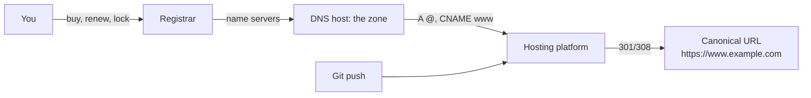

# Domains and hosting

Cheat sheet for the chapter. Prices, free-tier rules and limits are as of 2026 and live in the lessons, with their sources; check the linked official pages before relying on a number.

The labs in this chapter and the next two build on one domain that you buy in the first lab, so they cost one year of registration. Every lesson starts with checks on public domains that cost nothing.

## Lessons

1. [Buying and owning a domain](01-buying-and-owning-a-domain.md): registrar, registry, RDAP, locks, renewal, `.ca` rules.
2. [Pointing a domain at a host](02-pointing-a-domain-at-a-host.md): zones, apex and `www`, CNAME flattening, verification records, dangling records.
3. [Redirects and canonical domains](03-redirects-and-canonical-domains.md): 301, 308, 302, 307, one canonical URL, HSTS.
4. [Hosting platforms](04-hosting-platforms.md): static, frontend, container and VM hosting; free-tier terms.
5. [Vercel: deployments, previews and environments](05-vercel-deployments-and-environments.md): previews, variable scopes, promote, rollback.

## How the pieces fit

## Terms

| Term | Meaning |
|---|---|
| Registrant, registrar, registry | you; the company you buy from; the operator of the TLD (CIRA for `ca`) |
| RDAP | JSON service for registration data; replaced WHOIS for generic TLDs |
| Registrar lock | `clientTransferProhibited`: blocks transfers until you remove it |
| Auth code | password that authorizes a transfer to another registrar |
| Zone | all DNS records of a domain, held by its DNS host |
| Apex, `@` | the bare domain, `example.com` |
| CNAME flattening, ALIAS | a CNAME-like target at the apex, answered as addresses |
| Verification record | TXT or CNAME value that proves you control the zone |
| Dangling record | a record pointing at a deleted resource; enables subdomain takeover |
| Canonical URL | the one address you want used everywhere |
| HSTS | header telling browsers to use only HTTPS for a host |
| Static, frontend, container, VM hosting | files only; build + CDN + functions; long-running services; a whole server |
| Spin-down | a free service scaled to zero when idle; first request waits |
| Deployment | one immutable build with its own URL |
| Preview deployment | a deployment of a non-production branch or pull request |
| Promote, instant rollback | point production domains at a deployment; point them back without a rebuild |

## Redirect codes

| Code | Permanent | Method kept | Use for |
|---|---|---|---|
| 301 | yes | not guaranteed | domain moves, renamed pages |
| 308 | yes | yes | the same, and redirected POSTs |
| 302 | no | not guaranteed | temporary moves |
| 307 | no | yes | temporary moves of POSTs |

## Commands

| Task | Command |
|---|---|
| Registration data | `py rdap.py example.com` (script in lesson 1), or [lookup.icann.org](https://lookup.icann.org/) |
| Name servers | `nslookup -type=NS example.com` |
| Records from a public resolver | `nslookup example.com 1.1.1.1`, `nslookup -type=CNAME www.example.com 1.1.1.1` |
| Redirect chain | `curl -sIL http://example.com`, then read each status line and `Location` |
| Hosting headers | `curl -sI https://example.com` and read `Server`, `Cache-Control`, `X-Vercel-*` |
| Vercel variables to a local file | `vercel env pull` |
| Undo a rollback | `vercel promote <deployment url>` |

## Launch-day rules

- Two-factor authentication on the registrar account, auto-renew on, registrar lock on.
- Copy the whole zone before changing name servers. Keep MX and TXT records.
- Delete the registrar's parking records. Delete DNS records the day you delete what they point to.
- One canonical URL; every other variant reaches it in one or two permanent hops with the path kept.
- Check free-tier terms for commercial use before building on them.
- Variables are scoped per environment and apply to new deployments only. No secrets in `NEXT_PUBLIC_` variables.
