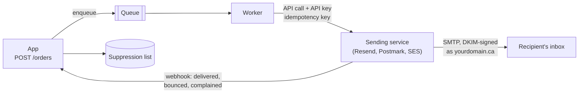

# Sending email from code

After this you can send transactional email (receipts, password resets, notifications) from an app through a sending service, test it without emailing real people, and handle bounces so your domain keeps a good reputation.

Before this: [Receiving mail and email authentication](01-receiving-mail-and-email-authentication.md), [background jobs](../../09-back-end/03-api-quality/01-background-jobs.md) and [webhooks](../../09-back-end/01-servers-and-apis/06-other-api-styles-graphql-grpc-webhooks.md).

## The idea

Your app needs to email a receipt after each order and a link when someone forgets their password. The first idea is to log in to your Gmail over SMTP from the code. That breaks quickly: Gmail limits how much you can send, your personal password ends up in a config file, the mail isn't signed for your domain, and you never find out which messages bounced.

Apps send through an email sending service instead. Your code makes one API call; the service signs the message with your domain's DKIM key, delivers it, retries, and tells you afterwards what happened.



In the diagram, sending happens in a worker, not in the request, as in [background jobs](../../09-back-end/03-api-quality/01-background-jobs.md). The arrow back from the service is how you learn that an address doesn't exist.

## Key terms

A **transactional email** is a message triggered by something the recipient did and needs: a receipt, a password reset, a shipping notice. A **marketing email** (newsletter, promotion) is sent to a list. They follow different rules, covered in the next lesson.

An **email sending service** (also called an ESP) delivers mail on your behalf: Resend, Postmark, Amazon SES, SendGrid, Mailgun. You reach it through an **HTTP API** or an **SMTP relay**, a mail server that accepts your messages with a username and password.

A **verified sending domain** is a domain whose DNS records you added at the service, so it can sign as you. Many teams use a subdomain such as `send.yourdomain.ca` for app mail, so its reputation is separate from people's mail.

A **MIME multipart/alternative** message carries the same content as plain text and as HTML; the mail program shows the best one it supports. **Reply-To** is a header that sends replies somewhere other than the `From` address.

A **hard bounce** is a permanent failure (the address doesn't exist). A **soft bounce** is temporary (mailbox full). A **complaint** is a recipient pressing "Report spam". A **suppression list** is the set of addresses you must no longer send to because they bounced or complained.

## How it works

1. Verify a sending domain at the service. It shows DKIM records (and often an SPF record for a return-path subdomain); add them to your zone and wait for "verified".
2. Store the service's API key as a secret environment variable on the server, never in browser code. Scope it to sending only, if the service allows.
3. Send from a background job. Give each send an **idempotency key** built from the event, such as `receipt/order-1042`, so a retried job doesn't send twice. Resend accepts one per request and remembers it for 24 hours ([Resend idempotency keys](https://resend.com/docs/dashboard/emails/idempotency-keys), as of 2026).
4. Receive the service's webhooks. On a hard bounce or a complaint, add the address to your suppression list and check it before every send.
5. Test without real recipients: locally with a capture server (Example 1), then against the service's test addresses, such as `delivered@resend.dev` and `bounced@resend.dev`, which simulate each outcome ([Resend test emails](https://resend.com/docs/dashboard/emails/send-test-emails)).

The API call itself is short. With Resend's Node.js SDK, from its docs (not run here, since it needs an API key):

```javascript
import { Resend } from "resend";

const resend = new Resend(process.env.RESEND_API_KEY);

const { data, error } = await resend.emails.send(
  {
    from: "Example Shop <orders@send.yourdomain.ca>",
    to: ["delivered@resend.dev"],
    subject: "Your order #1042",
    text: "Thanks for your order #1042.",
    html: "<p>Thanks for your order <b>#1042</b>.</p>",
  },
  { idempotencyKey: "receipt/order-1042" },
);
```

The call returns either `data` with the message id or `error`. Store the id with the order; the webhooks refer to it.

Free tiers are small and meant for development: Resend's free plan allows 3,000 messages a month and 100 a day ([Resend pricing](https://resend.com/pricing), as of 2026).

## Worked example

<div class="example" markdown>

### Example 1: building a message and catching it locally

Python's standard library builds and sends mail with `email.message` and `smtplib`. To test without sending anything, run a local SMTP server that prints what it receives. In WSL, in a virtual environment:

```bash
python3 -m pip install aiosmtpd
python3 -m aiosmtpd -n -l localhost:8025
```

`-n` skips switching to the `nobody` user, and `-l` sets the address to listen on; the default handler prints each message. In a second terminal, save this as `send_receipt.py` and run it:

```python
import smtplib
from email.message import EmailMessage
from email.utils import make_msgid

msg = EmailMessage()
msg["From"] = "Example Shop <orders@mail.example.com>"
msg["To"] = "ana@example.org"
msg["Reply-To"] = "help@example.com"
msg["Subject"] = "Your order #1042"
msg["Message-ID"] = make_msgid(domain="mail.example.com")
msg.set_content("Thanks for your order #1042.\nTotal: $18.50\n")
msg.add_alternative("<p>Thanks for your order <b>#1042</b>.</p><p>Total: $18.50</p>", subtype="html")

with smtplib.SMTP("localhost", 8025) as smtp:
    smtp.send_message(msg)
print("sent", msg["Message-ID"])
```

The server terminal prints the message (shortened):

```text
---------- MESSAGE FOLLOWS ----------
From: Example Shop <orders@mail.example.com>
To: ana@example.org
Reply-To: help@example.com
Subject: Your order #1042
Message-ID: <179425774490.6740.7079113033270793955@mail.example.com>
MIME-Version: 1.0
Content-Type: multipart/alternative;
 boundary="===============3325484827795842384=="

--===============3325484827795842384==
Content-Type: text/plain; charset="utf-8"

Thanks for your order #1042.
Total: $18.50

--===============3325484827795842384==
Content-Type: text/html; charset="utf-8"

<p>Thanks for your order <b>#1042</b>.</p><p>Total: $18.50</p>

--===============3325484827795842384==--
------------ END MESSAGE ------------
```

1. `set_content` makes a plain-text message; `add_alternative` turns it into `multipart/alternative` with the HTML as a second part. The boundary line separates the parts.
2. `Reply-To` sends customer replies to the help inbox, while the `From` stays the sending address.
3. `Message-ID` is a unique id under your domain. Mail programs use it to thread replies, and you can log it next to the order.

Check: the output contains both a `text/plain` and a `text/html` part, and no message left your machine. Switching to a real service later means changing the host, port and login (or the API call), not the message.

</div>

## Common mistakes

<div class="warning" markdown>

Watch out: sending inside the request handler. A slow or failing provider then slows or fails checkout. Enqueue the send and return; the worker retries with backoff.

Watch out: retrying a send without an idempotency key. A timeout after the provider accepted the message leads to two receipts. Pass a key built from the event and the record id.

Watch out: ignoring bounce and complaint webhooks. Repeated sends to dead addresses and complainers lower your domain's reputation, and inbox providers start filtering all of your mail, including password resets.

</div>

## Working with AI

<div class="ai" markdown>

Words to use: transactional email, sending service, verified sending domain, API key, idempotency key, multipart/alternative, hard bounce, suppression list.

Prompts to try:

- "Write a FastAPI endpoint that creates an order and enqueues a receipt email, plus an RQ worker that sends it through Resend with an idempotency key `receipt/<order id>`, retries 3 times with backoff, and skips addresses in a `suppressed_emails` table."
- "Write an Express webhook handler for Resend's `email.bounced` and `email.complained` events that verifies the signature and adds the address to a suppression table. Link the docs page for the event payload."

What to check:

- SDK method names and parameters. Compare with the provider's current docs; models mix up versions and providers.
- An API key in front-end code or in a `NEXT_PUBLIC_` variable. It belongs on the server only.
- A webhook handler that skips the signature check, or a worker with no idempotency key.

</div>

## Quiz

1\. Classify each as transactional or marketing: a password reset; "20% off this weekend"; a shipping notice; a monthly newsletter.

<details class="solution" markdown>
<summary>Answer</summary>

Transactional: the password reset and the shipping notice. Marketing: the discount and the newsletter.

</details>

2\. Why use `send.yourdomain.ca` for app mail instead of `yourdomain.ca`?

<details class="solution" markdown>
<summary>Answer</summary>

It keeps the app's sending reputation and DNS records (DKIM, return-path SPF) separate from the people's mailboxes on the main domain. A problem with the app's mail then doesn't hurt staff mail as much, and the records don't crowd the main SPF record.

</details>

3\. A worker times out after calling the provider, retries, and the customer gets two receipts. What was missing?

<details class="solution" markdown>
<summary>Answer</summary>

An idempotency key. The first call succeeded at the provider but the response was lost; with the same key on the retry, the provider would have recognized it and not sent again.

</details>

4\. In Example 1, what would the recipient see if their mail program can't show HTML?

<details class="solution" markdown>
<summary>Answer</summary>

The `text/plain` part: "Thanks for your order #1042." and the total. That is why the plain-text part should carry the full content, not "view this in HTML".

</details>

## Lab

<div class="lab" markdown>

### Lab: send a real receipt from your domain

Goal: send a DKIM-signed message from your domain through a sending service and confirm it passes SPF, DKIM and DMARC. Time: about 20 minutes. Runs in: WSL, the service's dashboard and Gmail. Needs: your domain and a free account at a sending service (Resend is used here).

1. Run Example 1 locally and check both parts appear.
2. In the service, add `send.yourdomain` as a sending domain. Add the DNS records it shows and wait until it is verified.
3. Create an API key with sending access only and store it as `RESEND_API_KEY` in your shell (not in a file in the repository).
4. Send one message to `delivered@resend.dev` and one to `bounced@resend.dev` using the snippet in How it works, with different idempotency keys. Check the dashboard for both outcomes.
5. Send one message to your personal Gmail. Use "Show original" and read SPF, DKIM and DMARC.
6. Cleanup: delete the API key if you won't use it again.

Expected result: the first test address shows delivered, the second bounced; the Gmail message shows SPF, DKIM and DMARC all PASS, with DKIM `d=` your domain or `send.yourdomain`.

<details class="solution" markdown>
<summary>Solution</summary>

In Gmail's "Show original", a passing message shows lines like:

```text
SPF:   PASS with IP 203.0.113.5
DKIM:  'PASS' with domain send.yourdomain.ca
DMARC: 'PASS'
```

Not run while writing this lesson, since it needs a purchased domain and an API key; Example 1 was run as shown. DMARC passes because the DKIM domain `send.yourdomain.ca` aligns with the From domain under relaxed alignment, the default, which accepts subdomains. If DMARC fails, check that the `from` address uses the verified domain, and that DKIM shows PASS rather than a signature from the service's own domain.

</details>

</div>

## Where this shows up

- Newsletters and other commercial messages need consent and an unsubscribe link under Canadian law: [email law and deliverability](03-email-law-and-deliverability.md).
- Password reset links are tokens with an expiry; see [secure authentication](../../12-security/01-web-security/05-secure-authentication.md).
