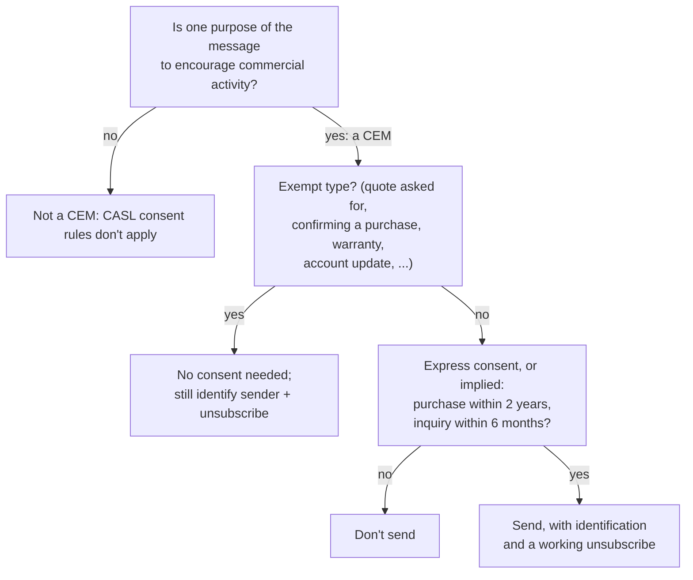

# Email law and deliverability

After this you can decide whether Canada's anti-spam law lets you send a given email, build the consent and unsubscribe pieces it requires, and meet the Gmail and Yahoo rules that decide whether bulk mail reaches the inbox.

Before this: [Sending email from code](02-sending-email-from-code.md) and [privacy and PIPEDA](../../12-security/02-cryptography/06-privacy-and-pipeda.md).

## The idea

Your app has 4,000 users who signed up with an email address. The founder wants to announce a new paid plan to all of them tomorrow. Two questions decide what happens. Are you allowed to send it? Canada's Anti-Spam Legislation (CASL) answers that, with penalties up to \$10 million for a business. And will it arrive? Gmail and Yahoo answer that, by checking authentication, unsubscribe headers and how many people mark you as spam.



In the diagram, the founder's announcement is a CEM, isn't an exempt type, and needs consent. Users who only signed up for a free account may not have given it.

This lesson explains the rules; it isn't legal advice. For a real business, read the act and the CRTC's guidance, or ask a lawyer.

## Key terms

A **commercial electronic message** (CEM) is an electronic message where, from its content, links or contact details, one purpose is to encourage participation in a commercial activity ([CASL section 1(2)](https://laws-lois.justice.gc.ca/eng/acts/E-1.6/page-1.html)). A promotion added to a receipt makes the receipt a CEM.

**Express consent** is a clear yes to receiving messages, such as an unticked box the person ticks, with the purpose stated and the sender named. It lasts until withdrawn. **Implied consent** comes from an **existing business relationship**: a purchase within the two years before the message, or an inquiry within the six months before it ([section 10(10)](https://laws-lois.justice.gc.ca/eng/acts/E-1.6/page-2.html)). It expires.

Every CEM, including the types exempt from consent, must **identify the sender**, give contact information, and include an **unsubscribe mechanism** ([section 6(2)](https://laws-lois.justice.gc.ca/eng/acts/E-1.6/page-1.html)). The mechanism must work for at least 60 days after the message, and requests must take effect within 10 business days ([section 11](https://laws-lois.justice.gc.ca/eng/acts/E-1.6/page-2.html)).

**One-click unsubscribe** is a pair of headers defined in [RFC 8058](https://www.rfc-editor.org/rfc/rfc8058): `List-Unsubscribe` gives an HTTPS URL, and `List-Unsubscribe-Post: List-Unsubscribe=One-Click` tells the mail program it can unsubscribe with one POST request, showing an "Unsubscribe" button next to the sender's name.

**Deliverability** is the share of your mail that reaches the inbox rather than the spam folder. **Sender reputation** is the score mailbox providers keep for your domain and sending IPs, driven mostly by complaints and bounces. The **spam rate** is the share of delivered messages that recipients report as spam.

## How it works

Before sending a marketing message:

1. Decide whether it is a CEM. A pure receipt, a password reset or a security alert usually isn't; a newsletter or promotion is.
2. Check consent per recipient: express, or implied with a date that hasn't expired. Store how and when you got it (form wording, date, page), because the sender must prove consent.
3. Put the sender's name, a mailing address and a contact method in the message, plus a working unsubscribe link.
4. Process unsubscribes automatically and at once. The law allows 10 business days; Yahoo asks bulk senders to honour them within 2 days ([Yahoo sender best practices](https://senders.yahooinc.com/best-practices/), as of 2026).

Then make sure it arrives. Gmail and Yahoo require bulk senders (Gmail: more than 5,000 messages a day to its users) to pass SPF, DKIM and DMARC with alignment, to support one-click unsubscribe on marketing mail, and to keep the spam rate below 0.3% ([Gmail sender guidelines](https://support.google.com/a/answer/81126), as of 2026). Google recommends staying below 0.1% and reports your rate in its free Postmaster Tools.

Habits that keep the spam rate low:

- Send only to people who asked. **Double opt-in** (a confirmation link sent after signup) proves the address works and the person wants mail.
- Separate streams: transactional mail and marketing mail on different subdomains or service streams, so a bad campaign doesn't delay password resets.
- Stop mailing people who haven't opened anything in many months, and remove hard bounces at once.

## Worked example

<div class="example" markdown>

### Example 1: a newsletter with the required parts

This builds a short newsletter with one-click unsubscribe headers and the identification CASL requires. The token identifies the recipient without putting their email address in the URL. Run it against the capture server from the previous lesson:

```python
import smtplib
from email.message import EmailMessage

token = "u_7f3a9c"  # per-recipient token from your database
msg = EmailMessage()
msg["From"] = "Example Shop <news@news.example.com>"
msg["To"] = "ana@example.org"
msg["Subject"] = "New fall menu"
msg["List-Unsubscribe"] = (
    f"<https://example.com/unsubscribe?t={token}>, "
    f"<mailto:unsubscribe@example.com?subject={token}>"
)
msg["List-Unsubscribe-Post"] = "List-Unsubscribe=One-Click"
msg.set_content(
    "Our fall menu is here.\n\n"
    "Example Shop, 100 King St W, Toronto ON, help@example.com\n"
    f"Unsubscribe: https://example.com/unsubscribe?t={token}\n"
)

with smtplib.SMTP("localhost", 8025) as smtp:
    smtp.send_message(msg)
```

```text
From: Example Shop <news@news.example.com>
To: ana@example.org
Subject: New fall menu
List-Unsubscribe: <https://example.com/unsubscribe?t=u_7f3a9c>,
 <mailto:unsubscribe@example.com?subject=u_7f3a9c>
List-Unsubscribe-Post: List-Unsubscribe=One-Click
Content-Type: text/plain; charset="utf-8"

Our fall menu is here.

Example Shop, 100 King St W, Toronto ON, help@example.com
Unsubscribe: https://example.com/unsubscribe?t=u_7f3a9c
```

1. `List-Unsubscribe` offers an HTTPS URL and a `mailto:` fallback. Python folded the long header onto a second line starting with a space, which is legal header syntax.
2. `List-Unsubscribe-Post` makes it one-click: the mail provider sends `POST` to the URL with the body `List-Unsubscribe=One-Click`, and your endpoint must unsubscribe without asking anything more.
3. The footer covers CASL's form rules: who sent it, how to reach them, and how to unsubscribe in the body too.

Check: the headers appear exactly as RFC 8058 spells them. In production, the sending service's DKIM signature must cover both headers, which services do for you when you pass the headers through their API.

</div>

## Common mistakes

<div class="warning" markdown>

Watch out: a pre-ticked "send me news" box, or consent buried in the terms of service. That isn't express consent under CASL. Use an unticked box with its own wording, and store the record.

Watch out: an unsubscribe link that requires logging in or more than one step. CASL requires a mechanism that is readily performed, and one-click unsubscribe must work from the POST alone.

Watch out: sending a first campaign to an old or bought list. Bounces and spam reports from addresses that never asked for mail damage the domain's reputation, which also hurts its transactional mail. Never buy lists; re-confirm old ones.

</div>

## Working with AI

<div class="ai" markdown>

Words to use: commercial electronic message, express consent, implied consent, existing business relationship, unsubscribe mechanism, one-click unsubscribe, spam rate, double opt-in.

Prompts to try:

- "Under CASL, which of these need consent, and which still need an unsubscribe link: an order confirmation, a receipt with a 10% coupon, a password reset, a monthly newsletter, a reminder that a free trial ends? Cite the section of the act for each."
- "Write an Express endpoint for RFC 8058 one-click unsubscribe: it accepts `POST /unsubscribe?t=TOKEN` with body `List-Unsubscribe=One-Click`, marks the subscriber as unsubscribed in Postgres, and returns 200 without a confirmation page."

What to check:

- US rules (CAN-SPAM: opt-out, 30 days) presented as Canadian law. CASL is opt-in, with 10 business days.
- Legal claims without a section number. Ask for the section and read it on the Justice Laws site.
- An unsubscribe handler that only works with GET or asks for confirmation. One-click must work from a single POST.

</div>

## Quiz

1\. A customer bought from your shop 18 months ago and never ticked a newsletter box. May you send them a promotion today under CASL? And in 8 months?

<details class="solution" markdown>
<summary>Answer</summary>

Today, yes, on implied consent from a purchase within the past two years, with identification and an unsubscribe link. In 8 months the purchase is 26 months old and the implied consent has expired, unless they bought again or gave express consent.

</details>

2\. Does an order confirmation need an unsubscribe link under CASL?

<details class="solution" markdown>
<summary>Answer</summary>

If it is purely a confirmation of the purchase, it is one of the types exempt from consent under section 6(6), but the act still applies the form requirements of 6(2), including an unsubscribe mechanism. Many senders also keep it free of promotions so it stays plainly transactional. Check the CRTC guidance for your case.

</details>

3\. Your newsletter's spam rate in Postmaster Tools is 0.4%. What is likely to happen, and what do you change first?

<details class="solution" markdown>
<summary>Answer</summary>

Gmail is likely to send more of your mail to spam or reject it, since 0.4% is above the 0.3% limit. Stop mailing people who haven't engaged recently, make unsubscribing easy (one-click headers and a visible link), and check that every address on the list opted in.

</details>

4\. Why should marketing and transactional mail use different subdomains or streams?

<details class="solution" markdown>
<summary>Answer</summary>

Reputation is tracked per domain and IP. If a campaign causes complaints, the marketing stream's reputation drops, while password resets and receipts on the other stream keep arriving.

</details>

## Lab

<div class="lab" markdown>

### Lab: audit three newsletters and fix your own

Goal: see how real senders meet the rules, then add them to your test sending. Time: about 20 minutes. Runs in: Gmail and WSL. Needs: the capture server and the sending service from the previous lesson.

1. Open three newsletters in your inbox and use "Show original". For each, note whether `List-Unsubscribe` and `List-Unsubscribe-Post` are present, and the SPF, DKIM and DMARC results.
2. In each message body, find the sender's name, postal address and unsubscribe link. Note any that are missing.
3. Run Example 1 against the capture server and check both headers.
4. Write the consent checkbox text for a signup form: unticked, naming your business, saying what you will send and that consent can be withdrawn. Write the fields you would store with it.
5. Send Example 1's message through your sending service to your own Gmail, with the headers passed through the API. Check that Gmail shows an "Unsubscribe" option next to the sender.

Expected result: a short table for the three newsletters; a consent text and a list of stored fields; your message showing Gmail's unsubscribe option.

<details class="solution" markdown>
<summary>Solution</summary>

Consent text: "Send me Example Shop's monthly newsletter and offers by email. You can unsubscribe at any time." Example Shop's name and contact appear on the form. Store: email address, the exact wording shown, timestamp, the page or form it came from, and the IP address or account id. Large senders' newsletters almost always have both headers and pass all three checks; small ones often lack `List-Unsubscribe-Post`. Step 5 was not run while writing this lesson, since it needs a domain and an API key. Gmail may not show its unsubscribe button for a sender it has seen only once or twice; the headers are still checked by the "Show original" view.

</details>

</div>

## Where this shows up

- Consent records are personal information, so [privacy and PIPEDA](../../12-security/02-cryptography/06-privacy-and-pipeda.md) rules on purpose and retention apply to them.
- The launch checklist in case study: launching a small site<!-- link: ../07-search-and-launch/03-case-study-launching-a-small-site.md --> includes the email items from this chapter.
