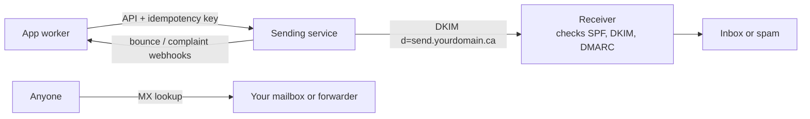

# Email from your domain

Cheat sheet for the chapter. Limits, free tiers and sender rules are as of 2026 and live in the lessons, with their sources. The law sections link to the Justice Laws site; this chapter explains the rules and is not legal advice.

## Lessons

1. [Receiving mail and email authentication](01-receiving-mail-and-email-authentication.md): MX, forwarding, SPF, DKIM, DMARC, Authentication-Results.
2. [Sending email from code](02-sending-email-from-code.md): sending services, verified domains, MIME, idempotency, bounces, local testing.
3. [Email law and deliverability](03-email-law-and-deliverability.md): CASL, consent, unsubscribe, one-click headers, spam rate.

## How the pieces fit

## Records for a domain

| Record | Host | Example value | Purpose |
|---|---|---|---|
| MX | `@` | provider's mail servers | where mail for the domain is delivered |
| TXT (SPF) | `@` | `v=spf1 include:<provider> -all` | servers allowed to send; one record only, at most 10 lookups |
| TXT or CNAME (DKIM) | `<selector>._domainkey` | from the sending service | public key for signatures |
| TXT (DMARC) | `_dmarc` | `v=DMARC1; p=none; rua=mailto:...` | policy for failures, and reports |
| No-mail domain | `@` and `_dmarc` | `v=spf1 -all` and `v=DMARC1; p=reject` | stops forging of a domain that never sends |

## Terms

| Term | Meaning |
|---|---|
| Envelope sender, header From | bounce address (`Return-Path`); the address the reader sees |
| SPF, DKIM, DMARC | IP allow-list; signature with a key in DNS; policy that requires an aligned pass |
| Alignment | the SPF or DKIM domain matches the header From domain |
| `p=none`, `quarantine`, `reject` | report only; spam folder; refuse |
| Transactional, marketing | triggered by the user's action; sent to a list |
| Sending service (ESP) | delivers mail through an API or SMTP relay |
| Hard bounce, soft bounce, complaint | permanent failure; temporary failure; marked as spam |
| Suppression list | addresses you must not mail again |
| CEM | commercial electronic message under CASL |
| Express, implied consent | a clear opt-in; from a purchase (2 years) or inquiry (6 months) |
| One-click unsubscribe | `List-Unsubscribe` + `List-Unsubscribe-Post: List-Unsubscribe=One-Click` |

## Commands

| Task | Command |
|---|---|
| Mail servers | `nslookup -type=MX example.com` |
| SPF | `nslookup -type=TXT example.com` |
| DMARC | `nslookup -type=TXT _dmarc.example.com` |
| A DKIM key | `nslookup -type=TXT <selector>._domainkey.example.com` |
| Local SMTP capture (WSL) | `python3 -m aiosmtpd -n -l localhost:8025` |
| Verdict on a message | Gmail, three-dot menu, "Show original" |

## Numbers to remember (as of 2026)

| Rule | Value | Source |
|---|---|---|
| Gmail bulk sender | more than 5,000 messages a day to Gmail | [Gmail guidelines](https://support.google.com/a/answer/81126) |
| Spam rate | below 0.3%; aim for below 0.1% | Gmail guidelines |
| Yahoo bulk unsubscribe | honoured within 2 days | [Yahoo best practices](https://senders.yahooinc.com/best-practices/) |
| CASL unsubscribe | effective within 10 business days; mechanism valid 60 days | [CASL s. 11](https://laws-lois.justice.gc.ca/eng/acts/E-1.6/page-2.html) |
| CASL implied consent | purchase within 2 years; inquiry within 6 months | CASL s. 10(10) |
| CASL maximum penalty | \$1 million (individual), \$10 million (other) | [CASL s. 20(4)](https://laws-lois.justice.gc.ca/eng/acts/E-1.6/page-3.html) |

## Rules of thumb

- Set up SPF, DKIM and DMARC before the first email, starting DMARC at `p=none`.
- Send from a worker, with an idempotency key; handle bounce and complaint webhooks.
- Keep transactional and marketing mail on separate subdomains or streams.
- Marketing needs recorded consent, identification and a one-click unsubscribe. Never buy a list.
