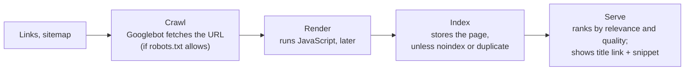

# SEO basics

After this you can explain how a search engine finds, stores and ranks a page, add the tags and files that help it, and check a page for the mistakes that keep it out of results.

Before this: [Redirects and canonical domains](../05-domains-and-hosting/03-redirects-and-canonical-domains.md), [HTML](../../08-front-end/01-html-css-and-the-browser/02-html.md) and [frameworks and libraries](../../08-front-end/03-react/04-frameworks-and-libraries-landscape.md).

## The idea

Your portfolio has been live for a month. Searching your own name shows your LinkedIn and GitHub, but not the site. Nothing is broken: a search engine has to discover the page, fetch it, decide to store it, and then decide it answers someone's query. **SEO** (search engine optimization) is making each of those steps work for your pages, and most of it is plain HTML hygiene plus useful content.

Google describes three stages ([how Search works](https://developers.google.com/search/docs/fundamentals/how-search-works)):



In the diagram, a page can drop out at every arrow: never discovered, blocked from crawling, empty after rendering, judged a duplicate, or less relevant than other pages. Google states that indexing isn't guaranteed and that it doesn't accept payment to crawl or rank a site.

## Key terms

A **crawler** (Google's is Googlebot) is a program that fetches pages and follows their links. **robots.txt** is a plain-text file at the root of a host (`https://example.com/robots.txt`) that tells crawlers which paths they may fetch ([RFC 9309](https://www.rfc-editor.org/rfc/rfc9309)). A **sitemap** is an XML file listing the URLs you want crawled, optionally with a last-modified date ([sitemaps.org](https://www.sitemaps.org/protocol.html)).

The **index** is the search engine's database of pages. A **noindex** rule, in `<meta name="robots" content="noindex">` or the `X-Robots-Tag` response header, asks for a page to stay out of it.

A **canonical link**, `<link rel="canonical" href="...">`, names the preferred URL among duplicates. Google treats redirects and canonical links as strong signals and sitemap entries as a weak one ([Google: canonicalization](https://developers.google.com/search/docs/crawling-indexing/consolidate-duplicate-urls)).

The **title link** is the clickable headline in a result, usually taken from the page's `<title>`. The **snippet** is the text under it, built mainly from the page content and sometimes from the `<meta name="description">` ([Google: snippets](https://developers.google.com/search/docs/appearance/snippet)).

**Structured data** is machine-readable facts about a page (a product's price, an article's date) in the schema.org vocabulary, usually as JSON-LD, which can earn richer results. **Open Graph** tags (`og:title`, `og:image`) control the preview card when a link is shared in chat or social apps ([ogp.me](https://ogp.me/)); they shape clicks, not ranking.

## How it works

For each page you want found:

1. Give it a unique `<title>` that says what the page is, then the site name: "Projects | Sam Lee".
2. Add a `<meta name="description">` written for a person reading results; make it unique per page.
3. Put the real text in the HTML. Google renders JavaScript, but rendering can wait in a queue and not every crawler runs JavaScript, so Google recommends server-side rendering or pre-rendering ([JavaScript SEO basics](https://developers.google.com/search/docs/crawling-indexing/javascript/javascript-seo-basics)). Use one `<h1>` and real links (`<a href>`).
4. Add a canonical link to the page's own canonical URL, matching your redirects from the domains chapter.
5. Make sure it isn't blocked: no `noindex` left over from a staging build, and not disallowed in `robots.txt`.

For the whole site, serve `robots.txt` and `sitemap.xml` from the canonical host, and point to the sitemap from `robots.txt`:

```text
User-agent: *
Allow: /

Sitemap: https://www.example.com/sitemap.xml
```

After that, ranking is mostly relevance and quality: does the page answer a search better than the alternatives? Speed matters at the margin. Core Web Vitals are used by Google's ranking systems, but Google shows the most relevant content even when its page experience is poor ([page experience](https://developers.google.com/search/docs/appearance/page-experience)); see [web performance](../../08-front-end/03-react/05-web-performance.md) for the metrics.

## Worked example

<div class="example" markdown>

### Example 1: checking the head of a page

This script fetches a page and prints the tags that matter, using only the standard library. Save it as `seo_check.py`:

```python
import sys, urllib.request
from html.parser import HTMLParser

class Head(HTMLParser):
    def __init__(self):
        super().__init__()
        self.found, self.h1, self._in = {}, 0, None

    def handle_starttag(self, tag, attrs):
        a = dict(attrs)
        if tag == "title":
            self._in = "title"
        elif tag == "h1":
            self.h1 += 1
        elif tag == "meta" and a.get("name") in ("description", "robots"):
            self.found[a["name"]] = a.get("content")
        elif tag == "meta" and a.get("property") in ("og:title", "og:image"):
            self.found[a["property"]] = a.get("content")
        elif tag == "link" and a.get("rel") == "canonical":
            self.found["canonical"] = a.get("href")

    def handle_data(self, data):
        if self._in == "title":
            self.found["title"] = data.strip()
            self._in = None

url = sys.argv[1]
with urllib.request.urlopen(url) as r:
    status, robots_header = r.status, r.headers.get("X-Robots-Tag")
    page = Head()
    page.feed(r.read().decode("utf-8", "replace"))

print("status:", status, "| X-Robots-Tag:", robots_header)
for key in ("title", "description", "canonical", "robots", "og:title", "og:image"):
    print(f"{key}: {page.found.get(key, '(missing)')}")
print("h1 count:", page.h1)
```

Run it on this book's home page:

```powershell
py seo_check.py https://faiyaz-svg.github.io/CSFromTheGroundUp/
```

```text
status: 200 | X-Robots-Tag: None
title: CS From the Ground Up - CS From the Ground Up
description: A self-study computer science and software development textbook, from bits and transistors to the cloud, data and AI-assisted development.
canonical: https://faiyaz-svg.github.io/CSFromTheGroundUp/
robots: (missing)
og:title: (missing)
og:image: (missing)
h1 count: 1
```

1. Status 200, no `X-Robots-Tag` and no robots meta tag: nothing blocks indexing.
2. The title repeats the site name, because the generator appends the site name to the page title and the home page's title is the site name. Search results would show it twice.
3. The description and canonical link are present and correct.
4. No Open Graph tags, so a link shared in a chat app gets a plain or guessed preview.

Both problems were fixed after this check, with a small theme override that shows the site name once and adds `og:title`, `og:description` and `og:url`, so running the script today gives a shorter title and no missing Open Graph title. Run it on `https://nextjs.org/` for comparison: the title is "Next.js by Vercel - The React Framework", and `og:title` and `og:image` are set.

Check: also request `https://faiyaz-svg.github.io/robots.txt`. It returns 404, because this book is a GitHub Pages project site under a path, and `robots.txt` only counts at the root of the host. Missing `robots.txt` means "crawl everything", which is fine here, but a project site can't set one.

</div>

## Common mistakes

<div class="warning" markdown>

Watch out: using `robots.txt` to hide a page. A disallowed URL can still be indexed from links to it, without its content; Google says `robots.txt` is not a way to keep a page out of Google ([robots.txt intro](https://developers.google.com/search/docs/crawling-indexing/robots/intro)). Use `noindex` (and let the page be crawled so the rule is seen), or put it behind a login.

Watch out: a `noindex` from staging that ships to production, often through a shared layout or an environment flag. Check production with the script or `curl -sI` after every launch.

Watch out: a client-rendered app whose HTML is an empty `<div id="root">`. Search engines may index it late or as empty. Pre-render public pages or use server-side rendering.

</div>

## Working with AI

<div class="ai" markdown>

Words to use: crawl, index, robots.txt, sitemap, noindex, canonical link, meta description, Open Graph.

Prompts to try:

- "Here is the `<head>` of my Next.js App Router page (paste). Using the Metadata API, set a unique title template, description, canonical URL and Open Graph image, and generate `robots.txt` and `sitemap.xml` for my site `https://www.example.com`."
- "My page is in my sitemap but Search Console says 'Crawled, currently not indexed'. Here is the page's HTML and response headers (paste). List possible causes in order of likelihood and how to check each."

What to check:

- Advice to "add keywords" to meta tags. Google ignores the `keywords` meta tag; check the claim against Google's documentation.
- A `robots.txt` that disallows pages you want indexed, or a sitemap with URLs on the wrong host (`http://`, non-canonical `www`).
- Promises of rankings or timelines. Indexing isn't guaranteed, and nobody can buy a ranking from Google.

</div>

## Quiz

1\. A page is listed in `sitemap.xml` and also `Disallow`ed in `robots.txt`. What will Google do?

<details class="solution" markdown>
<summary>Answer</summary>

It won't crawl the page, so it can't read the content. It may still index the bare URL if other pages link to it. The sitemap and `robots.txt` contradict each other; remove the disallow or the sitemap entry.

</details>

2\. Why does `X-Robots-Tag: noindex` on a preview deployment matter, and why should production not have it?

<details class="solution" markdown>
<summary>Answer</summary>

It keeps preview URLs out of search results, so duplicates of your site don't compete with it. On production it would remove your real pages from the index.

</details>

3\. Every page of a site has the title "Home". What problem does that cause, and what is the fix?

<details class="solution" markdown>
<summary>Answer</summary>

Results can't tell pages apart, and the title link may not match the query. Give each page a unique, descriptive title, usually "Page topic | Site name".

</details>

4\. You share your site's link in a group chat and it shows no image. Which tags do you add, and do they affect Google ranking?

<details class="solution" markdown>
<summary>Answer</summary>

Open Graph tags: `og:title`, `og:description`, `og:image` (and `og:url`). They control link previews, not ranking.

</details>

## Lab

<div class="lab" markdown>

### Lab: make your site findable

Goal: your site has correct head tags, `robots.txt` and `sitemap.xml` on the canonical host. Time: about 20 minutes. Runs in: your editor, WSL or PowerShell, and a browser. Needs: your Vercel site.

1. Run `seo_check.py` on your home page and on one other site you like. Write down what is missing on yours.
2. In `index.html` and `about.html`, add a unique `<title>`, a meta description, a canonical link to the canonical URL, and `og:title`, `og:description` and `og:image` (an image in the repository, as an absolute URL).
3. Add `robots.txt` (as in How it works) and `sitemap.xml` listing both pages with their canonical URLs. Push.
4. Run the script again on both pages, and `curl -s https://yourdomain/robots.txt` and `/sitemap.xml`.
5. Run the script on a preview deployment URL and compare `X-Robots-Tag` with production.

Expected result: both pages show a unique title, description, canonical and Open Graph tags; `robots.txt` and the sitemap load from the canonical host; only the preview has `X-Robots-Tag: noindex`.

<details class="solution" markdown>
<summary>Solution</summary>

The head of `about.html`, with `www` canonical:

```html
<title>About | Sam Lee</title>
<meta name="description" content="Sam Lee, fourth-year computer science student in Ontario: projects, experience and contact.">
<link rel="canonical" href="https://www.example.com/about.html">
<meta property="og:title" content="About Sam Lee">
<meta property="og:description" content="Projects, experience and contact.">
<meta property="og:image" content="https://www.example.com/og.png">
```

The sitemap:

```text
<?xml version="1.0" encoding="UTF-8"?>
<urlset xmlns="http://www.sitemaps.org/schemas/sitemap/0.9">
  <url><loc>https://www.example.com/</loc></url>
  <url><loc>https://www.example.com/about.html</loc></url>
</urlset>
```

The tags follow Google's and ogp.me's documentation; the deployment itself was not run while writing this lesson. A preview URL may return a login page because of Deployment Protection; that also keeps it out of search.

</details>

</div>

## Where this shows up

- Submitting the sitemap and watching indexing happen is [Google Search Console and analytics](02-google-search-console-and-analytics.md).
- Rendering choices (SSR, SSG, CSR) and their effect on search are in [frameworks and libraries](../../08-front-end/03-react/04-frameworks-and-libraries-landscape.md).
