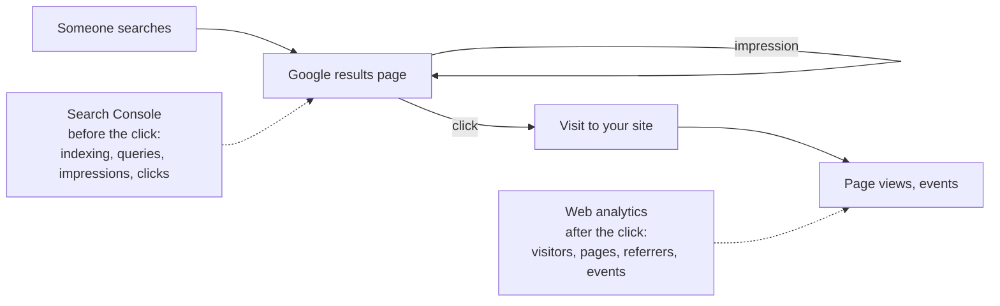

# Google Search Console and analytics

After this you can verify your site in Google Search Console, find out why a page isn't indexed, read the search performance numbers, and choose a web analytics tool that respects your visitors' privacy.

Before this: [SEO basics](01-seo-basics.md) and [pointing a domain at a host](../05-domains-and-hosting/02-pointing-a-domain-at-a-host.md).

## The idea

You fixed your tags and published a sitemap. Now you want answers: has Google indexed the site? Which searches show it, and does anyone click? What do visitors do once they arrive? Two kinds of tool split those questions at the click.



In the diagram, **Google Search Console** reports everything up to the click: whether Google can crawl and index your pages, which queries showed them and how often they were clicked. **Web analytics** reports what happens on your site, whether the visitor came from Google, a link or an email.

Google Search Console (`search.google.com/search-console`) is a different product from the Google Cloud console; it is free and needs no cloud account.

## Key terms

A **property** is a site you have verified in Search Console. A **Domain property** (`example.com`) covers every subdomain and both `http` and `https`, and must be verified with a DNS record. A **URL-prefix property** (`https://www.example.com/`) covers only URLs that start with that exact prefix ([Search Console: add a property](https://support.google.com/webmasters/answer/34592), as of 2026).

**URL Inspection** shows Google's indexed version of one URL: whether it is on Google, when it was crawled, and the **Google-selected canonical** next to the **user-declared canonical** (yours). It can run a live test and send a request to crawl the URL ([URL Inspection](https://support.google.com/webmasters/answer/9012289)).

The **Page indexing report** lists URLs that aren't indexed, grouped by reason. The **Performance report** counts **impressions** (times a page appeared in results), **clicks**, **CTR** (clicks divided by impressions) and **average position** (the average rank of your highest result) ([Performance report](https://support.google.com/webmasters/answer/7576553)).

In analytics, a **page view** is one load of a page, an **event** is an action you record (a signup, a download), and the **referrer** is the page a visitor came from. **UTM parameters** (`?utm_source=newsletter&utm_campaign=fall`) tag links so analytics can attribute visits to a campaign.

## How it works

1. In Search Console, add a Domain property for your domain. It shows a TXT record (`google-site-verification=...`); add it at your DNS host and click Verify. Keep the record, since removing it can remove your access.
2. Open Sitemaps and submit `https://www.yourdomain/sitemap.xml`.
3. Inspect your home page in URL Inspection. If it isn't indexed yet, request indexing once; there is a daily quota, and repeating the request doesn't make it faster.
4. Wait a few days, then read Pages. Common reasons: "Excluded by 'noindex' tag" (a tag you forgot), "Duplicate, Google chose different canonical than user" (check redirects and canonical links), "Crawled - currently not indexed" and "Discovered - currently not indexed" (Google knows the URL but hasn't valued or fetched it yet; improve the page and its internal links).
5. Read Performance weekly: queries, pages, CTR and position.

Bing Webmaster Tools offers the same kind of reports for Bing and can import your Search Console properties.

When you move a site to a new domain, add 301 redirects page by page, verify both domains, and use Search Console's **Change of Address** tool, which keeps the move signals active for 180 days. It isn't for HTTP to HTTPS or `www` changes ([Change of Address](https://support.google.com/webmasters/answer/9370220)).

For analytics, the choice is mostly about privacy:

| Tool | How it counts visitors | Notes, as of 2026 |
|---|---|---|
| Google Analytics 4 | first-party cookies `_ga` and `_ga_<id>`, kept 2 years by default ([GA4 cookies](https://support.google.com/analytics/answer/11397207)) | detailed reports and funnels; needs consent handling |
| Vercel Web Analytics | no cookies; a hash of the request, discarded after 24 hours ([Vercel analytics privacy](https://vercel.com/docs/analytics/privacy-policy)) | 50,000 events a month on Hobby |
| Plausible | no cookies; a daily hash of domain, IP address and browser with a salt deleted every 24 hours ([Plausible data policy](https://plausible.io/data-policy)) | simple dashboards; paid, or self-hosted |

Under [PIPEDA](../../12-security/02-cryptography/06-privacy-and-pipeda.md), tracking needs meaningful consent and a privacy policy that says what you collect. Quebec's private-sector privacy act (Law 25) adds that technology able to identify, locate or profile a person must be off by default ([LégisQuébec, P-39.1, s. 8.1](https://www.legisquebec.gouv.qc.ca/en/document/cs/P-39.1)). A cookieless, aggregate tool keeps both simpler.

## Worked example

<div class="example" markdown>

### Example 1: finding queries worth working on

The Performance report can be exported as CSV. This script reads rows in the shape of that export (the numbers are invented) and flags queries that show your site often but rarely get clicked:

```python
import csv, io

export = """Top queries,Clicks,Impressions,CTR,Position
sam lee portfolio,42,61,68.85%,1.2
sam lee,9,410,2.2%,7.8
react weather app tutorial,3,520,0.58%,14.3
ontario cs student projects,0,95,0%,31.5
"""

for row in csv.DictReader(io.StringIO(export)):
    clicks, shown = int(row["Clicks"]), int(row["Impressions"])
    ctr = clicks / shown
    pos = float(row["Position"])
    flag = "  <- shown often, rarely clicked" if shown >= 100 and ctr < 0.03 else ""
    print(f'{row["Top queries"]:28} {shown:4} shown  CTR {ctr:6.1%}  pos {pos:4.1f}{flag}')
```

```text
sam lee portfolio              61 shown  CTR  68.9%  pos  1.2
sam lee                       410 shown  CTR   2.2%  pos  7.8  <- shown often, rarely clicked
react weather app tutorial    520 shown  CTR   0.6%  pos 14.3  <- shown often, rarely clicked
ontario cs student projects    95 shown  CTR   0.0%  pos 31.5
```

1. "sam lee portfolio" is a navigational query: people looking for this site find it at position 1.2 and click.
2. "sam lee" shows the site 410 times at position 7.8, near the bottom of the first page, where few people click. Other people with the same name probably rank above it.
3. "react weather app tutorial" ranks around position 14, on the second page, so almost nobody sees it. A better title and a more complete tutorial page could move it up.
4. Recomputing CTR from clicks and impressions instead of trusting the column avoids parsing percentages, and shows that the CTR column is clicks divided by impressions.

Check: multiply each CTR by its impressions and you get the clicks back (2.2% of 410 is 9).

</div>

## Common mistakes

<div class="warning" markdown>

Watch out: a URL-prefix property for the wrong variant, such as `http://example.com` when the canonical is `https://www.example.com`. The reports stay empty. Use a Domain property, which covers all of them.

Watch out: deleting the verification TXT record during a DNS cleanup. Search Console re-checks it and you lose access. Label it in your zone notes.

Watch out: putting personal information in analytics: email addresses in event names, or user ids and tokens in tracked URLs. Analytics data is shared with a third party and kept for months. Strip it before sending.

</div>

## Working with AI

<div class="ai" markdown>

Words to use: Domain property, URL Inspection, Google-selected canonical, Page indexing report, impressions, CTR, average position, UTM parameters.

Prompts to try:

- "Search Console's Page indexing report shows 14 URLs as 'Duplicate, Google chose different canonical than user' on my Vercel site. Here are two of the URLs, their canonical tags and `curl -sIL` output (paste). What is Google seeing, and what do I change?"
- "My site gets visitors from Ontario and Quebec. Compare Google Analytics 4, Vercel Web Analytics and Plausible on what each stores about a visitor, whether I need a consent banner under PIPEDA and Quebec's Law 25, and the setup steps. Link the official docs."

What to check:

- Claims that requesting indexing guarantees or speeds up ranking. It asks for a crawl; indexing isn't guaranteed.
- Search Console menu names and reports from older versions. Compare with the current help pages.
- Legal conclusions about consent without a source. Read the regulator's guidance or ask someone qualified for a real business.

</div>

## Quiz

1\. Your site is `https://www.example.ca`, and you also redirect `example.ca`. Which kind of property do you add, and how do you verify it?

<details class="solution" markdown>
<summary>Answer</summary>

A Domain property for `example.ca`, which covers `www`, the apex and both schemes. Verify it with the TXT record Search Console shows, added at your DNS host.

</details>

2\. A page has 1,000 impressions and 15 clicks. What is its CTR, and what might raise it without changing its position?

<details class="solution" markdown>
<summary>Answer</summary>

1.5%. A clearer title and description that match what searchers want, since those are what they see in results.

</details>

3\. URL Inspection shows "User-declared canonical: https://www.example.ca/about" and "Google-selected canonical: https://example.ca/about". What does that suggest?

<details class="solution" markdown>
<summary>Answer</summary>

Google sees signals that the apex URL is the main one: perhaps the apex doesn't redirect, internal links or the sitemap use it, or the redirect is temporary. Make the apex 301 or 308 to `www`, and use `www` URLs everywhere.

</details>

4\. What does Search Console tell you that analytics can't, and the other way round?

<details class="solution" markdown>
<summary>Answer</summary>

Search Console: indexing status, and searches where your page appeared but wasn't clicked (impressions). Analytics: what visitors do after arriving, from every source, including links from other sites, email and social.

</details>

## Lab

<div class="lab" markdown>

### Lab: verify, submit, measure

Goal: your domain is verified in Search Console with its sitemap submitted, and your site counts visits without cookies. Time: about 20 minutes, then a check a week later. Runs in: Search Console, your DNS host and the Vercel dashboard. Needs: the site from SEO basics.

1. Add a Domain property for your domain in Search Console and add its TXT record. Check it with `nslookup -type=TXT yourdomain 1.1.1.1`, then verify.
2. Submit your sitemap. Inspect your home page and request indexing once.
3. Turn on Vercel Web Analytics for the project, add its script as its quickstart describes, and deploy.
4. Visit two pages from your phone, once through a link with `?utm_source=lab`, and check the analytics dashboard.
5. A week later, read Pages and Performance in Search Console. Write down any not-indexed reason and the top query.

Expected result: the property is verified, the sitemap status is "Success", the analytics dashboard shows your visits with `lab` as a source, and after a week Search Console shows your pages as indexed or gives a reason.

<details class="solution" markdown>
<summary>Solution</summary>

The verification record looks like `google-site-verification=<token from Search Console>` at the apex, beside your SPF record; a domain can have several TXT records, but only one of them may start with `v=spf1`. Not run while writing this lesson, since it needs a domain and accounts; the steps follow the Search Console and Vercel help pages linked above as of 2026. A brand-new site with few links often shows "Discovered - currently not indexed" for a while; links from your GitHub profile and LinkedIn help Google find and value it.

</details>

</div>

## Where this shows up

- Domain verification by DNS record is also needed for Sign in with Google's consent screen, in Sign in with Google<!-- link: ../08-google-cloud/03-sign-in-with-google.md -->.
- Funnels and retention from analytics data are covered in [analytics in SQL](../../11-data-engineering-and-data-science/02-data-science-and-ml/02-analytics-sql-cohorts-funnels-retention.md).
