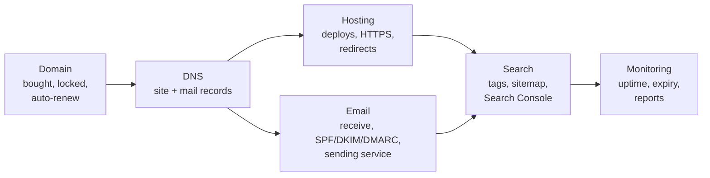

# Case study: launching a small site

After this you can take a small site from "works on my laptop" to launched, using one checklist that covers the domain, hosting, email, search and the monitoring that tells you when something expires or goes down.

Before this: the lessons in [Domains and hosting](../05-domains-and-hosting/index.md), [Email from your domain](../06-email-from-your-domain/index.md), [SEO basics](01-seo-basics.md) and [Search Console and analytics](02-google-search-console-and-analytics.md).

## The idea

A friend runs a small tutoring business in Toronto and asks you to build its site: a few pages, a contact form that emails them, and a monthly newsletter for parents. Each earlier lesson covered one piece. Launching means doing all of them in a sensible order, then noticing when something breaks months later.



In the diagram, DNS comes right after the domain because both the site and email depend on it, and monitoring comes last because it watches everything else.

## Requirements

Written down before building, as in [requirements and user stories](../../14-software-and-system-design/04-software-engineering-process/01-requirements-and-user-stories.md):

- The site is at `https://www.tutoring.example.ca`; every other variant redirects there.
- The contact form emails the owner within a minute and never loses a message.
- Parents can join the newsletter with consent that meets CASL, and leave it in one click.
- The owner can see how many people visit and which searches find the site.
- Someone is alerted if the site is down for more than 10 minutes, or if the domain or certificate is about to expire.
- It is a business, so every service must allow commercial use; the monthly cost is written down.

The last requirement changes the hosting choice: Vercel Hobby and GitHub Pages exclude this use, so the plan is a paid hosting plan, or a provider whose free tier allows commercial use, decided before any code is written.

## Launch checklist

| Area | Item | Check with |
|---|---|---|
| Domain | registered in the owner's account, 2FA on, auto-renew on, lock on | RDAP script (domains lesson 1) |
| DNS | apex and `www` point at the host; no parking records; zone noted | `nslookup` against `1.1.1.1` |
| HTTPS | certificate valid for every name you serve | browser, expiry script below |
| Redirects | one canonical URL; every variant one or two permanent hops, path kept | `curl -sIL` on four variants |
| Hosting | plan allows commercial use; production variables set; preview protected | dashboard, `/api/info`-style check |
| Receiving mail | MX for the owner's mailbox; test message arrives | send from another account |
| Sending mail | verified sending subdomain; SPF, DKIM, DMARC pass; bounces handled | Gmail "Show original" |
| Contact form | sends from a background job with an idempotency key; stored before sending | submit twice, check one email each |
| Newsletter | unticked consent box, record stored; one-click unsubscribe headers | capture server, then a real send |
| Search | unique titles and descriptions; canonical links; `robots.txt`; sitemap | `seo_check.py` |
| Search Console | Domain property verified; sitemap submitted | Search Console |
| Analytics | cookieless tool, or consent handled; privacy page published | dashboard, the privacy page |
| Monitoring | uptime check; expiry checks; owner on the alerts | trigger a test alert |
| Money | every service, its plan, its renewal date and card | one shared document |

The contact form shows how the lessons combine: the form handler saves the message to the database first (so it can't be lost), enqueues an email job, and returns. The job sends through the sending service with the key `contact/<message id>`, so a retry never sends twice, and a bounce webhook flags the owner's address if it stops working.

## Monitoring after launch

Three things expire or break without anyone touching the site.

An **uptime check** is an external service that requests your URL every few minutes and alerts you when it fails. UptimeRobot's free plan, for example, checks 50 URLs every 5 minutes and permits commercial use ([UptimeRobot pricing](https://uptimerobot.com/pricing/), as of 2026). Point it at a page that exercises the app, such as one that reads the database.

**TLS certificates** expire and must be renewed automatically. The maximum certificate lifetime is shrinking under a CA/Browser Forum decision: 200 days from March 2026, 100 days from March 2027 and 47 days from March 2029 ([DNSimple summary of ballot SC-081](https://support.dnsimple.com/articles/announcement-ssl-certificate-validity-changes/)). Platforms renew for you; a failing renewal is still worth an alert.

The **domain** itself expires if the card on file fails. An alert 30 days ahead leaves time to fix it.

<div class="example" markdown>

### Example 1: an expiry check you can schedule

This script reports the days left on a host's certificate and on a domain's registration, using TLS and the RDAP query from the domains chapter. Save it as `expiry_check.py`:

```python
import json, socket, ssl, sys, urllib.request
from datetime import datetime, timezone

def cert_days(host):
    ctx = ssl.create_default_context()
    with socket.create_connection((host, 443), timeout=10) as sock:
        with ctx.wrap_socket(sock, server_hostname=host) as tls:
            not_after = tls.getpeercert()["notAfter"]
    expires = datetime.fromtimestamp(ssl.cert_time_to_seconds(not_after), timezone.utc)
    return (expires - datetime.now(timezone.utc)).days

def domain_days(domain):
    with urllib.request.urlopen(f"https://rdap.org/domain/{domain}") as r:
        events = json.load(r)["events"]
    date = next(e["eventDate"] for e in events if e["eventAction"] == "expiration")
    expires = datetime.fromisoformat(date.replace("Z", "+00:00"))
    return (expires - datetime.now(timezone.utc)).days

host, domain = sys.argv[1], sys.argv[2]
for name, days, limit in (("certificate", cert_days(host), 14), ("domain", domain_days(domain), 30)):
    status = "OK" if days > limit else "RENEW SOON"
    print(f"{name:12} {days:5} days left  {status}")
```

```powershell
py expiry_check.py www.github.com github.com
py expiry_check.py www.cira.ca cira.ca
```

```text
certificate     79 days left  OK
domain         699 days left  OK
certificate     31 days left  OK
domain        8488 days left  OK
```

1. `cert_days` opens a TLS connection the way a browser does, so it also fails loudly if the certificate is already invalid. `getpeercert()["notAfter"]` is the expiry date.
2. `domain_days` reads the "expiration" event from RDAP. CIRA registered its own domain decades ahead; a small business usually renews yearly.
3. The limits (14 days for a certificate, 30 for a domain) leave time to react.

Check: the certificate figure matches the expiry date shown in the browser's certificate viewer for the same host. Some registries' RDAP servers refuse automated requests (the `.org` one returned 403 while writing this); if yours does, rely on the registrar's reminders and auto-renew.

To run it every Monday, a GitHub Actions workflow with a `schedule` trigger is enough, as in [GitHub Actions](../02-ci-cd/02-github-actions.md). Make it fail when renewal is near, so GitHub emails you about the failed run; add `sys.exit(1)` when any status is `RENEW SOON`. Schedules use UTC:

```yaml
name: expiry-check
on:
  schedule:
    - cron: "0 13 * * 1"
  workflow_dispatch:
jobs:
  check:
    runs-on: ubuntu-latest
    steps:
      - uses: actions/checkout@v7
      - uses: actions/setup-python@v6
        with:
          python-version: "3.14"
      - run: python expiry_check.py www.tutoring.example.ca tutoring.example.ca
```

</div>

## Common mistakes

<div class="warning" markdown>

Watch out: registering the client's domain and services in your own accounts. When you move on, they can't renew or change anything. Create accounts in the business's name with its email, and add yourself as a member.

Watch out: launching on a free tier that excludes commercial use, then migrating under pressure when the platform notices. Settle the plan and its monthly cost in the requirements.

Watch out: alerts that go only to the developer. The owner needs uptime and expiry alerts too, or nobody acts when you're unavailable.

</div>

## Working with AI

<div class="ai" markdown>

Words to use: launch checklist, canonical URL, sending subdomain, CASL consent, Domain property, uptime check, certificate expiry, commercial use.

Prompts to try:

- "I'm launching a site for a small Ontario business on Vercel Pro with Resend for email and a Next.js contact form. Turn this checklist into a GitHub issue template with one checkbox per item and the command to verify each (paste the checklist)."
- "Review this `expiry_check.py` and GitHub Actions workflow (paste). Make the job fail when any check says RENEW SOON, and explain how GitHub notifies me when a scheduled workflow fails."

What to check:

- Checklists that skip email authentication or consent, or that recommend a personal-use free tier for a business.
- Cron expressions in local time. GitHub Actions and Vercel schedules run in UTC; convert, and check with a cron translator.
- Monitoring that only checks the home page of a static site. Check a page that exercises the form or the database too.

</div>

## Quiz

1\. Why does DNS come before both hosting and email in the launch order?

<details class="solution" markdown>
<summary>Answer</summary>

The site needs A and CNAME records to receive traffic and get a certificate, and email needs MX, SPF, DKIM and DMARC records. Both depend on the zone being in place at a DNS host you control.

</details>

2\. The contact form handler sends the email directly and returns an error if the provider times out. What two changes make it meet the requirement "never loses a message"?

<details class="solution" markdown>
<summary>Answer</summary>

Save the message to the database before anything else, and send the email from a background job with retries and an idempotency key. A provider outage then delays the email but loses nothing.

</details>

3\. The workflow runs at `0 13 * * 1`. When is that in Toronto?

<details class="solution" markdown>
<summary>Answer</summary>

13:00 UTC on Mondays, which is 09:00 in Toronto during daylight saving time (UTC-4) and 08:00 in winter (UTC-5).

</details>

4\. The expiry script prints `certificate 9 days left RENEW SOON` for a site on Vercel. What do you check?

<details class="solution" markdown>
<summary>Answer</summary>

Vercel normally renews well before expiry, so something blocks renewal: the domain's DNS no longer points at Vercel (a changed A or CNAME record, or a moved zone), or the domain was removed from the project. Check the project's Domains page for an error and fix the records.

</details>

## Lab

<div class="lab" markdown>

### Lab: run the checklist on your own site

Goal: every row of the launch checklist is checked on the domain you built up across these chapters, with monitoring in place. Time: about 30 minutes. Runs in: your terminal, GitHub and the dashboards you set up earlier.

1. Copy the checklist into a `LAUNCH.md` file in your site's repository. Mark each row done, not applicable, or to do.
2. Fix the "to do" rows you can fix in 15 minutes. Write the rest down as GitHub issues.
3. Add `expiry_check.py`, make it exit with status 1 when any check says `RENEW SOON`, and add the workflow. Run it once with "Run workflow".
4. Create a free uptime check for your canonical URL, with alerts to your email. Pause your Vercel deployment or point the check at a missing path, confirm the alert arrives, then fix it.
5. In `LAUNCH.md`, list every service you use with its plan, monthly cost and renewal date.

Expected result: a committed `LAUNCH.md` with every row resolved or ticketed; a green workflow run; one test alert received.

<details class="solution" markdown>
<summary>Solution</summary>

The end of `expiry_check.py` with an exit code:

```python
results = (("certificate", cert_days(host), 14), ("domain", domain_days(domain), 30))
for name, days, limit in results:
    status = "OK" if days > limit else "RENEW SOON"
    print(f"{name:12} {days:5} days left  {status}")
sys.exit(1 if any(days <= limit for _, days, limit in results) else 0)
```

A failed scheduled run sends an email to the person who last edited the workflow's schedule, by default (check your GitHub notification settings). Steps 3 and 4 need your accounts and were not run while writing this lesson; the script itself was run as in Example 1. For step 4, pointing the monitor at `/does-not-exist` gives a 404 and triggers the alert without taking the site down.

</details>

</div>

## Where this shows up

- Uptime checks are a simple form of the monitoring in [logging, metrics and monitoring](../04-operations/01-logging-metrics-and-monitoring.md), and an alert at 3 a.m. is where [incidents and on-call](../04-operations/02-incidents-and-on-call.md) starts.
- A booking page that signs people in with Google uses the next chapter's sign in with Google<!-- link: ../08-google-cloud/03-sign-in-with-google.md -->.
