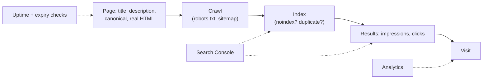

# Search and launch

Cheat sheet for the chapter. Tool features, free tiers and certificate rules are as of 2026 and live in the lessons, with their sources.

## Lessons

1. [SEO basics](01-seo-basics.md): crawl, index, serve; titles, descriptions, canonical links, robots.txt, sitemaps, Open Graph.
2. [Google Search Console and analytics](02-google-search-console-and-analytics.md): Domain property, URL Inspection, indexing reasons, performance numbers, privacy-friendly analytics.
3. [Case study: launching a small site](03-case-study-launching-a-small-site.md): the launch checklist, uptime and expiry monitoring.

## How the pieces fit



## Head of every page

```html
<title>Page topic | Site name</title>
<meta name="description" content="One or two sentences for a person reading results.">
<link rel="canonical" href="https://www.example.com/page">
<meta property="og:title" content="Page topic">
<meta property="og:description" content="Short description for link previews.">
<meta property="og:image" content="https://www.example.com/og.png">
```

## Terms

| Term | Meaning |
|---|---|
| Crawl, render, index, serve | fetch; run JavaScript; store; rank and show |
| robots.txt | crawl rules at the root of a host; doesn't keep a page out of the index |
| Sitemap | XML list of URLs to crawl |
| noindex | meta tag or `X-Robots-Tag` header asking to stay out of the index |
| Canonical link | `rel="canonical"`: the preferred URL among duplicates |
| Title link, snippet | the result's headline; the text under it |
| Structured data | schema.org facts as JSON-LD |
| Open Graph | tags for link preview cards |
| Domain property | Search Console property for every subdomain and scheme, verified by DNS TXT |
| URL Inspection | Google's view of one URL, with Google-selected and user-declared canonicals |
| Impressions, clicks, CTR, average position | shown; clicked; clicks / impressions; average top rank |
| Change of Address | Search Console tool for a move to a new domain (180 days) |
| Page view, event, referrer, UTM | analytics counts and campaign tags |
| Uptime check | external request every few minutes, with alerts |

## Indexing reasons and first fixes

| Page indexing reason | First thing to check |
|---|---|
| Excluded by 'noindex' tag | a staging tag or header in production |
| Blocked by robots.txt | a `Disallow` rule covering the path |
| Duplicate, Google chose different canonical than user | redirects, internal links and sitemap all use the canonical URL |
| Page with redirect | expected for redirected variants; remove them from the sitemap |
| Discovered - currently not indexed | links to the page, crawlable HTML |
| Crawled - currently not indexed | page content and usefulness |

## Commands

| Task | Command |
|---|---|
| Head tags of a page | `py seo_check.py URL` (lesson 1) |
| Indexing headers | `curl -sI URL` and look for `x-robots-tag` |
| robots.txt, sitemap | `curl -s https://www.example.com/robots.txt`, `/sitemap.xml` |
| Verification record | `nslookup -type=TXT example.com 1.1.1.1` |
| Certificate and domain expiry | `py expiry_check.py www.example.com example.com` (lesson 3) |

## Rules of thumb

- One canonical URL, used by redirects, canonical links, internal links and the sitemap alike.
- Real text in the HTML for public pages: server-side rendering or pre-rendering.
- Request indexing once; improve the page instead of repeating it.
- Search Console shows the search results page; analytics shows the site. Use both.
- Prefer cookieless, aggregated analytics; never send personal information to analytics.
- Monitor uptime, certificate expiry and domain expiry, with the owner on the alerts.
