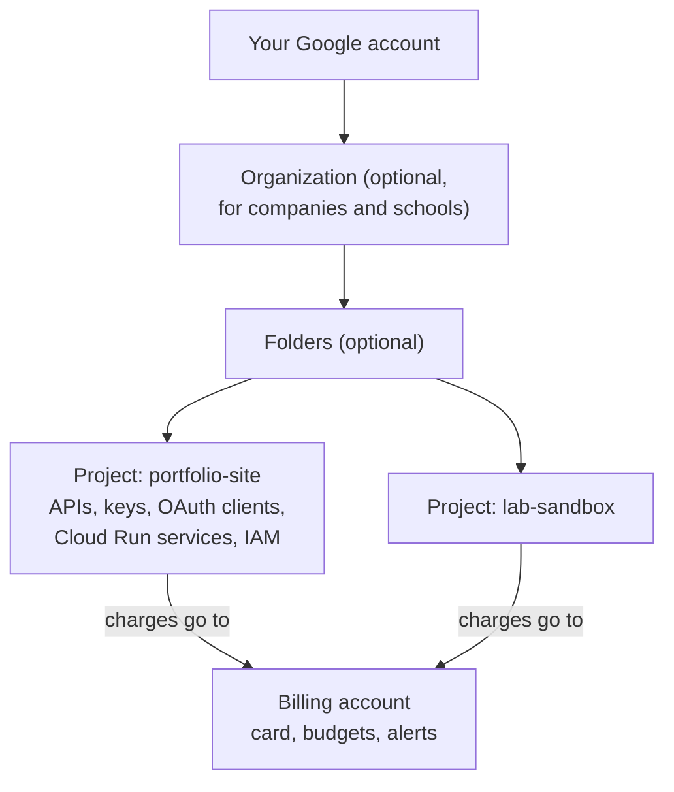

# Projects, billing and the console

After this you can find your way around the Google Cloud console, create a project with a budget alert, map the AWS services you know to their Google Cloud names, and tell Google's many "consoles" apart.

Before this: [Cloud models and regions](../03-aws/01-cloud-models-and-regions.md) and [AWS account, IAM and billing](../03-aws/02-aws-account-iam-and-billing.md).

## The idea

Sooner or later a tutorial says "create an OAuth client in the Google Cloud console" or "get a Maps API key". You open `console.cloud.google.com` and find hundreds of products, a project picker you never chose, and a billing prompt. The structure underneath is small: nearly everything you create lives in a **project**, and a project's costs go to a **billing account**.



In the diagram, projects are the unit of everything: which APIs are on, who has access, and whose card pays. One billing account can pay for many projects. Deleting a project deletes everything in it, which makes a throwaway project per lab the simplest cleanup.

## Key terms

The **Google Cloud console** is the web interface for Google Cloud at `console.cloud.google.com`. The **gcloud CLI** is its command-line tool, and **Cloud Shell** is a browser terminal in the console with `gcloud` already installed and signed in.

A **project** has three identifiers. The **project name** is a label you can change. The **project ID** is chosen at creation, globally unique and permanent; commands and URLs use it. The **project number** is assigned by Google ([creating and managing projects](https://docs.cloud.google.com/resource-manager/docs/creating-managing-projects), as of 2026).

An **organization** is the top of the hierarchy for a company or school domain, and **folders** group projects inside it. A personal account usually has projects with no organization.

A **billing account** holds the payment method. A **budget** watches spending and emails alerts at thresholds, by default 50%, 90% and 100%. An alerts-only budget doesn't cap spending ([budgets](https://docs.cloud.google.com/billing/docs/how-to/budgets)); for some services, a spend cap budget can pause them at the limit.

The **free trial** gives new accounts a \$300 credit for 90 days, and doesn't charge you afterwards unless you upgrade to a paid account. The **Free Tier** is a separate monthly allowance for some products, such as Cloud Run's 2 million requests a month ([free features](https://docs.cloud.google.com/free/docs/free-cloud-features), as of 2026).

A **region** is a location such as `northamerica-northeast1` (Montréal) or `northamerica-northeast2` (Toronto), as in AWS.

## How it works

1. Create a project with a readable ID, such as `sam-portfolio-2026`. IDs can't be changed or reused after deletion, so don't put secrets or a client's name in one you might give away.
2. Link it to a billing account, then create a budget with alerts. Do this before anything else, as you did for AWS.
3. Enable only the APIs you use (next lesson). Each product is an API that is off until you turn it on.
4. Grant access with IAM: add a person's Google account to the project with a role. The basic roles Owner, Editor and Viewer are broad; predefined roles such as Cloud Run Developer are narrower.
5. When a lab is done, shut the project down. It is deleted after 30 days, and its ID is never reused.

The products you met on AWS have Google Cloud equivalents:

| AWS | Google Cloud |
|---|---|
| EC2 | Compute Engine |
| S3 | Cloud Storage |
| Lambda | Cloud Run functions |
| ECS, Fargate, App Runner | Cloud Run |
| RDS | Cloud SQL |
| ECR | Artifact Registry |
| CloudWatch | Cloud Logging, Cloud Monitoring |
| Route 53 | Cloud DNS |
| Redshift | BigQuery |
| IAM user, role | Google account, service account |

Google also runs other consoles that people confuse with this one. Google Search Console (`search.google.com/search-console`) is for search indexing and needs no cloud project. The Firebase console manages Firebase apps, and each Firebase project is also a Google Cloud project. Google AI Studio issues Gemini API keys that also live in a Google Cloud project. The Google Workspace admin console manages a company's Gmail and Drive users.

## Worked example

<div class="example" markdown>

### Example 1: a lab project with a budget, from Cloud Shell

Open Cloud Shell from the console's toolbar. These commands come from the [gcloud reference](https://docs.cloud.google.com/sdk/gcloud/reference) and were not run while writing this lesson, since that needs an account:

```bash
gcloud projects create sam-lab-2026 --name="Lab sandbox"
gcloud config set project sam-lab-2026
gcloud billing accounts list
gcloud billing projects link sam-lab-2026 --billing-account=0X0X0X-0X0X0X-0X0X0X
gcloud billing budgets create --billing-account=0X0X0X-0X0X0X-0X0X0X \
  --display-name="lab budget" --budget-amount=20.00CAD \
  --threshold-rule=percent=0.50 --threshold-rule=percent=0.90 --threshold-rule=percent=1.00 \
  --filter-projects=projects/sam-lab-2026
```

1. `projects create` takes the permanent ID first and the changeable name as a flag.
2. `config set project` makes it the default for later commands, so you don't pass `--project` each time.
3. `billing accounts list` prints your billing account IDs; use yours in the next two commands.
4. The budget watches only this project and emails at 50%, 90% and 100% of \$20. The currency must match the billing account's currency.

Check: `gcloud config list` shows `project = sam-lab-2026`, and Billing, Budgets & alerts in the console lists "lab budget". The console's project picker at the top of every page should show the same project; most "I can't find my resource" problems are the wrong project selected there.

</div>

## Common mistakes

<div class="warning" markdown>

Watch out: working in the wrong project. The console remembers the last project you opened, and the CLI has its own default. Check the picker in the console and `gcloud config list` in the terminal before creating anything.

Watch out: trusting a budget to stop spending. An alerts-only budget sends email; resources keep running. Delete what you create, or shut the project down.

Watch out: giving a teammate Owner on a project because it's quick. Owner can delete the project and change billing. Use Editor or a predefined role for the product they work on.

</div>

## Working with AI

<div class="ai" markdown>

Words to use: project ID, billing account, budget alert, free trial, Free Tier, IAM role, region, Cloud Shell.

Prompts to try:

- "I know AWS: EC2, S3, Lambda, RDS, IAM roles. Explain the Google Cloud equivalents and the main differences in how projects and IAM work, with links to Google Cloud docs."
- "Write gcloud commands to create a project, link billing, create a 20 CAD budget limited to that project, and enable only the Cloud Run API. Then the command to shut the project down."

What to check:

- Old documentation URLs or product names (Cloud Functions is now Cloud Run functions; the docs moved to `docs.cloud.google.com`). Check the current page.
- gcloud flags that don't exist. Run `gcloud <command> --help` in Cloud Shell before trusting a flag.
- Free-tier claims. Limits differ by region and product; read the free features page.

</div>

## Quiz

1\. Which of a project's three identifiers can you change, and which do commands use?

<details class="solution" markdown>
<summary>Answer</summary>

Only the project name can change. Commands and URLs use the project ID, which is permanent and globally unique.

</details>

2\. Your budget is \$20 and the alert for 100% arrived. What happens to your running Cloud SQL instance?

<details class="solution" markdown>
<summary>Answer</summary>

Nothing: an alerts-only budget doesn't stop resources, and the instance keeps billing. Stop or delete it yourself (or use a spend cap where the service supports one).

</details>

3\. A tutorial says to "enable the Maps JavaScript API" and you can't find your API key afterwards. What is the first thing to check?

<details class="solution" markdown>
<summary>Answer</summary>

Which project is selected in the console's project picker. API keys, enabled APIs and OAuth clients are per project.

</details>

4\. You want your site in Google search results. Do you need a Google Cloud project?

<details class="solution" markdown>
<summary>Answer</summary>

No. That is Google Search Console, a separate product verified through DNS. A Cloud project is needed for things like OAuth clients, API keys and Cloud Run.

</details>

## Lab

<div class="lab" markdown>

### Lab: a safe Google Cloud setup

Goal: a Google Cloud account with a budget alert and one lab project for the rest of this chapter. Time: about 15 minutes. Runs in: the Google Cloud console and Cloud Shell. Costs: nothing if you stay within the free trial and Free Tier and follow the cleanup steps in later labs.

1. Sign in to `console.cloud.google.com` with a personal Google account and start the free trial. Note the billing account.
2. In Billing, create a budget of 20 in your currency with alerts at 50%, 90% and 100%.
3. Create a project for this chapter (console or Example 1's commands). Select it in the project picker.
4. Open Cloud Shell and run `gcloud config list` and `gcloud projects describe <your project ID>`.
5. Open IAM and find your own account and its role on the project.

Expected result: a project whose ID you know, linked to a billing account with a budget; Cloud Shell shows it as the default project; IAM lists you as Owner.

<details class="solution" markdown>
<summary>Solution</summary>

`gcloud projects describe` prints the project's `name`, `projectId`, `projectNumber` and `lifecycleState: ACTIVE`. Not run while writing this lesson, since it needs an account. If Cloud Shell shows a different project, run `gcloud config set project <your project ID>`. Keep the project; the next three lessons use it, and the last one ends with shutting it down.

</details>

</div>

## Where this shows up

- API keys and service accounts live inside the project: [APIs, keys and service accounts](02-apis-keys-and-service-accounts.md).
- The same budget-first habit is in [AWS account, IAM and billing](../03-aws/02-aws-account-iam-and-billing.md).
