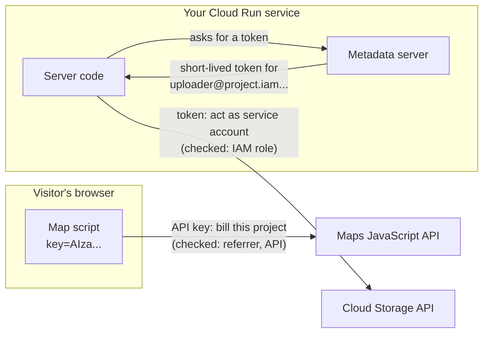

# APIs, keys and service accounts

After this you can turn on a Google API for a project, create an API key that is safe to put in a web page, and give server code access to Google Cloud without a password or a downloaded key file.

Before this: [Projects, billing and the console](01-projects-billing-and-the-console.md), [AWS account, IAM and billing](../03-aws/02-aws-account-iam-and-billing.md) and [secrets and dependency security](../../12-security/01-web-security/06-secrets-and-dependency-security.md).

## The idea

Two pieces of your app talk to Google. A map on the contact page loads in the visitor's browser, and a server job writes uploaded files to Cloud Storage. They need different kinds of credential. The map's call comes from anyone's browser, so its credential is public by design; it only needs to say which project pays, and to be useless anywhere else. The server's call acts on your data, so it needs a real identity with permissions, kept off any disk you don't control.



In the diagram, the left path is an **API key**: it identifies a project, not a person, and its restrictions are its only protection. The right path is a **service account** attached to the service, which gets short-lived tokens from the platform, so no long-lived secret exists to leak.

## Key terms

Each Google product is exposed as an **API** with a service name such as `maps-backend.googleapis.com` or `storage.googleapis.com`. An API must be **enabled** in a project before calls work, and each has **quotas** (calls per minute or per day).

An **API key** is a string that ties a request to a project for billing and quota. A standard API key doesn't authenticate a person or app ([API keys](https://docs.cloud.google.com/docs/authentication/api-keys), as of 2026). Its **application restriction** limits where it may be used (HTTP referrers, IP addresses, Android or iOS apps), and its **API restriction** limits which APIs it may call. Google calls unrestricted keys insecure and recommends both restrictions.

A **service account** is an identity for software, named like `uploader@my-project.iam.gserviceaccount.com`, that you grant IAM roles, like an AWS IAM role. An **attached service account** is one assigned to a resource such as a Cloud Run service; the code gets tokens for it from the **metadata server** inside Google Cloud.

A **service account key** is a downloadable JSON file holding a private key for a service account. It works anywhere, never expires on its own, and isn't covered by two-step verification, so a leaked one is worse than a leaked password ([managing service account keys](https://docs.cloud.google.com/iam/docs/best-practices-for-managing-service-account-keys)). For organizations created on or after 3 May 2024, creating these keys is blocked by default.

**Application Default Credentials** (ADC) is how Google's client libraries find credentials without code changes. They look, in order, at the file named by `GOOGLE_APPLICATION_CREDENTIALS`, then at a file created by `gcloud auth application-default login`, then at the attached service account through the metadata server ([ADC](https://docs.cloud.google.com/docs/authentication/application-default-credentials)).

## How it works

Pick the credential by where the code runs:

1. In a browser or mobile app, calling an API that accepts keys (Maps, for example): an API key with an application restriction (your site's referrers) and an API restriction (only that API).
2. On your laptop, calling Google Cloud APIs: run `gcloud auth application-default login` once. The libraries then use your own account through ADC, and nothing secret goes into the repository.
3. On Google Cloud (Cloud Run, Compute Engine): create a dedicated service account with only the roles the code needs, and attach it to the resource. The same code finds it through ADC.
4. In CI outside Google Cloud, such as GitHub Actions: use **Workload Identity Federation**, which trades the CI system's own short-lived token for a Google token, instead of storing a JSON key as a secret.

A restricted key, created from Cloud Shell with flags from the [gcloud reference](https://docs.cloud.google.com/sdk/gcloud/reference/services/api-keys/create) (not run here):

```bash
gcloud services enable maps-backend.googleapis.com
gcloud services api-keys create --display-name="site map" \
  --api-target=service=maps-backend.googleapis.com \
  --allowed-referrers="https://www.example.ca/*"
```

## Worked example

<div class="example" markdown>

### Example 1: watching ADC look for credentials

Google's `google-auth` library implements ADC. In a virtual environment, install it with `python -m pip install google-auth` and save this as `which_creds.py`:

```python
import google.auth
from google.auth.exceptions import DefaultCredentialsError

try:
    credentials, project = google.auth.default(
        scopes=["https://www.googleapis.com/auth/cloud-platform"]
    )
    kind = type(credentials)
    print("found:", f"{kind.__module__}.{kind.__name__}", "project:", project)
except DefaultCredentialsError as err:
    print("no credentials:", err)
```

On a machine with no Google credentials, run it plainly and then with the variable pointing at a key file that doesn't exist:

```bash
python which_creds.py
GOOGLE_APPLICATION_CREDENTIALS=key.json python which_creds.py
```

```text
no credentials: Your default credentials were not found. To set up Application Default Credentials, see https://cloud.google.com/docs/authentication/external/set-up-adc for more information.
no credentials: File key.json was not found.
```

1. With nothing configured, ADC checked all three places and found nothing, so it points you to the setup page.
2. With `GOOGLE_APPLICATION_CREDENTIALS` set, ADC uses that file and stops looking. A leftover variable from an old tutorial can make your code use the wrong account, or fail like this.
3. After `gcloud auth application-default login`, the first command prints `found: google.oauth2.credentials.Credentials` (your user account). On Cloud Run with an attached service account it prints `google.auth.compute_engine.credentials.Credentials`, because the token comes from the metadata server. The code is the same in all three places.

Check: the error messages match the order described in Key terms. Run `echo $GOOGLE_APPLICATION_CREDENTIALS` (or `$env:GOOGLE_APPLICATION_CREDENTIALS` in PowerShell) whenever credentials behave unexpectedly.

</div>

## Common mistakes

<div class="warning" markdown>

Watch out: an unrestricted API key in front-end code or a public repository. Anyone can copy it and spend your quota and money on any API the project has enabled. Restrict every key to its referrers or IPs and to the APIs it needs; rotate any key that was exposed.

Watch out: downloading a service account key "to make it work locally". Use `gcloud auth application-default login` on your machine and an attached service account in the cloud. If a key is truly needed, store it in a secret manager and set an expiry policy.

Watch out: giving a service account Editor or Owner. A compromised service then controls the project. Grant predefined roles for the products it uses, such as Storage Object Creator on one bucket.

</div>

## Working with AI

<div class="ai" markdown>

Words to use: enabled API, API key restriction, service account, IAM role, attached service account, Application Default Credentials, Workload Identity Federation, metadata server.

Prompts to try:

- "My Python app on Cloud Run writes to one Cloud Storage bucket. Give me gcloud commands to create a dedicated service account with the narrowest role on that bucket, attach it to the service, and the Python code using ADC. No JSON keys."
- "Set up GitHub Actions to deploy to Cloud Run with Workload Identity Federation instead of a service account key. List the gcloud commands and the workflow YAML, and link the docs for each step."

What to check:

- Any step that downloads a service account key or pastes JSON into a secret. Ask for the keyless alternative.
- Keys created without `--api-target` or an application restriction.
- Roles that are broader than the task: `roles/editor`, `roles/owner`, or project-wide storage admin for one bucket.

</div>

## Quiz

1\. Is it safe to put a Maps API key in your page's HTML? Under what conditions?

<details class="solution" markdown>
<summary>Answer</summary>

It is expected to be public for browser APIs like Maps, as long as it is restricted to your site's referrers and to the Maps APIs only, and has quotas set. Unrestricted, anyone can reuse it at your expense.

</details>

2\. Your code works on your laptop but on Cloud Run fails with "permission denied" on a bucket. What is the likely difference?

<details class="solution" markdown>
<summary>Answer</summary>

Locally ADC used your own account, which has broad access. On Cloud Run it uses the service account attached to the service, which lacks a role on the bucket. Grant that service account the needed role.

</details>

3\. In what order does ADC look for credentials?

<details class="solution" markdown>
<summary>Answer</summary>

The file in `GOOGLE_APPLICATION_CREDENTIALS`, then the file from `gcloud auth application-default login`, then the attached service account from the metadata server.

</details>

4\. Why is Workload Identity Federation better than a service account key stored as a GitHub secret?

<details class="solution" markdown>
<summary>Answer</summary>

No long-lived secret exists. Each run exchanges GitHub's short-lived token for a short-lived Google token, scoped by conditions such as the repository, so there is nothing that works forever if copied.

</details>

## Lab

<div class="lab" markdown>

### Lab: one key, one service account

Goal: a restricted API key and a dedicated service account in your lab project. Time: about 15 minutes. Runs in: Cloud Shell and the console. Needs: the project from the previous lab.

1. Run Example 1 on your own machine and note the message.
2. In Cloud Shell, enable the Maps JavaScript API and create a key restricted to `https://www.yourdomain/*` and that API only. Check its restrictions in APIs & Services, Credentials.
3. Create a service account: `gcloud iam service-accounts create site-runner --display-name="Site runner"`. Note its email.
4. Open IAM in the console and confirm `site-runner` has no roles yet. You will attach it to a Cloud Run service in the last lesson.
5. On your machine (if you install the gcloud CLI), run `gcloud auth application-default login`, then Example 1 again.
6. Cleanup: delete the API key if you won't embed a map.

Expected result: one key with two restrictions; one service account with no roles; Example 1 prints `found:` after step 5.

<details class="solution" markdown>
<summary>Solution</summary>

`gcloud services api-keys list` shows the key with its display name, and `gcloud services api-keys describe <key id>` shows `restrictions` with `browserKeyRestrictions` (your referrer) and `apiTargets` (the Maps service). The service account's email is `site-runner@<project id>.iam.gserviceaccount.com`. Not run while writing this lesson, since it needs an account; Example 1 was run as shown. If key creation fails, enable the API Keys API (`apikeys.googleapis.com`) first.

</details>

</div>

## Where this shows up

- Sign in with Google uses a third kind of credential, an OAuth client: [Sign in with Google](03-sign-in-with-google.md).
- The service account from this lab runs your container in [deploying to Cloud Run](04-deploying-to-cloud-run.md).
