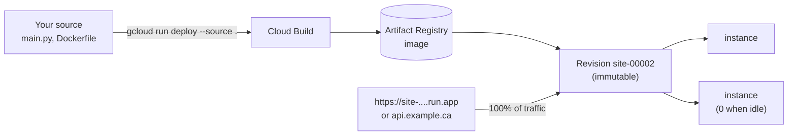

# Deploying to Cloud Run

After this you can deploy a containerized web service to Google Cloud Run from source, run it as a dedicated service account, roll back to an earlier revision, and put it on a subdomain of your own domain.

Before this: [APIs, keys and service accounts](02-apis-keys-and-service-accounts.md), [Docker images and Dockerfiles](../01-containers/02-docker-images-and-dockerfiles.md), [hosting platforms](../05-domains-and-hosting/04-hosting-platforms.md) and [deploying an app to EC2](../03-aws/08-deploying-an-app-to-ec2.md).

## The idea

The tutoring site's booking page needs a small API that runs longer than a page request allows and uses a Python library that doesn't fit a serverless function. On EC2 you would set up a server, nginx, certbot and systemd yourself. Cloud Run is the container platform from the hosting lesson: you give it a container (or source code it can build into one), and it runs it behind HTTPS, starts more copies under load, and stops them all when nobody is calling.



In the diagram, each deploy builds an image, stores it, and creates a new **revision**. Traffic is a pointer to revisions, so rolling back moves the pointer, like a Vercel rollback.

## Key terms

A Cloud Run **service** is a named, long-lived HTTPS endpoint, such as `site`. A **revision** is one deployed version of it: an image plus its settings (variables, memory, service account). A **container instance** is one running copy of a revision.

The **container contract** is what Cloud Run expects of your container: listen for HTTP on `0.0.0.0` at the port in the `PORT` environment variable (8080 by default), and keep no state on the local disk, which lives in memory and disappears with the instance. Cloud Run also sets `K_SERVICE` and `K_REVISION` ([container contract](https://docs.cloud.google.com/run/docs/container-contract)).

**Scale to zero** means no instances run when there are no requests, so an idle service costs nothing and the next request has a **cold start**. **Minimum instances** keep some warm and are billed even when idle ([autoscaling](https://docs.cloud.google.com/run/docs/about-instance-autoscaling)).

A **source deploy** (`gcloud run deploy --source .`) uploads your directory to Cloud Build, which builds it with your `Dockerfile` if there is one (or with buildpacks if not) and stores the image in an Artifact Registry repository named `cloud-run-source-deploy` ([deploying from source](https://docs.cloud.google.com/run/docs/deploying-source-code)).

The Free Tier covers 2 million requests, 180,000 vCPU-seconds and 360,000 GB-seconds a month per billing account, as of 2026 ([free features](https://docs.cloud.google.com/free/docs/free-cloud-features)); stored images and builds are billed separately.

## How it works

1. Write the app to the container contract and add a `Dockerfile`.
2. Choose a region. `northamerica-northeast2` (Toronto) keeps data in Canada; `us-central1` supports Cloud Run's own custom-domain mapping (step 6).
3. Deploy with your dedicated service account and public access. Google's recommended way to make a service public is `--no-invoker-iam-check` ([public access](https://docs.cloud.google.com/run/docs/authenticating/public)).
4. Each later deploy creates a new revision and moves all traffic to it once it starts. To test first, deploy with `--no-traffic --tag test` and open the tag's own URL.
5. To roll back, send traffic to an earlier revision: `gcloud run services update-traffic site --to-revisions site-00001-abc=100` ([rollbacks and traffic](https://docs.cloud.google.com/run/docs/rollouts-rollbacks-traffic-migration)).
6. For your own domain, there are three routes. Cloud Run domain mapping is in Preview, not recommended for production, and only in some regions (not Toronto or Montréal). A global external Application Load Balancer is the recommended production route. Firebase Hosting in front is the third ([custom domains](https://docs.cloud.google.com/run/docs/mapping-custom-domains)). Domain mapping first asks you to verify the domain, through the same Search Console verification you did in the search chapter.

## Worked example

<div class="example" markdown>

### Example 1: an app that follows the contract

`main.py` uses only the standard library. It reads `PORT`, listens on all interfaces, and reports which revision answered:

```python
import json, os
from http.server import BaseHTTPRequestHandler, HTTPServer

class Handler(BaseHTTPRequestHandler):
    def do_GET(self):
        body = json.dumps({
            "message": "hello from Cloud Run",
            "service": os.environ.get("K_SERVICE", "local"),
            "revision": os.environ.get("K_REVISION", "local"),
        }).encode()
        self.send_response(200)
        self.send_header("Content-Type", "application/json")
        self.end_headers()
        self.wfile.write(body)

port = int(os.environ.get("PORT", "8080"))
print(f"listening on 0.0.0.0:{port}", flush=True)
HTTPServer(("0.0.0.0", port), Handler).serve_forever()
```

Test it locally with the variables Cloud Run would set. In WSL, in one terminal:

```bash
PORT=8081 K_SERVICE=site K_REVISION=site-00002-xyz python3 main.py
```

```text
listening on 0.0.0.0:8081
```

In a second terminal, `curl -s localhost:8081`:

```text
{"message": "hello from Cloud Run", "service": "site", "revision": "site-00002-xyz"}
```

1. Binding to `0.0.0.0` instead of `127.0.0.1` lets Cloud Run's proxy reach the process; `127.0.0.1` would work locally and fail when deployed.
2. Reading `PORT` instead of hard-coding 8080 follows the contract, and let us run it on 8081 here.
3. `flush=True` sends the log line at once. Cloud Run collects whatever the process writes to stdout as logs.

The `Dockerfile` next to it:

```dockerfile
FROM python:3.14-slim
WORKDIR /app
COPY main.py .
CMD ["python", "main.py"]
```

Then the deploy, from Cloud Shell in the project directory (flags from the docs above; not run while writing this lesson, since it needs an account):

```bash
gcloud services enable run.googleapis.com cloudbuild.googleapis.com artifactregistry.googleapis.com
gcloud run deploy site --source . --region us-central1 \
  --service-account site-runner@PROJECT_ID.iam.gserviceaccount.com \
  --no-invoker-iam-check
```

Check: the deploy prints a `Service URL` ending in `run.app`; `curl -s` on it returns the JSON with `"service": "site"` and a revision name such as `site-00001-abc`. Deploy again after changing the message, and the revision number goes up.

</div>

## Common mistakes

<div class="warning" markdown>

Watch out: listening on `localhost` or a fixed port. The revision fails to start with a message that the container didn't listen on the expected port. Read `PORT` and bind to `0.0.0.0`.

Watch out: writing uploads or a SQLite file to the container's disk. It is memory, it is lost when the instance stops, and each instance has its own. Store files in Cloud Storage and data in a database.

Watch out: forgetting the images. Deleting the service leaves the built images in Artifact Registry, which bills for storage. Delete the repository too, or shut the whole project down.

</div>

## Working with AI

<div class="ai" markdown>

Words to use: Cloud Run service, revision, container contract, `PORT`, scale to zero, minimum instances, source deploy, domain mapping.

Prompts to try:

- "Convert this FastAPI app (paste) to run on Cloud Run: a Dockerfile using uvicorn on `$PORT` and `0.0.0.0`, the `gcloud run deploy --source .` command with a dedicated service account, and how to read secrets from Secret Manager instead of plain environment variables."
- "My Cloud Run service is in `northamerica-northeast2`. Compare the global external Application Load Balancer and Firebase Hosting for putting it on `api.example.ca`: steps, monthly cost at low traffic, and limitations. Link the docs."

What to check:

- Dockerfiles that hard-code `--port 8080` or bind to `127.0.0.1`.
- Domain mapping suggested for a region that doesn't support it. Check the region list on the custom domains page.
- `--allow-unauthenticated` or `allUsers` on a service that should be private, and minimum instances set without a reason (they bill while idle).

</div>

## Quiz

1\. Your container listens on `127.0.0.1:8080`. It works with `docker run -p 8080:8080` on your laptop only when you use host networking, and fails on Cloud Run. Why?

<details class="solution" markdown>
<summary>Answer</summary>

`127.0.0.1` accepts connections only from inside the same network namespace. Cloud Run's proxy connects from outside the container, so the app must listen on `0.0.0.0`.

</details>

2\. A deploy introduced a bug. Give the command that sends all traffic back to revision `site-00004-kel`.

<details class="solution" markdown>
<summary>Answer</summary>

`gcloud run services update-traffic site --to-revisions site-00004-kel=100` (add `--region` if it isn't your default). No rebuild happens; the old revision still exists.

</details>

3\. The service costs nothing on quiet days but the first morning request takes 3 seconds. What is happening, and what are the trade-offs of fixing it?

<details class="solution" markdown>
<summary>Answer</summary>

It scaled to zero overnight, and the first request waits for a cold start. Setting minimum instances to 1 removes the wait but bills for that instance all the time; making the container start faster (smaller image, less work at import) costs nothing.

</details>

4\. Why might a Canadian business choose `northamerica-northeast2` even though domain mapping isn't available there?

<details class="solution" markdown>
<summary>Answer</summary>

To keep data and processing in Canada (for customers' expectations or contracts) and close to Canadian users. It then uses a load balancer or Firebase Hosting for the custom domain, or calls the `run.app` URL from its own front end.

</details>

## Lab

<div class="lab" markdown>

### Lab: deploy, roll back, clean up

Goal: a Cloud Run service on your domain's `api` subdomain, one rollback, and a project with nothing left billing. Time: about 30 minutes. Runs in: WSL and Cloud Shell. Needs: the lab project, the `site-runner` service account and your verified domain.

1. Run Example 1 locally and check the JSON.
2. Upload `main.py` and the `Dockerfile` to Cloud Shell and deploy as in Example 1. Open the `run.app` URL.
3. Change the message, deploy again, and check that the revision changed. Roll back to the first revision with `update-traffic`, and check again.
4. Map `api.yourdomain` with `gcloud beta run domain-mappings create --service site --domain api.yourdomain --region us-central1`. Add the records from `gcloud beta run domain-mappings describe --domain api.yourdomain --region us-central1` at your DNS host, and wait for the certificate.
5. Cleanup: delete the domain mapping and its DNS record, `gcloud run services delete site --region us-central1`, and `gcloud artifacts repositories delete cloud-run-source-deploy --location us-central1`.
6. Cleanup: shut the project down with `gcloud projects delete PROJECT_ID`, and check Billing the next day.

Expected result: the service answers on `run.app` and on `https://api.yourdomain`; after the rollback the first message returns; after cleanup the project is pending deletion and no charges appear.

<details class="solution" markdown>
<summary>Solution</summary>

After step 3, `gcloud run revisions list --service site --region us-central1` shows two revisions, and the traffic column shows 100% on the first. After step 4, `curl -s https://api.yourdomain` returns the JSON; the certificate can take from about 15 minutes to 24 hours. Not run while writing this lesson, since it needs an account; the app was run locally as in Example 1, and the commands follow the Cloud Run docs linked above as of 2026. If `domain-mappings create` says the domain isn't verified, run `gcloud domains verify yourdomain`, which opens the Search Console verification you set up earlier. Remember the DNS cleanup in step 5, or the `api` record becomes a dangling record.

</details>

</div>

## Where this shows up

- The same deploy can run from GitHub Actions with Workload Identity Federation, combining this lesson with [GitHub Actions](../02-ci-cd/02-github-actions.md) and the previous one.
- Logs from the service appear in Cloud Logging, the Google Cloud counterpart of the tools in [logging, metrics and monitoring](../04-operations/01-logging-metrics-and-monitoring.md).
