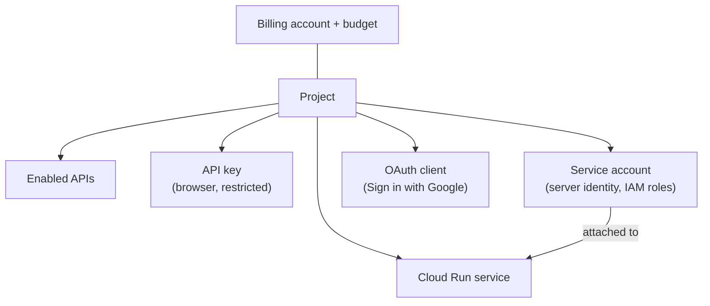

# Google Cloud

Cheat sheet for the chapter. Free-tier amounts, flags and console names are as of 2026 and live in the lessons, with their sources. The `gcloud` commands were checked against the [gcloud reference](https://docs.cloud.google.com/sdk/gcloud/reference), not run against a live account; run `gcloud <command> --help` in Cloud Shell before relying on a flag.

## Lessons

1. [Projects, billing and the console](01-projects-billing-and-the-console.md): projects, billing accounts, budgets, free trial, AWS-to-Google Cloud names.
2. [APIs, keys and service accounts](02-apis-keys-and-service-accounts.md): enabling APIs, restricted API keys, service accounts, ADC, no key files.
3. [Sign in with Google](03-sign-in-with-google.md): Google Auth Platform, OAuth clients, the button, ID token verification.
4. [Deploying to Cloud Run](04-deploying-to-cloud-run.md): container contract, source deploys, revisions, rollback, custom domains.

## How the pieces fit

## Terms

| Term | Meaning |
|---|---|
| Project name, ID, number | changeable label; permanent unique ID used by commands; Google-assigned number |
| Billing account, budget | who pays; email alerts at thresholds (no cap unless a spend cap is set) |
| Free trial, Free Tier | \$300 for 90 days; monthly allowances per product |
| Cloud Shell | browser terminal with `gcloud` signed in |
| API key | ties requests to a project; restrict by application and by API |
| Service account | identity for software, granted IAM roles |
| Attached service account | assigned to a resource; tokens come from the metadata server |
| ADC | `GOOGLE_APPLICATION_CREDENTIALS`, then `gcloud auth application-default login`, then the metadata server |
| Workload Identity Federation | CI's short-lived token exchanged for a Google token; no key file |
| Google Auth Platform | Branding, Audience, Clients, Data access for sign-in |
| Authorized JavaScript origin, redirect URI | where the button may load; where Google may send results |
| Testing, In production | up to 100 test users; anyone with a Google account |
| ID token claims | `iss`, `aud` (your client ID), `exp`, `sub` (stable user id) |
| Revision | one immutable deployed version of a Cloud Run service |
| Container contract | listen on `0.0.0.0:$PORT`; no state on local disk |
| Scale to zero, minimum instances | no cost when idle with a cold start; warm instances billed while idle |

## AWS to Google Cloud

| AWS | Google Cloud |
|---|---|
| EC2 | Compute Engine |
| S3 | Cloud Storage |
| Lambda | Cloud Run functions |
| ECS, Fargate, App Runner | Cloud Run |
| RDS | Cloud SQL |
| ECR | Artifact Registry |
| CloudWatch | Cloud Logging, Cloud Monitoring |
| Route 53 | Cloud DNS |
| IAM role | service account |

## Commands

| Task | Command |
|---|---|
| Create and select a project | `gcloud projects create ID --name="NAME"`, `gcloud config set project ID` |
| Link billing | `gcloud billing projects link ID --billing-account=ACCOUNT` |
| Budget for one project | `gcloud billing budgets create --billing-account=ACCOUNT --display-name="lab" --budget-amount=20.00CAD --threshold-rule=percent=0.90 --filter-projects=projects/ID` |
| Enable an API | `gcloud services enable run.googleapis.com` |
| Restricted API key | `gcloud services api-keys create --display-name="N" --api-target=service=S --allowed-referrers="https://www.example.ca/*"` |
| Service account | `gcloud iam service-accounts create NAME` |
| Local credentials | `gcloud auth application-default login` |
| Deploy from source | `gcloud run deploy SERVICE --source . --region REGION --service-account SA_EMAIL --no-invoker-iam-check` |
| Test a revision first | `gcloud run deploy SERVICE --source . --no-traffic --tag test` |
| Roll back | `gcloud run services update-traffic SERVICE --to-revisions REVISION=100` |
| Clean up | `gcloud run services delete SERVICE`, `gcloud artifacts repositories delete cloud-run-source-deploy --location REGION`, `gcloud projects delete ID` |

## Safe-account rules

- Budget alert first; one project per lab; shut it down at the end.
- Check the project picker (console) and `gcloud config list` (CLI) before creating anything.
- Every API key restricted by application and by API.
- No service account key files: ADC locally, attached service accounts in Google Cloud, Workload Identity Federation in CI.
- Verify ID tokens with Google's library and your client ID; key users by `sub`.
- Delete Artifact Registry images with the service; delete DNS records with the domain mapping.
