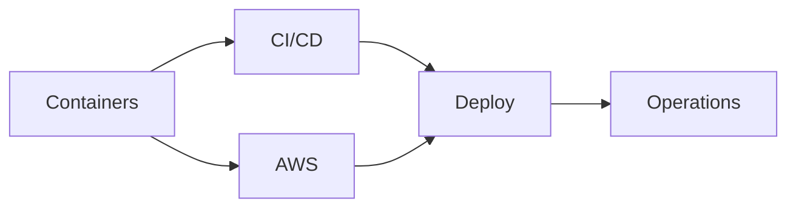

# DevOps and cloud

Containers, CI/CD pipelines, the core AWS services, and how to monitor a running system.

Before this folder: Operating systems and Linux, Networking, and Back end.

This folder is about getting code running somewhere other than your laptop. Containers cover VMs versus containers, Docker images, volumes, Compose and a first look at Kubernetes. CI/CD covers pipelines, GitHub Actions and deployment strategies. The AWS chapter covers accounts, IAM, EC2, S3, RDS, VPCs, Lambda and deploying an app. Operations covers logs, metrics, monitoring and incidents.

AI tools write Dockerfiles, pipeline files and cloud commands readily, and the mistakes are costly: an open security group, an over-broad IAM policy, a secret baked into an image, an instance left running on your bill. This folder gives you the terms to check each of those.

It builds on [Operating systems and Linux](../02-operating-systems-and-linux/index.md), [Networking](../07-networking/index.md) and [Back end](../09-back-end/index.md), with Git from [Developer tools and workflow](../04-developer-tools-and-workflow/index.md). It feeds [Software and system design](../14-software-and-system-design/index.md) and [The workplace](../16-the-workplace/index.md).

### How to use this folder

- The container labs need Docker with WSL2. Install it before the first chapter.
- The AWS labs need your own AWS account. Set a billing alert first, and delete what you create.
- Infrastructure as code is optional.

<!-- lessons:start -->
## Lessons

### 1. [Containers](01-containers/index.md)

1. [VMs vs containers](01-containers/01-vms-vs-containers.md)
2. [Docker images and Dockerfiles](01-containers/02-docker-images-and-dockerfiles.md)
3. [Volumes, networks and Compose](01-containers/03-volumes-networks-and-compose.md)
4. [Registries and Kubernetes basics](01-containers/04-registries-and-kubernetes-basics.md)

### 2. [CI/CD](02-ci-cd/index.md)

1. [CI/CD concepts](02-ci-cd/01-ci-cd-concepts.md)
2. [GitHub Actions](02-ci-cd/02-github-actions.md)
3. [Deployment strategies](02-ci-cd/03-deployment-strategies.md)
4. [Infrastructure as code](02-ci-cd/04-infrastructure-as-code.md) (optional)

### 3. [AWS](03-aws/index.md)

1. [Cloud models and regions](03-aws/01-cloud-models-and-regions.md)
2. [AWS account, IAM and billing](03-aws/02-aws-account-iam-and-billing.md)
3. [EC2](03-aws/03-ec2.md)
4. [S3](03-aws/04-s3.md)
5. [RDS managed Postgres](03-aws/05-rds-managed-postgres.md)
6. [VPCs and security groups](03-aws/06-vpcs-and-security-groups.md)
7. [Lambda and serverless](03-aws/07-lambda-and-serverless.md)
8. [Deploying an app to EC2](03-aws/08-deploying-an-app-to-ec2.md)

### 4. [Operations](04-operations/index.md)

1. [Logging metrics and monitoring](04-operations/01-logging-metrics-and-monitoring.md)
2. [Incidents and on-call](04-operations/02-incidents-and-on-call.md)

<!-- lessons:end -->
