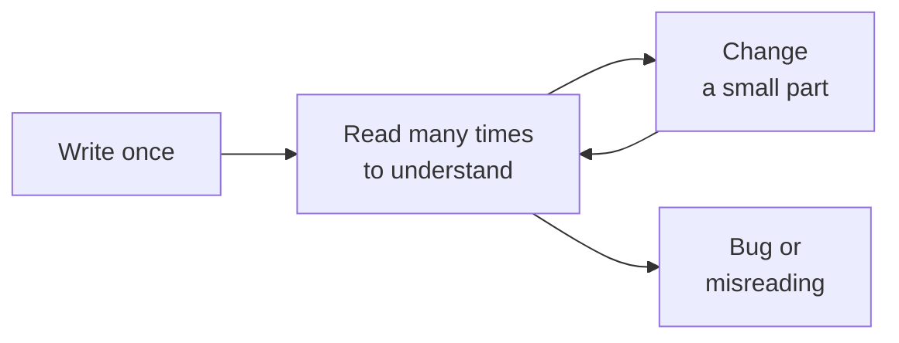

# Clean code

After this you can rewrite a hard-to-read function so the next reader (a teammate, you in six months, or an AI tool) understands it on the first pass, and name the specific problem you are fixing at each step.

Before this: [Classes and objects](../../03-programming-fundamentals/03-oop-and-paradigms/01-classes-and-objects.md) and [Linters, formatters and type checkers](../../06-developer-tools-and-workflow/03-code-quality/03-linters-formatters-and-type-checkers.md).

## The idea

You open a function written a year ago. It is 40 lines, nested five levels deep, and uses names like `t` and `o`. It works, so nobody dares touch it, and now you must add a rule.

Most of a developer's day is reading code, not writing it. Code is written once and read many times, so **clean code** is code arranged to be cheap to read: its meaning is visible without running it. Clean code does not run faster. The computer produces the same answer either way; the gain is for the human, and for any AI tool that reads the same text to guess what you want.



In the diagram, the loop between reading and changing is where the time goes. Every habit below makes the "read" box cheaper.

## Key terms

A **guard clause** is an early `return` (or `raise`) at the top of a function that handles an unwanted case and leaves the main path un-indented.

A **magic number** is a literal value in code whose meaning is not stated, like `0.9` or `86400`. A **named constant** gives it a name.

**DRY** ("don't repeat yourself") is the rule that each piece of knowledge should live in one place. **Premature abstraction** is merging code that only looks alike before you know it changes for the same reason.

A **code smell** is a surface sign that something may be wrong underneath, such as a 60-line function. It is a prompt to look, not a proof of a bug.

## How it works

The habits are small and mechanical. Apply them one at a time and run the code between steps.

1. Name for meaning. `order_total` says what it returns; `f` does not. Use full words, one name per concept, and a verb for a function (`send_receipt`) and a noun for a value (`subtotal`). A long, exact name beats a short vague one.
2. Give each function one job, small enough to name in a short phrase without "and". If the name needs "and", split it.
3. Replace magic numbers with named constants, defined once near the top.
4. Flatten nesting with guard clauses. Deep nesting forces the reader to hold every condition in their head at once.
5. Write comments that explain why, not what. `# The bank rounds half to even, so we match it` is useful; `# add one to i` repeats the code. If a comment is needed to explain what a line does, rename something instead.
6. Format consistently, and let a formatter do it so nobody argues about it.

On DRY: when you see two similar blocks, wait for a third before merging them (the "rule of three"). Two blocks that look alike today may change for different reasons next month. A shared helper then fills with flags and `if` branches to serve both, which costs more than the duplication did.

## Worked examples

<div class="example" markdown>

### Example 1: untangling one function

The function `f` computes an order total. It is correct, and hard to read.

```python
def f(o, u):
    if o is not None:
        if u["active"]:
            if len(o["items"]) > 0:
                t = 0
                for i in o["items"]:
                    t += i[0] * i[1]
                if t > 100:
                    t = t * 0.9
                return t
            else:
                return 0
        else:
            return 0
    else:
        return 0
```

We apply the habits in order.

1. Names: `f` becomes `order_total`, `o` becomes `order`, `u` becomes `customer`, `t` becomes `subtotal`, and each item is a `(price, qty)` pair instead of `i[0]` and `i[1]`.
2. Magic numbers: `100` and `0.9` become `BULK_DISCOUNT_THRESHOLD` and `BULK_DISCOUNT_RATE`.
3. Guard clause: three nested checks that all return 0 become one `if` at the top.
4. The loop becomes `sum(...)`.

```python
BULK_DISCOUNT_THRESHOLD = 100
BULK_DISCOUNT_RATE = 0.10

def order_total(order, customer):
    if order is None or not customer["active"] or not order["items"]:
        return 0
    subtotal = sum(price * qty for price, qty in order["items"])
    if subtotal > BULK_DISCOUNT_THRESHOLD:
        return subtotal * (1 - BULK_DISCOUNT_RATE)
    return subtotal
```

Check: run both versions on the same inputs and compare. For an order of 2 items at 30 and 3 items at 25, a subtotal of 135, both print `121.5`. They also agree on `None`, an empty order, an inactive customer (all `0`), and a small order of 2 at 10 (`20`).

Refactoring only counts if behaviour stays the same, so compare outputs before you trust the rewrite. [Coupling, cohesion and refactoring](06-coupling-cohesion-and-refactoring.md) turns this into tests.

</div>

## Common mistakes

<div class="warning" markdown>

Watch out: comments that restate the code (`# loop over items`). They go stale when the code changes and then lie. Write the reason, or delete the comment.

Watch out: abstracting too early. A `process(data, mode, flag1, flag2)` function that serves four callers is harder to read than four short copies. Wait for the third repeat.

Watch out: renaming for its own sake in a shared codebase. Follow the existing style; a consistent codebase is more readable than a perfect one that nobody can predict.

</div>

## Working with AI

<div class="ai" markdown>

Words to use: guard clause, magic number, single responsibility, extract function, DRY, code smell, behaviour-preserving.

Prompts to try:

- "Refactor this Python function for readability without changing behaviour: rename variables, replace magic numbers with named constants, and use guard clauses. Keep the public signature. Show a diff and list each change." (paste the function)
- "List the code smells in this module, ranked by how hard they make the next change. Do not rewrite anything yet."

What to check:

- Changed behaviour. AI tools often "improve" an edge case (empty input, `None`, rounding). Run the old and new versions on the same inputs, as in Example 1.
- Renamed public functions that other files still call. Search the repo for the old name.
- Over-abstraction: a new class, helper or config layer for a function used once.
- Comments that describe what the code does, or invented reasons. Keep a comment only if you can confirm the why.

Clean code also helps the tool. A model reading `order_total(order, customer)` guesses your intent correctly far more often than one reading `f(o, u)`, and its edits land in the right place.

</div>

## Quiz

1\. Why is "reading code is most of the job" a reason to prefer clear names over short ones?

<details class="solution" markdown>
<summary>Answer</summary>

A name is typed once and read many times. A few extra characters cost almost nothing to write, while a vague name costs every reader a moment of guessing each time they see it.

</details>

2\. What does this print, and which habit would you apply to improve it?

```python
def price(qty):
    return qty * 4.99 if qty < 10 else qty * 4.99 * 0.85

print(price(10))
```

<details class="solution" markdown>
<summary>Answer</summary>

It prints `42.415000000000006` (10 × 4.99 × 0.85, with a float rounding tail). The `10`, `4.99` and `0.85` are magic numbers: name them `BULK_QTY`, `UNIT_PRICE` and `BULK_DISCOUNT_FACTOR`.

</details>

3\. A teammate merges two functions that both loop over users, one to send emails and one to export CSV, into `handle_users(mode)`. A month later each has special cases. What went wrong?

<details class="solution" markdown>
<summary>Answer</summary>

Premature abstraction. The two jobs only looked alike; they change for different reasons, so the shared function gathers flags and branches. Splitting them again (or waiting for a third use) would have been cheaper.

</details>

4\. Which comment is worth keeping: `# increment counter` or `# retry three times: the payment API drops about 1% of first requests`?

<details class="solution" markdown>
<summary>Answer</summary>

The second. It explains why the code is written that way, which the code cannot say. The first repeats the code.

</details>

## Lab

<div class="lab" markdown>

### Lab: clean up a function

Goal: refactor a messy function in small steps and prove its behaviour did not change. Time: about 15 minutes. Runs in: any terminal with Python 3.

1. Save Example 1's `f` as `orders.py` along with the five test calls from the Check paragraph, each printed.
2. Rename the parameters and locals. Run the script and confirm the five outputs are unchanged.
3. Replace the magic numbers with constants. Run again.
4. Replace the nesting with one guard clause. Run again.
5. Add a rule: orders over 500 get a further 5% off. Notice how much easier it is to place in the clean version.

Expected result: the same five outputs after every step.

```text
121.5 121.5
0 0
0 0
0 0
20 20
```

<details class="solution" markdown>
<summary>Solution</summary>

The solution is the `order_total` function in Example 1. For step 5, add `LARGE_ORDER_THRESHOLD = 500` and `LARGE_ORDER_RATE = 0.05`, then after the bulk discount check, `if subtotal > LARGE_ORDER_THRESHOLD: subtotal *= 1 - LARGE_ORDER_RATE` before returning. Decide whether the two discounts stack and write that choice as a comment.

</details>

</div>

## Where this shows up

- Code review: most review comments are about names, size and nesting. See [GitHub, pull requests and code review](../../06-developer-tools-and-workflow/01-editor-and-git/04-github-pull-requests-and-code-review.md).
- The next lesson, [SOLID principles](02-solid-principles.md), applies the "one job" idea to classes.
