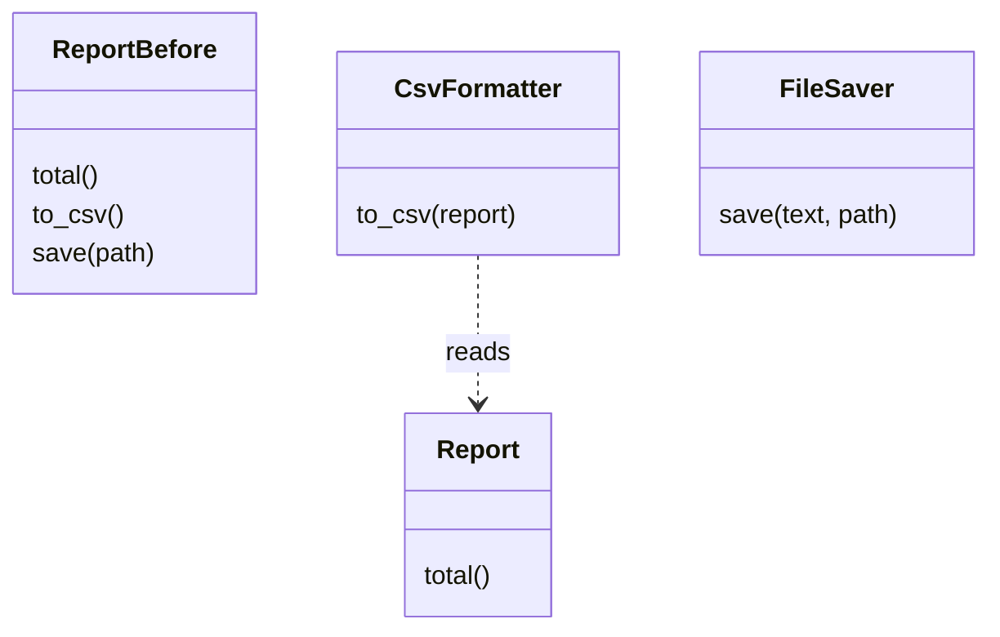
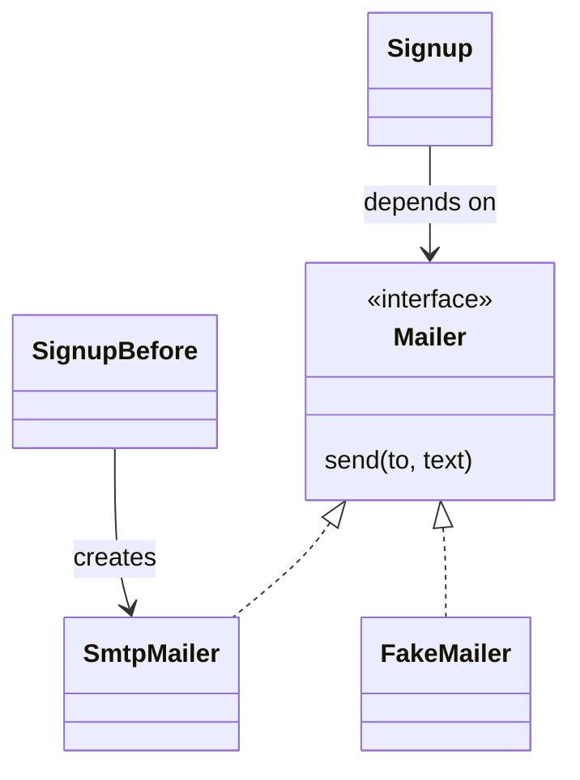

# SOLID principles

After this you can state the five SOLID principles in one sentence each, recognize the code smell that each one fixes, and judge when applying them is overkill.

Before this: [Clean code](01-clean-code.md) and [Composition and interfaces](../../03-programming-fundamentals/03-oop-and-paradigms/03-composition-and-interfaces.md).

## The idea

A `Report` class computes totals, formats CSV and writes files. Then finance wants a different CSV layout, ops wants the file saved to cloud storage, and each change risks breaking the totals. The class has three reasons to change, so every edit touches code unrelated to it.

**SOLID** is a set of five design guidelines for object-oriented code (named by Robert C. Martin). They are rules of thumb for keeping a class easy to change, not laws. Each one answers the same question: when a requirement changes, how many places must I edit, and how likely is it that I break something unrelated?



In the diagram, `ReportBefore` has three jobs in one class. After the split, each box has one reason to change.

## Key terms

The five principles, with their letters:

| Letter | Principle | In one sentence |
|---|---|---|
| S | **Single Responsibility Principle (SRP)** | A class should have one reason to change. |
| O | **Open/Closed Principle (OCP)** | Code is open to extension and closed to modification: add behaviour by adding code, not by editing working code. |
| L | **Liskov Substitution Principle (LSP)** | A subclass must work anywhere its parent class is expected, without surprising the caller. |
| I | **Interface Segregation Principle (ISP)** | Many small interfaces beat one large one; no class is forced to implement methods it does not use. |
| D | **Dependency Inversion Principle (DIP)** | High-level code depends on an abstraction, not on a concrete low-level class. |

## How it works

Each principle is easiest to see as a before and after. The runnable versions are short; the point is the shape.

**SRP.** Split by reason to change. The class that holds data and the code that formats or saves it go in different places:

```python
class Report:
    def __init__(self, rows):
        self.rows = rows
    def total(self):
        return sum(self.rows)

def to_csv(report):
    return ",".join(str(r) for r in report.rows)

def save_text(text, path):
    with open(path, "w") as f:
        f.write(text)
```

**OCP.** A chain of `if kind == ...` must be edited for every new case. Replace it with objects that share a method, so a new case is a new class. This is the **strategy** pattern from [Design patterns](03-design-patterns.md).

```python
class Standard:
    def cost(self, kg): return 5 + kg
class Express:
    def cost(self, kg): return 12 + 2 * kg
class Pickup:               # added later, no existing code edited
    def cost(self, kg): return 0

def checkout(method, kg):
    return method.cost(kg)
```

**LSP.** If a subclass raises where its parent did not, callers break. `Penguin(Bird)` that raises on `fly()` is the classic case. The fix is a better hierarchy: only birds that can fly get `fly()`.

```python
class Bird:
    def fly(self): return "flap"
class Penguin(Bird):
    def fly(self): raise NotImplementedError("penguins cannot fly")

def migrate(birds):
    return [b.fly() for b in birds]
# migrate([Bird(), Penguin()]) raises NotImplementedError
```

**ISP.** An abstract `Machine` with `print_doc`, `scan` and `fax` forces a basic printer to stub two methods that raise. Split into small `Printer` and `Scanner` protocols, and let each class match only what it does:

```python
from typing import Protocol

class Printer(Protocol):
    def print_doc(self, doc): ...

class SimplePrinter:
    def print_doc(self, doc): return f"printed {doc}"

def run_print_job(p: Printer):
    return p.print_doc("report.pdf")
```

**DIP.** Covered in the earlier lesson as dependency injection: the signup code takes a `Mailer`, not a hard-wired `SmtpMailer`.



Before (top), the arrow points from high-level code straight to a concrete class. After (bottom), both sides point at the interface, so the arrow from the details is "inverted".

## Worked examples

<div class="example" markdown>

### Example 1: swapping a dependency in a test

We want to test that signing up sends a welcome message, without sending real email.

1. `Signup` takes a `mailer` in `__init__` and calls `self.mailer.send(email, "welcome")`.
2. In the test we pass a `FakeMailer` that records calls in a list.
3. In production we pass `SmtpMailer()`. `Signup` is the same code in both.

```python
class Signup:
    def __init__(self, mailer):
        self.mailer = mailer
    def register(self, email):
        return self.mailer.send(email, "welcome")

class FakeMailer:
    def __init__(self): self.sent = []
    def send(self, to, text):
        self.sent.append((to, text)); return "queued"

fake = FakeMailer()
Signup(fake).register("a@x.ca")
print(fake.sent)
```

```text
[('a@x.ca', 'welcome')]
```

Check: the printed list holds the one message. With the old `SmtpMailer().send(...)` hard-wired inside `register`, the only way to see the call would have been to read a real inbox.

</div>

## When SOLID is overkill

SOLID reduces the cost of change, so it pays only where change is expected. A 50-line script, a prototype, or a class with one caller does not need an interface for every dependency. The cost of too much structure is real: many tiny classes, indirection to follow, and an `AbstractFactoryProvider` that does the work of one function.

A reasonable approach: write the simple version, and apply a principle the second time a change hurts. A long `if` chain that you have edited three times is a signal for OCP. A class you cannot test without a network is a signal for DIP.

## Common mistakes

<div class="warning" markdown>

Watch out: reading SRP as "one method per class". The rule is one reason to change, so a class with ten methods about the same concern is fine.

Watch out: inheritance for code reuse, which is where LSP breaks. If the subclass is not a true is-a, use composition.

Watch out: an interface with a single implementation and no test double. It adds a file and a name and removes no coupling.

</div>

## Working with AI

<div class="ai" markdown>

Words to use: single responsibility, open/closed, Liskov substitution, interface segregation, dependency inversion, dependency injection, Protocol, test double.

Prompts to try:

- "This Python class `OrderManager` validates input, calculates tax, writes to Postgres and sends email. Identify which SOLID principle each part breaks, then propose a split. Keep it to the smallest number of classes that gives separate reasons to change."
- "Show how to unit test `Signup.register` with a fake `Mailer` using `typing.Protocol`, without mocking libraries."

What to check:

- Over-engineering. AI tools like to produce factories, abstract bases and interfaces for code with one implementation. Ask which change each new class is for.
- Subclasses that override a parent method to raise or return something different (an LSP break). Read every override.
- Imports: after a DIP refactor the high-level module should not import the concrete class. Search for it.
- Behaviour changes hidden inside a "pure refactor". Run the tests before and after.

</div>

## Quiz

1\. A function has `if payment == "card": ... elif payment == "paypal": ...` and gets a new branch for every provider. Which principle does it strain, and what is the fix?

<details class="solution" markdown>
<summary>Answer</summary>

Open/closed: adding a provider edits working code. Give each provider its own class or function with a shared method, and pick one by name, so a new provider is new code only.

</details>

2\. Predict the output.

```python
class Bird:
    def fly(self): return "flap"
class Penguin(Bird):
    def fly(self): raise NotImplementedError("no")

for b in [Bird(), Penguin()]:
    print(b.fly())
```

<details class="solution" markdown>
<summary>Answer</summary>

It prints `flap`, then raises `NotImplementedError: no`. `Penguin` cannot stand in for `Bird`, which is a Liskov violation.

</details>

3\. Your `ReportService` imports `psycopg2` and calls it directly, so unit tests need a running Postgres. Which principle, and how would you fix it?

<details class="solution" markdown>
<summary>Answer</summary>

Dependency inversion. Make `ReportService` take a repository (an interface with `get_rows()`), implement it once for Postgres and once in memory for tests.

</details>

4\. When would you decide not to apply these principles?

<details class="solution" markdown>
<summary>Answer</summary>

In a small script, prototype, or code that will not change and has one caller. Apply a principle when a real change hurts, not before.

</details>

## Lab

<div class="lab" markdown>

### Lab: split a class and fake its dependency

Goal: apply SRP and DIP to one class and test it without a network. Time: about 15 minutes. Runs in: any terminal with Python 3.

1. Write a class `Notifier` with one method `welcome(email)` that builds the text `"Welcome, <email>"` and "sends" it by `print`.
2. Split it: a function `build_welcome(email)` that returns the text, and a `PrintSender` class with `send(to, text)`.
3. Add a `Welcomer` class that takes a sender in `__init__` and uses `build_welcome` and `sender.send`.
4. Write a `FakeSender` that stores messages in a list. Make `Welcomer(fake).run("a@x.ca")` pass an `assert` on that list.
5. Run `Welcomer(PrintSender()).run("a@x.ca")` to confirm the real path still works.

Expected result: the assert passes and the real sender prints the message.

```text
a@x.ca: Welcome, a@x.ca
```

<details class="solution" markdown>
<summary>Solution</summary>

```python
def build_welcome(email):
    return f"Welcome, {email}"

class PrintSender:
    def send(self, to, text):
        print(f"{to}: {text}")

class FakeSender:
    def __init__(self): self.sent = []
    def send(self, to, text): self.sent.append((to, text))

class Welcomer:
    def __init__(self, sender):
        self.sender = sender
    def run(self, email):
        self.sender.send(email, build_welcome(email))

fake = FakeSender()
Welcomer(fake).run("a@x.ca")
assert fake.sent == [("a@x.ca", "Welcome, a@x.ca")]
Welcomer(PrintSender()).run("a@x.ca")
```

</details>

</div>

## Where this shows up

- [Design patterns](03-design-patterns.md) names the common shapes that SOLID leads to.
- Test doubles and mocks: [Integration tests, mocks and end-to-end](../../06-developer-tools-and-workflow/03-code-quality/02-integration-tests-mocks-and-e2e.md).
