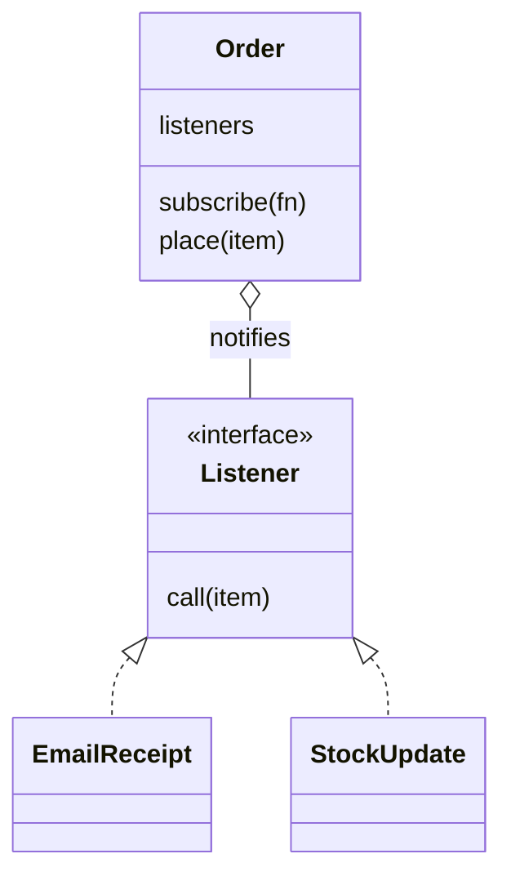
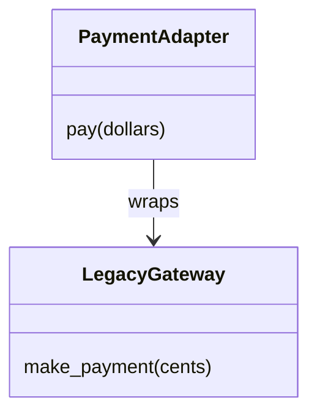
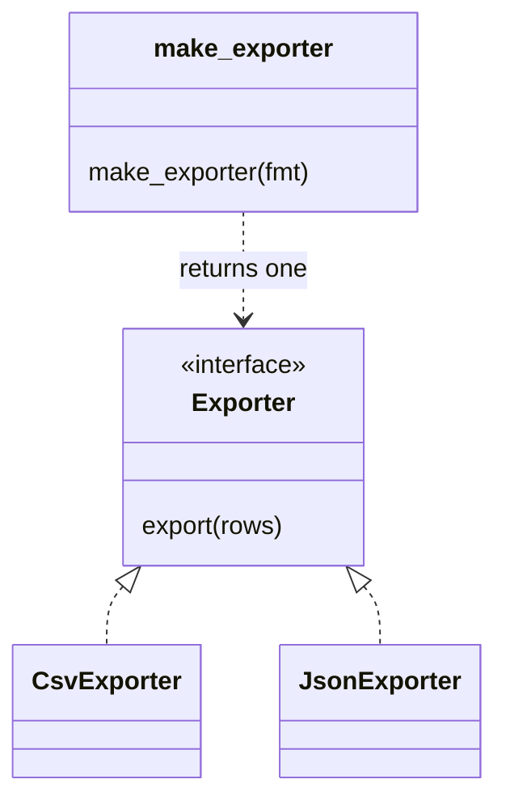
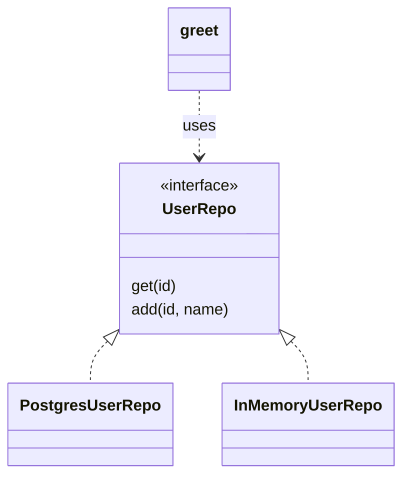

# Design patterns

After this you can recognize six common design patterns (strategy, observer, adapter, factory, repository, decorator) by the problem each solves, read a teammate's or an AI tool's code that uses them by name, and spot two anti-patterns.

Before this: [SOLID principles](02-solid-principles.md).

## The idea

You are asked to add a second payment provider, and a colleague says "put an adapter in front of it." A new developer who knows the word hears a full design in one phrase. One who does not hears nothing.

A **design pattern** is a named, reusable solution to a problem that keeps appearing in software design. It is a recipe for the shape of the code, not a library you import. The book that made them popular, *Design Patterns* (Gamma, Helm, Johnson and Vlissides, 1994), catalogued 23. A few come up daily, and most of the value is the shared vocabulary.

Patterns are not required, not rules, and not a score. Forcing a pattern onto a problem that does not have the matching shape gives code that is harder to read than the direct version.

## Key terms

A **strategy** swaps one algorithm for another behind a common method. An **observer** lets objects subscribe to events from another object. An **adapter** wraps an incompatible interface so it matches the one your code expects. A **factory** is a function or class that decides which object to create. A **repository** hides how data is stored behind methods like `get` and `add`. A **decorator** wraps a function or object to add behaviour without changing it.

A **god object** is one class that knows and does too much. A **singleton** is a class limited to one global instance.

## How it works

Each pattern pairs a problem with a shape. The strategy pattern appeared in [SOLID principles](02-solid-principles.md) as `Standard`, `Express` and `Pickup` shipping classes; the others follow.

**Observer.** The problem: placing an order must trigger email, stock updates and analytics, and `place()` should not know about each. The order keeps a list of listeners and calls them.



```python
class Order:
    def __init__(self):
        self.listeners = []
    def subscribe(self, fn):
        self.listeners.append(fn)
    def place(self, item):
        for fn in self.listeners:
            fn(item)
```

Node.js has this built in as `EventEmitter`, the same shape in TypeScript (run with `node file.ts`):

```typescript
import { EventEmitter } from "node:events";

const orders = new EventEmitter();
orders.on("placed", (item: string) => console.log("email receipt for", item));
orders.on("placed", (item: string) => console.log("update stock for", item));
orders.emit("placed", "book");
```

**Adapter.** The problem: a legacy gateway takes cents as an integer, but your code passes dollars. Wrap it, so your code sees one interface and only the adapter knows the old one.



```python
class PaymentAdapter:
    def __init__(self, gateway):
        self.gateway = gateway
    def pay(self, dollars):
        return self.gateway.make_payment(int(dollars * 100))
```

**Factory.** The problem: the code needs an exporter, but which one depends on a setting. One function holds the choice, so callers never name concrete classes.



```python
def make_exporter(fmt):
    exporters = {"csv": CsvExporter, "json": JsonExporter}
    return exporters[fmt]()
```

**Repository.** The problem: business code is full of SQL, so tests need a database and a change of storage touches everything. A repository exposes `get(id)` and `add(...)`, and the storage hides behind it.



**Decorator.** The problem: add timing, logging or caching to many functions without editing each. Python has syntax for it: `@name` above a function passes it through a wrapper.

```python
import functools, time

def timed(fn):
    @functools.wraps(fn)
    def wrapper(*args, **kwargs):
        start = time.perf_counter()
        result = fn(*args, **kwargs)
        print(f"{fn.__name__} took {(time.perf_counter() - start) * 1000:.1f} ms")
        return result
    return wrapper

@timed
def slow_add(a, b):
    time.sleep(0.02)
    return a + b
```

Calling `slow_add(2, 3)` prints a line like `slow_add took 20.3 ms` (the number varies), then returns `5`. Note that this is the Python language feature and the design pattern together; the pattern is wrapping one thing with another that has the same interface.

Dependency injection, from [Composition and interfaces](../../03-programming-fundamentals/03-oop-and-paradigms/03-composition-and-interfaces.md), holds all of these together: the pieces are passed in, so factories and tests can swap them.

## Worked examples

<div class="example" markdown>

### Example 1: a repository you can test

We want a `greet` function that works with a real database later, but today with a dictionary.

1. Define the contract: a repository with `get(user_id)`.
2. Write `InMemoryUserRepo` that stores names in a dict.
3. Write `greet(repo, user_id)` that only calls `repo.get`.

```python
class InMemoryUserRepo:
    def __init__(self):
        self.users = {}
    def add(self, user_id, name):
        self.users[user_id] = name
    def get(self, user_id):
        return self.users.get(user_id)

def greet(repo, user_id):
    name = repo.get(user_id)
    return f"Hello, {name}" if name else "Unknown user"

repo = InMemoryUserRepo()
repo.add(1, "Ada")
print(greet(repo, 1), "|", greet(repo, 2))
```

```text
Hello, Ada | Unknown user
```

Check: both the found and the missing case behave as intended with no database. A `PostgresUserRepo` with the same `get` replaces the in-memory one and `greet` does not change. ORMs such as Django's or SQLAlchemy's are close to this idea; see [ORMs and migrations](../../10-databases-sql-and-postgres/05-databases-in-apps/02-orms-and-migrations.md).

</div>

## Anti-patterns

An **anti-pattern** is a common solution that looks fine and causes trouble. The **god object** grows because adding "one more method" is easy; the fix is the split from SRP. The **singleton** gives one global instance (a database connection, a config) that any code can reach. It hides dependencies, since a function using it does not list it among its parameters, and it makes tests share state. In Python a module-level object does the same job, and passing the object in is usually clearer.

## Common mistakes

<div class="warning" markdown>

Watch out: starting from the pattern. Find the problem first (a long `if` chain, a hard-wired dependency), then pick a pattern if one fits.

Watch out: confusing a Python decorator (`@timed`) with the decorator pattern. They overlap, but the pattern also applies to classes that wrap other objects.

Watch out: a "factory" or "manager" class that only calls one constructor. A plain function or the constructor itself is enough.

</div>

## Working with AI

<div class="ai" markdown>

Words to use: strategy, observer, adapter, factory, repository, decorator, dependency injection, god object.

Prompts to try:

- "I have this `if/elif` chain choosing a tax calculation by country. Which design pattern fits, and show the smallest Python version. Say what I lose in readability."
- "Wrap this third-party client (paste the class) in an adapter so my code depends on a `PaymentGateway` Protocol with `charge(amount_cents)`. Include a fake for tests."

What to check:

- Pattern names on code that does not match. Compare the actual structure with the diagram of the pattern.
- Extra layers. A repository over a repository, or a factory that returns one fixed class.
- Singletons or module-level state added "for convenience" that tests will share.
- Event handlers that fail silently: in the observer shape, one listener raising can stop the rest. Test that case.

</div>

## Quiz

1\. A function sends the same alert by email, SMS and chat, and a new channel is added each quarter. Which pattern helps, and what does the caller see?

<details class="solution" markdown>
<summary>Answer</summary>

Strategy (or observer, if each channel reacts to an event). The caller sees one `send(message)` method and never names the concrete channel; a new channel is a new class.

</details>

2\. What does this print?

```python
class A:
    def __init__(self): self.fns = []
class Order(A):
    def place(self, x):
        for f in self.fns: f(x)

o = Order()
o.fns.append(lambda x: print("a", x))
o.fns.append(lambda x: print("b", x))
o.place(1)
```

<details class="solution" markdown>
<summary>Answer</summary>

`a 1` then `b 1`. Listeners are called in the order they were added.

</details>

3\. A vendor SDK returns `{"amt": 1250}` but your code expects `Payment(amount_cents=1250)`, and the SDK is used in 40 places. How do you reduce the damage of a future SDK change?

<details class="solution" markdown>
<summary>Answer</summary>

Put an adapter around the SDK that returns your `Payment` type, and call only the adapter. A change in the SDK then touches one file.

</details>

4\. Why is a global singleton database connection a problem for tests?

<details class="solution" markdown>
<summary>Answer</summary>

Every test reaches the same shared instance, so state leaks between tests, and the dependency is not visible in function signatures. Passing the connection in (or a repository) lets each test supply its own.

</details>

## Lab

<div class="lab" markdown>

### Lab: add an observer and a decorator

Goal: use two patterns in 30 lines. Time: about 15 minutes. Runs in: any terminal with Python 3.

1. Create `Order` with `subscribe` and `place` as in the lesson.
2. Write a decorator `logged` that prints `calling <name>` before calling the wrapped function.
3. Decorate `place` with `logged`.
4. Subscribe two listeners and place an order for `"pen"`.
5. Make one listener raise an exception. What happens to the other? Decide how `place` should behave.

Expected result:

```text
calling place
email receipt for pen
update stock for pen
```

<details class="solution" markdown>
<summary>Solution</summary>

```python
import functools

def logged(fn):
    @functools.wraps(fn)
    def wrapper(*a, **k):
        print("calling", fn.__name__)
        return fn(*a, **k)
    return wrapper

class Order:
    def __init__(self):
        self.listeners = []
    def subscribe(self, fn):
        self.listeners.append(fn)
    @logged
    def place(self, item):
        for fn in self.listeners:
            fn(item)

o = Order()
o.subscribe(lambda i: print("email receipt for", i))
o.subscribe(lambda i: print("update stock for", i))
o.place("pen")
```

If the first listener raises, the second never runs. Wrapping each call in `try/except` and logging the error isolates them; choose that on purpose.

</details>

</div>

## Where this shows up

- Express middleware is a chain of handlers in the same spirit: [Express routing and middleware](../../09-back-end/01-servers-and-apis/03-express-routing-and-middleware.md).
- The next lesson, [Layered architecture and MVC](04-layered-architecture-and-mvc.md), applies repositories and adapters at the scale of a whole application.
