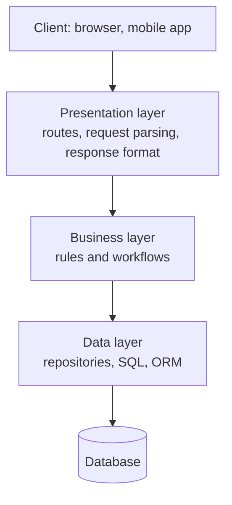
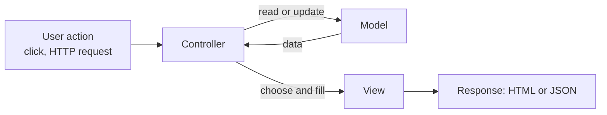

# Layered architecture and MVC

After this you can sketch a web application as presentation, business and data layers, say which layer a given piece of code belongs in, and map MVC onto Express, Django and Rails.

Before this: [Design patterns](03-design-patterns.md) and [What a back end does](../../09-back-end/01-servers-and-apis/01-what-a-back-end-does.md).

## The idea

An endpoint handler grows. It parses JSON, checks the user's balance, runs three SQL queries, formats the response and writes a log line, all in one 120-line function. A bug in the balance rule means reading SQL, and changing the database means editing every handler.

**Layered architecture** fixes this by splitting the program into layers, each with one kind of job, where a layer may call only the layer directly below it. The usual three are shown below.



In the diagram, requests travel downward and results travel back up. The presentation layer never touches SQL, and the data layer knows nothing about HTTP.

## Key terms

The **presentation layer** handles input and output: HTTP routes, parsing, status codes, JSON or HTML. The **business layer** (also called the service or domain layer) holds the rules that make the application what it is, such as "a withdrawal cannot exceed the balance". The **data layer** reads and writes storage, usually through repositories ([Design patterns](03-design-patterns.md)).

**MVC (Model-View-Controller)** is a way to organize the interactive part of an application. The **model** holds data and the rules about it. The **view** is what the user sees. The **controller** receives user input, asks the model to act and picks the view to show.

**Hexagonal architecture** (also called ports and adapters) puts the business logic in the centre and has everything else, such as web, database and message queue, plug into it through interfaces called ports, implemented by adapters. It is layered architecture with the dependency arrows pointing inward, the same idea as dependency inversion in [SOLID principles](02-solid-principles.md).

## How it works

In MVC the controller sits in the middle. A request reaches the controller, which asks the model, and the controller hands the result to a view:



The frameworks use the same three jobs under different names:

| Framework | Model | View | Controller |
|---|---|---|---|
| Ruby on Rails | ActiveRecord classes | ERB templates | Controller classes |
| Django | Model classes | Templates | "Views" (the functions or classes in `views.py`) |
| Express | Whatever you choose (an ORM or plain functions) | Templates, or JSON, or a React front end | Route handlers |

Watch the Django naming: what Django calls a "view" is a controller in MVC terms, and its "template" is the view. Express gives no structure at all. You choose the folders, which is why teams often adopt `routes/`, `services/` and `repositories/` by convention. See [Express routing and middleware](../../09-back-end/01-servers-and-apis/03-express-routing-and-middleware.md) and [Python back ends: FastAPI and Django](../../09-back-end/01-servers-and-apis/07-python-back-ends-fastapi-and-django.md).

Where each check lives:

1. Input validation of shape and type (is `amount` a positive integer?) belongs at the edge, in the presentation layer. Reject bad input before it goes deeper. See [Validation and error handling](../../09-back-end/01-servers-and-apis/05-validation-and-error-handling.md).
2. Business rules (can this account withdraw that much?) belong in the business layer, so they apply no matter whether the request comes from the web, a script or a queue.
3. The data layer can also enforce constraints (`NOT NULL`, unique keys) as the last defence. Treat that as a safety net, not as the only place a rule exists.

## Worked examples

<div class="example" markdown>

### Example 1: one withdrawal through three layers

The handler is the presentation layer, `AccountService` the business layer and `AccountRepo` the data layer.

1. The handler converts `"30"` to `30` and rejects non-positive numbers with status 400.
2. `AccountService.withdraw` loads the balance through the repository and raises `InsufficientFunds` if the amount is too large.
3. The handler turns that exception into status 409. The service has no idea what HTTP is.

```python
class AccountRepo:
    def __init__(self):
        self.balances = {"ada": 100}
    def get_balance(self, name):
        return self.balances[name]
    def set_balance(self, name, amount):
        self.balances[name] = amount

class InsufficientFunds(Exception):
    pass

class AccountService:
    def __init__(self, repo):
        self.repo = repo
    def withdraw(self, name, amount):
        balance = self.repo.get_balance(name)
        if amount > balance:
            raise InsufficientFunds(f"balance is {balance}")
        self.repo.set_balance(name, balance - amount)
        return balance - amount

def withdraw_handler(service, body):
    try:
        amount = int(body["amount"])
        if amount <= 0:
            raise ValueError
    except (KeyError, ValueError):
        return 400, {"error": "amount must be a positive integer"}
    try:
        new_balance = service.withdraw(body["account"], amount)
    except InsufficientFunds as e:
        return 409, {"error": str(e)}
    return 200, {"balance": new_balance}

service = AccountService(AccountRepo())
print(withdraw_handler(service, {"account": "ada", "amount": "30"}))
print(withdraw_handler(service, {"account": "ada", "amount": "500"}))
print(withdraw_handler(service, {"account": "ada", "amount": "-5"}))
```

```text
(200, {'balance': 70})
(409, {'error': 'balance is 70'})
(400, {'error': 'amount must be a positive integer'})
```

Check: the three outputs match the three paths (success, a business-rule failure, bad input). The business rule can be tested by calling `service.withdraw` directly with no HTTP at all, and the repository can be swapped for a real database without touching the other two layers.

</div>

## Common mistakes

<div class="warning" markdown>

Watch out: the "fat controller", where the route handler holds the business rules. They then cannot be reused from a script or a queue worker. Move them into a service.

Watch out: validating only in the browser. Anyone can send a request without your front end, so the server must check every input.

Watch out: layers that leak. If the business layer returns a database row object or raises an HTTP error, the layers are tangled and the boundary is only a folder name.

</div>

## Working with AI

<div class="ai" markdown>

Words to use: presentation layer, service layer, repository, controller, fat controller, validation at the boundary, ports and adapters.

Prompts to try:

- "Refactor this Express route handler (paste it) so the route only parses input and returns responses, a `WithdrawalService` holds the rules, and a repository holds the queries. Keep behaviour the same and show the three files."
- "In Django, which parts of this app are MVC's model, view and controller? Use Django's own names and point out where its naming differs."

What to check:

- Business rules inside the handler or inside SQL strings only.
- A service that imports `request`, `response` or a framework class.
- Validation missing on the server because the AI added it only to the front end.
- Layers that were created but still bypassed, for example a handler that calls the database client directly.

</div>

## Quiz

1\. Which layer should decide that a user may not withdraw more than their balance, and why not the handler?

<details class="solution" markdown>
<summary>Answer</summary>

The business layer. A rule in the handler would not apply when the same operation is triggered from a script or a queue, and it could not be tested without HTTP.

</details>

2\. In Django, which MVC part is `views.py`?

<details class="solution" markdown>
<summary>Answer</summary>

The controller. Django's templates play the role of the MVC view.

</details>

3\. Using the example, what does `withdraw_handler(service, {"account": "ada", "amount": "abc"})` return?

<details class="solution" markdown>
<summary>Answer</summary>

`(400, {'error': 'amount must be a positive integer'})`. `int("abc")` raises `ValueError`, which the handler catches.

</details>

4\. A service function builds an HTTP 404 response. What is wrong?

<details class="solution" markdown>
<summary>Answer</summary>

It knows about HTTP, so the business layer depends on the presentation layer. Raise a domain exception such as `NotFound`, and let the handler map it to 404.

</details>

## Lab

<div class="lab" markdown>

### Lab: add a layer rule

Goal: add a business rule without touching the other layers. Time: about 15 minutes. Runs in: any terminal with Python 3.

1. Save the example code as `layers.py`.
2. Add a rule: a single withdrawal cannot exceed 50. Raise `LimitExceeded` from the service.
3. Make the handler turn `LimitExceeded` into status 422.
4. Call the handler with an amount of 60 and again with 20.
5. Check that you changed `AccountService` and `withdraw_handler` only, and not `AccountRepo`.

Expected result: the 60 request returns 422, the 20 request returns 200.

<details class="solution" markdown>
<summary>Solution</summary>

Add `class LimitExceeded(Exception): pass`. In `withdraw`, before the balance check:

```python
if amount > 50:
    raise LimitExceeded("limit is 50 per withdrawal")
```

In the handler, `except LimitExceeded as e: return 422, {"error": str(e)}` next to the `InsufficientFunds` clause. Output for 60 is `(422, {'error': 'limit is 50 per withdrawal'})` and for 20 is `(200, {'balance': 80})`.

</details>

</div>

## Where this shows up

- [Monoliths and microservices](05-monoliths-and-microservices.md) asks what happens when one layered application is split across the network.
- ORMs and the data layer: [ORMs and migrations](../../10-databases-sql-and-postgres/05-databases-in-apps/02-orms-and-migrations.md).
